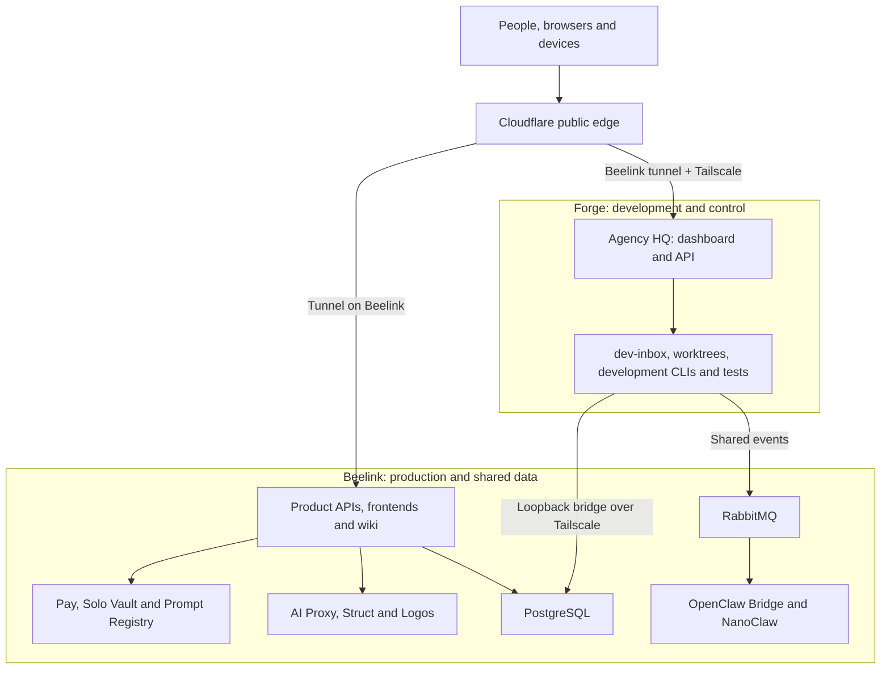
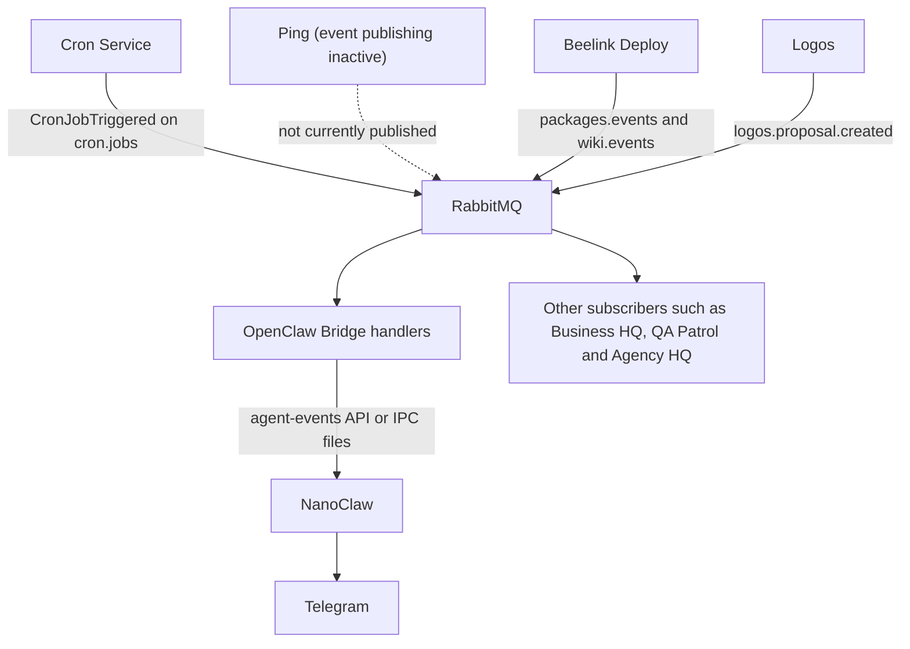
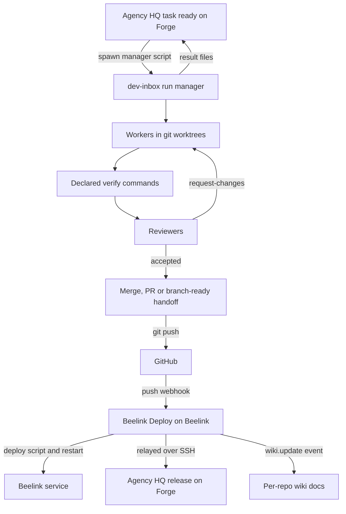

The self-hosted core of the ecosystem lives on **two small Linux boxes with separate jobs**. **Beelink** is the production and data host. It runs PostgreSQL, RabbitMQ, secrets, Pay identity, most product apps and the public front door. **Forge** is the execution host, where agents plan, write, test and review code. Finished work normally reaches production through `git push`, GitHub and Beelink Deploy.

Around those two hosts sit a set of shared npm building blocks and a few cross-cutting services: Pay for identity, Solo Vault for credentials, Prompt Registry for prompts, AI Proxy and Struct for model inference, and Logos for knowledge.

> **Snapshot: 31 October 2026** (observation date 2026-10-31). Based on the ecosystem registry, the current host reference, and repository guide excerpts supplied for this update. Excerpts came from Life (including its [architecture](/repos/jeffrey-keyser-life/architecture/), [services and dependencies](/repos/jeffrey-keyser-life/services-and-dependencies/) and [operations](/repos/jeffrey-keyser-life/operations/) guides, and its Web Push sections), Switchboard, Agency HQ (including its [operations guide](/repos/jeffrey-keyser-agency-hq/operations/)), AI Proxy (including its [architecture](/repos/jeffrey-keyser-ai-proxy/architecture/) and [operations](/repos/jeffrey-keyser-ai-proxy/operations/) guides), Analytics Pulse, dev-inbox (including its [architecture guide](/repos/jeffrey-keyser-dev-inbox/architecture/), [operations guide](/repos/jeffrey-keyser-dev-inbox/operations/) and [services and dependencies](/repos/jeffrey-keyser-dev-inbox/services-and-dependencies/)), Ping and the Ping architecture guide, openclaw-bridge, Logos (including its [architecture](/repos/jeffrey-keyser-logos/architecture/) and [operations](/repos/jeffrey-keyser-logos/operations/) guides), Struct, Pay (including its [architecture](/repos/jeffrey-keyser-pay/architecture/), [services and dependencies](/repos/jeffrey-keyser-pay/services-and-dependencies/) and [operations](/repos/jeffrey-keyser-pay/operations/) guides), pay-auth-integration, Insta Travel Map, Image Studio, Music Store, Feedback Registry (including its [architecture](/repos/jeffrey-keyser-feedback-registry/architecture/), [services and dependencies](/repos/jeffrey-keyser-feedback-registry/services-and-dependencies/) and [operations](/repos/jeffrey-keyser-feedback-registry/operations/) guides), Beelink Deploy (including its [home](/repos/jeffrey-keyser-beelink-deploy/home/), [services and dependencies](/repos/jeffrey-keyser-beelink-deploy/services-and-dependencies/) and [operations](/repos/jeffrey-keyser-beelink-deploy/operations/) pages), MyRRS (including its [architecture](/repos/jeffrey-keyser-myrrs/architecture/), [services and dependencies](/repos/jeffrey-keyser-myrrs/services-and-dependencies/) and [operations](/repos/jeffrey-keyser-myrrs/operations/) guides), and Solo Vault guides. Where the older registry and the current host reference disagree about where a component runs, the current host reference is used.

## The big picture

[Open the topology diagram at full size](/diagrams/ecosystem-topology.svg)

## Two hosts, two jobs

Since 2026-10-18 the homelab has had two identical Beelink ME Mini machines. The rule of thumb is simple. Data, user-facing apps and ingress live on **Beelink**. dev-inbox, Agency HQ and the development agent CLIs run on **Forge**. Some Beelink services, such as Struct and NanoClaw, still invoke agent CLIs locally. The split exists because agent test stacks were driving production to high load. See [Homelab architecture](/repos/jeffrey-keyser-homelab/architecture/) and [Homelab services and dependencies](/repos/jeffrey-keyser-homelab/services-and-dependencies/).

**Beelink (production)** runs:

- PostgreSQL 17 and RabbitMQ
- Solo Vault and Pay
- cloudflared and Beelink Deploy
- NanoClaw and OpenClaw Bridge
- Netdata
- the application backends and static frontends, most of them as systemd services

**Forge (execution)** runs:

- Agency HQ (port 3040)
- all dev-inbox units: work queue, plan supervision, issue publishing and triage, the clipboard buffer, and timers
- the development agent CLIs, git worktrees and test suites

The shared databases, broker, secrets, Pay, Cloudflare ingress, Beelink Deploy and NanoClaw stay on Beelink. Agency HQ's own control UI and API run on Forge.

The dev-inbox and Agency HQ state left on Beelink was frozen at the cutover. Treat it as not live.

### The compatibility bridge

Much older code assumes everything is on `localhost`. Several shims keep that code working across the host boundary:

- **Explicit settings on Forge.** Forge services point at Beelink's Tailscale address where configuration supports it.
- **Loopback bridge on Forge.** A user unit holds one SSH session that forwards Beelink's app ports (about 55 forwards in the current unit) onto Forge's loopback. `localhost:<port>` fallbacks therefore still work. Ports owned by Forge (3040 and 3053) and port 3099 are excluded.
- **Plan-manager shim on Forge (port 3099).** On Forge, port 3099 serves the plan-manager wake paths locally. Every other path is proxied to OpenClaw Bridge on Beelink.
- **Agency HQ proxy on Beelink (port 3040).** A small relay forwards this port to Forge, so NanoClaw callers that assume `localhost:3040` still reach Agency HQ. On Beelink, port 3040 is the proxy, not Agency HQ itself. AI Proxy's optional dispatch-registry read also defaults to loopback port 3040, so where AI Proxy runs on Beelink that default reaches this relay ([AI Proxy services and dependencies](/repos/jeffrey-keyser-ai-proxy/services-and-dependencies/)).

When a new service lands on Beelink, its port must be added to the Forge loopback bridge.

## Ingress, data and messaging

**Cloudflare Tunnel** is the only public front door. No ports are exposed directly to the internet. A tracked `cloudflared` config maps `*.jeffreykeyser.net` hostnames to local Beelink ports. The agency hostname is the exception: it is routed to Forge over Tailscale. cloudflared does not hot-reload, so ingress changes need a restart. See [Homelab home](/repos/jeffrey-keyser-homelab/home/).

On Beelink, OpenClaw Bridge's public edge gate narrows what tunnel traffic can reach. Requests that arrive through the tunnel may use only a short allow-list of health, Twilio, inbound email and contact-form routes; other paths return 404 for tunnel requests. Local and Tailscale callers are not affected ([OpenClaw Bridge architecture](/repos/jeffrey-keyser-openclaw-bridge/architecture/)).

**PostgreSQL** is one shared instance on Beelink. Many applications own their own database or schema. Examples include `agency`, `logos`, `qa`, `nof1`, `music` and `image_studio`. Some reuse a shared schema: Spanish Studio and Spanish Tutor share the `spanish` schema in the ping database. Life uses a `life` schema for Pay-to-local user mapping and the `public` schema for journal data ([Life architecture](/repos/jeffrey-keyser-life/architecture/)). MyRRS documents a `myrrs` schema in a shared database, and its source excerpts do not confirm the live database target ([MyRRS services and dependencies](/repos/jeffrey-keyser-myrrs/services-and-dependencies/)). Do not assume every app uses the same database or schema. Most services build their pool and migrations on `database-base-config`.

**RabbitMQ** carries scheduled and domain events. Exchange names and payload types live in [Message Contracts](/repos/jeffrey-keyser-message-contracts/architecture/), which is the single source of truth for message shapes. Agency HQ also declares a `daily.summary` topic exchange at startup ([Agency HQ services and dependencies](/repos/jeffrey-keyser-agency-hq/services-and-dependencies/)). The older Event Bus package is legacy.

## Shared npm building blocks

Most Express services start from `express-server-factory`, which covers health checks, routing, error formatting and lifecycle. On top of that sit a few other packages:

- `express-middleware-suite`, `api-error-kit` (`@jeffrey-keyser/api-errors`) and `github-error-issues` for consistent errors
- `database-base-config` for database access and migrations
- `pay-auth-integration` for login, including Pay-backed admin routes in Switchboard and Analytics Pulse ([Switchboard architecture](/repos/jeffrey-keyser-switchboard/architecture/), [Analytics Pulse home](/repos/jeffrey-keyser-analytics-pulse/home/))
- `personal-ui-kit` and `redux-app-toolkit` for frontends
- `domain-core` and its Pantry, MYRRS and Pay domain cores for business rules

Many shared packages publish to GitHub Packages; private package installs need configured registry credentials. Beelink Deploy handles both application deploys and package publishing.

## Flow 1: a person uses an app, and Pay identity

A browser request reaches a product's frontend and API through Cloudflare. Pay-enabled apps use [pay-auth-integration](/repos/jeffrey-keyser-pay-auth-integration/architecture/) for shared server and React sign-in helpers. A common path proxies authentication through the app server to [Pay](/repos/jeffrey-keyser-pay/home/); redirects, token handling and authorization rules depend on the application.

The default server gate in pay-auth-integration checks bearer tokens against Pay's protected `/auth/me` endpoint and takes identity from that response, not from unverified JWT claims. The package changeset says this has been the default since 6.10.2, so consumers still on 6.10.1 or earlier should upgrade ([pay-auth-integration changeset](https://github.com/Jeffrey-Keyser/pay-auth-integration/blob/30144e234fa74be1a4d1d9de04d1f17af30c380f/.changeset/validators-use-profile-identity.md)). In Pay itself, `/auth/ping` answers anonymously, but if an `Authorization` header is sent the token is verified and an invalid one gets 401 ([Pay operations](/repos/jeffrey-keyser-pay/operations/)).

Pay's architecture guide adds further gates. CORS accepts an exact allow-list of origins plus the configured base URL's subdomains, and malformed origins are rejected. OTP email verification is bound to the address the OTP was issued for, so an address changed after issue is not verified by it. Creating or revoking admin tokens requires a signed-in admin session, not an API or admin token. Concurrent deliveries of the same Stripe event are serialized by a PostgreSQL advisory lock; a competing delivery receives a retryable 409 or 500. Side effects already produced before a session loss are not withdrawn, so a Stripe retry may repeat a notification. Payment-success event-bus publication is attempted at most once per verified Stripe event and effect kind: a reservation is committed before the publisher is called, and a returned invocation is recorded only as an invocation, not as broker acceptance or consumer delivery. Receipts for events first seen before that table existed are absent, so their absence does not prove that no earlier publication occurred ([Pay architecture](/repos/jeffrey-keyser-pay/architecture/)).

The Pay operations guide documents a VPS deploy target and does not verify the live port. Its deploy script's health gate probes port 3017, and the current host reference places Pay on Beelink at port 3017, so that host reference is used here. The unit file is not in the supplied excerpts. Rolling back the payment-success receipt migration would drop the receipt table ([Pay operations](/repos/jeffrey-keyser-pay/operations/)).

Pay-integrated examples include:

- [Ping](/repos/jeffrey-keyser-ping/home/), [Life](/repos/jeffrey-keyser-life/home/) and [Image Studio](/repos/jeffrey-keyser-image-studio/home/)
- [Music Store](/repos/jeffrey-keyser-music-store/home/), [nof1](/repos/jeffrey-keyser-nof1/home/) and Pantry
- [Insta Travel Map](/repos/jeffrey-keyser-insta-travel-map/services-and-dependencies/), which uses pay-auth-integration for sign-in and calls the Pay service for access-control lookups. Handles taken from route parameters are validated before they are placed in a Pay path, so encoded traversal values are rejected ([Insta Travel Map services and dependencies](/repos/jeffrey-keyser-insta-travel-map/services-and-dependencies/))
- [Feedback Registry](/repos/jeffrey-keyser-feedback-registry/home/), which uses Pay for JWT validation. Its bulk resolution writes an in-app notice for each resolved report with a reporter identity in the same database transaction as the resolution. Reporter emails are sent only after the batch commits, and a mail failure does not roll the batch back. Setting `notifyUser` to `false` suppresses both ([Feedback Registry architecture](/repos/jeffrey-keyser-feedback-registry/architecture/), [Feedback Registry services and dependencies](/repos/jeffrey-keyser-feedback-registry/services-and-dependencies/)). Its server refuses to start unless its origin, CORS, session, JWT and Pay service settings are present. Its CORS origin list always includes the MyRRS origin, and its deploy script registers the MyRRS app idempotently before restarting the service. The supplied sources do not show whether the deploy webhook invokes that script ([Feedback Registry operations](/repos/jeffrey-keyser-feedback-registry/operations/)). Admin surfaces such as Agency HQ and Beelink Deploy logs also use Pay.
- [MyRRS](/repos/jeffrey-keyser-myrrs/home/), which uses pay-auth-integration for sign-in and proxies profile reads and updates to the Pay users API. Its client feedback widget posts reports directly to the shared Feedback Registry rather than through the MyRRS Express API. The MyRRS guides verify its code and unit files, but do not show that its systemd units run on any host ([MyRRS architecture](/repos/jeffrey-keyser-myrrs/architecture/), [MyRRS services and dependencies](/repos/jeffrey-keyser-myrrs/services-and-dependencies/), [MyRRS operations](/repos/jeffrey-keyser-myrrs/operations/))
- [Analytics Pulse](/repos/jeffrey-keyser-analytics-pulse/home/) and the Switchboard admin routes, which use Pay sign-in with the Pay URL configured in their code
- [AI Proxy](/repos/jeffrey-keyser-ai-proxy/architecture/), whose `/v1/applications` routes accept Pay-service JWTs

Life is a documented self-hosted voice-first journal. Its Pay SSO middleware guards journal routes, and it also serves guest creation and share-token readers on public routes. Its architecture guide scopes entry image, audio and person-group routes to the journal in the URL, so resources a journal does not own return 404 ([Life architecture](/repos/jeffrey-keyser-life/architecture/), [Life home](/repos/jeffrey-keyser-life/home/)).

Life's Web Push support is opt-in phone notification. Browsers register through `/api/v1/push` with the Pay bearer token, and a frontend-root `push-sw.js` service worker handles only push and notification-click events. Push is unavailable until the server's VAPID settings are provided, and the API still starts without them. Signing out first revokes the device's push registration on the server. If revocation fails, the owner stays signed in and can retry or explicitly sign out, which drops the browser subscription first. Closed-page delivery is verified manually, not by an automated test ([Life architecture](/repos/jeffrey-keyser-life/architecture/), [Life services and dependencies](/repos/jeffrey-keyser-life/services-and-dependencies/), [Life operations](/repos/jeffrey-keyser-life/operations/)).

Ping is a Pay-integrated location and health service. Its Express API in `server/` serves shortcut-facing routes that check an `X-Ping-Key` header, and a Vite-built React single-page app uses JWT or session access. A user-resolution guard returns 401 for Pay principals whose id is not a Ping user UUID, so system tokens cannot reach user-scoped routes ([Ping architecture](/repos/jeffrey-keyser-ping/architecture/)).

Authentication varies by service: some use Pay, others accept API keys or expose selected public routes. The service-specific guides document those boundaries. Ping Mobile uses a Ping key; Pantry Manager adds its own API-key policy.

## Flow 2: scheduled and domain events

[Open the event flow diagram at full size](/diagrams/ecosystem-events.svg)

[Cron Service](/repos/jeffrey-keyser-cron-service/architecture/) only publishes; it does no work itself. A successful publish is recorded as awaiting downstream, not as completed work.

Subscribers do the actual work:

- [OpenClaw Bridge](/repos/jeffrey-keyser-openclaw-bridge/architecture/) runs handlers for cron alerts, Ping events when they are published, briefings, Flights, Spanish lessons, Agency decisions and Cream City Web.
- Business HQ, Logos, QA Patrol, Feedback Registry and NanoClaw bind their own keys. Feedback Registry's RabbitMQ cron consumer binds `feedback.#` on the `cron.jobs` exchange ([Feedback Registry services and dependencies](/repos/jeffrey-keyser-feedback-registry/services-and-dependencies/)).
- [Agency HQ](/repos/jeffrey-keyser-agency-hq/architecture/) binds queue `agency-hq.logos-proposal-cards` to `logos.proposal.created` and sends one Telegram approve or reject card per proposal. If enrichment from the Logos API fails, the card is still sent with the event fields. Its orchestration, heartbeat, ops-events, probe-failed, runstream and project-reconciliation consumers register after the broker connects, and a failed connect logs and reconnects.

Beelink Deploy publishes merged-PR package events and default-branch `wiki.update` events. The supplied Beelink Deploy excerpts do not include consumer code. openclaw-bridge is named in a comment as the `packages.events` consumer, which makes it an expected consumer that the source does not confirm ([Beelink Deploy services and dependencies](/repos/jeffrey-keyser-beelink-deploy/services-and-dependencies/)).

Ping's own RabbitMQ publisher is currently inactive. Its `EventPublisher` keeps its interface, but publishing methods resolve without connecting to RabbitMQ or sending messages, so no arrive or depart events are emitted from Ping today ([Ping architecture](/repos/jeffrey-keyser-ping/architecture/)). Ping's other background work is local. A dwell worker re-checks pending arrival deadlines every 15 seconds, and a visit is created only after the zone's dwell time has elapsed. When VAPID keys are configured, a capture-attention worker checks on start and then every 30 minutes, and sends web push alerts for automatic collection sources that need attention, at most once per episode. A push endpoint that answers 404 or 410 has its subscription removed, and an episode whose send did not succeed is retried on the next check ([Ping architecture](/repos/jeffrey-keyser-ping/architecture/)).

OpenClaw Bridge forwards each handler's event to a configured target: `openclaw`, `nanoclaw` or `both`. The supplied excerpts do not show the default target. NanoClaw delivery runs only when `NANOCLAW_ENABLED` is `true` ([OpenClaw Bridge services and dependencies](/repos/jeffrey-keyser-openclaw-bridge/services-and-dependencies/)).

[NanoClaw](/repos/jeffrey-keyser-nanoclaw/home/) is the personal assistant gateway. It is a single process with a Telegram channel, a scheduler and agent runners. It replaces the historical OpenClaw gateway. Some services also notify NanoClaw directly through its message API or IPC files. Examples are Presence Signal, Image Studio import notices, Cream City Web run summaries and Solo Vault expiry alerts.

## Flow 3: from strategy to shipped code

[Open the delivery workflow diagram at full size](/diagrams/ecosystem-delivery.svg)

**Agency HQ decides; dev-inbox executes.**

[Agency HQ](/repos/jeffrey-keyser-agency-hq/home/) is the strategic and supervisory layer. It is in a product reset centred on Runs and Topology views and a small supervised control plane for proposals, decisions, dev-inbox dispatch and outcome reporting. Its older dashboard, Kanban, sprint, meeting, CEO-agent, persona and memory mechanisms are legacy surfaces under audit, not parity requirements. Its dispatcher runs admission gates and then spawns dev-inbox's manager script, and a result watcher reconciles plan, result and review files into task status. Startup attests the release and holds a singleton session before admitting work, and project acceptance scripts run in clean shared clones at bound commit SHAs with a minimal environment and secret redaction ([Agency HQ architecture](/repos/jeffrey-keyser-agency-hq/architecture/)). Acceptance environments can also read selected ecosystem tables through a read-only database role; the harness fails if that role has elevated or write privileges ([Agency HQ services and dependencies](/repos/jeffrey-keyser-agency-hq/services-and-dependencies/)).

Agency HQ's Needs you page keeps owner viewing state for outcomes since the previous visit. Its routes require a signed-in Pay owner session, machine tokens cannot use them, and they notify nobody and do not touch execution. Its homelab-stewardship routes are read-only GET endpoints ([Agency HQ architecture](/repos/jeffrey-keyser-agency-hq/architecture/)).

Agency HQ's startup order runs the unhandled-rejection guard first, then deployment attestation, configuration and schema checks, and only then listens and marks ready. The database pool defaults to 15 connections, overridable through `DATABASE_POOL_MAX` (previously fixed at 5). A transient database connection failure is logged and the process keeps running, while other unhandled rejections still exit with code 1. If startup closes admission over unfinished work from a previous runtime, it sends one owner Telegram alert, and new cron, manual and owner-action work queues until an operator reconciles that work ([Agency HQ operations](/repos/jeffrey-keyser-agency-hq/operations/)).

Agency HQ's `/health` reports the full commit of the running release, read once at startup from the release manifest, or `null` when a release has no readable manifest. A null value does not change health status ([Agency HQ operations](/repos/jeffrey-keyser-agency-hq/operations/)). The manifest, `dist/deployment-release.json`, is the source of truth for that revision because the environment variable carrying it does not reach the systemd service. During a drain, runtime freshness uses a 45-second window over a 5-second heartbeat and fails only if the old runtime stays stale for 60 seconds ([Agency HQ operations](/repos/jeffrey-keyser-agency-hq/operations/)). Its Homelab Stewardship snapshot reports each source with its status, observation time and commit. Sources that cannot be read are marked unavailable and the snapshot is flagged partial, rather than being omitted ([Agency HQ operations](/repos/jeffrey-keyser-agency-hq/operations/)).

Project acceptance environments can declare owner-authored control worlds. A proof must show zero failures in a known-valid control world and more under an adverse fault in a separate fresh world before it counts, and the production measurement is still recorded separately ([Agency HQ architecture](/repos/jeffrey-keyser-agency-hq/architecture/)). For an accepted design, Agency HQ holds a merge-pending handoff for ten minutes before raising a review item, because normal terminal completion applies the policy sign-off and merges about a minute later.

Governed completion resolves the implementation repository for each task. A plan whose tasks span several governed repositories still needs the policy sign-off, and each task's verified and reviewed commit must be merged in the repository where it was implemented ([Agency HQ architecture](/repos/jeffrey-keyser-agency-hq/architecture/)).

An outside-finding intake CLI reads one authored GitHub issue at a time into a local findings directory and records assessor decisions. It is not a running service, and GitHub polling and automatic semantic assessment are not implemented ([Agency HQ architecture](/repos/jeffrey-keyser-agency-hq/architecture/)).

[dev-inbox](/repos/jeffrey-keyser-dev-inbox/architecture/) moves each run through these steps:

1. plan
2. approve
3. enrich (optional)
4. implement in isolated worktrees
5. verify
6. review
7. bounded revision (three revisions by default; a reject is never auto-revised)
8. land

The run manager is a shell entry point that takes a per-run lease, so a second active manager for the same run exits instead of running. Planners, scouts, workers, reviewers, prospectors and the observer run as development agent CLI sessions, started in tmux by default or as transient systemd units when configured. These are development agents on Forge, not product runtime CLIs.

State and policy for planning sit in `plan-managerd`, a Go binary that is now the sole plan-manager runtime. It handles the state machine, wake routing, projection, provider selection, recovery and supervision; the older Bash plan-manager fallback has been removed. Worker and manager verification run through a task-bound verification host that accepts only list, run and status operations, and verification receipts are kept per task with the most recent actionable failure preserved. A receipt classified as a failure is also published beside the canonical receipt, so a later infrastructure or stale run does not erase the last actionable failure. Freshness and status read only the canonical receipt ([dev-inbox architecture](/repos/jeffrey-keyser-dev-inbox/architecture/)). When the sandbox denies socket creation, the same operation-only protocol runs over a file exchange directory, and commands and identities come from the launcher binding rather than the client ([dev-inbox architecture](/repos/jeffrey-keyser-dev-inbox/architecture/)).

Manager verification can project a plan into one task's verification request through `plan-managerd manager-verify render-plan-request`. A pinned binary that rejects that operation records a configuration-failure receipt and runs no verification commands. The elapsed-budget check for the manager's worker poll loop is answered by a `worker-budget` verdict that credits recorded verification run time, and it is consulted only after the base timeout is spent. The budget probe also checks the `worker-verify-run.lock` lease, so a verification run in flight is visible to the budget decision. Worker and manager verification for one repository share a lease so that suites do not reset the same test database concurrently ([dev-inbox architecture](/repos/jeffrey-keyser-dev-inbox/architecture/)).

dev-inbox also has an opt-in clipboard relay for cloud agent sessions. Its enrollment, tail-cursor and reply-reading steps are handled by source-run Go helpers rather than a running service, and the optional model-completion API lane through AI Proxy is off by default ([dev-inbox services and dependencies](/repos/jeffrey-keyser-dev-inbox/services-and-dependencies/)).

Operator gates stay in front of destructive or production-sensitive actions. Queue preapproval authorizes execution only, never a merge or a production deploy.

The normal deploy path from Forge to production is `git push` → GitHub → [Beelink Deploy](/repos/jeffrey-keyser-beelink-deploy/architecture/). Beelink Deploy listens on port 9000 and binds `127.0.0.1` by default. It fails closed: when no webhook secret is configured, `/webhook` returns HTTP 500 and queues nothing. When the secret is set, the GitHub HMAC signature is checked. It also accepts key-protected manual deploys and serializes deploys per repository. A repeat of the latest queued SHA, or of the SHA already live, is deduplicated, while an older SHA that succeeded earlier is deployed again, so a branch reset to it rolls back. Each repo's deploy script runs, health is polled, and Telegram is notified when configured. Agency HQ deploys are relayed to Forge automatically ([Beelink Deploy home](/repos/jeffrey-keyser-beelink-deploy/home/), [Beelink Deploy operations](/repos/jeffrey-keyser-beelink-deploy/operations/)).

Default-branch pushes delivered to Beelink Deploy publish a `wiki.update` event before any deploy gate, which drives per-repo wiki refreshes. The Project Wiki updater consumes those events to maintain repository guides and rebuild the site; its [implementation and operating model](https://github.com/Jeffrey-Keyser/project-wiki/blob/390d2b3b1567ea8588ac2a5b3e59b72bf166f3f3/README.md) are documented in this repository.

The retired Claude Issue Creator and Claude Issue Triager are deprecated, replaced by dev-inbox.

## Model inference: two lanes

Not every AI call goes through one gateway. There are two lanes.

- **API lane: [AI Proxy](/repos/jeffrey-keyser-ai-proxy/architecture/).**
  - Gives apps per-application keys, quotas, model controls, usage logs and a Claude budget guard across several providers.
  - Accepts durable Claude Message Batches for applications whose metadata enables batch use. Admission checks the application allowance, the shared Claude caps and daily quotas in one transaction before provider submission. The batch poller runs inside the server process on a 30-second timer when `ANTHROPIC_API_KEY` is set, using PostgreSQL leases. Pending batch reservations count against the Claude budget ([AI Proxy architecture](/repos/jeffrey-keyser-ai-proxy/architecture/), [AI Proxy operations](/repos/jeffrey-keyser-ai-proxy/operations/)).
  - Its `/internal/anthropic-budget` status answers direct loopback requests only.
  - The supplied AI Proxy pages name Life (Whisper and chat) and Image Studio as callers. Image Studio submits image jobs to AI Proxy `/v1/image`, polls them, and fetches its AI Proxy key from Solo Vault ([Image Studio architecture](/repos/jeffrey-keyser-image-studio/architecture/)). Earlier notes also name dev-inbox, Agency HQ, QA Patrol and Spanish Studio; the supplied pages do not confirm those.
  - dev-inbox has an optional API lane, off by default.
- **CLI lane.**
  - [Struct](/repos/jeffrey-keyser-struct/architecture/) wraps a local agent CLI to return schema-validated JSON. It is internal only, on port 3032. Logos, Life, Feedback Registry and Flights use it. Logos confirms its calls to Struct in source. Life uses Struct for its structuring prompts and its synopsis, edge-explanation and insight calls through `STRUCT_URL` ([Life services and dependencies](/repos/jeffrey-keyser-life/services-and-dependencies/), [Life architecture](/repos/jeffrey-keyser-life/architecture/)). Feedback Registry triage can use Struct when it is configured, but only after the Jev endpoint, and before keyword rules ([Feedback Registry architecture](/repos/jeffrey-keyser-feedback-registry/architecture/)). Codex runs are forced to a read-only sandbox, even when configured flags request more ([Struct services and dependencies](/repos/jeffrey-keyser-struct/services-and-dependencies/)).
  - dev-inbox and NanoClaw run agent CLIs directly.
  - Logos sends free-form calls, such as extraction fallback, to native Codex, Copilot or Gemini CLIs, trying each provider in order ([Logos architecture](/repos/jeffrey-keyser-logos/architecture/)).

Struct reads dispatch configuration from Agency HQ when `AGENCY_HQ_URL` is set, and listens for `dispatch-config.updated` on `agency.events` when RabbitMQ is configured. Its RabbitMQ reconnects start at 10 seconds, double per consecutive failure and are capped at five minutes. Without Agency HQ, it keeps its environment provider ([Struct services and dependencies](/repos/jeffrey-keyser-struct/services-and-dependencies/)).

## Knowledge, prompts and credentials

[Logos](/repos/jeffrey-keyser-logos/architecture/) is the knowledge hub. Its ingestion path works like this:

1. URLs and RSS feeds arrive by API or through a RabbitMQ event.
2. A worker extracts and chunks the content and embeds it with a local model into PostgreSQL with pgvector.
3. Struct proposes new or updated themed pages.
4. A human approves, rejects or comments in a review page.
5. Agents can call the query API for cited answers, or `POST /v1/retrieve` for exact whole-section evidence without synthesis. Named agent callers such as dev-inbox and Agency HQ are still listed as future consumers.

Logos also stores project contexts, such as product intent for Beelink Steward. Its liveness endpoint, `/health`, does not check the database or model. `/ready` runs a database query and an embedding probe. The deploy smoke test checks only `/health`, so a passing deploy does not prove that the database or embeddings are ready ([Logos operations](/repos/jeffrey-keyser-logos/operations/)).

**Prompts** live in [Prompt Registry](/repos/jeffrey-keyser-prompt-registry/home/), a versioned key-value store. Logos, Struct templates, Agency HQ personas, Passthrough actions and OpenClaw Bridge read from it.

**Credentials** live in [Solo Vault](/repos/jeffrey-keyser-solo-vault/home/). It encrypts secrets and serves them to services at deploy or boot time, using scoped API keys. On-host services prefer its loopback address. Its [architecture guide](/repos/jeffrey-keyser-solo-vault/architecture/) documents API-key authorization by project and environment scope, rotation policies with 5-field cron schedules, a rotation scheduler that checks every 60 seconds and skips duplicate runs within two minutes, webhook delivery signed with HMAC-SHA256 with up to three attempts, and an expiry check that routes alerts to NanoClaw. The architecture guide describes the API as a Lambda handler alongside a local entry point. The current host reference places Solo Vault on Beelink, and the Lambda deployment status is not verified. The supplied excerpts show no caller for the webhook delivery module. This page deliberately lists no secret names, paths, salts or values.

## Operations at a glance

- **Homelab** holds the host setup, ingress config and the Forge bootstrap.
- **Beelink Backup** runs a weekly encrypted off-site backup, triggered by Cron Service.
- **QA Patrol** runs Playwright checks against apps.
- **Clipboard buffer** is a single-slot copy site run by dev-inbox on Forge (port 3053). The current host reference places it on Forge; the older registry entry placed it on Beelink. It is served publicly through Cloudflare Tunnel, and its buffer is readable by anyone with the hostname, so do not push secrets through it without Cloudflare Access in front ([dev-inbox](https://github.com/Jeffrey-Keyser/dev-inbox)).
- **Analytics Pulse** is a privacy-focused web analytics platform with a React admin client, an Express 5 API and a tracking library. Its README lists no cookies, Do Not Track handling and hashed IP addresses. Its guides do not verify the production topology ([Analytics Pulse home](/repos/jeffrey-keyser-analytics-pulse/home/)).
- **Switchboard** provides feature flags and typed configuration with an admin UI and client SDK. Its deployment guide documents a systemd-managed process behind Cloudflare Tunnel. The supplied pages do not confirm any consuming application ([Switchboard home](/repos/jeffrey-keyser-switchboard/home/)).
- **[Beelink Steward](/repos/jeffrey-keyser-beelink-steward/home/)** is a planned advisory host-care agent. It is **not yet built**, so it is not a deployed service. Its units exist in the repo but are not established as installed.

The AWS Terraform repos remain as legacy reference.

## Where to look first

- *Which host runs a service, and how does ingress reach it?* → [Homelab architecture](/repos/jeffrey-keyser-homelab/architecture/)
- *Why didn't my push deploy?* → [Beelink Deploy operations](/repos/jeffrey-keyser-beelink-deploy/operations/)
- *How does an agent run plan, review and land work?* → [dev-inbox architecture](/repos/jeffrey-keyser-dev-inbox/architecture/) and [Agency HQ home](/repos/jeffrey-keyser-agency-hq/home/)
- *Why isn't an Agency HQ run dispatching?* → [Agency HQ architecture](/repos/jeffrey-keyser-agency-hq/architecture/)
- *Why didn't a scheduled job do anything?* → [Cron Service](/repos/jeffrey-keyser-cron-service/services-and-dependencies/), then [OpenClaw Bridge](/repos/jeffrey-keyser-openclaw-bridge/services-and-dependencies/)
- *Why doesn't Ping emit arrive or depart events?* → [Ping architecture](/repos/jeffrey-keyser-ping/architecture/)
- *What message shape does an exchange expect?* → [Message Contracts](/repos/jeffrey-keyser-message-contracts/architecture/)
- *How do I add sign-in to an app?* → [pay-auth-integration](/repos/jeffrey-keyser-pay-auth-integration/home/)
- *Where should an AI call go?* → [AI Proxy](/repos/jeffrey-keyser-ai-proxy/home/) or [Struct](/repos/jeffrey-keyser-struct/home/)
- *Why isn't the assistant replying on Telegram?* → [NanoClaw operations](/repos/jeffrey-keyser-nanoclaw/operations/)
- *How does knowledge get into Logos?* → [Logos home](/repos/jeffrey-keyser-logos/home/)
- *Why did a Logos deploy pass but search fail?* → [Logos operations](/repos/jeffrey-keyser-logos/operations/)
- *How do credential rotation and expiry alerts work?* → [Solo Vault architecture](/repos/jeffrey-keyser-solo-vault/architecture/)
- *How does Life's push notification sign-out work?* → [Life operations](/repos/jeffrey-keyser-life/operations/)
- *What does a term mean?* → each repo's glossary, for example [dev-inbox glossary](/repos/jeffrey-keyser-dev-inbox/glossary/)

## Keeping this map current

The Forge wiki worker checks the ecosystem and host registries daily and coalesces wiki changes for 30 minutes. Directory links come from checked-in guide files. Background narrative and repository updates use Claude Message Batches through AI Proxy; structural changes receive an Opus review. Updates are validated and built before publication. Failed or stale results keep the last published version. Paid submissions stop when the configured credit allowance expires; directory checks continue.

## Repository and wiki directory

This directory covers **69 repositories**, including **33 complete six-page wiki guides**. “Documented” describes source coverage. Guide links are derived from files that exist in the wiki.

### Platform services

| Repository | Responsibility | Status | Wiki pages |
| --- | --- | --- | --- |
| [ai-proxy](https://github.com/Jeffrey-Keyser/ai-proxy) | Central LLM gateway giving apps per-application keys, quotas, model controls, usage tracking, a Claude budget guard and durable Claude Message Batches for allowed applications. | documented | [Overview](/repos/jeffrey-keyser-ai-proxy/home/) · [Architecture](/repos/jeffrey-keyser-ai-proxy/architecture/) · [Workflow](/repos/jeffrey-keyser-ai-proxy/iteration-loop/) · [Dependencies](/repos/jeffrey-keyser-ai-proxy/services-and-dependencies/) · [Operations](/repos/jeffrey-keyser-ai-proxy/operations/) · [Glossary](/repos/jeffrey-keyser-ai-proxy/glossary/) |
| [analytics-pulse](https://github.com/Jeffrey-Keyser/analytics-pulse) | Privacy-focused web analytics platform with a React admin client, Express API, tracking library and Pay sign-in; production topology is not verified by the supplied guides. | documented | [Overview](/repos/jeffrey-keyser-analytics-pulse/home/) · [Architecture](/repos/jeffrey-keyser-analytics-pulse/architecture/) · [Workflow](/repos/jeffrey-keyser-analytics-pulse/iteration-loop/) · [Dependencies](/repos/jeffrey-keyser-analytics-pulse/services-and-dependencies/) · [Operations](/repos/jeffrey-keyser-analytics-pulse/operations/) · [Glossary](/repos/jeffrey-keyser-analytics-pulse/glossary/) |
| [cron-service](https://github.com/Jeffrey-Keyser/cron-service) | Publisher-only scheduler that sends cron-triggered RabbitMQ messages and records job runs in PostgreSQL. | documented | [Overview](/repos/jeffrey-keyser-cron-service/home/) · [Architecture](/repos/jeffrey-keyser-cron-service/architecture/) · [Workflow](/repos/jeffrey-keyser-cron-service/iteration-loop/) · [Dependencies](/repos/jeffrey-keyser-cron-service/services-and-dependencies/) · [Operations](/repos/jeffrey-keyser-cron-service/operations/) · [Glossary](/repos/jeffrey-keyser-cron-service/glossary/) |
| [feedback-registry](https://github.com/Jeffrey-Keyser/feedback-registry) | Collects user bug reports and feature requests, triages them through Jev, then Struct when configured, then keyword rules, creates linked GitHub issues, and supports bulk resolution that writes reporter in-app notices and optional emails after commit. | documented | [Overview](/repos/jeffrey-keyser-feedback-registry/home/) · [Architecture](/repos/jeffrey-keyser-feedback-registry/architecture/) · [Workflow](/repos/jeffrey-keyser-feedback-registry/iteration-loop/) · [Dependencies](/repos/jeffrey-keyser-feedback-registry/services-and-dependencies/) · [Operations](/repos/jeffrey-keyser-feedback-registry/operations/) · [Glossary](/repos/jeffrey-keyser-feedback-registry/glossary/) |
| [pay](https://github.com/Jeffrey-Keyser/pay) | Central authentication and payment backend providing JWT identity, guest login, Stripe processing and an admin-only app registry with a public anonymous catalog that omits portfolio hostnames. | documented | [Overview](/repos/jeffrey-keyser-pay/home/) · [Architecture](/repos/jeffrey-keyser-pay/architecture/) · [Workflow](/repos/jeffrey-keyser-pay/iteration-loop/) · [Dependencies](/repos/jeffrey-keyser-pay/services-and-dependencies/) · [Operations](/repos/jeffrey-keyser-pay/operations/) · [Glossary](/repos/jeffrey-keyser-pay/glossary/) |
| [qa-patrol](https://github.com/Jeffrey-Keyser/qa-patrol) | QA-as-a-Service running Playwright workflow steps against apps and returning evidence-backed reports. | documented | [Overview](/repos/jeffrey-keyser-qa-patrol/home/) · [Architecture](/repos/jeffrey-keyser-qa-patrol/architecture/) · [Workflow](/repos/jeffrey-keyser-qa-patrol/iteration-loop/) · [Dependencies](/repos/jeffrey-keyser-qa-patrol/services-and-dependencies/) · [Operations](/repos/jeffrey-keyser-qa-patrol/operations/) · [Glossary](/repos/jeffrey-keyser-qa-patrol/glossary/) |
| [solo-vault](https://github.com/Jeffrey-Keyser/solo-vault) | Self-hosted secrets service storing encrypted credentials behind scoped API keys, with rotation policies on 5-field cron schedules, a rotation scheduler, expiry alerts, HMAC-signed webhook delivery module and a CLI. | documented | [Overview](/repos/jeffrey-keyser-solo-vault/home/) · [Architecture](/repos/jeffrey-keyser-solo-vault/architecture/) · [Workflow](/repos/jeffrey-keyser-solo-vault/iteration-loop/) · [Dependencies](/repos/jeffrey-keyser-solo-vault/services-and-dependencies/) · [Operations](/repos/jeffrey-keyser-solo-vault/operations/) · [Glossary](/repos/jeffrey-keyser-solo-vault/glossary/) |
| [struct](https://github.com/Jeffrey-Keyser/struct) | Internal structured-completion service wrapping a local agent CLI to return schema-validated JSON; reads dispatch configuration from Agency HQ when AGENCY_HQ_URL is set. | documented | [Overview](/repos/jeffrey-keyser-struct/home/) · [Architecture](/repos/jeffrey-keyser-struct/architecture/) · [Workflow](/repos/jeffrey-keyser-struct/iteration-loop/) · [Dependencies](/repos/jeffrey-keyser-struct/services-and-dependencies/) · [Operations](/repos/jeffrey-keyser-struct/operations/) · [Glossary](/repos/jeffrey-keyser-struct/glossary/) |
| [Switchboard](https://github.com/Jeffrey-Keyser/Switchboard) | Feature flag and typed configuration service with an Express API, admin UI and client SDK; documented as a systemd service behind Cloudflare Tunnel, with no confirmed consuming applications in source. | documented | [Overview](/repos/jeffrey-keyser-switchboard/home/) · [Architecture](/repos/jeffrey-keyser-switchboard/architecture/) · [Workflow](/repos/jeffrey-keyser-switchboard/iteration-loop/) · [Dependencies](/repos/jeffrey-keyser-switchboard/services-and-dependencies/) · [Operations](/repos/jeffrey-keyser-switchboard/operations/) · [Glossary](/repos/jeffrey-keyser-switchboard/glossary/) |

### Orchestration and agent workflows

| Repository | Responsibility | Status | Wiki pages |
| --- | --- | --- | --- |
| [agency-hq](https://github.com/Jeffrey-Keyser/agency-hq) | Agent orchestration control plane on Forge that dispatches dev-inbox runs and shows Runs and Topology views; legacy meeting, CEO-agent, sprint and persona surfaces are under audit during a product reset. | documented | [Overview](/repos/jeffrey-keyser-agency-hq/home/) · [Architecture](/repos/jeffrey-keyser-agency-hq/architecture/) · [Workflow](/repos/jeffrey-keyser-agency-hq/iteration-loop/) · [Dependencies](/repos/jeffrey-keyser-agency-hq/services-and-dependencies/) · [Operations](/repos/jeffrey-keyser-agency-hq/operations/) · [Glossary](/repos/jeffrey-keyser-agency-hq/glossary/) · [Projects Guide](/repos/jeffrey-keyser-agency-hq/projects-guide/) · [Projects Troubleshooting](/repos/jeffrey-keyser-agency-hq/projects-troubleshooting/) · [Reconciliation Lifecycle](/repos/jeffrey-keyser-agency-hq/reconciliation-lifecycle/) · [Requirements and Acceptance](/repos/jeffrey-keyser-agency-hq/requirements-and-acceptance/) |
| [business-hq](https://github.com/Jeffrey-Keyser/business-hq) | Financial layer tracking products, revenue, costs and daily snapshots from Pay, Agency and cron events. | documented | [Overview](/repos/jeffrey-keyser-business-hq/home/) · [Architecture](/repos/jeffrey-keyser-business-hq/architecture/) · [Workflow](/repos/jeffrey-keyser-business-hq/iteration-loop/) · [Dependencies](/repos/jeffrey-keyser-business-hq/services-and-dependencies/) · [Operations](/repos/jeffrey-keyser-business-hq/operations/) · [Glossary](/repos/jeffrey-keyser-business-hq/glossary/) |
| [dev-inbox](https://github.com/Jeffrey-Keyser/dev-inbox) | Multi-provider agent orchestration on Forge that plans, implements, verifies, reviews and lands software changes; a Go plan-managerd runtime owns plan state, wake routing and supervision, and development agent CLIs run the planner, worker and reviewer roles. | documented | [Overview](/repos/jeffrey-keyser-dev-inbox/home/) · [Architecture](/repos/jeffrey-keyser-dev-inbox/architecture/) · [Workflow](/repos/jeffrey-keyser-dev-inbox/iteration-loop/) · [Dependencies](/repos/jeffrey-keyser-dev-inbox/services-and-dependencies/) · [Operations](/repos/jeffrey-keyser-dev-inbox/operations/) · [Glossary](/repos/jeffrey-keyser-dev-inbox/glossary/) |
| [nanoclaw](https://github.com/Jeffrey-Keyser/nanoclaw) | Personal assistant gateway on Beelink with Telegram channel, scheduler and agent runners, replacing OpenClaw. | documented | [Overview](/repos/jeffrey-keyser-nanoclaw/home/) · [Architecture](/repos/jeffrey-keyser-nanoclaw/architecture/) · [Workflow](/repos/jeffrey-keyser-nanoclaw/iteration-loop/) · [Dependencies](/repos/jeffrey-keyser-nanoclaw/services-and-dependencies/) · [Operations](/repos/jeffrey-keyser-nanoclaw/operations/) · [Glossary](/repos/jeffrey-keyser-nanoclaw/glossary/) |
| [openclaw-bridge](https://github.com/Jeffrey-Keyser/openclaw-bridge) | Event bridge whose handlers forward RabbitMQ and webhook events to OpenClaw, NanoClaw or both per handler target, with NanoClaw delivery gated by NANOCLAW_ENABLED and a public edge gate limiting tunnel traffic to a short allow-list. | documented | [Overview](/repos/jeffrey-keyser-openclaw-bridge/home/) · [Architecture](/repos/jeffrey-keyser-openclaw-bridge/architecture/) · [Workflow](/repos/jeffrey-keyser-openclaw-bridge/iteration-loop/) · [Dependencies](/repos/jeffrey-keyser-openclaw-bridge/services-and-dependencies/) · [Operations](/repos/jeffrey-keyser-openclaw-bridge/operations/) · [Glossary](/repos/jeffrey-keyser-openclaw-bridge/glossary/) |
| [passthrough](https://github.com/Jeffrey-Keyser/passthrough) | Claude Code Web dispatch protocol that fetches action instructions from Prompt Registry and opens PRs. | documented | Not scaffolded |

### Knowledge, prompts, and documentation

| Repository | Responsibility | Status | Wiki pages |
| --- | --- | --- | --- |
| [logos](https://github.com/Jeffrey-Keyser/logos) | Knowledge hub ingesting URLs and RSS feeds into reviewed themed pages, answering agent queries with citations, and offering bounded whole-section retrieval without synthesis. | documented | [Overview](/repos/jeffrey-keyser-logos/home/) · [Architecture](/repos/jeffrey-keyser-logos/architecture/) · [Workflow](/repos/jeffrey-keyser-logos/iteration-loop/) · [Dependencies](/repos/jeffrey-keyser-logos/services-and-dependencies/) · [Operations](/repos/jeffrey-keyser-logos/operations/) · [Glossary](/repos/jeffrey-keyser-logos/glossary/) |
| [milo-workspace](https://github.com/Jeffrey-Keyser/milo-workspace) | Git-backed identity, memory and log store for the Milo assistant, described against the historical OpenClaw gateway. | documented | Not scaffolded |
| [project-wiki](https://github.com/Jeffrey-Keyser/project-wiki) | Central architecture and operations wiki serving source-cited repository guides with a RabbitMQ-driven updater. | documented | Not scaffolded |
| [prompt-registry](https://github.com/Jeffrey-Keyser/prompt-registry) | Versioned key-value store holding reusable prompts for apps, agents and workflows. | documented | [Overview](/repos/jeffrey-keyser-prompt-registry/home/) · [Architecture](/repos/jeffrey-keyser-prompt-registry/architecture/) · [Workflow](/repos/jeffrey-keyser-prompt-registry/iteration-loop/) · [Dependencies](/repos/jeffrey-keyser-prompt-registry/services-and-dependencies/) · [Operations](/repos/jeffrey-keyser-prompt-registry/operations/) · [Glossary](/repos/jeffrey-keyser-prompt-registry/glossary/) |

### Applications and domain services

| Repository | Responsibility | Status | Wiki pages |
| --- | --- | --- | --- |
| [Apps](https://github.com/Jeffrey-Keyser/Apps) | Static landing page listing connected ecosystem applications, served through Cloudflare Tunnel using personal-ui-kit. | documented | Not scaffolded |
| [cream-city-web](https://github.com/Jeffrey-Keyser/cream-city-web) | AI-operated Milwaukee web design micro-business with lead CLIs, site staging, payment API and email worker. | documented | [Overview](/repos/jeffrey-keyser-cream-city-web/home/) · [Architecture](/repos/jeffrey-keyser-cream-city-web/architecture/) · [Workflow](/repos/jeffrey-keyser-cream-city-web/iteration-loop/) · [Dependencies](/repos/jeffrey-keyser-cream-city-web/services-and-dependencies/) · [Operations](/repos/jeffrey-keyser-cream-city-web/operations/) · [Glossary](/repos/jeffrey-keyser-cream-city-web/glossary/) |
| [Dota-2-Draft-Helper](https://github.com/Jeffrey-Keyser/Dota-2-Draft-Helper) | Minimal web app suggesting Dota 2 hero picks from synergy and counter matrices. | documented | Not scaffolded |
| [google-flights](https://github.com/Jeffrey-Keyser/google-flights) | Flight deal tracker parsing deal emails with Struct and storing structured deals in PostgreSQL. | documented | Not scaffolded |
| [image-studio](https://github.com/Jeffrey-Keyser/image-studio) | AI image generation app with Pay sign-in, AI Proxy generation, versioned library and S3 storage. | documented | [Overview](/repos/jeffrey-keyser-image-studio/home/) · [Architecture](/repos/jeffrey-keyser-image-studio/architecture/) · [Workflow](/repos/jeffrey-keyser-image-studio/iteration-loop/) · [Dependencies](/repos/jeffrey-keyser-image-studio/services-and-dependencies/) · [Operations](/repos/jeffrey-keyser-image-studio/operations/) · [Glossary](/repos/jeffrey-keyser-image-studio/glossary/) |
| [insta-travel-map](https://github.com/Jeffrey-Keyser/insta-travel-map) | Map-based travel request app where signed-in users pin locations and admins review submissions; uses Pay for sign-in and access-control lookups, with route handles validated before they reach Pay paths. | documented | [Overview](/repos/jeffrey-keyser-insta-travel-map/home/) · [Architecture](/repos/jeffrey-keyser-insta-travel-map/architecture/) · [Workflow](/repos/jeffrey-keyser-insta-travel-map/iteration-loop/) · [Dependencies](/repos/jeffrey-keyser-insta-travel-map/services-and-dependencies/) · [Operations](/repos/jeffrey-keyser-insta-travel-map/operations/) · [Glossary](/repos/jeffrey-keyser-insta-travel-map/glossary/) |
| [Jeffrey-Keyser.net](https://github.com/Jeffrey-Keyser/Jeffrey-Keyser.net) | Personal website and portfolio with an Express API, self-hosted on Beelink with webhook deploys. | documented | Not scaffolded |
| [Life](https://github.com/Jeffrey-Keyser/Life) | Voice-first journal that transcribes, structures and links entries into a people and tag graph, using Pay sign-in, AI Proxy and Struct, with opt-in Web Push phone notifications that are unavailable until VAPID settings are provided. | documented | [Overview](/repos/jeffrey-keyser-life/home/) · [Architecture](/repos/jeffrey-keyser-life/architecture/) · [Workflow](/repos/jeffrey-keyser-life/iteration-loop/) · [Dependencies](/repos/jeffrey-keyser-life/services-and-dependencies/) · [Operations](/repos/jeffrey-keyser-life/operations/) · [Glossary](/repos/jeffrey-keyser-life/glossary/) |
| [music-store](https://github.com/Jeffrey-Keyser/music-store) | Cloud-backed DJ music library with web UI, S3 storage and a sync CLI. | documented | [Overview](/repos/jeffrey-keyser-music-store/home/) · [Architecture](/repos/jeffrey-keyser-music-store/architecture/) · [Workflow](/repos/jeffrey-keyser-music-store/iteration-loop/) · [Dependencies](/repos/jeffrey-keyser-music-store/services-and-dependencies/) · [Operations](/repos/jeffrey-keyser-music-store/operations/) · [Glossary](/repos/jeffrey-keyser-music-store/glossary/) |
| [myrrs](https://github.com/Jeffrey-Keyser/myrrs) | Routine scheduling web app combining probability-based selection, streak tracking and a rule engine; uses pay-auth-integration sign-in with Pay profile proxying and a client feedback widget that posts directly to Feedback Registry. Source excerpts do not confirm that its systemd units are running. | documented | [Overview](/repos/jeffrey-keyser-myrrs/home/) · [Architecture](/repos/jeffrey-keyser-myrrs/architecture/) · [Workflow](/repos/jeffrey-keyser-myrrs/iteration-loop/) · [Dependencies](/repos/jeffrey-keyser-myrrs/services-and-dependencies/) · [Operations](/repos/jeffrey-keyser-myrrs/operations/) · [Glossary](/repos/jeffrey-keyser-myrrs/glossary/) |
| [nof1](https://github.com/Jeffrey-Keyser/nof1) | Personal N-of-1 experiment tracker with phases, quick-log entries and computed insights. | documented | [Overview](/repos/jeffrey-keyser-nof1/home/) · [Architecture](/repos/jeffrey-keyser-nof1/architecture/) · [Workflow](/repos/jeffrey-keyser-nof1/iteration-loop/) · [Dependencies](/repos/jeffrey-keyser-nof1/services-and-dependencies/) · [Operations](/repos/jeffrey-keyser-nof1/operations/) · [Glossary](/repos/jeffrey-keyser-nof1/glossary/) |
| [Pantry](https://github.com/Jeffrey-Keyser/Pantry) | Kitchen management app for ingredients, AI receipt scanning and recipes, separate from Pantry Manager. | documented | Not scaffolded |
| [pantry-manager](https://github.com/Jeffrey-Keyser/pantry-manager) | Standalone inventory service tracking products, stock and receipt-backed purchase history, distinct from Pantry. | documented | [Overview](/repos/jeffrey-keyser-pantry-manager/home/) · [Architecture](/repos/jeffrey-keyser-pantry-manager/architecture/) · [Workflow](/repos/jeffrey-keyser-pantry-manager/iteration-loop/) · [Dependencies](/repos/jeffrey-keyser-pantry-manager/services-and-dependencies/) · [Operations](/repos/jeffrey-keyser-pantry-manager/operations/) · [Glossary](/repos/jeffrey-keyser-pantry-manager/glossary/) |
| [ping](https://github.com/Jeffrey-Keyser/ping) | Location, health and life-tracking service that resolves zones, records visits and dwell arrivals, and sends capture-attention web push alerts when VAPID keys are configured; its RabbitMQ event publisher is currently inactive. | documented | [Overview](/repos/jeffrey-keyser-ping/home/) · [Architecture](/repos/jeffrey-keyser-ping/architecture/) · [Workflow](/repos/jeffrey-keyser-ping/iteration-loop/) · [Dependencies](/repos/jeffrey-keyser-ping/services-and-dependencies/) · [Operations](/repos/jeffrey-keyser-ping/operations/) · [Glossary](/repos/jeffrey-keyser-ping/glossary/) |
| [presence-signal](https://github.com/Jeffrey-Keyser/presence-signal) | Local Wi-Fi presence proxy that polls the router and sends transition notices through NanoClaw. | documented | [Overview](/repos/jeffrey-keyser-presence-signal/home/) · [Architecture](/repos/jeffrey-keyser-presence-signal/architecture/) · [Workflow](/repos/jeffrey-keyser-presence-signal/iteration-loop/) · [Dependencies](/repos/jeffrey-keyser-presence-signal/services-and-dependencies/) · [Operations](/repos/jeffrey-keyser-presence-signal/operations/) · [Glossary](/repos/jeffrey-keyser-presence-signal/glossary/) |
| [spanish-studio](https://github.com/Jeffrey-Keyser/spanish-studio) | Voice-centric Spanish practice app with persona role-play, pronunciation review and a reading workbench. | documented | [Overview](/repos/jeffrey-keyser-spanish-studio/home/) · [Architecture](/repos/jeffrey-keyser-spanish-studio/architecture/) · [Workflow](/repos/jeffrey-keyser-spanish-studio/iteration-loop/) · [Dependencies](/repos/jeffrey-keyser-spanish-studio/services-and-dependencies/) · [Operations](/repos/jeffrey-keyser-spanish-studio/operations/) · [Glossary](/repos/jeffrey-keyser-spanish-studio/glossary/) |
| [spanish-tutor](https://github.com/Jeffrey-Keyser/spanish-tutor) | Spaced repetition Spanish vocabulary system living as a schema and functions in the ping database. | documented | Not scaffolded |
| [Workout](https://github.com/Jeffrey-Keyser/Workout) | Workout tracking application with Apple Shortcuts integration, built with personal-ui-kit. | documented | Not scaffolded |

### Shared packages and frameworks

| Repository | Responsibility | Status | Wiki pages |
| --- | --- | --- | --- |
| [api-error-kit](https://github.com/Jeffrey-Keyser/api-error-kit) | Shared npm package of standardized API error formats, status codes and transformation patterns for backend services. | documented | Not scaffolded |
| [api-toolkit](https://github.com/Jeffrey-Keyser/api-toolkit) | Shared backend utilities and helper abstractions reused across multiple API services in the ecosystem. | documented | Not scaffolded |
| [api-types](https://github.com/Jeffrey-Keyser/api-types) | Shared TypeScript type definitions for API contracts used across multiple full-stack projects. | documented | Not scaffolded |
| [bootstrap-env](https://github.com/Jeffrey-Keyser/bootstrap-env) | CLI and library for loading and validating environment variables consistently across Express backend services. | documented | Not scaffolded |
| [database-base-config](https://github.com/Jeffrey-Keyser/database-base-config) | Shared PostgreSQL connection pooling, query helpers, transactions and migration CLI tooling for services. | documented | Not scaffolded |
| [domain-core](https://github.com/Jeffrey-Keyser/domain-core) | Base domain-driven design building blocks extended by the Pantry, MYRRS and Pay domain cores. | documented | Not scaffolded |
| [express-middleware-suite](https://github.com/Jeffrey-Keyser/express-middleware-suite) | Standardized Express middleware for logging, tracing, validation, error mapping, security headers and auth wrappers. | documented | Not scaffolded |
| [express-server-factory](https://github.com/Jeffrey-Keyser/express-server-factory) | Factory producing consistent Express services with routing, health checks, error formatting and lifecycle management. | documented | Not scaffolded |
| [github-error-issues](https://github.com/Jeffrey-Keyser/github-error-issues) | Package that turns application errors into deduplicated GitHub issues via Express error middleware. | documented | Not scaffolded |
| [message-contracts](https://github.com/Jeffrey-Keyser/message-contracts) | Single source of truth for RabbitMQ exchange constants, event types and correlation helpers. | documented | [Overview](/repos/jeffrey-keyser-message-contracts/home/) · [Architecture](/repos/jeffrey-keyser-message-contracts/architecture/) · [Workflow](/repos/jeffrey-keyser-message-contracts/iteration-loop/) · [Dependencies](/repos/jeffrey-keyser-message-contracts/services-and-dependencies/) · [Operations](/repos/jeffrey-keyser-message-contracts/operations/) · [Glossary](/repos/jeffrey-keyser-message-contracts/glossary/) |
| [myrrs-domain-core](https://github.com/Jeffrey-Keyser/myrrs-domain-core) | Domain core library encapsulating MYRRS business invariants, aggregates and domain events. | documented | Not scaffolded |
| [pantry-domain-core](https://github.com/Jeffrey-Keyser/pantry-domain-core) | Domain library for Pantry item rules, categorization and domain events shared by frontend and backend. | documented | Not scaffolded |
| [pay-api-types](https://github.com/Jeffrey-Keyser/pay-api-types) | TypeScript type definitions for Pay APIs shared between Pay and integrating packages. | documented | Not scaffolded |
| [pay-auth-integration](https://github.com/Jeffrey-Keyser/pay-auth-integration) | Library adding Pay-backed sign-in and payments through server proxy middleware and React components; the default gate validates bearer tokens against Pay /auth/me, and versions 6.10.1 and earlier should be upgraded. | documented | [Overview](/repos/jeffrey-keyser-pay-auth-integration/home/) · [Architecture](/repos/jeffrey-keyser-pay-auth-integration/architecture/) · [Workflow](/repos/jeffrey-keyser-pay-auth-integration/iteration-loop/) · [Dependencies](/repos/jeffrey-keyser-pay-auth-integration/services-and-dependencies/) · [Operations](/repos/jeffrey-keyser-pay-auth-integration/operations/) · [Glossary](/repos/jeffrey-keyser-pay-auth-integration/glossary/) |
| [pay-domain-core](https://github.com/Jeffrey-Keyser/pay-domain-core) | Domain-driven design core holding Pay aggregates, value objects, events and business logic. | documented | Not scaffolded |
| [personal-ui-kit](https://github.com/Jeffrey-Keyser/personal-ui-kit) | Shared React component library and design system used by ecosystem frontends, with Storybook docs. | documented | [Overview](/repos/jeffrey-keyser-personal-ui-kit/home/) · [Architecture](/repos/jeffrey-keyser-personal-ui-kit/architecture/) · [Workflow](/repos/jeffrey-keyser-personal-ui-kit/iteration-loop/) · [Dependencies](/repos/jeffrey-keyser-personal-ui-kit/services-and-dependencies/) · [Operations](/repos/jeffrey-keyser-personal-ui-kit/operations/) · [Glossary](/repos/jeffrey-keyser-personal-ui-kit/glossary/) |
| [redux-app-toolkit](https://github.com/Jeffrey-Keyser/redux-app-toolkit) | Abstractions over Redux Toolkit and RTK Query patterns to reduce frontend boilerplate. | documented | Not scaffolded |

### Mobile and desktop clients

| Repository | Responsibility | Status | Wiki pages |
| --- | --- | --- | --- |
| [ping-mobile](https://github.com/Jeffrey-Keyser/ping-mobile) | Native iOS companion collecting background location, drives and health data for the Ping backend. | documented | Not scaffolded |
| [Whisperclip](https://github.com/Jeffrey-Keyser/Whisperclip) | Electron desktop app for hotkey-triggered voice recording and transcription for quick notes and dictation. | documented | Not scaffolded |

### Hosting, deployment, and operations

| Repository | Responsibility | Status | Wiki pages |
| --- | --- | --- | --- |
| [beelink-backup](https://github.com/Jeffrey-Keyser/beelink-backup) | Weekly encrypted backup scripts for Beelink databases, service configuration and repository metadata, triggered by Cron Service. | documented | Not scaffolded |
| [beelink-deploy](https://github.com/Jeffrey-Keyser/beelink-deploy) | Beelink webhook deploy service that binds 127.0.0.1 port 9000 by default, fails closed when no webhook secret is configured, checks GitHub HMAC signatures when one is set, runs per-repo deploy scripts with per-repo serialization, and publishes packages.events and wiki.update events. | documented | [Overview](/repos/jeffrey-keyser-beelink-deploy/home/) · [Architecture](/repos/jeffrey-keyser-beelink-deploy/architecture/) · [Workflow](/repos/jeffrey-keyser-beelink-deploy/iteration-loop/) · [Dependencies](/repos/jeffrey-keyser-beelink-deploy/services-and-dependencies/) · [Operations](/repos/jeffrey-keyser-beelink-deploy/operations/) · [Glossary](/repos/jeffrey-keyser-beelink-deploy/glossary/) |
| [beelink-steward](https://github.com/Jeffrey-Keyser/beelink-steward) | Advisory-first Beelink host care agent with deterministic sensors and owner-granted actions; not yet built. | planned | [Overview](/repos/jeffrey-keyser-beelink-steward/home/) · [Architecture](/repos/jeffrey-keyser-beelink-steward/architecture/) · [Workflow](/repos/jeffrey-keyser-beelink-steward/iteration-loop/) · [Dependencies](/repos/jeffrey-keyser-beelink-steward/services-and-dependencies/) · [Operations](/repos/jeffrey-keyser-beelink-steward/operations/) · [Glossary](/repos/jeffrey-keyser-beelink-steward/glossary/) |
| [github-actions](https://github.com/Jeffrey-Keyser/github-actions) | Reusable GitHub Actions workflows and composite actions for cross-project CI, publishing and downstream notifications. | documented | Not scaffolded |
| [homelab](https://github.com/Jeffrey-Keyser/homelab) | Configuration, ingress and runbooks for the Beelink production host and Forge execution host. | documented | [Overview](/repos/jeffrey-keyser-homelab/home/) · [Architecture](/repos/jeffrey-keyser-homelab/architecture/) · [Workflow](/repos/jeffrey-keyser-homelab/iteration-loop/) · [Dependencies](/repos/jeffrey-keyser-homelab/services-and-dependencies/) · [Operations](/repos/jeffrey-keyser-homelab/operations/) · [Glossary](/repos/jeffrey-keyser-homelab/glossary/) |
| [mcp-aws-bastion](https://github.com/Jeffrey-Keyser/mcp-aws-bastion) | MCP server letting AI tools run readonly or admin AWS CLI commands with validation. | documented | Not scaffolded |
| [mcp-postgres-bastion](https://github.com/Jeffrey-Keyser/mcp-postgres-bastion) | MCP server letting AI tools query PostgreSQL RDS through AWS SSM bastion tunnels. | documented | Not scaffolded |

### Legacy and deprecated systems

| Repository | Responsibility | Status | Wiki pages |
| --- | --- | --- | --- |
| [ClaudeIssueCreator](https://github.com/Jeffrey-Keyser/ClaudeIssueCreator) | Former GitHub Actions issue creation and orchestration tool, deprecated and replaced by dev-inbox. | deprecated | Not scaffolded |
| [ClaudeIssueTriager](https://github.com/Jeffrey-Keyser/ClaudeIssueTriager) | Former AI GitHub workflow for classifying issues and proposing fixes, deprecated and replaced by dev-inbox. | deprecated | Not scaffolded |
| [event-bus](https://github.com/Jeffrey-Keyser/event-bus) | Pluggable RabbitMQ and AWS event bus package whose message types moved to message-contracts. | legacy | Not scaffolded |
| [serverless-web-infra](https://github.com/Jeffrey-Keyser/serverless-web-infra) | Terraform module for CloudFront, S3, API Gateway and Lambda sites, kept for reference after self-hosting. | legacy | Not scaffolded |
| [ServerlessWebTemplate](https://github.com/Jeffrey-Keyser/ServerlessWebTemplate) | Starter template for Lambda-based backends, legacy since most services moved to self-hosting. | legacy | Not scaffolded |
| [shared-infra](https://github.com/Jeffrey-Keyser/shared-infra) | Core AWS Terraform infrastructure for publicly hosted sites, kept only for reference. | legacy | Not scaffolded |

## Sources and coverage

The map combines the [ecosystem registry](https://prompt-api.jeffreykeyser.net/api/v1/prompts/Jeffrey-Keyser%2Fecosystem), the [host reference](https://prompt-api.jeffreykeyser.net/api/v1/prompts/Jeffrey-Keyser%2Fhost), and the repository guides linked above, captured on **23 October 2026**. The host reference governs the current Beelink/Forge split where older repository prose differs. Repository URLs were checked against GitHub; registration and a reachable repository do not establish runtime health.

The guide snapshot comes from [Project Wiki at `390d2b3`](https://github.com/Jeffrey-Keyser/project-wiki/tree/390d2b3b1567ea8588ac2a5b3e59b72bf166f3f3/content/repos). Each individual guide links to the implementation sources behind its claims.
