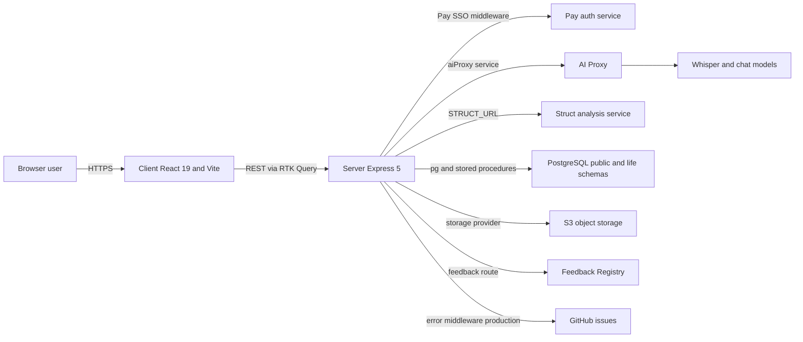

# Architecture

Life is a two-package monorepo. The root package wraps `client` and `server` and runs scripts across both ([package.json:5-8](https://github.com/Jeffrey-Keyser/Life/blob/e2171006c39ec539a94c1053414f833ccad2286f/package.json#L5-L8)). Both packages are private ([client/package.json:4](https://github.com/Jeffrey-Keyser/Life/blob/e2171006c39ec539a94c1053414f833ccad2286f/client/package.json#L4), [server/package.json:4](https://github.com/Jeffrey-Keyser/Life/blob/e2171006c39ec539a94c1053414f833ccad2286f/server/package.json#L4)).

## Component map

## Client

- The client is a Vite app. Dev server port is 3001, with an `/api` proxy to 3002 ([client/vite.config.ts:13-19](https://github.com/Jeffrey-Keyser/Life/blob/e2171006c39ec539a94c1053414f833ccad2286f/client/vite.config.ts#L13-L19)).
- The API base comes from `VITE_API_URL`, defaulting to a localhost URL ([client/src/config/api.ts:2](https://github.com/Jeffrey-Keyser/Life/blob/e2171006c39ec539a94c1053414f833ccad2286f/client/src/config/api.ts#L2)). Pay uses `VITE_PAY_URL` ([client/src/config/payAuth.ts:4](https://github.com/Jeffrey-Keyser/Life/blob/e2171006c39ec539a94c1053414f833ccad2286f/client/src/config/payAuth.ts#L4)).
- Routes separate public screens from protected ones. Journal, person, tag, and debug routes sit under `ProtectedRoute` ([client/src/Router.tsx:17-27](https://github.com/Jeffrey-Keyser/Life/blob/e2171006c39ec539a94c1053414f833ccad2286f/client/src/Router.tsx#L17-L27)).
- The graph is a custom canvas and d3-force pipeline. Cytoscape remains as a dependency ([client/package.json:21-22](https://github.com/Jeffrey-Keyser/Life/blob/e2171006c39ec539a94c1053414f833ccad2286f/client/package.json#L21-L22), [docs/time-tags-era-cloud-design.md:35](https://github.com/Jeffrey-Keyser/Life/blob/e2171006c39ec539a94c1053414f833ccad2286f/docs/time-tags-era-cloud-design.md#L35)). The renderer file itself is not in the attached excerpts.
- Opt-in phone notifications sit in the Profile sheet (`PushSettings`, [client/src/components/user/PushSettings.tsx](https://github.com/Jeffrey-Keyser/Life/blob/a633ba54f10012c72dd551b6e0125e31eb76124e/client/src/components/user/PushSettings.tsx)). The browser calls `/api/v1/push` through `client/src/services/pushSubscription.ts` ([source](https://github.com/Jeffrey-Keyser/Life/blob/a633ba54f10012c72dd551b6e0125e31eb76124e/client/src/services/pushSubscription.ts)).
- The push service worker is served from the frontend root at `/push-sw.js` with scope `/`. It handles only `push` and `notificationclick`. It has no fetch handler and uses no caches ([client/public/push-sw.js](https://github.com/Jeffrey-Keyser/Life/blob/a633ba54f10012c72dd551b6e0125e31eb76124e/client/public/push-sw.js)).
- Every explicit sign-out control uses one shared hook, `usePushAwareSignOut`. The AppShell menus and the Profile sheet both use it ([client/src/hooks/usePushAwareSignOut.ts](https://github.com/Jeffrey-Keyser/Life/blob/a633ba54f10012c72dd551b6e0125e31eb76124e/client/src/hooks/usePushAwareSignOut.ts), [client/src/components/shell/AppShell.tsx](https://github.com/Jeffrey-Keyser/Life/blob/a633ba54f10012c72dd551b6e0125e31eb76124e/client/src/components/shell/AppShell.tsx), [client/src/components/user/UserProfile.tsx](https://github.com/Jeffrey-Keyser/Life/blob/a633ba54f10012c72dd551b6e0125e31eb76124e/client/src/components/user/UserProfile.tsx)). The hook revokes this device's push registration on the server before Pay logout runs. If revocation fails, the owner stays signed in and can retry, stay signed in, or sign out anyway. Sign out anyway drops the browser subscription first ([SignOutCleanupNotice](https://github.com/Jeffrey-Keyser/Life/blob/a633ba54f10012c72dd551b6e0125e31eb76124e/client/src/components/user/SignOutCleanupNotice.tsx)).

## Server contracts

- `server/app.ts` composes middleware and routers. Correlation IDs are first ([server/app.ts:56-57](https://github.com/Jeffrey-Keyser/Life/blob/e2171006c39ec539a94c1053414f833ccad2286f/server/app.ts#L56-L57)).
- Journal APIs live under `/api/v1/journals`, with voice routes mounted beside them ([server/app.ts:101-102](https://github.com/Jeffrey-Keyser/Life/blob/e2171006c39ec539a94c1053414f833ccad2286f/server/app.ts#L101-L102)). Health, user, and diagnostics routes are root-level ([server/app.ts:97-100](https://github.com/Jeffrey-Keyser/Life/blob/e2171006c39ec539a94c1053414f833ccad2286f/server/app.ts#L97-L100)).
- Web Push routes are mounted at `/api/v1/push` ([server/app.ts:113](https://github.com/Jeffrey-Keyser/Life/blob/a633ba54f10012c72dd551b6e0125e31eb76124e/server/app.ts#L113), [server/routes/push.routes.ts](https://github.com/Jeffrey-Keyser/Life/blob/a633ba54f10012c72dd551b6e0125e31eb76124e/server/routes/push.routes.ts)). They cover push config and status, device registration, revocation, and a fixed test notification. The VAPID variables are optional. Without them the API still starts, and push reports as unavailable ([server/config/env.ts](https://github.com/Jeffrey-Keyser/Life/blob/a633ba54f10012c72dd551b6e0125e31eb76124e/server/config/env.ts), [server/services/push/config.ts](https://github.com/Jeffrey-Keyser/Life/blob/a633ba54f10012c72dd551b6e0125e31eb76124e/server/services/push/config.ts)).
- Successful responses use an `ok()` envelope ([server/routes/index.ts:29](https://github.com/Jeffrey-Keyser/Life/blob/e2171006c39ec539a94c1053414f833ccad2286f/server/routes/index.ts#L29)). The client unwraps it ([CLAUDE.md:151](https://github.com/Jeffrey-Keyser/Life/blob/e2171006c39ec539a94c1053414f833ccad2286f/CLAUDE.md#L151)).
- Entries carry `parent_entry_id` and optional addenda ([server/types/index.ts:50](https://github.com/Jeffrey-Keyser/Life/blob/e2171006c39ec539a94c1053414f833ccad2286f/server/types/index.ts#L50), [server/services/entries.service.ts:43-49](https://github.com/Jeffrey-Keyser/Life/blob/e2171006c39ec539a94c1053414f833ccad2286f/server/services/entries.service.ts#L43-L49)).
- Entry image and audio routes, and person-group routes, are scoped to the journal in the URL. Uploads check that the entry belongs to that journal before storage. Deletes match only rows inside that journal entry. Person-group reads and mutations require a journal-to-group mapping. Resources the journal does not own return 404 ([server/services/entries.service.ts](https://github.com/Jeffrey-Keyser/Life/blob/3f7050ef2a81420ead07517db176a3445892ff25/server/services/entries.service.ts), [server/services/audioEntry.ts](https://github.com/Jeffrey-Keyser/Life/blob/3f7050ef2a81420ead07517db176a3445892ff25/server/services/audioEntry.ts), [server/services/personGroups.service.ts](https://github.com/Jeffrey-Keyser/Life/blob/3f7050ef2a81420ead07517db176a3445892ff25/server/services/personGroups.service.ts), [server/db/stored_procedures/delete_image_from_entry.sql](https://github.com/Jeffrey-Keyser/Life/blob/3f7050ef2a81420ead07517db176a3445892ff25/server/db/stored_procedures/delete_image_from_entry.sql)).

## Voice and AI

- Transcription uses Whisper-1 through the AI Proxy ([server/services/aiProxy.ts:114-119](https://github.com/Jeffrey-Keyser/Life/blob/e2171006c39ec539a94c1053414f833ccad2286f/server/services/aiProxy.ts#L114-L119)).
- Chat calls also go through the AI Proxy. The default chat model is `gpt-4o-mini` ([server/services/aiProxy.ts:138](https://github.com/Jeffrey-Keyser/Life/blob/e2171006c39ec539a94c1053414f833ccad2286f/server/services/aiProxy.ts#L138)).
- Structuring sends a schema-constrained prompt to the Struct service ([server/services/voiceEntry.ts:244-247](https://github.com/Jeffrey-Keyser/Life/blob/e2171006c39ec539a94c1053414f833ccad2286f/server/services/voiceEntry.ts#L244-L247)).
- Uploads are capped at 25 MB ([server/routes/voiceEntry.ts:25-28](https://github.com/Jeffrey-Keyser/Life/blob/e2171006c39ec539a94c1053414f833ccad2286f/server/routes/voiceEntry.ts#L25-L28)).

## Data and storage

- The `life` schema maps Pay users to local users, and the `public` schema holds journal data ([CLAUDE.md:131-136](https://github.com/Jeffrey-Keyser/Life/blob/e2171006c39ec539a94c1053414f833ccad2286f/CLAUDE.md#L131-L136)).
- Audio and images go to a storage provider, currently S3 only. The database stores object keys ([server/services/storage/index.ts:9-12](https://github.com/Jeffrey-Keyser/Life/blob/e2171006c39ec539a94c1053414f833ccad2286f/server/services/storage/index.ts#L9-L12), [server/services/audioEntry.ts:15-19](https://github.com/Jeffrey-Keyser/Life/blob/e2171006c39ec539a94c1053414f833ccad2286f/server/services/audioEntry.ts#L15-L19)).
- Web Push registrations are stored in a `push_subscription` table ([server/db/schema/2026_10_30_push_subscription.sql](https://github.com/Jeffrey-Keyser/Life/blob/a633ba54f10012c72dd551b6e0125e31eb76124e/server/db/schema/2026_10_30_push_subscription.sql)). Registration, deactivation, lookups, and delivery-attempt records go through stored procedures in `server/db/stored_procedures/` ([server/dal/push.dal.ts](https://github.com/Jeffrey-Keyser/Life/blob/a633ba54f10012c72dd551b6e0125e31eb76124e/server/dal/push.dal.ts)).
- Synopsis vectors use a local model with 384 dimensions ([server/embed/index.ts:4-5](https://github.com/Jeffrey-Keyser/Life/blob/e2171006c39ec539a94c1053414f833ccad2286f/server/embed/index.ts#L4-L5)).
