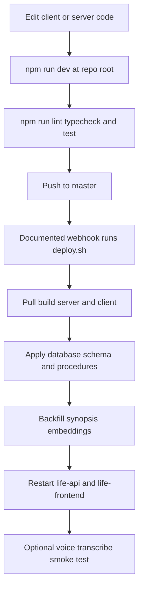

# Iteration Loop

This page covers how a change moves from a local edit to a running host. It separates what the scripts do from what docs describe.

## Local loop

1. **Run both halves.** `npm run dev` starts the server and client concurrently ([package.json:8-10](https://github.com/Jeffrey-Keyser/Life/blob/e2171006c39ec539a94c1053414f833ccad2286f/package.json#L8-L10)). The server dev script uses ts-node ([server/package.json:7](https://github.com/Jeffrey-Keyser/Life/blob/e2171006c39ec539a94c1053414f833ccad2286f/server/package.json#L7)).
2. **Edit.** Route handlers stay thin, and business logic goes in services ([CLAUDE.md:181-184](https://github.com/Jeffrey-Keyser/Life/blob/e2171006c39ec539a94c1053414f833ccad2286f/CLAUDE.md#L181-L184)). New endpoints usually also need a stored procedure and a client RTK Query endpoint ([CLAUDE.md:180-186](https://github.com/Jeffrey-Keyser/Life/blob/e2171006c39ec539a94c1053414f833ccad2286f/CLAUDE.md#L180-L186)).
3. **Verify.** Root scripts run both workspaces in turn: `lint`, `typecheck`, `test`, `test:coverage`, and `e2e` ([package.json:14-27](https://github.com/Jeffrey-Keyser/Life/blob/e2171006c39ec539a94c1053414f833ccad2286f/package.json#L14-L27)).
4. **Test scope.** Server tests use Jest and match `__tests__` and `.test.ts` files ([server/jest.config.ts:5](https://github.com/Jeffrey-Keyser/Life/blob/e2171006c39ec539a94c1053414f833ccad2286f/server/jest.config.ts#L5)). Client tests use Vitest with jsdom ([client/vite.config.ts:25-28](https://github.com/Jeffrey-Keyser/Life/blob/e2171006c39ec539a94c1053414f833ccad2286f/client/vite.config.ts#L25-L28)). Client tests must cover logic, not DOM rendering ([CLAUDE.md:45](https://github.com/Jeffrey-Keyser/Life/blob/e2171006c39ec539a94c1053414f833ccad2286f/CLAUDE.md#L45)).
5. **E2E.** Playwright starts the client dev server on port 4001 unless one is already running locally ([playwright.config.ts:4](https://github.com/Jeffrey-Keyser/Life/blob/e2171006c39ec539a94c1053414f833ccad2286f/playwright.config.ts#L4), [playwright.config.ts:24-27](https://github.com/Jeffrey-Keyser/Life/blob/e2171006c39ec539a94c1053414f833ccad2286f/playwright.config.ts#L24-L27)).

## Push and deploy

- Pushes to `master` are documented to trigger the beelink-deploy webhook, which runs `./deploy.sh` ([CLAUDE.md:79-80](https://github.com/Jeffrey-Keyser/Life/blob/e2171006c39ec539a94c1053414f833ccad2286f/CLAUDE.md#L79-L80), [docs/DEPLOYMENT.md:24](https://github.com/Jeffrey-Keyser/Life/blob/e2171006c39ec539a94c1053414f833ccad2286f/docs/DEPLOYMENT.md#L24)). The listener code is not in the attached excerpts, so the webhook is documented, not verified.
- `[skip deploy]` or `[no deploy]` in a commit message is documented to skip auto-deploy ([CLAUDE.md:82](https://github.com/Jeffrey-Keyser/Life/blob/e2171006c39ec539a94c1053414f833ccad2286f/CLAUDE.md#L82)).
- `deploy.sh` is the verified entry point. It unsets `NODE_ENV` so dev dependencies install ([deploy.sh:5](https://github.com/Jeffrey-Keyser/Life/blob/e2171006c39ec539a94c1053414f833ccad2286f/deploy.sh#L5)). It pulls, builds the server, prepares the embedding model, and builds the client with production `VITE_*` values ([deploy.sh:8-21](https://github.com/Jeffrey-Keyser/Life/blob/e2171006c39ec539a94c1053414f833ccad2286f/deploy.sh#L8-L21)).
- Database changes apply in order: `schema/`, then `migrations/`, then `stored_procedures/` ([docs/DEPLOYMENT.md:79-85](https://github.com/Jeffrey-Keyser/Life/blob/e2171006c39ec539a94c1053414f833ccad2286f/docs/DEPLOYMENT.md#L79-L85)). `deploy.sh` runs this step and then the synopsis backfill ([deploy.sh:24-31](https://github.com/Jeffrey-Keyser/Life/blob/e2171006c39ec539a94c1053414f833ccad2286f/deploy.sh#L24-L31)).
- The script restarts `life-api` and `life-frontend` last ([deploy.sh:34-36](https://github.com/Jeffrey-Keyser/Life/blob/e2171006c39ec539a94c1053414f833ccad2286f/deploy.sh#L34-L36)).

CLAUDE.md lists a backfill-free deploy order and a frontend-only redeploy ([CLAUDE.md:90-103](https://github.com/Jeffrey-Keyser/Life/blob/e2171006c39ec539a94c1053414f833ccad2286f/CLAUDE.md#L90-L103)). `deploy.sh` is the newer and authoritative sequence, so treat CLAUDE.md as a secondary source here.

## After deploy

Run the voice smoke test against production. It exits 0 on success, 1 on transcription failure, and 2 on configuration error ([docs/DEPLOYMENT.md:53-65](https://github.com/Jeffrey-Keyser/Life/blob/e2171006c39ec539a94c1053414f833ccad2286f/docs/DEPLOYMENT.md#L53-L65)). The script is exposed as `smoke:voice-transcribe` ([server/package.json:18](https://github.com/Jeffrey-Keyser/Life/blob/e2171006c39ec539a94c1053414f833ccad2286f/server/package.json#L18)). Its source file is not in the excerpts.

The `terraform/` directory is not the active production path ([docs/DEPLOYMENT.md:73-75](https://github.com/Jeffrey-Keyser/Life/blob/e2171006c39ec539a94c1053414f833ccad2286f/docs/DEPLOYMENT.md#L73-L75)).
