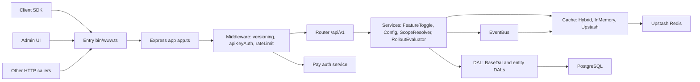

# Architecture

Switchboard has three code surfaces: the Express server in `server/`, a React admin client in `client/`, and a TypeScript SDK in `client-sdk/` ([README.md:L155-L188](https://github.com/Jeffrey-Keyser/Switchboard/blob/f730264d34f112e64d6ba76a2efcd846c762d5bd/README.md#L155-L188)). The README architecture diagram still shows Lambda and API Gateway, which the current deployment guide describes as retired ([DEPLOYMENT_BEELINK.md:L3-L6](https://github.com/Jeffrey-Keyser/Switchboard/blob/f730264d34f112e64d6ba76a2efcd846c762d5bd/docs/DEPLOYMENT_BEELINK.md#L3-L6)).

## Component map

## Contracts

**Entrypoint.** `bin/www.ts` awaits `getExpressApp()` and calls `app.listen(config.PORT)` ([www.ts:L12-L20](https://github.com/Jeffrey-Keyser/Switchboard/blob/f730264d34f112e64d6ba76a2efcd846c762d5bd/server/bin/www.ts#L12-L20)). The app is built with `createExpressApp` and cached ([app.ts:L243-L253](https://github.com/Jeffrey-Keyser/Switchboard/blob/f730264d34f112e64d6ba76a2efcd846c762d5bd/server/app.ts#L243-L253)).

**Routing.** Routes mount at `/`, `/api/v1`, and `/auth` ([app.ts:L191-L195](https://github.com/Jeffrey-Keyser/Switchboard/blob/f730264d34f112e64d6ba76a2efcd846c762d5bd/server/app.ts#L191-L195)). The v1 router mounts auth, diagnostics, cache, features, configs, applications, audit-logs, and realtime ([v1/index.ts:L48-L76](https://github.com/Jeffrey-Keyser/Switchboard/blob/f730264d34f112e64d6ba76a2efcd846c762d5bd/server/routes/versions/v1/index.ts#L48-L76)).

**Versioning.** Version negotiation sets an `API-Version` header, and only version 1 is accepted ([app.ts:L212-L216](https://github.com/Jeffrey-Keyser/Switchboard/blob/f730264d34f112e64d6ba76a2efcd846c762d5bd/server/app.ts#L212-L216), [versioning.ts:L26-L46](https://github.com/Jeffrey-Keyser/Switchboard/blob/f730264d34f112e64d6ba76a2efcd846c762d5bd/server/middleware/versioning.ts#L26-L46)).

**Authentication.** Consumer routes validate an API key from `X-API-Key` or `Authorization: ApiKey` ([apiKeyAuth.ts:L18-L35](https://github.com/Jeffrey-Keyser/Switchboard/blob/f730264d34f112e64d6ba76a2efcd846c762d5bd/server/middleware/apiKeyAuth.ts#L18-L35)). Admin auth uses `setupPayAuth` against `PAY_SERVICE_URL`, defaulting to `https://pay.jeffreykeyser.net` ([app.ts:L59](https://github.com/Jeffrey-Keyser/Switchboard/blob/f730264d34f112e64d6ba76a2efcd846c762d5bd/server/app.ts#L59), [app.ts:L86](https://github.com/Jeffrey-Keyser/Switchboard/blob/f730264d34f112e64d6ba76a2efcd846c762d5bd/server/app.ts#L86)).

**Rate limits.** The general limiter allows 1000 requests per 15 minutes; the strict limiter allows 10 ([rateLimit.ts:L44-L62](https://github.com/Jeffrey-Keyser/Switchboard/blob/f730264d34f112e64d6ba76a2efcd846c762d5bd/server/middleware/rateLimit.ts#L44-L62), [rateLimit.ts:L78-L80](https://github.com/Jeffrey-Keyser/Switchboard/blob/f730264d34f112e64d6ba76a2efcd846c762d5bd/server/middleware/rateLimit.ts#L78-L80)).

**Services.** `FeatureToggleService` and `ConfigService` use write-through caching and publish events ([FeatureToggleService.ts:L21-L28](https://github.com/Jeffrey-Keyser/Switchboard/blob/f730264d34f112e64d6ba76a2efcd846c762d5bd/server/services/FeatureToggleService.ts#L21-L28), [ConfigService.ts:L36-L60](https://github.com/Jeffrey-Keyser/Switchboard/blob/f730264d34f112e64d6ba76a2efcd846c762d5bd/server/services/ConfigService.ts#L36-L60)). `ScopeResolver` checks user, application, then global scope ([ScopeResolver.ts:L77-L155](https://github.com/Jeffrey-Keyser/Switchboard/blob/f730264d34f112e64d6ba76a2efcd846c762d5bd/server/services/ScopeResolver.ts#L77-L155)).

**Cache.** `HybridCacheClient` reads L1 memory first, then L2 Upstash, and writes both ([HybridCacheClient.ts:L49-L73](https://github.com/Jeffrey-Keyser/Switchboard/blob/f730264d34f112e64d6ba76a2efcd846c762d5bd/server/services/cache/HybridCacheClient.ts#L49-L73)). Strategy options are `memory`, `upstash`, `hybrid`, and `none` ([cache/index.ts:L59-L93](https://github.com/Jeffrey-Keyser/Switchboard/blob/f730264d34f112e64d6ba76a2efcd846c762d5bd/server/services/cache/index.ts#L59-L93)).

**EventBus.** Events are published to channels and a buffer ([EventBus.ts:L109-L116](https://github.com/Jeffrey-Keyser/Switchboard/blob/f730264d34f112e64d6ba76a2efcd846c762d5bd/server/services/EventBus.ts#L109-L116)). The code notes Upstash has no direct Pub/Sub, so it uses list-based storage ([EventBus.ts:L155-L156](https://github.com/Jeffrey-Keyser/Switchboard/blob/f730264d34f112e64d6ba76a2efcd846c762d5bd/server/services/EventBus.ts#L155-L156)). Buffered writes happen only when a Redis handle is exposed ([EventBus.ts:L182-L191](https://github.com/Jeffrey-Keyser/Switchboard/blob/f730264d34f112e64d6ba76a2efcd846c762d5bd/server/services/EventBus.ts#L182-L191)).

**Data access.** `BaseDal` wraps the `pg` pool and offers transactions ([BaseDal.ts:L8-L13](https://github.com/Jeffrey-Keyser/Switchboard/blob/f730264d34f112e64d6ba76a2efcd846c762d5bd/server/dal/BaseDal.ts#L8-L13), [BaseDal.ts:L61-L77](https://github.com/Jeffrey-Keyser/Switchboard/blob/f730264d34f112e64d6ba76a2efcd846c762d5bd/server/dal/BaseDal.ts#L61-L77)). The pool is created from shared database config ([connection.ts:L4](https://github.com/Jeffrey-Keyser/Switchboard/blob/f730264d34f112e64d6ba76a2efcd846c762d5bd/server/db/connection.ts#L4)).

**SDK.** The SDK exports `SwitchboardClient` and React integration from one entry ([client-sdk/src/index.ts:L9-L41](https://github.com/Jeffrey-Keyser/Switchboard/blob/f730264d34f112e64d6ba76a2efcd846c762d5bd/client-sdk/src/index.ts#L9-L41)).
