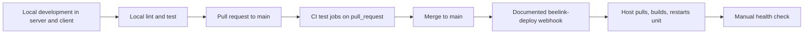

# Iteration Loop

This page describes the contributor loop based on the scripts and workflows in the source excerpts. Older Terraform and Lambda steps are not part of the current loop.

## Steps

1. **Local development.** In `server/`, `npm run dev` runs `ts-node ./bin/www.ts`. The CLAUDE guide says it needs a `.env` copied from `.env.example` ([server/package.json:L7](https://github.com/Jeffrey-Keyser/Switchboard/blob/f730264d34f112e64d6ba76a2efcd846c762d5bd/server/package.json#L7), [CLAUDE.md:L38-L39](https://github.com/Jeffrey-Keyser/Switchboard/blob/f730264d34f112e64d6ba76a2efcd846c762d5bd/CLAUDE.md#L38-L39)).

2. **Local checks.** Run `npm run lint` and `npm test` in `server/`. Coverage uses `npm run test:coverage` ([server/package.json:L10-L13](https://github.com/Jeffrey-Keyser/Switchboard/blob/f730264d34f112e64d6ba76a2efcd846c762d5bd/server/package.json#L10-L13)). The SDK has `lint`, `test`, and `type-check` scripts in `client-sdk/` ([client-sdk/package.json:L15-L19](https://github.com/Jeffrey-Keyser/Switchboard/blob/f730264d34f112e64d6ba76a2efcd846c762d5bd/client-sdk/package.json#L15-L19)).

3. **Pull request CI.** The workflow runs on pushes to `main` and `develop`, and on pull requests to `main` ([ci-cd-pipeline.yml:L3-L7](https://github.com/Jeffrey-Keyser/Switchboard/blob/f730264d34f112e64d6ba76a2efcd846c762d5bd/.github/workflows/ci-cd-pipeline.yml#L3-L7)). The `test-frontend` and `test-backend` jobs run only for pull requests ([ci-cd-pipeline.yml:L11-L13](https://github.com/Jeffrey-Keyser/Switchboard/blob/f730264d34f112e64d6ba76a2efcd846c762d5bd/.github/workflows/ci-cd-pipeline.yml#L11-L13), [ci-cd-pipeline.yml:L113-L114](https://github.com/Jeffrey-Keyser/Switchboard/blob/f730264d34f112e64d6ba76a2efcd846c762d5bd/.github/workflows/ci-cd-pipeline.yml#L113-L114)). The backend job runs `npm run test:coverage` in `main/server` ([ci-cd-pipeline.yml:L146-L151](https://github.com/Jeffrey-Keyser/Switchboard/blob/f730264d34f112e64d6ba76a2efcd846c762d5bd/.github/workflows/ci-cd-pipeline.yml#L146-L151)).

4. **Merge and deploy.** The workflow says GitHub Actions no longer deploys production. Merging to the default branch triggers a `beelink-deploy` webhook that pulls, rebuilds, and restarts `switchboard-server.service` ([ci-cd-pipeline.yml:L215-L224](https://github.com/Jeffrey-Keyser/Switchboard/blob/f730264d34f112e64d6ba76a2efcd846c762d5bd/.github/workflows/ci-cd-pipeline.yml#L215-L224)). The webhook itself is not defined in the excerpts, so its behavior is documented, not verified.

5. **Manual deploy.** The fallback is `git pull`, `npm ci`, `npm run build`, and a systemd restart ([DEPLOYMENT_BEELINK.md:L107-L116](https://github.com/Jeffrey-Keyser/Switchboard/blob/f730264d34f112e64d6ba76a2efcd846c762d5bd/docs/DEPLOYMENT_BEELINK.md#L107-L116)).

6. **Database changes.** Run `server/db/deploy.sh`. It applies migrations, schema, stored procedures, session tables, and development-only seeds ([deploy.sh:L10-L39](https://github.com/Jeffrey-Keyser/Switchboard/blob/f730264d34f112e64d6ba76a2efcd846c762d5bd/server/db/deploy.sh#L10-L39)).

## Conventions

- Rollback is documented as checking out a previous commit, rebuilding, and restarting ([DEPLOYMENT_BEELINK.md:L127-L133](https://github.com/Jeffrey-Keyser/Switchboard/blob/f730264d34f112e64d6ba76a2efcd846c762d5bd/docs/DEPLOYMENT_BEELINK.md#L127-L133)).
- Load-test scripts exist in `server/package.json` but the excerpts do not show a CI job that runs them ([server/package.json:L15-L19](https://github.com/Jeffrey-Keyser/Switchboard/blob/f730264d34f112e64d6ba76a2efcd846c762d5bd/server/package.json#L15-L19)).
- The CLAUDE guide still describes Terraform and AWS steps. The Beelink document says those tools are retired ([DEPLOYMENT_BEELINK.md:L8-L10](https://github.com/Jeffrey-Keyser/Switchboard/blob/f730264d34f112e64d6ba76a2efcd846c762d5bd/docs/DEPLOYMENT_BEELINK.md#L8-L10)), so treat those sections as stale.
