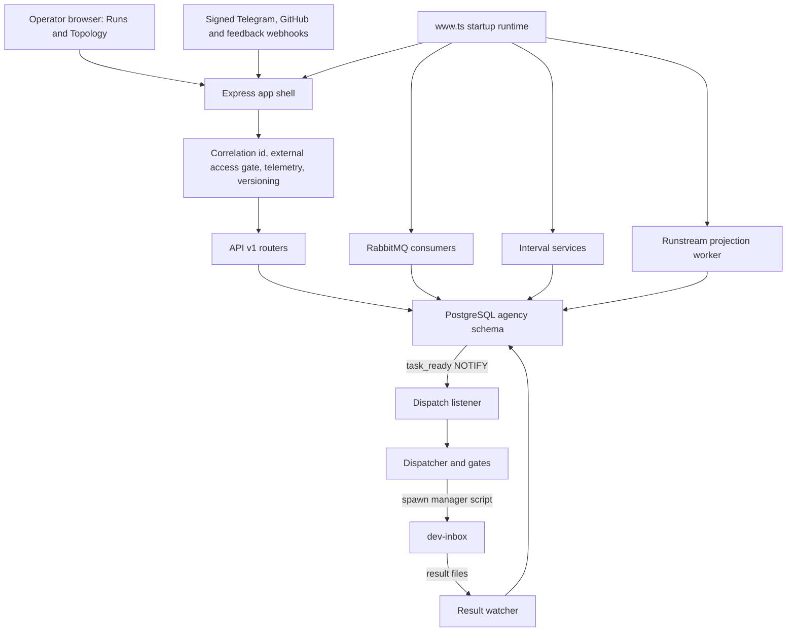

# Architecture

Agency HQ is one Node process: an Express app built with `@jeffrey-keyser/express-server-factory`, plus long-running listeners, consumers and interval services started from `src/bin/www.ts` ([src/app.ts:L1-L5](https://github.com/Jeffrey-Keyser/agency-hq/blob/c107e01386cfa76587ccfd868b861936c4eea8b1/src/app.ts#L1-L5), [src/bin/www.ts:L171-L232](https://github.com/Jeffrey-Keyser/agency-hq/blob/c107e01386cfa76587ccfd868b861936c4eea8b1/src/bin/www.ts#L171-L232)). Treat legacy subsystems (meetings, CEO agent, sprints) as under audit per the redesign notice ([CLAUDE.md:L9-L14](https://github.com/Jeffrey-Keyser/agency-hq/blob/c107e01386cfa76587ccfd868b861936c4eea8b1/CLAUDE.md#L9-L14)).

## Components

- **HTTP shell.** Mounts `/`, `/dashboard` and `/api/v1`; factory auth is disabled and access control comes from custom middleware: correlation id, external access gate, Wave 0 access telemetry, version negotiation ([src/app.ts:L69](https://github.com/Jeffrey-Keyser/agency-hq/blob/c107e01386cfa76587ccfd868b861936c4eea8b1/src/app.ts#L69), [src/app.ts:L90-L120](https://github.com/Jeffrey-Keyser/agency-hq/blob/c107e01386cfa76587ccfd868b861936c4eea8b1/src/app.ts#L90-L120)). An error middleware maps `AgencyError` to status plus JSON with the trace id ([src/app.ts:L121-L126](https://github.com/Jeffrey-Keyser/agency-hq/blob/c107e01386cfa76587ccfd868b861936c4eea8b1/src/app.ts#L121-L126)).
- **v1 routers.** The router index mounts legacy resources (tasks, sprints, meetings, decisions, autonomy, ceo, webhook, artifacts) alongside newer ones: runs, run-traces, run-analyses, dispatch-config, model-consumers, project-reconciliation, acceptance-try, queue-jobs, telemetry, portfolio-steward and homelab-stewardship ([src/routes/versions/v1/index.ts:L36-L68](https://github.com/Jeffrey-Keyser/agency-hq/blob/c107e01386cfa76587ccfd868b861936c4eea8b1/src/routes/versions/v1/index.ts#L36-L68), [src/routes/versions/v1/index.ts](https://github.com/Jeffrey-Keyser/agency-hq/blob/e1373ec3d1886686eccee7765f302b34c139e23b/src/routes/versions/v1/index.ts)). The homelab-stewardship router exposes GET routes only: the snapshot, its JSON export, and the read-only `/intelligence` feedback endpoint, which returns the current review brief and retained outside-finding decisions behind the same owner access and private no-store caching ([src/routes/versions/v1/homelab-stewardship.ts](https://github.com/Jeffrey-Keyser/agency-hq/blob/83c425de67c3f4cd30547f39bb228bce72a410f6/src/routes/versions/v1/homelab-stewardship.ts), [src/__tests__/homelab-stewardship-route.test.ts](https://github.com/Jeffrey-Keyser/agency-hq/blob/83c425de67c3f4cd30547f39bb228bce72a410f6/src/__tests__/homelab-stewardship-route.test.ts)). README and CLAUDE.md list further endpoints; treat those lists as documentation ([CLAUDE.md:L96-L114](https://github.com/Jeffrey-Keyser/agency-hq/blob/c107e01386cfa76587ccfd868b861936c4eea8b1/CLAUDE.md#L96-L114)).
- **Outside finding intake (supervised CLI).** Not a running service. `src/bin/intelligence-findings.ts` offers `ingest`, `decide` and `feedback` commands. Its service in `src/services/intelligence-findings.ts` reads one authored GitHub issue through `gh`, checks cited source excerpts against the repository revision, records an assessor's decision as an immutable receipt, and reads the retained history. Storage is a local directory (`INTELLIGENCE_FINDINGS_DIR`, default `~/.local/share/agency-intelligence/findings`) that the CLI and Agency HQ must both read. GitHub polling and automatic semantic assessment are not implemented ([src/bin/intelligence-findings.ts](https://github.com/Jeffrey-Keyser/agency-hq/blob/83c425de67c3f4cd30547f39bb228bce72a410f6/src/bin/intelligence-findings.ts), [src/services/intelligence-findings.ts](https://github.com/Jeffrey-Keyser/agency-hq/blob/83c425de67c3f4cd30547f39bb228bce72a410f6/src/services/intelligence-findings.ts), [docs/intelligence-findings-pilot.md](https://github.com/Jeffrey-Keyser/agency-hq/blob/83c425de67c3f4cd30547f39bb228bce72a410f6/docs/intelligence-findings-pilot.md)).
- **Deployment runtime and admission.** Startup attests the release and holds a singleton session before admitting work; losing exclusivity exits the process ([src/bin/www.ts:L101-L108](https://github.com/Jeffrey-Keyser/agency-hq/blob/c107e01386cfa76587ccfd868b861936c4eea8b1/src/bin/www.ts#L101-L108)). Work units are wrapped in `withDeploymentWork` ([src/execution/ghost-task-auto-resolver.ts:L26-L28](https://github.com/Jeffrey-Keyser/agency-hq/blob/c107e01386cfa76587ccfd868b861936c4eea8b1/src/execution/ghost-task-auto-resolver.ts#L26-L28)).
- **Execution.** The dispatcher runs sequential gates (build freshness, autonomy, attempt caps, duplicates) and spawns `manager-standalone.sh` detached ([src/execution/dispatcher.ts:L146-L349](https://github.com/Jeffrey-Keyser/agency-hq/blob/c107e01386cfa76587ccfd868b861936c4eea8b1/src/execution/dispatcher.ts#L146-L349)). Result watcher and dispatch listener run under crash-recovery backoff ([src/bin/www.ts:L195-L198](https://github.com/Jeffrey-Keyser/agency-hq/blob/c107e01386cfa76587ccfd868b861936c4eea8b1/src/bin/www.ts#L195-L198)).
- **RabbitMQ consumers.** Orchestration, heartbeat, ops-events, probe-failed, runstream, project-reconciliation and Logos proposal-card consumers register after connecting; a failed connect logs and reconnects ([src/bin/www.ts:L181-L193](https://github.com/Jeffrey-Keyser/agency-hq/blob/c107e01386cfa76587ccfd868b861936c4eea8b1/src/bin/www.ts#L181-L193)). The Logos consumer binds queue `agency-hq.logos-proposal-cards` to `logos.proposal.created` and sends one Telegram approve/reject card per proposal ([src/services/logos-proposal-cards.ts:L130-L139](https://github.com/Jeffrey-Keyser/agency-hq/blob/28c1fbc06d4be757b1d3c3550dfc54a5320e299c/src/services/logos-proposal-cards.ts#L130-L139)).
- **Interval services.** Ghost detection then auto-resolution, decision decay, retry scheduler, notification decay, stale meeting/repo detectors, iteration engine, backlog triage, feedback ingestion and session cleanup ([src/bin/www.ts:L203-L220](https://github.com/Jeffrey-Keyser/agency-hq/blob/c107e01386cfa76587ccfd868b861936c4eea8b1/src/bin/www.ts#L203-L220)).
- **Run projection.** A durable worker projects ledger runs into read models independently of RabbitMQ ([src/bin/www.ts:L222-L227](https://github.com/Jeffrey-Keyser/agency-hq/blob/c107e01386cfa76587ccfd868b861936c4eea8b1/src/bin/www.ts#L222-L227)); read paths query `agency.run_traces`, `run_steps`, `run_invocations`, `run_slices` and `run_events` ([src/dal/run-analyses.ts:L156-L178](https://github.com/Jeffrey-Keyser/agency-hq/blob/c107e01386cfa76587ccfd868b861936c4eea8b1/src/dal/run-analyses.ts#L156-L178)).
- **Project reconciliation and acceptance.** Acceptance scripts run in clean shared clones at bound SHAs with a minimal environment and secret redaction ([src/services/project-acceptance.ts:L93-L128](https://github.com/Jeffrey-Keyser/agency-hq/blob/c107e01386cfa76587ccfd868b861936c4eea8b1/src/services/project-acceptance.ts#L93-L128), [src/services/project-acceptance.ts:L222-L234](https://github.com/Jeffrey-Keyser/agency-hq/blob/c107e01386cfa76587ccfd868b861936c4eea8b1/src/services/project-acceptance.ts#L222-L234)). For `project-ecosystem-commerce` only, the acceptance environment also receives `ACCEPTANCE_ECOSYSTEM_DB_SECRET`, fetched from Solo Vault (`agency-hq` / `production` / `ecosystem-readings-db`); the source comment states this production reader secret is never placed in agent prompts or the general passthrough, and the variable is omitted when Vault returns nothing ([src/services/project-acceptance.ts](https://github.com/Jeffrey-Keyser/agency-hq/blob/4523d08c221914ed3ae6c036d227fb64c95f2566/src/services/project-acceptance.ts)). The accepted-design recovery pass checks whether a design's running queue job is waiting at the plan's merge gate, signalled by `plans/<id>/needs-attention/terminal-complete-merge-pending.json` with class `merge-pending`; if so, it can raise a 'Design plan needs merge review' attention item suggesting `complete.sh <plan> --sign-off`. Normal terminal completion writes that handoff and then applies the policy sign-off and merges about a minute later, so the page is held, and any existing attention is left untouched, until the handoff's `detectedAt` is more than 10 minutes old. A handoff without a readable `detectedAt` pages immediately ([src/services/project-governed-completion.ts](https://github.com/Jeffrey-Keyser/agency-hq/blob/eb2eb8290d40b845f4ae3deb88953f5c33c8e2bd/src/services/project-governed-completion.ts), [src/services/project-reconciliation-design-review.ts](https://github.com/Jeffrey-Keyser/agency-hq/blob/eb2eb8290d40b845f4ae3deb88953f5c33c8e2bd/src/services/project-reconciliation-design-review.ts), [src/__tests__/project-execution-dispatch.test.ts](https://github.com/Jeffrey-Keyser/agency-hq/blob/eb2eb8290d40b845f4ae3deb88953f5c33c8e2bd/src/__tests__/project-execution-dispatch.test.ts)). Governed completion resolves the implementation repository per task, from the `repoPath` each slice run records in its `plan.json`. Runs that record no repository default to the Dev Inbox checkout, and a target the project does not list among its heartbeat's governed repositories fails closed. A single-repository plan keeps the existing candidate and recovery proofs. A plan whose tasks span several governed repositories still needs the policy sign-off, with its candidate merged in one of those repositories, and also requires every task's verified and reviewed commit (matching `verify.json` and `review.json`) to be merged in the repository it was implemented in. Recovered runs in a cross-repository plan fail closed ([src/services/project-governed-completion.ts](https://github.com/Jeffrey-Keyser/agency-hq/blob/fb6fdb8231195ea3f5c961b8e68833a89ba93c26/src/services/project-governed-completion.ts), [src/__tests__/project-governed-completion.test.ts](https://github.com/Jeffrey-Keyser/agency-hq/blob/fb6fdb8231195ea3f5c961b8e68833a89ba93c26/src/__tests__/project-governed-completion.test.ts)).
- **Project evidence manifests.** Per-project manifests live under `acceptance/projects/`. `project-ecosystem-commerce.json` declares `minEvidence: "source"`, `legacyChecks: "keep"`, a list of design constraints (`TEST-MODE-ONLY`, `NO-OUTWARD`, `SHARED-FIRST`, `HONEST-READINGS`, `CANDIDATE-CAP`), and rules that match `ECOSYSTEM_COMMERCE-*` requirement ids by regular expression to a `kind` (`aim`, `review`, `artifact`, `behavior` or `records`), optionally with an `environment`, `params` and a `domain` giving an enumerator and notes. Aim and review rows are never drafted, aims become design constraints carried into every slice, and the Pay artifact rows bind to `repo-static` ([acceptance/projects/project-ecosystem-commerce.json](https://github.com/Jeffrey-Keyser/agency-hq/blob/40d22d6d7a0ba69b6c7f604718b04b1404b20d02/acceptance/projects/project-ecosystem-commerce.json)). The manifest now declares two environments: `repo-static` (bound to `pay`) and `ecosystem-readings`. The `ecosystem-readings` binding names `connectionRef: ACCEPTANCE_ECOSYSTEM_DB_SECRET`, a `P30D` window, an exclusion definition (`fixtures/ecosystem-exclusions-v1.json` with its version and sha256), and an owner-declared app list with keys, Pay IDs, domains, aliases, a `product` or `candidate` tier, and a `maxRung` cap (6 for products Pantry, Ping and Life; 3 for candidates MyRRS, Travel Map, Image Studio and Spanish Studio, the last two having no Pay ID). Each readings-bound requirement now gets its own `records` rule with a clause-specific enumerator, instead of one rule shared by many ids. For example, `LADDER-01` enumerates in-scope apps by recorded readiness rung (with `maxRung` described as a policy cap, not achieved readiness), `LADDER-R2-02` enumerates Analytics traffic by owner/agent/test/external classification, and `LADDER-R6-01` enumerates windowed external-active-user and paying-customer readings. The shared notes say to read only the clause's own measure, check `sources()` and `result.present` before counting (an absent producer is `measure_absent`, an existing empty source is a real zero), apply `ecosystem-exclusions-v1` to every user/revenue reading, and not gate a clause on unrelated source kinds ([acceptance/projects/project-ecosystem-commerce.json](https://github.com/Jeffrey-Keyser/agency-hq/blob/4523d08c221914ed3ae6c036d227fb64c95f2566/acceptance/projects/project-ecosystem-commerce.json)). A captured resolution lists 28 commerce requirements resolved as `bound:ecosystem-readings` ([docs/operations/ecosystem-readings-resolution.json](https://github.com/Jeffrey-Keyser/agency-hq/blob/4523d08c221914ed3ae6c036d227fb64c95f2566/docs/operations/ecosystem-readings-resolution.json)).
- **Ecosystem readings environment.** `acceptance/environments/ecosystem-readings.{json,mjs}` is a `deployed`-strength environment that takes read-only snapshots of production PostgreSQL tables in the `pay`, `analytics_pulse`, `feedback`, `pantry` and `agency_hq` databases. It requires the dedicated `ecosystem_readings` role, fails the harness if that role has elevated or write privileges, and reads each database in a `REPEATABLE READ READ ONLY` transaction with a 15 s statement timeout over a frozen UTC `[since,until)` window; snapshots are not atomic across databases. Missing tables, and derived measures with no bound producer (readiness, MRR, usage packs, response times, commerce steward, proposals, weekly summaries, effort impact), are reported as `present: false` with `declineKind: measure_absent` rather than zero. The exclusion file must match its bound sha256 and version and carry recorded owner approval. Probes include `window()`, `sources()`, `apps()`, `users()`, `activeUsers()`, `payments()`, `subscriptions()`, `usagePacks()`, `events()`, `feedback()`, `incidents()`, `stewardPasses()` and `exclusions()`; faults (`inject-external-user`, `inject-excluded-user`, `drop-source`, `alter-amount`, `inject-steward-pass`) act only on in-memory rows ([acceptance/environments/ecosystem-readings.json](https://github.com/Jeffrey-Keyser/agency-hq/blob/4523d08c221914ed3ae6c036d227fb64c95f2566/acceptance/environments/ecosystem-readings.json), [acceptance/environments/ecosystem-readings.mjs](https://github.com/Jeffrey-Keyser/agency-hq/blob/4523d08c221914ed3ae6c036d227fb64c95f2566/acceptance/environments/ecosystem-readings.mjs)). The exclusion fixture `ecosystem-exclusions-v1` names 12 accounts (test/example, owner and agent) and reserved domains, and states that unknown identities remain unattributed, never external ([acceptance/fixtures/ecosystem-exclusions-v1.json](https://github.com/Jeffrey-Keyser/agency-hq/blob/4523d08c221914ed3ae6c036d227fb64c95f2566/acceptance/fixtures/ecosystem-exclusions-v1.json)).
- **Meeting engine (legacy).** Facilitator, templates and artifact extraction ([src/meeting-engine/index.ts:L1-L6](https://github.com/Jeffrey-Keyser/agency-hq/blob/c107e01386cfa76587ccfd868b861936c4eea8b1/src/meeting-engine/index.ts#L1-L6)).

## Contracts

- **Dispatch handoff:** spawn with stdout parsed for `Run ID:` ([src/execution/dispatcher.ts:L107-L114](https://github.com/Jeffrey-Keyser/agency-hq/blob/c107e01386cfa76587ccfd868b861936c4eea8b1/src/execution/dispatcher.ts#L107-L114)).
- **Result files:** `{runId}-plan.json`, `{taskId}.json`, `{taskId}-review.json`, mapped to task statuses ([docs/execution-architecture.md:L85-L102](https://github.com/Jeffrey-Keyser/agency-hq/blob/c107e01386cfa76587ccfd868b861936c4eea8b1/docs/execution-architecture.md#L85-L102)).
- **Event bus:** `task_ready` NOTIFY with a startup scan for missed events ([docs/event-bus.md:L238-L245](https://github.com/Jeffrey-Keyser/agency-hq/blob/c107e01386cfa76587ccfd868b861936c4eea8b1/docs/event-bus.md#L238-L245)).
- **Plan manifests:** the Runs list reads `plans/<id>/slices.json` beside dev-inbox results ([src/services/run-list-context.ts:L60-L69](https://github.com/Jeffrey-Keyser/agency-hq/blob/c107e01386cfa76587ccfd868b861936c4eea8b1/src/services/run-list-context.ts#L60-L69)).
- **Merge-pending handoff:** a running plan with `state.json` status `running` and `needs-attention/terminal-complete-merge-pending.json` of class `merge-pending` is reported with its plan id, the handoff's `evidence.lastError` (or 'Plan merge gate needs review') and, when present as a string, its `detectedAt` ([src/services/project-governed-completion.ts](https://github.com/Jeffrey-Keyser/agency-hq/blob/eb2eb8290d40b845f4ae3deb88953f5c33c8e2bd/src/services/project-governed-completion.ts)).
- **Logos proposal review:** a Telegram `logos_proposal:` callback calls the Logos approve or reject endpoint directly, then replaces the card with the result or the proposal's existing status ([src/routes/versions/v1/webhook-callbacks.ts:L356-L408](https://github.com/Jeffrey-Keyser/agency-hq/blob/28c1fbc06d4be757b1d3c3550dfc54a5320e299c/src/routes/versions/v1/webhook-callbacks.ts#L356-L408)).
