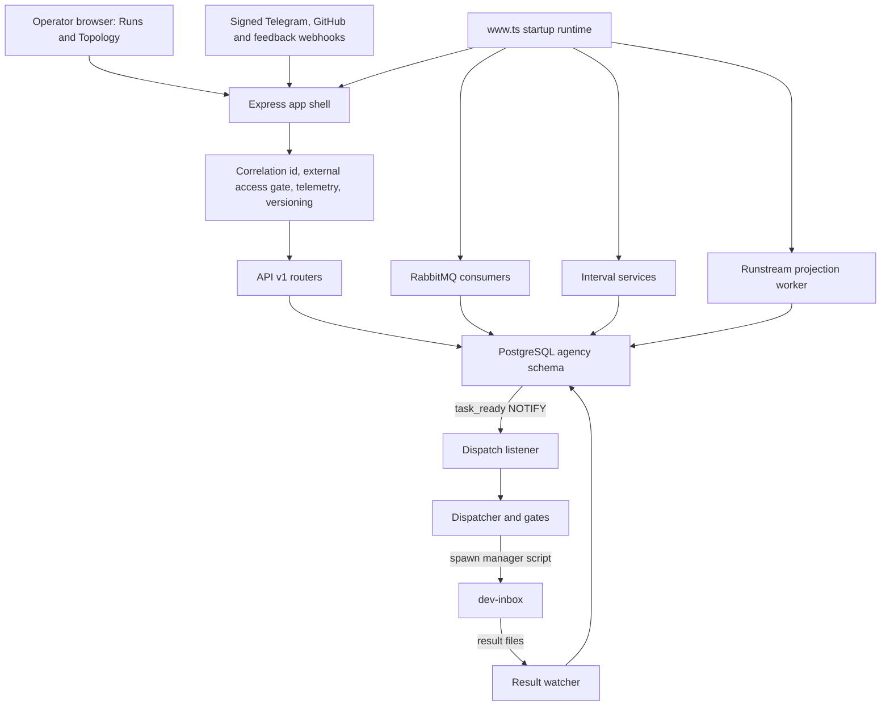

# Architecture

Agency HQ is one Node process: an Express app built with `@jeffrey-keyser/express-server-factory`, plus long-running listeners, consumers and interval services started from `src/bin/www.ts` ([src/app.ts:L1-L5](https://github.com/Jeffrey-Keyser/agency-hq/blob/c107e01386cfa76587ccfd868b861936c4eea8b1/src/app.ts#L1-L5), [src/bin/www.ts:L171-L232](https://github.com/Jeffrey-Keyser/agency-hq/blob/c107e01386cfa76587ccfd868b861936c4eea8b1/src/bin/www.ts#L171-L232)). Treat legacy subsystems (meetings, CEO agent, sprints) as under audit per the redesign notice ([CLAUDE.md:L9-L14](https://github.com/Jeffrey-Keyser/agency-hq/blob/c107e01386cfa76587ccfd868b861936c4eea8b1/CLAUDE.md#L9-L14)).

## Components

- **HTTP shell.** Mounts `/`, `/dashboard` and `/api/v1`; factory auth is disabled and access control comes from custom middleware: correlation id, external access gate, Wave 0 access telemetry, version negotiation ([src/app.ts:L69](https://github.com/Jeffrey-Keyser/agency-hq/blob/c107e01386cfa76587ccfd868b861936c4eea8b1/src/app.ts#L69), [src/app.ts:L90-L120](https://github.com/Jeffrey-Keyser/agency-hq/blob/c107e01386cfa76587ccfd868b861936c4eea8b1/src/app.ts#L90-L120)). An error middleware maps `AgencyError` to status plus JSON with the trace id ([src/app.ts:L121-L126](https://github.com/Jeffrey-Keyser/agency-hq/blob/c107e01386cfa76587ccfd868b861936c4eea8b1/src/app.ts#L121-L126)).
- **v1 routers.** The router index mounts legacy resources (tasks, sprints, meetings, decisions, autonomy, ceo, webhook, artifacts) alongside newer ones: runs, run-traces, run-analyses, needs-you-outcome-windows, dispatch-config, model-consumers, project-reconciliation, acceptance-try, queue-jobs, telemetry, portfolio-steward and homelab-stewardship ([src/routes/versions/v1/index.ts:L36-L68](https://github.com/Jeffrey-Keyser/agency-hq/blob/c107e01386cfa76587ccfd868b861936c4eea8b1/src/routes/versions/v1/index.ts#L36-L68), [src/routes/versions/v1/index.ts](https://github.com/Jeffrey-Keyser/agency-hq/blob/f2db9e3eee85d4fee818e1846343034cbc9bd02e/src/routes/versions/v1/index.ts)). The homelab-stewardship router exposes GET routes only: the snapshot, its JSON export, and the read-only `/intelligence` feedback endpoint, which returns the current review brief and retained outside-finding decisions behind the same owner access and private no-store caching ([src/routes/versions/v1/homelab-stewardship.ts](https://github.com/Jeffrey-Keyser/agency-hq/blob/83c425de67c3f4cd30547f39bb228bce72a410f6/src/routes/versions/v1/homelab-stewardship.ts), [src/__tests__/homelab-stewardship-route.test.ts](https://github.com/Jeffrey-Keyser/agency-hq/blob/83c425de67c3f4cd30547f39bb228bce72a410f6/src/__tests__/homelab-stewardship-route.test.ts)). README and CLAUDE.md list further endpoints; treat those lists as documentation ([CLAUDE.md:L96-L114](https://github.com/Jeffrey-Keyser/agency-hq/blob/c107e01386cfa76587ccfd868b861936c4eea8b1/CLAUDE.md#L96-L114)).
- **Needs you outcome windows.** Owner viewing state for the Needs you page's "Outcomes since your previous visit" list, mounted at `/api/v1/needs-you/outcome-windows`. Every route requires the signed-in Pay owner session (machine JWTs carry no owner identity), writes need the session CSRF token, and responses are `private, no-store`. The service issues a window `[lower, upper)` over recorded run `completed_at`: upper is the database clock when the window opens, and lower is the owner's acknowledged boundary or 24 hours earlier on a first visit. Windows persist in `agency.needs_you_outcome_windows` and the owner boundary in `agency.needs_you_visit_boundaries` (migration `1710600175000`); acknowledgement only moves the boundary forward. Outcome rows come from `listRunOutcomeRows` and `countRunOutcomes` in the run-analyses DAL, which compare `completed_at` at microsecond precision. The route notifies nobody and does not touch execution ([src/routes/versions/v1/needs-you-outcomes.ts](https://github.com/Jeffrey-Keyser/agency-hq/blob/f2db9e3eee85d4fee818e1846343034cbc9bd02e/src/routes/versions/v1/needs-you-outcomes.ts), [src/services/needs-you-outcomes.ts](https://github.com/Jeffrey-Keyser/agency-hq/blob/f2db9e3eee85d4fee818e1846343034cbc9bd02e/src/services/needs-you-outcomes.ts), [migrations/1710600175000_needs-you-outcome-windows.ts](https://github.com/Jeffrey-Keyser/agency-hq/blob/f2db9e3eee85d4fee818e1846343034cbc9bd02e/migrations/1710600175000_needs-you-outcome-windows.ts), [src/dal/run-analyses.ts](https://github.com/Jeffrey-Keyser/agency-hq/blob/f2db9e3eee85d4fee818e1846343034cbc9bd02e/src/dal/run-analyses.ts)).
- **Outside finding intake (supervised CLI).** Not a running service. `src/bin/intelligence-findings.ts` offers `ingest`, `decide` and `feedback` commands. Its service in `src/services/intelligence-findings.ts` reads one authored GitHub issue through `gh`, checks cited source excerpts against the repository revision, records an assessor's decision as an immutable receipt, and reads the retained history. Storage is a local directory (`INTELLIGENCE_FINDINGS_DIR`, default `~/.local/share/agency-intelligence/findings`) that the CLI and Agency HQ must both read. GitHub polling and automatic semantic assessment are not implemented ([src/bin/intelligence-findings.ts](https://github.com/Jeffrey-Keyser/agency-hq/blob/83c425de67c3f4cd30547f39bb228bce72a410f6/src/bin/intelligence-findings.ts), [src/services/intelligence-findings.ts](https://github.com/Jeffrey-Keyser/agency-hq/blob/83c425de67c3f4cd30547f39bb228bce72a410f6/src/services/intelligence-findings.ts), [docs/intelligence-findings-pilot.md](https://github.com/Jeffrey-Keyser/agency-hq/blob/83c425de67c3f4cd30547f39bb228bce72a410f6/docs/intelligence-findings-pilot.md)).
- **Deployment runtime and admission.** Startup attests the release and holds a singleton session before admitting work; losing exclusivity exits the process ([src/bin/www.ts:L101-L108](https://github.com/Jeffrey-Keyser/agency-hq/blob/c107e01386cfa76587ccfd868b861936c4eea8b1/src/bin/www.ts#L101-L108)). Work units are wrapped in `withDeploymentWork` ([src/execution/ghost-task-auto-resolver.ts:L26-L28](https://github.com/Jeffrey-Keyser/agency-hq/blob/c107e01386cfa76587ccfd868b861936c4eea8b1/src/execution/ghost-task-auto-resolver.ts#L26-L28)).
- **Execution.** The dispatcher runs sequential gates (build freshness, autonomy, attempt caps, duplicates) and spawns `manager-standalone.sh` detached ([src/execution/dispatcher.ts:L146-L349](https://github.com/Jeffrey-Keyser/agency-hq/blob/c107e01386cfa76587ccfd868b861936c4eea8b1/src/execution/dispatcher.ts#L146-L349)). Result watcher and dispatch listener run under crash-recovery backoff ([src/bin/www.ts:L195-L198](https://github.com/Jeffrey-Keyser/agency-hq/blob/c107e01386cfa76587ccfd868b861936c4eea8b1/src/bin/www.ts#L195-L198)).
- **RabbitMQ consumers.** Orchestration, heartbeat, ops-events, probe-failed, runstream, project-reconciliation and Logos proposal-card consumers register after connecting; a failed connect logs and reconnects ([src/bin/www.ts:L181-L193](https://github.com/Jeffrey-Keyser/agency-hq/blob/c107e01386cfa76587ccfd868b861936c4eea8b1/src/bin/www.ts#L181-L193)). The Logos consumer binds queue `agency-hq.logos-proposal-cards` to `logos.proposal.created` and sends one Telegram approve/reject card per proposal ([src/services/logos-proposal-cards.ts:L130-L139](https://github.com/Jeffrey-Keyser/agency-hq/blob/28c1fbc06d4be757b1d3c3550dfc54a5320e299c/src/services/logos-proposal-cards.ts#L130-L139)).
- **Interval services.** Ghost detection then auto-resolution, decision decay, retry scheduler, notification decay, stale meeting/repo detectors, iteration engine, backlog triage, feedback ingestion and session cleanup ([src/bin/www.ts:L203-L220](https://github.com/Jeffrey-Keyser/agency-hq/blob/c107e01386cfa76587ccfd868b861936c4eea8b1/src/bin/www.ts#L203-L220)).
- **Run projection.** A durable worker projects ledger runs into read models independently of RabbitMQ ([src/bin/www.ts:L222-L227](https://github.com/Jeffrey-Keyser/agency-hq/blob/c107e01386cfa76587ccfd868b861936c4eea8b1/src/bin/www.ts#L222-L227)); read paths query `agency.run_traces`, `run_steps`, `run_invocations`, `run_slices` and `run_events` ([src/dal/run-analyses.ts:L156-L178](https://github.com/Jeffrey-Keyser/agency-hq/blob/c107e01386cfa76587ccfd868b861936c4eea8b1/src/dal/run-analyses.ts#L156-L178)).
- **Project reconciliation and acceptance.** Acceptance scripts run in clean shared clones at bound SHAs with a minimal environment and secret redaction ([src/services/project-acceptance.ts:L93-L128](https://github.com/Jeffrey-Keyser/agency-hq/blob/c107e01386cfa76587ccfd868b861936c4eea8b1/src/services/project-acceptance.ts#L93-L128), [src/services/project-acceptance.ts:L222-L234](https://github.com/Jeffrey-Keyser/agency-hq/blob/c107e01386cfa76587ccfd868b861936c4eea8b1/src/services/project-acceptance.ts#L222-L234)). For `project-ecosystem-commerce` only, the acceptance environment also receives `ACCEPTANCE_ECOSYSTEM_DB_SECRET`, fetched from Solo Vault (`agency-hq` / `production` / `ecosystem-readings-db`); the source comment states this production reader secret is never placed in agent prompts or the general passthrough, and the variable is omitted when Vault returns nothing ([src/services/project-acceptance.ts](https://github.com/Jeffrey-Keyser/agency-hq/blob/4523d08c221914ed3ae6c036d227fb64c95f2566/src/services/project-acceptance.ts)). Environment proofs allow up to 16 faults per check. An environment may declare owner-authored `proofControls` (known-valid worlds with a fixed `fault`, `args` and `description`); a proof may name one with `control` only when the requirement's manifest params list it in `proofControls`. The assertion must then count zero in the control world and more under the adverse fault in a separate fresh world, while the actual production count stays the check's measurement and floor and is recorded as `productionClean`. Control definitions enter the environment version only for requirements that allow them, so other versions are unchanged. The try endpoint accepts `control` (without `fault` or `args`) for a dry run in mode `control` ([src/services/project-acceptance-environments.ts](https://github.com/Jeffrey-Keyser/agency-hq/blob/8598a9473789582e2b8276e9bc7fd00a5bcb418d/src/services/project-acceptance-environments.ts), [src/services/project-acceptance-try.ts](https://github.com/Jeffrey-Keyser/agency-hq/blob/8598a9473789582e2b8276e9bc7fd00a5bcb418d/src/services/project-acceptance-try.ts), [src/services/project-acceptance-admin.ts](https://github.com/Jeffrey-Keyser/agency-hq/blob/8598a9473789582e2b8276e9bc7fd00a5bcb418d/src/services/project-acceptance-admin.ts), [docs/project-reconciliation.md](https://github.com/Jeffrey-Keyser/agency-hq/blob/8598a9473789582e2b8276e9bc7fd00a5bcb418d/docs/project-reconciliation.md)). The accepted-design recovery pass checks whether a design's running queue job is waiting at the plan's merge gate, signalled by `plans/<id>/needs-attention/terminal-complete-merge-pending.json` with class `merge-pending`; if so, it can raise a 'Design plan needs merge review' attention item suggesting `complete.sh <plan> --sign-off`. Normal terminal completion writes that handoff and then applies the policy sign-off and merges about a minute later, so the page is held, and any existing attention is left untouched, until the handoff's `detectedAt` is more than 10 minutes old. A handoff without a readable `detectedAt` pages immediately ([src/services/project-governed-completion.ts](https://github.com/Jeffrey-Keyser/agency-hq/blob/eb2eb8290d40b845f4ae3deb88953f5c33c8e2bd/src/services/project-governed-completion.ts), [src/services/project-reconciliation-design-review.ts](https://github.com/Jeffrey-Keyser/agency-hq/blob/eb2eb8290d40b845f4ae3deb88953f5c33c8e2bd/src/services/project-reconciliation-design-review.ts), [src/__tests__/project-execution-dispatch.test.ts](https://github.com/Jeffrey-Keyser/agency-hq/blob/eb2eb8290d40b845f4ae3deb88953f5c33c8e2bd/src/__tests__/project-execution-dispatch.test.ts)). Governed completion resolves the implementation repository per task, from the `repoPath` each slice run records in its `plan.json`. Runs that record no repository default to the Dev Inbox checkout, and a target the project does not list among its heartbeat's governed repositories fails closed. A single-repository plan keeps the existing candidate and recovery proofs. A plan whose tasks span several governed repositories still needs the policy sign-off, with its candidate merged in one of those repositories, and also requires every task's verified and reviewed commit (matching `verify.json` and `review.json`) to be merged in the repository it was implemented in. Recovered runs in a cross-repository plan fail closed ([src/services/project-governed-completion.ts](https://github.com/Jeffrey-Keyser/agency-hq/blob/fb6fdb8231195ea3f5c961b8e68833a89ba93c26/src/services/project-governed-completion.ts), [src/__tests__/project-governed-completion.test.ts](https://github.com/Jeffrey-Keyser/agency-hq/blob/fb6fdb8231195ea3f5c961b8e68833a89ba93c26/src/__tests__/project-governed-completion.test.ts)).
- **Project evidence manifests.** Per-project manifests live under `acceptance/projects/`. `project-ecosystem-commerce.json` declares `minEvidence: "source"`, `legacyChecks: "keep"`, a list of design constraints (`TEST-MODE-ONLY`, `NO-OUTWARD`, `SHARED-FIRST`, `HONEST-READINGS`, `CANDIDATE-CAP`), and rules that match `ECOSYSTEM_COMMERCE-*` requirement ids by regular expression to a `kind` (`aim`, `review`, `artifact`, `behavior` or `records`), optionally with an `environment`, `params` and a `domain` giving an enumerator and notes. Aim and review rows are never drafted, aims become design constraints carried into every slice, and the Pay artifact rows bind to `repo-static` ([acceptance/projects/project-ecosystem-commerce.json](https://github.com/Jeffrey-Keyser/agency-hq/blob/40d22d6d7a0ba69b6c7f604718b04b1404b20d02/acceptance/projects/project-ecosystem-commerce.json)). The manifest now declares two environments: `repo-static` (bound to `pay`) and `ecosystem-readings`. The `ecosystem-readings` binding names `connectionRef: ACCEPTANCE_ECOSYSTEM_DB_SECRET`, a `P30D` window, an exclusion definition (`fixtures/ecosystem-exclusions-v1.json` with its version and sha256), and an owner-declared app list with keys, Pay IDs, domains, aliases, a `product` or `candidate` tier, and a `maxRung` cap (6 for products Pantry, Ping and Life; 3 for candidates MyRRS, Travel Map, Image Studio and Spanish Studio, the last two having no Pay ID). Each readings-bound requirement now gets its own `records` rule with a clause-specific enumerator, instead of one rule shared by many ids. For example, `LADDER-01` enumerates in-scope apps by recorded readiness rung (with `maxRung` described as a policy cap, not achieved readiness), `LADDER-R2-02` enumerates Analytics traffic by owner/agent/test/external classification, and `LADDER-R6-01` enumerates windowed external-active-user and paying-customer readings. The shared notes say to read only the clause's own measure, check `sources()` and `result.present` before counting (an absent producer is `measure_absent`, an existing empty source is a real zero), apply `ecosystem-exclusions-v1` to every user/revenue reading, and not gate a clause on unrelated source kinds ([acceptance/projects/project-ecosystem-commerce.json](https://github.com/Jeffrey-Keyser/agency-hq/blob/4523d08c221914ed3ae6c036d227fb64c95f2566/acceptance/projects/project-ecosystem-commerce.json)). Clause notes now point to the new adverse controls: the traffic-classification clause reads the `exclusions().traffic` audit (while `events()` stays filtered to external traffic), the per-app user/customer clause can use `misattribute-app` (with live Pantry receipt-scan activity as the pantry-to-ping witness), and the exclusion clause uses `bypass-exclusions` as its violation-increasing proof while `inject-excluded-user` stays harmless ([acceptance/projects/project-ecosystem-commerce.json](https://github.com/Jeffrey-Keyser/agency-hq/blob/59c039de64c5ed1dc09590c0ab5b02697b595ed8/acceptance/projects/project-ecosystem-commerce.json)). Every declared app now also carries `pricedForLiveRevenue: false`, and the binding has a `pricingApplicability` block (version and fixture `ecosystem-live-pricing-v1`, scope `live-revenue`, its sha256, an empty `pricedAppKeys` list, owner `jkeyser` and the recorded time). The `LADDER-R6-01` notes say that no apps are currently priced for live revenue, that Pantry test scan offers do not qualify, and that the conditional live-priced customer subdomain stays empty until the owner records a new version; the classification changes no application prices or Stripe settings. The per-app user/customer clause notes now also name `misattribute-app` with `seed:true` for payments and `alter-total` for the ecosystem active-user and paying-customer totals ([acceptance/projects/project-ecosystem-commerce.json](https://github.com/Jeffrey-Keyser/agency-hq/blob/9f9820f22f748261c7e21bbb04080b98bb05e7fb/acceptance/projects/project-ecosystem-commerce.json)). The `LADDER-R6-01` notes further state that a missing relevant source, producer or reading must be reported as unmeasurable (`measure_absent`), never as a violation; that `drop-source` must not be used as a violation-increasing product proof; that numerical integrity uses `alter-total` with `{probe: activeUsers, app: pantry}` alongside the attribution, window and exclusion controls; and that a future owner change to live-pricing applicability requires reviewing the newly applicable customer branch and its proofs. The exclusion clause notes now say that expected readings should be reconstructed from `exclusions().records` and the approved definition, not from filtered outputs or physical row counts alone, and name `omit-external-user` as the over-exclusion/false-completion control, with `bypass-exclusions` separately proving excluded identities cannot enter readings ([acceptance/projects/project-ecosystem-commerce.json](https://github.com/Jeffrey-Keyser/agency-hq/blob/86cfb3d8c4b066b2ea3bcc68824dc70f4a86fcec/acceptance/projects/project-ecosystem-commerce.json)). The existential paying-customer clause (DONE-08, enumerating in-scope apps by actual external paying customers in the window) now sets `params.proofControls` to `["external-paying-customer"]`. Its notes say the actual production existential may already fail with count 1; only this requirement may use that control, and the same assertion must count 0 in the control world and 1 under `remove-paying-customers` and under `replace-customers-with-excluded` in separate disposable worlds. The production baseline and floor stay at the actual count, and unrelated violations or revenue inferred from test payments must never be added ([acceptance/projects/project-ecosystem-commerce.json](https://github.com/Jeffrey-Keyser/agency-hq/blob/8598a9473789582e2b8276e9bc7fd00a5bcb418d/acceptance/projects/project-ecosystem-commerce.json), [docs/project-reconciliation.md](https://github.com/Jeffrey-Keyser/agency-hq/blob/8598a9473789582e2b8276e9bc7fd00a5bcb418d/docs/project-reconciliation.md)). The pricing fixture `acceptance/fixtures/ecosystem-live-pricing-v1.json` records the owner's approved answer 'No apps priced for live revenue yet', states that test offers do not qualify, and requires a new owner-approved version when live pricing applicability changes ([acceptance/fixtures/ecosystem-live-pricing-v1.json](https://github.com/Jeffrey-Keyser/agency-hq/blob/9f9820f22f748261c7e21bbb04080b98bb05e7fb/acceptance/fixtures/ecosystem-live-pricing-v1.json)). The operations note says provisioning rejects disagreement between the approved artifact and the per-app flags ([docs/operations/ecosystem-readings.md](https://github.com/Jeffrey-Keyser/agency-hq/blob/9f9820f22f748261c7e21bbb04080b98bb05e7fb/docs/operations/ecosystem-readings.md)). A captured resolution lists 28 commerce requirements resolved as `bound:ecosystem-readings`, now at environment version `de4ebda4df5c78ea` ([docs/operations/ecosystem-readings-resolution.json](https://github.com/Jeffrey-Keyser/agency-hq/blob/86cfb3d8c4b066b2ea3bcc68824dc70f4a86fcec/docs/operations/ecosystem-readings-resolution.json)).
- **Ecosystem readings environment.** `acceptance/environments/ecosystem-readings.{json,mjs}` is a `deployed`-strength environment that takes read-only snapshots of production PostgreSQL tables in the `pay`, `analytics_pulse`, `feedback`, `pantry` and `agency_hq` databases. It requires the dedicated `ecosystem_readings` role, fails the harness if that role has elevated or write privileges, and reads each database in a `REPEATABLE READ READ ONLY` transaction with a 15 s statement timeout over a frozen UTC `[since,until)` window; snapshots are not atomic across databases. Missing tables, and derived measures with no bound producer (readiness, MRR, usage packs, response times, commerce steward, proposals, weekly summaries, effort impact), are reported as `present: false` with `declineKind: measure_absent` rather than zero. The exclusion file must match its bound sha256 and version and carry recorded owner approval. Probes include `window()`, `sources()`, `apps()`, `users()`, `activeUsers()`, `payments()`, `subscriptions()`, `usagePacks()`, `usage()`, `events()`, `feedback()`, `incidents()`, `stewardPasses()` and `exclusions()` ([acceptance/environments/ecosystem-readings.json](https://github.com/Jeffrey-Keyser/agency-hq/blob/9f9820f22f748261c7e21bbb04080b98bb05e7fb/acceptance/environments/ecosystem-readings.json), [acceptance/environments/ecosystem-readings.mjs](https://github.com/Jeffrey-Keyser/agency-hq/blob/9f9820f22f748261c7e21bbb04080b98bb05e7fb/acceptance/environments/ecosystem-readings.mjs)). `apps()` documents `pricedForLiveRevenue` as the owner-declared applicability for R6 live-revenue readings; test offers do not set it true. Each `activeUsers()` row now carries an `evidence` list of `{source, recordId, app, at, kind, sessionId}` entries from Analytics events and Pantry receipt-scan debits, so scan-only activity is enumerated with dated provenance that can be checked against `window()`. `usage()` returns filtered billing usage events (joined through subscription items and subscriptions) and Pantry scan transactions (joined through Pantry users to Pay), with `source`, `recordId`, `app`, `userId`, `at`, `kind` and `quantity`; it reports `measure_absent` if any required billing, Pantry or identity source is missing. It is consumption and credit history, never pack purchases or revenue, and signup grants are labelled and do not count as active use ([acceptance/environments/ecosystem-readings.mjs](https://github.com/Jeffrey-Keyser/agency-hq/blob/9f9820f22f748261c7e21bbb04080b98bb05e7fb/acceptance/environments/ecosystem-readings.mjs), [acceptance/environments/ecosystem-readings.json](https://github.com/Jeffrey-Keyser/agency-hq/blob/9f9820f22f748261c7e21bbb04080b98bb05e7fb/acceptance/environments/ecosystem-readings.json)). `exclusions()` also returns a `traffic` array: an uncounted audit of every in-window Analytics event, including excluded and unknown traffic, with app mapping, account/user ids, a classification (`owner`, `agent`, `test`, `acceptance-harness`, `external` or `unattributed`), an `excluded` flag, flag/identity evidence and the exclusion version. It is not an external-user count ([acceptance/environments/ecosystem-readings.mjs](https://github.com/Jeffrey-Keyser/agency-hq/blob/59c039de64c5ed1dc09590c0ab5b02697b595ed8/acceptance/environments/ecosystem-readings.mjs)). It now also returns a `usage` array that retains every in-window raw billing usage and Pantry transaction record, independently of the filtered `usage()` reading, with app, in-scope flag, timestamp, kind, quantity, resolved user id, an `excluded` flag, whether a Pay account was identified, test/agent/acceptance-harness/account-type flags and the exclusion version ([acceptance/environments/ecosystem-readings.mjs](https://github.com/Jeffrey-Keyser/agency-hq/blob/9f9820f22f748261c7e21bbb04080b98bb05e7fb/acceptance/environments/ecosystem-readings.mjs)). `exclusions()` additionally returns a `records` object: an independent, unfiltered, uncounted source audit keyed `users`, `apps`, `payments`, `subscriptions`, `subscriptionItems`, `billingApps`, `usageEvents`, `pantryUsers`, `pantryTransactions`, `projects`, `events` and `sessions`. Each array holds exactly the adapter's selected columns under their original snake_case names (the source comment notes these never include auth hashes or tokens). `null` marks an absent producer, while `[]` is an existing empty source; dropping a source makes its entry `null`. The audit is returned as a copy, so editing it does not change later readings, and it lets an assertion reconstruct both excluded and omitted external records; it is not a business reading ([acceptance/environments/ecosystem-readings.mjs](https://github.com/Jeffrey-Keyser/agency-hq/blob/86cfb3d8c4b066b2ea3bcc68824dc70f4a86fcec/acceptance/environments/ecosystem-readings.mjs), [acceptance/environments/ecosystem-readings.json](https://github.com/Jeffrey-Keyser/agency-hq/blob/86cfb3d8c4b066b2ea3bcc68824dc70f4a86fcec/acceptance/environments/ecosystem-readings.json), [src/__tests__/project-acceptance-ecosystem-readings.test.ts](https://github.com/Jeffrey-Keyser/agency-hq/blob/86cfb3d8c4b066b2ea3bcc68824dc70f4a86fcec/src/__tests__/project-acceptance-ecosystem-readings.test.ts)). Faults act only on in-memory rows: `inject-external-user`, `inject-excluded-user`, `drop-source`, `alter-amount`, `inject-steward-pass`, plus narrow adverse controls. `bypass-exclusions` injects one identity with an approved excluded email and lets only that identity leak into user, activity and revenue readings, leaving the definition, `matchedAccounts` and traffic audit intact. `misattribute-app` (`probe` of `activeUsers`, `payments` or `subscriptions`; default `pantry` to `ping`) duplicates one app's reported view into another app's view only, leaving raw rows, the source app view and the ecosystem total unchanged; it fails the harness unless both apps are registered and in scope and the source app has actual rows in the window ([acceptance/environments/ecosystem-readings.mjs](https://github.com/Jeffrey-Keyser/agency-hq/blob/59c039de64c5ed1dc09590c0ab5b02697b595ed8/acceptance/environments/ecosystem-readings.mjs), [src/__tests__/project-acceptance-ecosystem-readings.test.ts](https://github.com/Jeffrey-Keyser/agency-hq/blob/59c039de64c5ed1dc09590c0ab5b02697b595ed8/src/__tests__/project-acceptance-ecosystem-readings.test.ts)). An optional `seed:true` on `misattribute-app` first adds a valid in-memory external witness when an existing source is empty, which supports payment-attribution proofs before the first real payment; a missing producer is never seeded. `alter-total` (`probe` of `activeUsers` or `payments`, `field` of `total` or `payingCustomers`, default +1) corrupts only a measurable reported ecosystem count, preserving rows and per-app views, and refuses absent or unknown metrics. `alter-activity-time` corrupts only the reported `activeUsers()` evidence dates, keeping raw records and counts ([acceptance/environments/ecosystem-readings.json](https://github.com/Jeffrey-Keyser/agency-hq/blob/9f9820f22f748261c7e21bbb04080b98bb05e7fb/acceptance/environments/ecosystem-readings.json), [acceptance/environments/ecosystem-readings.mjs](https://github.com/Jeffrey-Keyser/agency-hq/blob/9f9820f22f748261c7e21bbb04080b98bb05e7fb/acceptance/environments/ecosystem-readings.mjs), [docs/operations/ecosystem-readings.md](https://github.com/Jeffrey-Keyser/agency-hq/blob/9f9820f22f748261c7e21bbb04080b98bb05e7fb/docs/operations/ecosystem-readings.md)). `alter-total` now also takes an optional `app` key: with it, only that registered in-scope app's count is corrupted, leaving the global and other-app views unchanged (it fails the harness for an unregistered or out-of-scope key); without it, the fault targets the ecosystem total as before. A new `omit-external-user` fault (`app`, default `pantry`) seeds one valid external identity across the user, activity, payment, subscription and usage sources, then wrongly drops that identity from produced readings as if over-excluded, counting its rows as excluded, while the raw `records` and audit classifications stay complete. It is the adverse proof against silently dropping external controls and makes no production writes ([acceptance/environments/ecosystem-readings.mjs](https://github.com/Jeffrey-Keyser/agency-hq/blob/86cfb3d8c4b066b2ea3bcc68824dc70f4a86fcec/acceptance/environments/ecosystem-readings.mjs), [acceptance/environments/ecosystem-readings.json](https://github.com/Jeffrey-Keyser/agency-hq/blob/86cfb3d8c4b066b2ea3bcc68824dc70f4a86fcec/acceptance/environments/ecosystem-readings.json), [src/__tests__/project-acceptance-ecosystem-readings.test.ts](https://github.com/Jeffrey-Keyser/agency-hq/blob/86cfb3d8c4b066b2ea3bcc68824dc70f4a86fcec/src/__tests__/project-acceptance-ecosystem-readings.test.ts)). Two further faults support the paying-customer existential: `remove-paying-customers` empties the in-memory payment, subscription, subscription-item and usage-event rows while keeping source presence and the account/app registries (it fails the harness unless those billing sources are present), and `replace-customers-with-excluded` does the same, then adds one positive live succeeded payment for a new identity using an approved excluded email and an in-scope product app, so there must still be no external paying customer. The environment also declares a `proofControls` entry `external-paying-customer`, which runs the `seed-paying-customer` fault: it requires present user, app and payment sources and a registered in-scope product app, reuses the first reported user (or adds one at a `real-customer.invalid` address) and adds one explicitly live, succeeded, positive Stripe payment for that app. These faults touch only disposable snapshot rows, never the database, prices or Stripe, and the control never replaces the production measurement ([acceptance/environments/ecosystem-readings.mjs](https://github.com/Jeffrey-Keyser/agency-hq/blob/8598a9473789582e2b8276e9bc7fd00a5bcb418d/acceptance/environments/ecosystem-readings.mjs), [acceptance/environments/ecosystem-readings.json](https://github.com/Jeffrey-Keyser/agency-hq/blob/8598a9473789582e2b8276e9bc7fd00a5bcb418d/acceptance/environments/ecosystem-readings.json)). The owner assertion `docs/operations/ecosystem-readings-paying-customer.mjs` reports `measure_absent` when a required source, the approved exclusion definition or the raw audit is missing; returns no violation when a windowed, succeeded, positive, live, non-synthetic payment belongs to a nonexcluded account and an in-scope app; returns `measure_absent` when relevant payment or active-subscription attribution is incomplete; and otherwise records one violation, 'No in-scope app has an external paying customer' ([docs/operations/ecosystem-readings-paying-customer.mjs](https://github.com/Jeffrey-Keyser/agency-hq/blob/8598a9473789582e2b8276e9bc7fd00a5bcb418d/docs/operations/ecosystem-readings-paying-customer.mjs)). A captured DONE-08 preflight at environment version `8d5a7006d5bb7845` records an actual production count of 1, 1 after an ordinary excluded injection, unmeasurable (exit 2, no count) with payments missing, and two passing proofs against control `external-paying-customer` (control 0, production 1, faulted 1) for `remove-paying-customers` and `replace-customers-with-excluded`. It also lists 22 other environments whose versions are unaffected ([docs/operations/ecosystem-readings-done08-preflight.json](https://github.com/Jeffrey-Keyser/agency-hq/blob/8598a9473789582e2b8276e9bc7fd00a5bcb418d/docs/operations/ecosystem-readings-done08-preflight.json)). A captured adverse-proof run at environment version `6edf294d50d8cbcf` records leaked-excluded-identity counts of 0 clean, 0 after an ordinary excluded injection and 7 under the bypass (the excluded-user control now seeds both usage sources), and a clean count of 0 against 1 under fault for each of active-user attribution, payment attribution, the ecosystem user total, the ecosystem customer total and the activity window ([docs/operations/ecosystem-readings-adverse-proofs.json](https://github.com/Jeffrey-Keyser/agency-hq/blob/9f9820f22f748261c7e21bbb04080b98bb05e7fb/docs/operations/ecosystem-readings-adverse-proofs.json)). A new captured file, `docs/operations/ecosystem-readings-reviewed-guards.json`, records two reviewed assertions measured at environment version `de4ebda4df5c78ea` (stored version `6edf294d50d8cbcf`), each with a clean count of 0 and 0 after an ordinary excluded injection. `external-users-customers` (`EC01-01`) counts 1 under each of `misattribute-app` for active users and for seeded payments, `alter-total` for the active-user total and for paying customers, and 4 under `bypass-exclusions`. `r6-windowed-traction` (`LADDER-R6-01`) counts 1 under each of seeded `alter-activity-time`, seeded `misattribute-app` for active users, `bypass-exclusions` and per-app `alter-total` (`app: pantry`). Both treat missing activity as unmeasurable (exit 2, no count), and `EC01-01` does the same for missing payments ([docs/operations/ecosystem-readings-reviewed-guards.json](https://github.com/Jeffrey-Keyser/agency-hq/blob/86cfb3d8c4b066b2ea3bcc68824dc70f4a86fcec/docs/operations/ecosystem-readings-reviewed-guards.json)). The operations note says R6 uses the per-app `alter-total` proof in place of an invalid availability-as-business-failure proof, and that these reviewed assertions are applied only through the owner API after their strict adverse and ordinary excluded-account controls pass ([docs/operations/ecosystem-readings.md](https://github.com/Jeffrey-Keyser/agency-hq/blob/86cfb3d8c4b066b2ea3bcc68824dc70f4a86fcec/docs/operations/ecosystem-readings.md)). The exclusion fixture `ecosystem-exclusions-v1` names 12 accounts (test/example, owner and agent) and reserved domains, and states that unknown identities remain unattributed, never external ([acceptance/fixtures/ecosystem-exclusions-v1.json](https://github.com/Jeffrey-Keyser/agency-hq/blob/4523d08c221914ed3ae6c036d227fb64c95f2566/acceptance/fixtures/ecosystem-exclusions-v1.json)).
- **Meeting engine (legacy).** Facilitator, templates and artifact extraction ([src/meeting-engine/index.ts:L1-L6](https://github.com/Jeffrey-Keyser/agency-hq/blob/c107e01386cfa76587ccfd868b861936c4eea8b1/src/meeting-engine/index.ts#L1-L6)).

## Contracts

- **Dispatch handoff:** spawn with stdout parsed for `Run ID:` ([src/execution/dispatcher.ts:L107-L114](https://github.com/Jeffrey-Keyser/agency-hq/blob/c107e01386cfa76587ccfd868b861936c4eea8b1/src/execution/dispatcher.ts#L107-L114)).
- **Result files:** `{runId}-plan.json`, `{taskId}.json`, `{taskId}-review.json`, mapped to task statuses ([docs/execution-architecture.md:L85-L102](https://github.com/Jeffrey-Keyser/agency-hq/blob/c107e01386cfa76587ccfd868b861936c4eea8b1/docs/execution-architecture.md#L85-L102)).
- **Event bus:** `task_ready` NOTIFY with a startup scan for missed events ([docs/event-bus.md:L238-L245](https://github.com/Jeffrey-Keyser/agency-hq/blob/c107e01386cfa76587ccfd868b861936c4eea8b1/docs/event-bus.md#L238-L245)).
- **Plan manifests:** the Runs list reads `plans/<id>/slices.json` beside dev-inbox results ([src/services/run-list-context.ts:L60-L69](https://github.com/Jeffrey-Keyser/agency-hq/blob/c107e01386cfa76587ccfd868b861936c4eea8b1/src/services/run-list-context.ts#L60-L69)).
- **Merge-pending handoff:** a running plan with `state.json` status `running` and `needs-attention/terminal-complete-merge-pending.json` of class `merge-pending` is reported with its plan id, the handoff's `evidence.lastError` (or 'Plan merge gate needs review') and, when present as a string, its `detectedAt` ([src/services/project-governed-completion.ts](https://github.com/Jeffrey-Keyser/agency-hq/blob/eb2eb8290d40b845f4ae3deb88953f5c33c8e2bd/src/services/project-governed-completion.ts)).
- **Logos proposal review:** a Telegram `logos_proposal:` callback calls the Logos approve or reject endpoint directly, then replaces the card with the result or the proposal's existing status ([src/routes/versions/v1/webhook-callbacks.ts:L356-L408](https://github.com/Jeffrey-Keyser/agency-hq/blob/28c1fbc06d4be757b1d3c3550dfc54a5320e299c/src/routes/versions/v1/webhook-callbacks.ts#L356-L408)).
