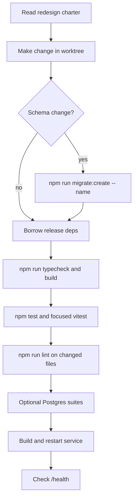

# Iteration Loop

This page covers how a contributor changes Agency HQ. The runtime dispatch loop is described in [Architecture](../architecture/).

## 1. Check the redesign constraint first

Do not add features to, or deepen dependencies on, the legacy dashboard, Kanban, backlog, sprint, meeting, CEO-agent, persona or memory mechanisms without reading the redesign charter; the notice is not authorisation for unreviewed deletion either ([CLAUDE.md:L9-L14](https://github.com/Jeffrey-Keyser/agency-hq/blob/c107e01386cfa76587ccfd868b861936c4eea8b1/CLAUDE.md#L9-L14)). The model-consumer audit repeats this for meeting and research model roles ([docs/model-consumer-audit.md:L31](https://github.com/Jeffrey-Keyser/agency-hq/blob/c107e01386cfa76587ccfd868b861936c4eea8b1/docs/model-consumer-audit.md#L31)).

## 2. Migrations

Always create migrations with `npm run migrate:create -- <name>`, which produces a sequential timestamp; never use `Date.now()` because it breaks the runner ([CLAUDE.md:L66-L70](https://github.com/Jeffrey-Keyser/agency-hq/blob/c107e01386cfa76587ccfd868b861936c4eea8b1/CLAUDE.md#L66-L70)). The scripts are wired to `scripts/run-migrate.js`, `run-migrate-down.js` and `create-migration.js` ([package.json:L17-L20](https://github.com/Jeffrey-Keyser/agency-hq/blob/c107e01386cfa76587ccfd868b861936c4eea8b1/package.json#L17-L20)). The server refuses to start if required schema elements are missing ([src/bin/www.ts:L133-L138](https://github.com/Jeffrey-Keyser/agency-hq/blob/c107e01386cfa76587ccfd868b861936c4eea8b1/src/bin/www.ts#L133-L138)).

After writing a migration, run `npm run declare:migrations` and commit `deployment-compatibility.json` with it. `npm run typecheck` and `npm run build` first run `scripts/deployment-release.js check-declaration .`, which compares the `migrations/` digest with the declared `targetSchema` and fails while they differ. An undeclared migration therefore fails slice verification and local builds rather than later deploys, which otherwise fail closed with `AGENCY_COMPAT_STALE` ([package.json:L8-L10](https://github.com/Jeffrey-Keyser/agency-hq/blob/faaa049b8d1ede8ec302c1e2129b83c04f6bafd5/package.json#L8-L10), [docs/operations/deployment-drain.md](https://github.com/Jeffrey-Keyser/agency-hq/blob/faaa049b8d1ede8ec302c1e2129b83c04f6bafd5/docs/operations/deployment-drain.md)). `migrate:create` prints the same reminder ([scripts/create-migration.js](https://github.com/Jeffrey-Keyser/agency-hq/blob/faaa049b8d1ede8ec302c1e2129b83c04f6bafd5/scripts/create-migration.js)).

The declaration step refuses changed or removed applied migrations, and destructive operations in a new migration's `up`: DROP, RENAME, column type, SET NOT NULL or DROP DEFAULT changes, TRUNCATE, destructive node-pg-migrate builders, and NOT NULL columns added without a default. After a human review shows that old code still running during the migration is safe, pass the migration with `--reviewed <migration>`. Otherwise split the change into expand and contract releases ([scripts/deployment-release.js](https://github.com/Jeffrey-Keyser/agency-hq/blob/faaa049b8d1ede8ec302c1e2129b83c04f6bafd5/scripts/deployment-release.js)).

## 3. Build and test in a clean worktree

Clean worktrees intentionally skip dependency install. `scripts/with-release-deps.sh -- <command>` reuses the deployed release's `node_modules` only when lockfile hashes match, and fails closed otherwise ([docs/clean-worktree-verification.md:L3-L18](https://github.com/Jeffrey-Keyser/agency-hq/blob/c107e01386cfa76587ccfd868b861936c4eea8b1/docs/clean-worktree-verification.md#L3-L18)). Override the release location with `AGENCY_HQ_RELEASE_DIR` ([docs/clean-worktree-verification.md:L20-L21](https://github.com/Jeffrey-Keyser/agency-hq/blob/c107e01386cfa76587ccfd868b861936c4eea8b1/docs/clean-worktree-verification.md#L20-L21)).

Useful scripts ([package.json:L8-L16](https://github.com/Jeffrey-Keyser/agency-hq/blob/faaa049b8d1ede8ec302c1e2129b83c04f6bafd5/package.json#L8-L16)):

- `npm run typecheck` runs the declaration check and then `tsc --noEmit`. `npm run build` runs the declaration check and then `tsc`. A stale migration declaration fails both.
- `npm run declare:migrations` re-declares `deployment-compatibility.json` after a migration is added.
- `npm test` runs `npx vitest run`; pass a file path for focused runs.
- `npm run test:postgres:sessions` and `test:postgres:projection` set `AGENCY_HQ_REQUIRE_TEST_DATABASE=1` and need a test database.
- `npm run test:verify` runs `scripts/verify-notification-metrics.js`.
- `npm run lint` runs `scripts/lint-changed.sh`, which by name targets changed files; its exact behaviour is not in the provided excerpts.

Missing dev dependencies can make suites fail to load; a past audit hit this with `jsdom` and `supertest` ([docs/orchestration-explorer-cohort-comparison-verification.md:L30-L32](https://github.com/Jeffrey-Keyser/agency-hq/blob/c107e01386cfa76587ccfd868b861936c4eea8b1/docs/orchestration-explorer-cohort-comparison-verification.md#L30-L32)).

## 4. Continuous integration

No CI workflow file is included in this snapshot's excerpts, so whether CI runs and what it checks is **unknown** here. Do not assume a green build gate exists; run the commands above locally.

## 5. Ship

The documented deploy is `npm run build` followed by `systemctl --user restart agency-hq` ([README.md:L101-L106](https://github.com/Jeffrey-Keyser/agency-hq/blob/c107e01386cfa76587ccfd868b861936c4eea8b1/README.md#L101-L106)). Because `build` now runs the migration declaration check first, a stale declaration stops the build before `tsc` runs. The unit file runs from a `releases/agency-hq/current` directory, so production may be promoted through a release step not shown here ([agency-hq.service:L9-L10](https://github.com/Jeffrey-Keyser/agency-hq/blob/c107e01386cfa76587ccfd868b861936c4eea8b1/agency-hq.service#L9-L10)). `npm run build:deploy` compiles and writes a `reload_service` request into NanoClaw's IPC tasks directory ([package.json:L11](https://github.com/Jeffrey-Keyser/agency-hq/blob/faaa049b8d1ede8ec302c1e2129b83c04f6bafd5/package.json#L11)). Verify with `/health` (see [Operations](../operations/)).

## Other contributor scripts

`meeting:run`, `index:requirements`, `reconcile:replay`, `backfill:runstream`, `reconcile:runstream`, `project:runstream`, `project:reconcile`, `mockup-loop`, `graveyard:sweep` and `cleanup:ecosystem` are one-off tools ([package.json:L21-L30](https://github.com/Jeffrey-Keyser/agency-hq/blob/c107e01386cfa76587ccfd868b861936c4eea8b1/package.json#L21-L30)). The runstream ledger cutover is gated by a human-run go/no-go runbook ([README.md:L108-L113](https://github.com/Jeffrey-Keyser/agency-hq/blob/c107e01386cfa76587ccfd868b861936c4eea8b1/README.md#L108-L113)).

`manager:context` is an on-demand, read-only host command, not a one-off migration tool. `npm run manager:context -- --json` emits an `agency-manager-context/v1` envelope built from existing GET APIs. It requires `AGENCY_HQ_URL` and `AGENCY_HQ_OWNER_TOKEN`, refuses redirects and unsupported arguments, and writes nothing, starts no model and changes no control-plane state ([package.json:L28](https://github.com/Jeffrey-Keyser/agency-hq/blob/3cca2946e9f618675cf9de8b86a655cda0df5276/package.json#L28), [src/bin/manager-context.ts](https://github.com/Jeffrey-Keyser/agency-hq/blob/3cca2946e9f618675cf9de8b86a655cda0df5276/src/bin/manager-context.ts), [src/services/manager-context.ts](https://github.com/Jeffrey-Keyser/agency-hq/blob/3cca2946e9f618675cf9de8b86a655cda0df5276/src/services/manager-context.ts), [docs/operations/manager-context.md](https://github.com/Jeffrey-Keyser/agency-hq/blob/3cca2946e9f618675cf9de8b86a655cda0df5276/docs/operations/manager-context.md)). Its tests live in `src/__tests__/manager-context.test.ts` and `src/__tests__/manager-context-cli.test.ts`.

`manager:run` is an owner-invoked host command that advances one named project instruction. Its shape is `npm run manager:run -- --project <exact-project-id> --instruction <text> --request-id <uuid> [--allow-trigger | --allow-resubmit]` ([package.json](https://github.com/Jeffrey-Keyser/agency-hq/blob/12c468e96781/package.json), [src/bin/manager-run.ts](https://github.com/Jeffrey-Keyser/agency-hq/blob/12c468e96781/src/bin/manager-run.ts)). It requires `AGENCY_HQ_URL` and `AGENCY_HQ_OWNER_TOKEN` and exits before any runtime import when either is missing. The `--request-id` value is the invocation UUID. Without a grant flag the command can only produce an explanation. `--allow-trigger` lets the model propose at most one reconciliation-trigger attempt for the named project. `--allow-resubmit` lets it propose one project resubmission through the existing owner-action endpoint, which preserves paused recurrence and existing admission controls; the two grants are mutually exclusive and neither authorizes the other operation. The argument parser rejects duplicate flags and flags missing a value ([src/bin/manager-run.ts](https://github.com/Jeffrey-Keyser/agency-hq/blob/12c468e96781/src/bin/manager-run.ts), [docs/operations/manager-context.md](https://github.com/Jeffrey-Keyser/agency-hq/blob/12c468e96781/docs/operations/manager-context.md#explicit-project-resubmission)). The inference call receives the bounded prompt only, with no owner token and no tools. Only trusted host code holds the owner token. Decision inference goes through the ecosystem AI Proxy at `MANAGER_AI_PROXY_URL` (default `http://127.0.0.1:3005`, a bare origin only) using the manager's own application key `MANAGER_AI_PROXY_API_KEY`, which is required. `MANAGER_DECISION_PROVIDER` selects `anthropic` (default, model `claude-haiku-5-5`) or `openai` (model `gpt-5-mini`), and `MANAGER_DECISION_MODEL` must belong to the selected provider's family. The retired `MANAGER_OPENAI_API_KEY` and `MANAGER_ANTHROPIC_API_KEY` are ignored, and there is no fallback to direct provider credentials ([src/services/manager-runtime.ts](https://github.com/Jeffrey-Keyser/agency-hq/blob/ff01ae82505f34c59440b03befa707a7dcf4e039/src/services/manager-runtime.ts), [src/lib/effect-free-proxy-chat.ts](https://github.com/Jeffrey-Keyser/agency-hq/blob/ff01ae82505f34c59440b03befa707a7dcf4e039/src/lib/effect-free-proxy-chat.ts), [docs/operations/manager-context.md](https://github.com/Jeffrey-Keyser/agency-hq/blob/ff01ae82505f34c59440b03befa707a7dcf4e039/docs/operations/manager-context.md)). `MANAGER_RUN_ACTOR` (default `cli:owner`) names the actor persisted with the invocation. Invocation history is persisted in `agency.manager_action_invocations` and `agency.manager_action_events` by migration `1710600178000_manager-action-invocations` ([migrations/1710600178000_manager-action-invocations.ts](https://github.com/Jeffrey-Keyser/agency-hq/blob/99295201ccfb/migrations/1710600178000_manager-action-invocations.ts)). The resubmit grant is stored in an additive `allow_resubmit` boolean column (default false) added by migration `1710600180000_manager-action-resubmit-grant`, so historical invocations read as false ([migrations/1710600180000_manager-action-resubmit-grant.ts](https://github.com/Jeffrey-Keyser/agency-hq/blob/12c468e96781/migrations/1710600180000_manager-action-resubmit-grant.ts)). Deployments must apply that migration before enabling this application version. Production activation and scheduling of this command remain owner-operated; no notification producer is attached ([docs/operations/manager-context.md](https://github.com/Jeffrey-Keyser/agency-hq/blob/12c468e96781/docs/operations/manager-context.md)).

An inference result may instead be a consequential-decision escalation. The trusted runtime validates a bounded question and reason, two to four stable option ids with one matching recommended option, and citations bound to the recorded context. It then commits one immutable `escalation` event and its `escalated` outcome under the invocation lock, and reports the invocation and Needs you links. It executes no option and sends no Telegram message. The escalation appears as pending in Needs you until a named, authenticated owner records one valid option and a resolution note through `POST /api/v1/manager-actions/invocations/:invocationId/resolution`. That verdict removes the pending item and grants no operational authority; any later operational instruction is a separate `manager:run` trigger or resubmit ([docs/operations/manager-context.md](https://github.com/Jeffrey-Keyser/agency-hq/blob/b6736a166d259beb2eb261376baf9dc6247cdc77/docs/operations/manager-context.md), [src/bin/manager-run.ts](https://github.com/Jeffrey-Keyser/agency-hq/blob/b6736a166d259beb2eb261376baf9dc6247cdc77/src/bin/manager-run.ts), [src/routes/versions/v1/manager-actions.ts](https://github.com/Jeffrey-Keyser/agency-hq/blob/b6736a166d259beb2eb261376baf9dc6247cdc77/src/routes/versions/v1/manager-actions.ts)).

Before inference, `manager:run` builds its prompt from the already-collected `manager:context` pack without a new source request. The prompt carries at most four queue summary lines and three referenced episode summary lines, each at most 280 characters, and project and queue evidence share one UTF-8 byte budget (`MANAGER_PROMPT_MAX_BYTES`). Queue state is global, so the prompt and history label it as not proof of a project's blockage. The finalized post-budget context is recorded in the `context` event before inference. If mandatory content cannot fit, the run records a `prompt-too-large` refusal and stops before inference and dispatch. An audit persistence failure (`audit-failure`) also prevents inference and dispatch ([docs/operations/manager-context.md](https://github.com/Jeffrey-Keyser/agency-hq/blob/9375ee2c413e60606be01d004c6ebae4373fb878/docs/operations/manager-context.md), [src/services/manager-runtime.ts](https://github.com/Jeffrey-Keyser/agency-hq/blob/9375ee2c413e60606be01d004c6ebae4373fb878/src/services/manager-runtime.ts)).
