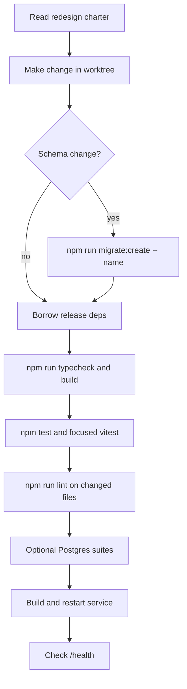

# Iteration Loop

This page covers how a contributor changes Agency HQ. The runtime dispatch loop is described in [Architecture](../architecture/).

## 1. Check the redesign constraint first

Do not add features to, or deepen dependencies on, the legacy dashboard, Kanban, backlog, sprint, meeting, CEO-agent, persona or memory mechanisms without reading the redesign charter; the notice is not authorisation for unreviewed deletion either ([CLAUDE.md:L9-L14](https://github.com/Jeffrey-Keyser/agency-hq/blob/c107e01386cfa76587ccfd868b861936c4eea8b1/CLAUDE.md#L9-L14)). The model-consumer audit repeats this for meeting and research model roles ([docs/model-consumer-audit.md:L31](https://github.com/Jeffrey-Keyser/agency-hq/blob/c107e01386cfa76587ccfd868b861936c4eea8b1/docs/model-consumer-audit.md#L31)).

## 2. Migrations

Always create migrations with `npm run migrate:create -- <name>`, which produces a sequential timestamp; never use `Date.now()` because it breaks the runner ([CLAUDE.md:L66-L70](https://github.com/Jeffrey-Keyser/agency-hq/blob/c107e01386cfa76587ccfd868b861936c4eea8b1/CLAUDE.md#L66-L70)). The scripts are wired to `scripts/run-migrate.js`, `run-migrate-down.js` and `create-migration.js` ([package.json:L17-L20](https://github.com/Jeffrey-Keyser/agency-hq/blob/c107e01386cfa76587ccfd868b861936c4eea8b1/package.json#L17-L20)). The server refuses to start if required schema elements are missing ([src/bin/www.ts:L133-L138](https://github.com/Jeffrey-Keyser/agency-hq/blob/c107e01386cfa76587ccfd868b861936c4eea8b1/src/bin/www.ts#L133-L138)).

## 3. Build and test in a clean worktree

Clean worktrees intentionally skip dependency install. `scripts/with-release-deps.sh -- <command>` reuses the deployed release's `node_modules` only when lockfile hashes match, and fails closed otherwise ([docs/clean-worktree-verification.md:L3-L18](https://github.com/Jeffrey-Keyser/agency-hq/blob/c107e01386cfa76587ccfd868b861936c4eea8b1/docs/clean-worktree-verification.md#L3-L18)). Override the release location with `AGENCY_HQ_RELEASE_DIR` ([docs/clean-worktree-verification.md:L20-L21](https://github.com/Jeffrey-Keyser/agency-hq/blob/c107e01386cfa76587ccfd868b861936c4eea8b1/docs/clean-worktree-verification.md#L20-L21)).

Useful scripts ([package.json:L8-L16](https://github.com/Jeffrey-Keyser/agency-hq/blob/c107e01386cfa76587ccfd868b861936c4eea8b1/package.json#L8-L16)):

- `npm run typecheck` (`tsc --noEmit`) and `npm run build` (`tsc`).
- `npm test` runs `npx vitest run`; pass a file path for focused runs.
- `npm run test:postgres:sessions` and `test:postgres:projection` set `AGENCY_HQ_REQUIRE_TEST_DATABASE=1` and need a test database.
- `npm run test:verify` runs `scripts/verify-notification-metrics.js`.
- `npm run lint` runs `scripts/lint-changed.sh`, which by name targets changed files; its exact behaviour is not in the provided excerpts.

Missing dev dependencies can make suites fail to load; a past audit hit this with `jsdom` and `supertest` ([docs/orchestration-explorer-cohort-comparison-verification.md:L30-L32](https://github.com/Jeffrey-Keyser/agency-hq/blob/c107e01386cfa76587ccfd868b861936c4eea8b1/docs/orchestration-explorer-cohort-comparison-verification.md#L30-L32)).

## 4. Continuous integration

No CI workflow file is included in this snapshot's excerpts, so whether CI runs and what it checks is **unknown** here. Do not assume a green build gate exists; run the commands above locally.

## 5. Ship

The documented deploy is `npm run build` followed by `systemctl --user restart agency-hq` ([README.md:L101-L106](https://github.com/Jeffrey-Keyser/agency-hq/blob/c107e01386cfa76587ccfd868b861936c4eea8b1/README.md#L101-L106)). The unit file runs from a `releases/agency-hq/current` directory, so production may be promoted through a release step not shown here ([agency-hq.service:L9-L10](https://github.com/Jeffrey-Keyser/agency-hq/blob/c107e01386cfa76587ccfd868b861936c4eea8b1/agency-hq.service#L9-L10)). `npm run build:deploy` compiles and writes a `reload_service` request into NanoClaw's IPC tasks directory ([package.json:L10](https://github.com/Jeffrey-Keyser/agency-hq/blob/c107e01386cfa76587ccfd868b861936c4eea8b1/package.json#L10)). Verify with `/health` (see [Operations](../operations/)).

## Other contributor scripts

`meeting:run`, `index:requirements`, `reconcile:replay`, `backfill:runstream`, `reconcile:runstream`, `project:runstream`, `project:reconcile`, `mockup-loop`, `graveyard:sweep` and `cleanup:ecosystem` are one-off tools ([package.json:L21-L30](https://github.com/Jeffrey-Keyser/agency-hq/blob/c107e01386cfa76587ccfd868b861936c4eea8b1/package.json#L21-L30)). The runstream ledger cutover is gated by a human-run go/no-go runbook ([README.md:L108-L113](https://github.com/Jeffrey-Keyser/agency-hq/blob/c107e01386cfa76587ccfd868b861936c4eea8b1/README.md#L108-L113)).
