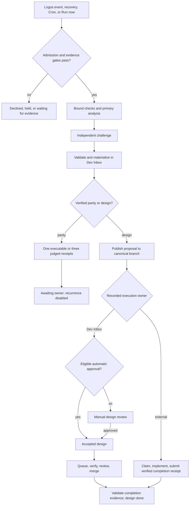

# Reconciliation lifecycle

This guide explains how one project reconciliation moves from trigger to completion. It describes the documented and implemented behavior at deployed revision `4523d08`, observed 2026-10-29. It is not a statement of live project health. Agency HQ and Dev Inbox run on Forge, and the user-facing wiki runs on Beelink.

For the dashboard steps, see [Projects guide](../projects-guide/). For requirement text and acceptance checks, see [Requirements and acceptance](../requirements-and-acceptance/). For failures, see [Projects troubleshooting](../projects-troubleshooting/). For the broader picture, see [Overview](../home/).

## Who can act

Owners sign in to `/dashboard/projects` with a Pay account whose current role is `admin`. Browser project writes also need the page CSRF token. Agency checks each Projects session against Pay, and a Pay outage fails closed for Projects access ([source](https://github.com/Jeffrey-Keyser/agency-hq/blob/4523d08c221914ed3ae6c036d227fb64c95f2566/docs/project-reconciliation.md#L3-L18)).

Automated callers use Agency HQ JWTs with an allowed role and do not need a browser session ([source](https://github.com/Jeffrey-Keyser/agency-hq/blob/4523d08c221914ed3ae6c036d227fb64c95f2566/docs/project-reconciliation.md#L20-L23)). The `leave-paused` and `resubmit` owner actions additionally require a named identity: a nonblank Pay account ID or a verified JWT subject. Identityless requests get HTTP 403 with `owner-identity-required` before any heartbeat, cron, admission, or scheduling change ([source](https://github.com/Jeffrey-Keyser/agency-hq/blob/4523d08c221914ed3ae6c036d227fb64c95f2566/docs/project-reconciliation.md#L26-L34)).

## Triggers

A run can start from four kinds of trigger.

- **Logos events.** A distinct `logos.context.changed` event activates a configured heartbeat and schedules its first run. Events for contexts without a configured heartbeat fail closed, and Agency never invents repository paths from a Logos event. Exact event replays are ignored by `event_id` ([source](https://github.com/Jeffrey-Keyser/agency-hq/blob/4523d08c221914ed3ae6c036d227fb64c95f2566/docs/project-reconciliation.md#L51-L55)).
- **Recovery.** A bounded recovery pass runs at startup and every five minutes by default. It compares each project's authoritative Logos snapshot fingerprint with the stored heartbeat. A difference atomically reactivates the project, enables Cron, and requests one `snapshot-recovery` run. The database compare-and-set prevents RabbitMQ delivery and periodic recovery from both claiming the same change ([source](https://github.com/Jeffrey-Keyser/agency-hq/blob/4523d08c221914ed3ae6c036d227fb64c95f2566/docs/project-reconciliation.md#L96-L106)). The interval is `PROJECT_RECONCILIATION_RECOVERY_INTERVAL_MS`, with a 1000 ms minimum ([source](https://github.com/Jeffrey-Keyser/agency-hq/blob/4523d08c221914ed3ae6c036d227fb64c95f2566/src/services/project-reconciliation-recovery.ts#L222-L229)).
- **Cron.** When `CRON_API_KEY` is available, Agency keeps a Cron Service job on the `project.reconciliation.requested` route. Cron-triggered runs report terminal success or failure back by a shared correlation ID ([source](https://github.com/Jeffrey-Keyser/agency-hq/blob/4523d08c221914ed3ae6c036d227fb64c95f2566/docs/project-reconciliation.md#L108-L111), [source](https://github.com/Jeffrey-Keyser/agency-hq/blob/4523d08c221914ed3ae6c036d227fb64c95f2566/docs/project-reconciliation.md#L130-L135)).
- **Run now.** An owner can trigger one admitted run with the ad hoc helper. Its `--watch` flag follows the durable phase heartbeat to completion ([source](https://github.com/Jeffrey-Keyser/agency-hq/blob/4523d08c221914ed3ae6c036d227fb64c95f2566/docs/project-reconciliation.md#L702-L714)).

The recovery pass also replays related work such as design publications, accepted-design enqueues, and acceptance drafting, in a fixed order ([source](https://github.com/Jeffrey-Keyser/agency-hq/blob/4523d08c221914ed3ae6c036d227fb64c95f2566/src/services/project-reconciliation-recovery.ts#L160-L220)).

## Registration and prerequisites

A project is registered with its Logos context, cadence, and governed repositories. Registration persists these as a `configured` heartbeat and keeps Cron disabled ([source](https://github.com/Jeffrey-Keyser/agency-hq/blob/4523d08c221914ed3ae6c036d227fb64c95f2566/docs/project-reconciliation.md#L36-L55)).

Before activation or run admission, the project needs requirement coverage. Coverage is one of `unknown`, `indexed`, `unindexed`, `stale`, or `intentionally-loopless`. A normal project needs a Dev Inbox ledger loop for its Logos context. An owner may register an intentionally loopless project with `allowLoopless`, which allows runs without a ledger, but parity receipts stay inconclusive until an index exists ([source](https://github.com/Jeffrey-Keyser/agency-hq/blob/4523d08c221914ed3ae6c036d227fb64c95f2566/docs/project-reconciliation.md#L65-L74)).

A failed reindex leaves coverage `stale`, and admission refuses runs until the index catches up. Recovery retries the reindex with exponential backoff from 15 minutes up to six hours, so a persistent failure does not spend an indexing call on every pass ([source](https://github.com/Jeffrey-Keyser/agency-hq/blob/4523d08c221914ed3ae6c036d227fb64c95f2566/src/services/project-reconciliation-recovery.ts#L59-L80)).

## Admission and capacity

Admission has several gates. Each indexer or checker pass writes a bounded evidence row with its pass ID, loop and corpus binding, requirement IDs, failure categories, duration, and provider usage. Missing usage means unknown, not zero ([source](https://github.com/Jeffrey-Keyser/agency-hq/blob/4523d08c221914ed3ae6c036d227fb64c95f2566/docs/project-reconciliation.md#L76-L83)).

The per-project design capacity limits open designs. When the durable open-design projection is at capacity, Agency declines the trigger before either reconciliation agent starts. Dev Inbox independently rechecks the same budget at promotion ([source](https://github.com/Jeffrey-Keyser/agency-hq/blob/4523d08c221914ed3ae6c036d227fb64c95f2566/docs/project-reconciliation.md#L112-L128)).

Admission also checks the run's bound corpus and application revisions. Each run snapshots the application SHA map, and that map is bound to every checker pass ([source](https://github.com/Jeffrey-Keyser/agency-hq/blob/4523d08c221914ed3ae6c036d227fb64c95f2566/docs/project-reconciliation.md#L76-L79)).

## Immutable bindings

A run binds to one corpus fingerprint and one set of repository SHAs. Those bindings do not change during the run. Failed runs keep their immutable application SHAs and a mode-0600 diagnostic receipt under `results/reconciliation/<projectId>/<runId>.failure.json` ([source](https://github.com/Jeffrey-Keyser/agency-hq/blob/4523d08c221914ed3ae6c036d227fb64c95f2566/docs/project-reconciliation.md#L130-L135)).

A code revision invalidates old satisfaction rows and resets the parity streak. Evidence from older SHAs is not reused as proof for the new revision ([source](https://github.com/Jeffrey-Keyser/agency-hq/blob/4523d08c221914ed3ae6c036d227fb64c95f2566/docs/project-reconciliation.md#L85-L94)). Judged evidence is rebound rather than invalidated when all changes fall under `PROJECT_RECONCILIATION_BINDING_IGNORE`, which defaults to `design/,ledger/` ([source](https://github.com/Jeffrey-Keyser/agency-hq/blob/4523d08c221914ed3ae6c036d227fb64c95f2566/docs/project-reconciliation.md#L439-L441)).

## Requirement evidence and the checker

Requirements are satisfied in one of two ways. Requirements with a `locked` acceptance check are decided by the check alone: all passing means satisfied, any execution error means unknown, and otherwise unsatisfied. Only results from the current run count. Those rows never go to the judged checker, which keeps its per-run cap for the rest ([source](https://github.com/Jeffrey-Keyser/agency-hq/blob/4523d08c221914ed3ae6c036d227fb64c95f2566/docs/project-reconciliation.md#L363-L371)).

The rest remain model-judged. Judged requirements appear as `judged · weak` on the dashboard ([source](https://github.com/Jeffrey-Keyser/agency-hq/blob/4523d08c221914ed3ae6c036d227fb64c95f2566/docs/project-reconciliation.md#L369-L371)).

The bounded judged-checker pass runs before the expensive primary and challenge scan. A stale selected requirement may use one priority slot, and reselection uses the same executable verdicts and exclusions ([source](https://github.com/Jeffrey-Keyser/agency-hq/blob/4523d08c221914ed3ae6c036d227fb64c95f2566/docs/project-target-selection.md#L3-L10)).

## Target selection and blocker waits

The run picks one target requirement with a deterministic order. A regression comes first, then the failing checked requirement with the largest remaining distance, then judged-unsatisfied rows, then never-verified rows. Requirements already targeted by an open design are skipped ([source](https://github.com/Jeffrey-Keyser/agency-hq/blob/4523d08c221914ed3ae6c036d227fb64c95f2566/docs/project-reconciliation.md#L372-L376)).

Two kinds of target are demoted behind fresh ones rather than removed. A certification-only target is one where nearly every failing check only reports unreviewed or uncertified observations. A repeatedly inconclusive target has been the target of two or more inconclusive runs in the last twelve completed runs, with no proposal since ([source](https://github.com/Jeffrey-Keyser/agency-hq/blob/4523d08c221914ed3ae6c036d227fb64c95f2566/docs/project-reconciliation.md#L398-L407)).

A target can also wait for evidence. The ledger may hold a bounded target deferral for an explicit unresolved blocker or a typed `runtime-binding-unavailable` result. Runtime blockers must cite an existing repository file with exact lines, checked at the bound SHA. Publication-pending items and arbitrary prose cannot create a deferral. Deferrals expire after six hours, and relevant changes invalidate them early ([source](https://github.com/Jeffrey-Keyser/agency-hq/blob/4523d08c221914ed3ae6c036d227fb64c95f2566/docs/project-target-selection.md#L14-L39)).

If every remaining eligible target is deferred, neither expensive agent runs. The server records a typed `target-evidence-blocked` wait with the target IDs. That wait resets parity streaks and follows ordinary cadence. Authority gates and existing no-progress holds are unchanged, and a missing target is never treated as permission to proceed ([source](https://github.com/Jeffrey-Keyser/agency-hq/blob/4523d08c221914ed3ae6c036d227fb64c95f2566/docs/project-target-selection.md#L41-L56)).

## Primary, challenge, and materialization

A run moves through the phase sequence `queued`, `preflight`, `primary`, `challenge`, `materialization`, then `completed` or `failed`. Each phase records duration and bounded diagnostics such as backend, model, token count, and content hashes. It does not record prompt or document bodies ([source](https://github.com/Jeffrey-Keyser/agency-hq/blob/4523d08c221914ed3ae6c036d227fb64c95f2566/docs/project-reconciliation.md#L566-L574)).

Every executable check runs in the `primary` phase before the primary agent. Scripts run against clean shared checkouts at the bound SHAs, and the canonical checkouts are never modified ([source](https://github.com/Jeffrey-Keyser/agency-hq/blob/4523d08c221914ed3ae6c036d227fb64c95f2566/docs/project-reconciliation.md#L157-L163)).

An independent challenger reviews the primary output. A challenger that leaves a gap inconclusive without a specific reason gets one reason-repair attempt, and an unreasoned repeat fails visibly ([source](https://github.com/Jeffrey-Keyser/agency-hq/blob/4523d08c221914ed3ae6c036d227fb64c95f2566/docs/project-reconciliation.md#L583-L588)). Before a run, Agency gives both agents a bounded summary of prior candidates and their challenge verdicts ([source](https://github.com/Jeffrey-Keyser/agency-hq/blob/4523d08c221914ed3ae6c036d227fb64c95f2566/docs/project-reconciliation.md#L583-L586)).

In materialization, Agency hands the output to Dev Inbox, which owns binding and the final validation boundary ([source](https://github.com/Jeffrey-Keyser/agency-hq/blob/4523d08c221914ed3ae6c036d227fb64c95f2566/docs/project-reconciliation.md#L692-L694)).

## Parity: fully checked versus judged

A parity outcome means the analysis and independent challenge found no uncovered actionable mismatch. It is accepted as verified only when the requirement index and current evidence support it and no blocking design, paused unfinished work, or implemented work awaiting verification remains ([completion evidence gate](https://github.com/Jeffrey-Keyser/agency-hq/blob/4523d08c221914ed3ae6c036d227fb64c95f2566/src/dal/project-reconciliation.ts#L1024-L1053)).

When every indexed requirement is satisfied by an executed acceptance check at the bound corpus and application revisions, one verified parity receipt reaches sustained parity. The transition sets the displayed streak to 3 and moves the project to `awaiting-owner`. If any requirement still uses judged evidence, three agreeing verified parity receipts at the same binding are required. A changed application binding resets the streak ([implemented parity transition](https://github.com/Jeffrey-Keyser/agency-hq/blob/4523d08c221914ed3ae6c036d227fb64c95f2566/src/lib/project-reconciliation-state.ts#L20-L44)).

The older blanket three-receipt wording in the source document does not describe the fully executable fast path. The implementation above resolves that ambiguity. Sustained parity disables recurrence and requests an owner decision; it is a conclusion about the bound evidence, not a guarantee about every possible product behavior ([owner notification](https://github.com/Jeffrey-Keyser/agency-hq/blob/4523d08c221914ed3ae6c036d227fb64c95f2566/src/services/project-reconciliation.ts#L423-L435)).

## Proposal publication

When a run materializes a proposal, Dev Inbox copies only the generated design into a clean worktree at the latest remote default-branch commit. It regenerates `design/INDEX.json`, verifies that exactly one design changed, and pushes the commit. A concurrent remote push is retried up to three times ([source](https://github.com/Jeffrey-Keyser/agency-hq/blob/4523d08c221914ed3ae6c036d227fb64c95f2566/docs/project-reconciliation.md#L620-L627)).

Publication verifies cited code lines in every governed repository against the run's bound revision. If verification, the catalog update, the commit, or the push fails, the local proposal stays inspectable and its GitHub link is suppressed until publication succeeds ([source](https://github.com/Jeffrey-Keyser/agency-hq/blob/4523d08c221914ed3ae6c036d227fb64c95f2566/docs/project-reconciliation.md#L627-L635)).

## Approval: automatic and manual

`autoApproveDesigns` defaults to `true`, and owners can change it per project. Enabling it scans existing eligible proposals right away ([source](https://github.com/Jeffrey-Keyser/agency-hq/blob/4523d08c221914ed3ae6c036d227fb64c95f2566/docs/project-reconciliation.md#L57-L63)).

For a Dev Inbox-owned design with automatic approval on, a completed, conflict-free run whose blocking proposal was published to the canonical Dev Inbox branch moves the proposal to `accepted`. The worker rechecks policy under a per-design advisory lock. A staged or unavailable publication raises a recovery notification and is never treated as an approval request ([source](https://github.com/Jeffrey-Keyser/agency-hq/blob/4523d08c221914ed3ae6c036d227fb64c95f2566/docs/project-reconciliation.md#L637-L644)). With the switch off, the owner gets a manual Telegram review card instead ([source](https://github.com/Jeffrey-Keyser/agency-hq/blob/4523d08c221914ed3ae6c036d227fb64c95f2566/docs/project-reconciliation.md#L644-L646)).

## Dev Inbox queue, verification, review, and completion

An accepted design is queued in Dev Inbox. Jobs default to automatic queue acceptance after verification and an approving independent review. A job with `reviewMode: manual` stops at the branch review boundary. Queue pause, release, and merge controls still apply ([source](https://github.com/Jeffrey-Keyser/agency-hq/blob/4523d08c221914ed3ae6c036d227fb64c95f2566/docs/project-reconciliation.md#L646-L652)). A manual opt-in lives in Dev Inbox policy, and the choice is bound when Agency enqueues the job ([source](https://github.com/Jeffrey-Keyser/agency-hq/blob/4523d08c221914ed3ae6c036d227fb64c95f2566/docs/project-reconciliation.md#L681-L685)).

Completion waits for evidence. The updater checks the exact bound queue attempt, the merged candidate, and every slice review before it marks the design done. It never infers completion from an event alone ([source](https://github.com/Jeffrey-Keyser/agency-hq/blob/4523d08c221914ed3ae6c036d227fb64c95f2566/docs/project-reconciliation.md#L652-L661)). Short retries cover the gap before queue collection, and the recovery pass covers missed events. A succeeded queue job alone does not close a design ([source](https://github.com/Jeffrey-Keyser/agency-hq/blob/4523d08c221914ed3ae6c036d227fb64c95f2566/docs/runbooks/project-queue-recovery.md#L65-L77)).

A plan with a `terminal-complete-merge-pending` handoff has not passed its merge gate yet. If it persists, inspect the automatic sign-off result, slice evidence, and integration diff before using the native manual sign-off control ([source](https://github.com/Jeffrey-Keyser/agency-hq/blob/4523d08c221914ed3ae6c036d227fb64c95f2566/docs/runbooks/project-queue-recovery.md#L53-L63)).

## No-progress holds and owner actions

The guard tracks repeated inconclusive visits. An admission holds further automatic runs after three inconclusive visits to the same cited code seam, or five consecutive inconclusive runs at the same corpus and application binding. A commit that leaves the cited lines unchanged still counts as the same seam ([source](https://github.com/Jeffrey-Keyser/agency-hq/blob/4523d08c221914ed3ae6c036d227fb64c95f2566/docs/project-reconciliation.md#L588-L599)).

The hold is a durable `rejected-no-progress` admission with owner attention. It does not assert parity or resolve a document conflict. A changed corpus or cited code can admit another run. So can an explicit owner resubmit after review ([source](https://github.com/Jeffrey-Keyser/agency-hq/blob/4523d08c221914ed3ae6c036d227fb64c95f2566/docs/project-reconciliation.md#L594-L599)).

Repeated operational failures pause recurrence and disable the synchronized Cron job; the default threshold is three. Inspect the retained failure receipts and the pause cause. Recovery can reactivate an operationally paused project after the design store checks clean and an exponential cooldown has elapsed (30 minutes initially by default). Automatic reactivation has a bounded budget, default three until a run completes; when it is spent, the owner must fix the cause and reactivate. An explicit owner pause is separate from this operational recovery policy ([operational failure threshold](https://github.com/Jeffrey-Keyser/agency-hq/blob/4523d08c221914ed3ae6c036d227fb64c95f2566/src/services/project-reconciliation.ts#L627-L650), [automatic recovery](https://github.com/Jeffrey-Keyser/agency-hq/blob/4523d08c221914ed3ae6c036d227fb64c95f2566/src/services/project-reconciliation.ts#L568-L607), [recovery budget](https://github.com/Jeffrey-Keyser/agency-hq/blob/4523d08c221914ed3ae6c036d227fb64c95f2566/src/services/project-reconciliation.ts#L40-L51)). The owner action route accepts `leave-paused`, `resubmit`, and `reactivate` ([source](https://github.com/Jeffrey-Keyser/agency-hq/blob/4523d08c221914ed3ae6c036d227fb64c95f2566/docs/project-reconciliation.md#L697-L700)).

## Lifecycle at a glance

## Related guides

- [Projects guide](../projects-guide/)
- [Requirements and acceptance](../requirements-and-acceptance/)
- [Projects troubleshooting](../projects-troubleshooting/)
- [Overview](../home/)
- Operator references in the source: [project reconciliation](https://github.com/Jeffrey-Keyser/agency-hq/blob/4523d08c221914ed3ae6c036d227fb64c95f2566/docs/project-reconciliation.md), [target selection](https://github.com/Jeffrey-Keyser/agency-hq/blob/4523d08c221914ed3ae6c036d227fb64c95f2566/docs/project-target-selection.md), [queue recovery](https://github.com/Jeffrey-Keyser/agency-hq/blob/4523d08c221914ed3ae6c036d227fb64c95f2566/docs/runbooks/project-queue-recovery.md), [external execution](https://github.com/Jeffrey-Keyser/agency-hq/blob/4523d08c221914ed3ae6c036d227fb64c95f2566/docs/operations/external-project-execution.md)
