# Architecture

AI Proxy runs as one Node process. `server/app.ts` builds a `ServerConfig` and passes it to `createExpressApp`. The resulting app is cached and returned by `getExpressApp()` ([server/app.ts:L121](https://github.com/Jeffrey-Keyser/ai-proxy/blob/bdbfe33bbacd4b9ca75b10e845c2ed11fc3f79df/server/app.ts#L121), [server/app.ts:L288-L298](https://github.com/Jeffrey-Keyser/ai-proxy/blob/bdbfe33bbacd4b9ca75b10e845c2ed11fc3f79df/server/app.ts#L288-L298)).

`server/bin/www.ts` performs startup in this order ([server/bin/www.ts:L10-L26](https://github.com/Jeffrey-Keyser/ai-proxy/blob/bdbfe33bbacd4b9ca75b10e845c2ed11fc3f79df/server/bin/www.ts#L10-L26)):

1. Initialise OpenTelemetry.
2. Import the app.
3. Call `listen`. If `ANTHROPIC_API_KEY` is set, it also starts the batch worker (`startBatchWorker`, `server/routes/batches.ts`). The worker is stopped on shutdown.

```mermaid
flowchart LR
  Client["Client app"] --> Edge["Cloudflare Tunnel"]
  Edge --> Corr["correlationId middleware"]
  Corr --> SvcKey["serviceApiKey gate"]
  SvcKey --> Pay["Pay auth middleware"]
  Pay --> Routes["Routers under /v1, /auth, /internal, /api/v1"]
  Routes --> AppAuth["applicationAuth"]
  AppAuth --> Rate["rateLimit"]
  Rate --> Managed["managedModel"]
  Managed --> Budget["anthropicBudget"]
  Budget --> Cache["responseCache"]
  Cache --> Usage["usageTracking"]
  Usage --> Ctrl["Controllers and domain services"]
  Ctrl --> Prov["Provider clients"]
  Prov --> Ext["OpenAI, Anthropic, Gemini, Meta, OpenRouter, ElevenLabs, TypeSafe"]
  Ctrl --> DAL["DAL classes"]
  Cache --> DAL
  Usage --> DAL
  DAL --> PG["PostgreSQL"]
```

## Components

**Global middleware.** A correlation-ID middleware runs first, followed by the service API key gate ([server/app.ts:L259-L264](https://github.com/Jeffrey-Keyser/ai-proxy/blob/bdbfe33bbacd4b9ca75b10e845c2ed11fc3f79df/server/app.ts#L259-L264)). After the routes, `githubErrorMiddleware` reports errors against `Jeffrey-Keyser/ai-proxy` ([server/app.ts:L281-L283](https://github.com/Jeffrey-Keyser/ai-proxy/blob/bdbfe33bbacd4b9ca75b10e845c2ed11fc3f79df/server/app.ts#L281-L283)).

**Factory settings.**
- CORS is enabled and allows the `X-Model-Source` header.
- The JSON body limit is 10 MB, sized for base64 images.
- Sessions are stored in PostgreSQL ([server/app.ts:L130-L163](https://github.com/Jeffrey-Keyser/ai-proxy/blob/bdbfe33bbacd4b9ca75b10e845c2ed11fc3f79df/server/app.ts#L130-L163)).

**Pay auth.** `setupPayAuth` proxies authentication to the Pay service. A list of public routes bypasses it, including provider routes that use application keys instead ([server/app.ts:L63-L105](https://github.com/Jeffrey-Keyser/ai-proxy/blob/bdbfe33bbacd4b9ca75b10e845c2ed11fc3f79df/server/app.ts#L63-L105)). `/v1/batches` is in this public list because it authenticates with application keys.

**Routers.** All mount points are declared in one table ([server/app.ts:L203-L219](https://github.com/Jeffrey-Keyser/ai-proxy/blob/bdbfe33bbacd4b9ca75b10e845c2ed11fc3f79df/server/app.ts#L203-L219)). They include:
- applications, chat, batches, async chat, transcription, TTS, System One, image, usage and diagnostics
- `/internal/model-consumers`
- `/internal/anthropic-budget`

**Per-route pipelines.**
- Chat runs application auth, rate limit, `managedModel('chat')`, the budget guard, cache and usage tracking ([server/routes/chat.ts:L351-L360](https://github.com/Jeffrey-Keyser/ai-proxy/blob/bdbfe33bbacd4b9ca75b10e845c2ed11fc3f79df/server/routes/chat.ts#L351-L360)).
- TTS has no cache step. Instead it tracks character counts manually when the audio stream ends ([server/routes/textToSpeech.ts:L104-L110](https://github.com/Jeffrey-Keyser/ai-proxy/blob/bdbfe33bbacd4b9ca75b10e845c2ed11fc3f79df/server/routes/textToSpeech.ts#L104-L110), [server/routes/textToSpeech.ts:L173-L195](https://github.com/Jeffrey-Keyser/ai-proxy/blob/bdbfe33bbacd4b9ca75b10e845c2ed11fc3f79df/server/routes/textToSpeech.ts#L173-L195)).
- Batches (`/v1/batches`) use application auth and a `MessageBatchService`, not the realtime chat pipeline. The router requires `X-Model-Source: request` on submission (`server/routes/batches.ts`).

**Durable Claude batches.** `MessageBatchService` (`server/batch/service.ts`) admits each submission in one PostgreSQL transaction under a shared advisory lock. It checks app metadata, the allowance, the shared Claude caps and daily quotas, then inserts a `message_batches` job and `message_batch_items` reservations. Provider submission happens after that transaction, with SDK retries disabled. Request validation and cost estimates live in `server/batch/contracts.ts`. The Anthropic adapter is `server/batch/provider.ts`. The schema is `server/db/migrations/009_create_message_batches.sql`.

**Domain services.** These cover chat completion, usage tracking, rate limiting, async jobs, job cleanup and health checks ([server/domain/services/index.ts:L1-L10](https://github.com/Jeffrey-Keyser/ai-proxy/blob/bdbfe33bbacd4b9ca75b10e845c2ed11fc3f79df/server/domain/services/index.ts#L1-L10)). `AnthropicBudgetService` prices successful `claude-%` rows for the current credit cycle and caches the result for 30 seconds ([server/domain/services/AnthropicBudgetService.ts:L18-L20](https://github.com/Jeffrey-Keyser/ai-proxy/blob/bdbfe33bbacd4b9ca75b10e845c2ed11fc3f79df/server/domain/services/AnthropicBudgetService.ts#L18-L20), [server/domain/services/AnthropicBudgetService.ts:L89-L96](https://github.com/Jeffrey-Keyser/ai-proxy/blob/bdbfe33bbacd4b9ca75b10e845c2ed11fc3f79df/server/domain/services/AnthropicBudgetService.ts#L89-L96)). Unsettled batch reservations are now added to spend when checking the monthly and daily caps. The status also reports `reservedUsd` when it is non-zero. Batch rows with `processing_mode: 'batch'` use their stored `cost_usd`.

**Provider layer.** `ProviderFactory` selects a client per model, so Anthropic-bound models are routed correctly ([server/routes/chat.ts:L37-L40](https://github.com/Jeffrey-Keyser/ai-proxy/blob/bdbfe33bbacd4b9ca75b10e845c2ed11fc3f79df/server/routes/chat.ts#L37-L40)). `AnthropicClient` makes Claude behave like OpenAI for callers ([server/infrastructure/providers/AnthropicClient.ts:L34-L56](https://github.com/Jeffrey-Keyser/ai-proxy/blob/bdbfe33bbacd4b9ca75b10e845c2ed11fc3f79df/server/infrastructure/providers/AnthropicClient.ts#L34-L56)):
- It removes sampling parameters that Claude 5.x rejects.
- It maps `reasoning_effort` to Anthropic's effort setting.
- It translates stop reasons into OpenAI `finish_reason` values.

**DAL.** These are raw parameterised SQL classes over a shared `pg` pool:
- `ApplicationDal` checks bcrypt hashes by scanning every application ([server/dal/ApplicationDal.ts:L54-L79](https://github.com/Jeffrey-Keyser/ai-proxy/blob/bdbfe33bbacd4b9ca75b10e845c2ed11fc3f79df/server/dal/ApplicationDal.ts#L54-L79)).
- `RequestLogDal` writes the request log and upserts the daily summary in one transaction ([server/dal/RequestLogDal.ts:L31-L100](https://github.com/Jeffrey-Keyser/ai-proxy/blob/bdbfe33bbacd4b9ca75b10e845c2ed11fc3f79df/server/dal/RequestLogDal.ts#L31-L100)). Its usage summaries also return batch token and cost totals, so batch spend is not billed at realtime rates.

**Worker.** `server/worker.ts` is written as a Lambda handler. It processes chat and image jobs and also handles a `cleanup` action ([server/worker.ts:L1-L14](https://github.com/Jeffrey-Keyser/ai-proxy/blob/bdbfe33bbacd4b9ca75b10e845c2ed11fc3f79df/server/worker.ts#L1-L14), [server/worker.ts:L172-L194](https://github.com/Jeffrey-Keyser/ai-proxy/blob/bdbfe33bbacd4b9ca75b10e845c2ed11fc3f79df/server/worker.ts#L172-L194)). The provided source does not show how it is invoked on the self-hosted deployment. The batch poller is separate: it runs in-process on a 30-second timer, using PostgreSQL leases.

## Contracts

- **Request ID.** Every response carries `X-Request-ID`. A value sent by the caller is reused ([server/middleware/correlationId.ts:L23-L27](https://github.com/Jeffrey-Keyser/ai-proxy/blob/bdbfe33bbacd4b9ca75b10e845c2ed11fc3f79df/server/middleware/correlationId.ts#L23-L27)).
- **Chat response.** Chat responses include a `metadata` block with `trace_id`, `application_id` and `latency_ms` ([server/controllers/ChatController.ts:L102-L113](https://github.com/Jeffrey-Keyser/ai-proxy/blob/bdbfe33bbacd4b9ca75b10e845c2ed11fc3f79df/server/controllers/ChatController.ts#L102-L113)).
- **Quota errors.** Exceeding a quota returns `429 RATE_LIMIT_EXCEEDED` with quota details and a reset time at the next UTC midnight ([server/middleware/rateLimit.ts:L65-L81](https://github.com/Jeffrey-Keyser/ai-proxy/blob/bdbfe33bbacd4b9ca75b10e845c2ed11fc3f79df/server/middleware/rateLimit.ts#L65-L81)).
- **Claude budget errors.** The proxy's own guard returns `429 ANTHROPIC_BUDGET_EXHAUSTED` ([server/middleware/anthropicBudget.ts:L22-L33](https://github.com/Jeffrey-Keyser/ai-proxy/blob/bdbfe33bbacd4b9ca75b10e845c2ed11fc3f79df/server/middleware/anthropicBudget.ts#L22-L33)). An empty Anthropic credit balance returns `402 PROVIDER_CREDITS_EXHAUSTED` ([server/infrastructure/providers/AnthropicClient.ts:L312-L320](https://github.com/Jeffrey-Keyser/ai-proxy/blob/bdbfe33bbacd4b9ca75b10e845c2ed11fc3f79df/server/infrastructure/providers/AnthropicClient.ts#L312-L320)).
- **Batch submission.** `POST /v1/batches` returns `202` with a local UUID and durable state after admission succeeds. Admission failures use codes such as `BATCH_BUDGET_EXHAUSTED`, `BATCH_BUDGET_EXPIRED`, `BATCH_NOT_ENABLED`, `ANTHROPIC_BUDGET_EXHAUSTED` and `APPLICATION_QUOTA_EXCEEDED`. Reusing an idempotency key with a different payload returns `409 IDEMPOTENCY_CONFLICT`. Unexpected failures return `503 BATCH_SERVICE_UNAVAILABLE` without upstream detail (`server/routes/batches.ts`, `server/batch/service.ts`).
- **Async chat.** `POST /v1/chat/async` returns `202` with `ticket_id` and `poll_url`. An optional `callback_url` can be supplied ([server/routes/chatAsync.ts:L171-L172](https://github.com/Jeffrey-Keyser/ai-proxy/blob/bdbfe33bbacd4b9ca75b10e845c2ed11fc3f79df/server/routes/chatAsync.ts#L171-L172), [server/routes/chatAsync.ts:L270-L282](https://github.com/Jeffrey-Keyser/ai-proxy/blob/bdbfe33bbacd4b9ca75b10e845c2ed11fc3f79df/server/routes/chatAsync.ts#L270-L282)).
- **Auth error mapping.** 401 and 403 errors raised by `@jeffrey-keyser/api-errors` are matched by constructor name, because `instanceof` checks fail across the package boundary ([server/app.ts:L233-L255](https://github.com/Jeffrey-Keyser/ai-proxy/blob/bdbfe33bbacd4b9ca75b10e845c2ed11fc3f79df/server/app.ts#L233-L255)).

Related pages: [Services and Dependencies](../services-and-dependencies/), [Glossary](../glossary/).
