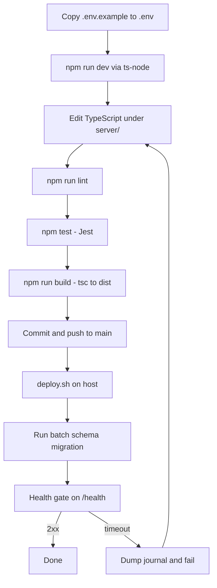

# Iteration Loop

All active development happens in the `server/` workspace. Its npm scripts cover the dev server, build, lint and tests ([server/package.json:L5-L15](https://github.com/Jeffrey-Keyser/ai-proxy/blob/bdbfe33bbacd4b9ca75b10e845c2ed11fc3f79df/server/package.json#L5-L15)).

## 1. Local setup

1. From `server/`, copy `.env.example` to `.env`.
2. Run `npm install`.
3. Run `npm run dev`, which starts `ts-node ./bin/www.ts` ([README.md:L106-L114](https://github.com/Jeffrey-Keyser/ai-proxy/blob/bdbfe33bbacd4b9ca75b10e845c2ed11fc3f79df/README.md#L106-L114), [server/package.json:L7](https://github.com/Jeffrey-Keyser/ai-proxy/blob/bdbfe33bbacd4b9ca75b10e845c2ed11fc3f79df/server/package.json#L7)).

Startup fails fast if any of these are missing ([server/config/env.ts:L127-L132](https://github.com/Jeffrey-Keyser/ai-proxy/blob/bdbfe33bbacd4b9ca75b10e845c2ed11fc3f79df/server/config/env.ts#L127-L132), [server/config/env.ts:L221-L231](https://github.com/Jeffrey-Keyser/ai-proxy/blob/bdbfe33bbacd4b9ca75b10e845c2ed11fc3f79df/server/config/env.ts#L221-L231), [server/config/env.ts:L282](https://github.com/Jeffrey-Keyser/ai-proxy/blob/bdbfe33bbacd4b9ca75b10e845c2ed11fc3f79df/server/config/env.ts#L282)):
- `NODE_ENV`
- `AI_PROXY_API_KEY`
- `ORIGIN_BASE_URL`, `CORS_ALLOWED_ORIGINS`, `SESSION_SECRET`, `JWT_SECRET`, `PAY_SERVICE_URL` and `OPENAI_API_KEY`

## 2. Lint, test, build

- **Lint.** `npm run lint` runs ESLint 9 with a flat config. `no-console` and `no-explicit-any` produce warnings, not errors ([server/eslint.config.js:L35-L46](https://github.com/Jeffrey-Keyser/ai-proxy/blob/bdbfe33bbacd4b9ca75b10e845c2ed11fc3f79df/server/eslint.config.js#L35-L46)).
- **Test.** `npm test` runs Jest with ts-jest.
  - Tests are any files under `__tests__` or named `*.test.ts` / `*.spec.ts`.
  - The setup file is `tests/setup.ts` ([server/jest.config.js:L1-L20](https://github.com/Jeffrey-Keyser/ai-proxy/blob/bdbfe33bbacd4b9ca75b10e845c2ed11fc3f79df/server/jest.config.js#L1-L20)).
  - Tests live in `server/tests/__tests__/` and mocks in `server/tests/__mocks__/` ([CLAUDE.md:L318-L319](https://github.com/Jeffrey-Keyser/ai-proxy/blob/bdbfe33bbacd4b9ca75b10e845c2ed11fc3f79df/CLAUDE.md#L318-L319)).
  - To run one file: `npm test -- path/to/test.test.ts` ([CLAUDE.md:L59-L60](https://github.com/Jeffrey-Keyser/ai-proxy/blob/bdbfe33bbacd4b9ca75b10e845c2ed11fc3f79df/CLAUDE.md#L59-L60)).
  - The batch PostgreSQL lifecycle suite (`server/tests/__tests__/batch/message-batches.postgres.test.ts`) runs only when `BATCH_TEST_CONFIG_FILE` points to a private `pg` Pool config. It creates and drops a random isolated schema. Without that file, its DB cases are skipped (README).
- **Provider costs in tests.** The image-provider tests make no billable calls ([docs/image-model-setup.md:L44-L45](https://github.com/Jeffrey-Keyser/ai-proxy/blob/bdbfe33bbacd4b9ca75b10e845c2ed11fc3f79df/docs/image-model-setup.md#L44-L45)). Model-control validation uses mocked model calls ([docs/model-controls.md:L13](https://github.com/Jeffrey-Keyser/ai-proxy/blob/bdbfe33bbacd4b9ca75b10e845c2ed11fc3f79df/docs/model-controls.md#L13)).
- **Build.** `npm run build` runs `tsc` with strict ES2020 settings and writes to `dist/`. The `tests` directory is excluded from compilation ([server/tsconfig.json:L3-L8](https://github.com/Jeffrey-Keyser/ai-proxy/blob/bdbfe33bbacd4b9ca75b10e845c2ed11fc3f79df/server/tsconfig.json#L3-L8), [server/tsconfig.json:L25](https://github.com/Jeffrey-Keyser/ai-proxy/blob/bdbfe33bbacd4b9ca75b10e845c2ed11fc3f79df/server/tsconfig.json#L25)).

## 3. Contributor conventions

The documented workflow ([CLAUDE.md:L344-L353](https://github.com/Jeffrey-Keyser/ai-proxy/blob/bdbfe33bbacd4b9ca75b10e845c2ed11fc3f79df/CLAUDE.md#L344-L353)):
- Keep TypeScript types intact.
- Update the Swagger JSDoc when you change an endpoint.
- Run tests and lint before committing.

Swagger collects annotations from `./routes/**/*.ts` and is disabled when `NODE_ENV=test` ([server/app.ts:L181-L187](https://github.com/Jeffrey-Keyser/ai-proxy/blob/bdbfe33bbacd4b9ca75b10e845c2ed11fc3f79df/server/app.ts#L181-L187)). Notable changes go under `## [Unreleased]` in the changelog ([CHANGELOG.md:L8-L11](https://github.com/Jeffrey-Keyser/ai-proxy/blob/bdbfe33bbacd4b9ca75b10e845c2ed11fc3f79df/CHANGELOG.md#L8-L11)).

## 4. Shipping

CLAUDE.md says pushes to main use `deploy.sh`. The script does a lockfile-exact install, builds, runs the batch schema migration, restarts the systemd service and then applies a health gate ([CLAUDE.md:L162](https://github.com/Jeffrey-Keyser/ai-proxy/blob/bdbfe33bbacd4b9ca75b10e845c2ed11fc3f79df/CLAUDE.md#L162), [deploy.sh](https://github.com/Jeffrey-Keyser/ai-proxy/blob/9feca9aa4e6057291add262fc1cf268f2abff052/deploy.sh)). The deployment guide lists the steps as ([docs/deployment.md:L146-L158](https://github.com/Jeffrey-Keyser/ai-proxy/blob/bdbfe33bbacd4b9ca75b10e845c2ed11fc3f79df/docs/deployment.md#L146-L158)):

1. `git pull`
2. `npm install`
3. `npm run build`, with build errors no longer masked
4. Run `node scripts/migrate-batches.cjs` from the server directory. This applies the additive `009_create_message_batches.sql` migration. It must run before the new server starts.
5. `systemctl restart`
6. Poll `/health`; on timeout, dump the journal and exit non-zero

The two documents disagree in two places:
- **Install command:** the guide says `npm install`, while CLAUDE.md says the install is lockfile-exact.
- **Health URL:** the guide's default is `127.0.0.1:3001`, while CLAUDE.md says `127.0.0.1:3005`.

The migration step is not yet described in the deployment guide. The `deploy.sh` file itself was not part of the original snapshot, so the other steps remain unconfirmed.

**CI status is unknown.** No GitHub Actions workflow files were provided. The Lambda/ECR pipeline described in CLAUDE.md is labelled legacy ([CLAUDE.md:L187](https://github.com/Jeffrey-Keyser/ai-proxy/blob/bdbfe33bbacd4b9ca75b10e845c2ed11fc3f79df/CLAUDE.md#L187), [CLAUDE.md:L336-L342](https://github.com/Jeffrey-Keyser/ai-proxy/blob/bdbfe33bbacd4b9ca75b10e845c2ed11fc3f79df/CLAUDE.md#L336-L342)). It is also not documented here how a push to main triggers `deploy.sh` on the host.

## 5. Feedback loop

Errors that reach the after-route middleware are passed to `githubErrorMiddleware` for this repository ([server/app.ts:L281-L283](https://github.com/Jeffrey-Keyser/ai-proxy/blob/bdbfe33bbacd4b9ca75b10e845c2ed11fc3f79df/server/app.ts#L281-L283)). That feeds production failures back into the issue tracker. For runtime checks after a deploy, see [Operations](../operations/).
