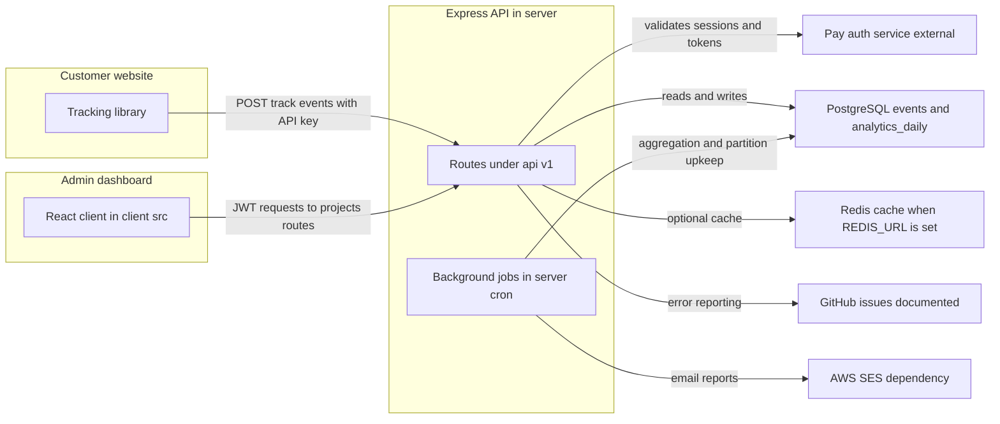

# Architecture

Analytics-Pulse has three deliverables: a tracking library used on customer sites, an Express API, and a React admin client ([docs/ARCHITECTURE.md:L7-L11](https://github.com/Jeffrey-Keyser/analytics-pulse/blob/32744d978fd9eb0cd42b8198bd04d3ef4c0f3cea/docs/ARCHITECTURE.md#L7-L11)). The API holds the state. The tracker and client call it over HTTP.

## Component map

The diagram shows configured or documented paths. Whether SES, Redis, and GitHub calls run in a given environment is not confirmed by these excerpts.

## Role contracts

**Composition root (`server/app.ts`).** The app is built with `createServerlessAppSync` from `express-server-factory`, covering CORS, sessions, Pay auth, health, Swagger, and routes ([server/app.ts:L1-L5](https://github.com/Jeffrey-Keyser/analytics-pulse/blob/32744d978fd9eb0cd42b8198bd04d3ef4c0f3cea/server/app.ts#L1-L5), [server/app.ts:L139-L197](https://github.com/Jeffrey-Keyser/analytics-pulse/blob/32744d978fd9eb0cd42b8198bd04d3ef4c0f3cea/server/app.ts#L139-L197)). Sessions use a `user_sessions` table with a 24-hour TTL ([server/app.ts:L164-L170](https://github.com/Jeffrey-Keyser/analytics-pulse/blob/32744d978fd9eb0cd42b8198bd04d3ef4c0f3cea/server/app.ts#L164-L170)). CLAUDE.md describes wrapping with serverless-http for Lambda ([CLAUDE.md:L222](https://github.com/Jeffrey-Keyser/analytics-pulse/blob/32744d978fd9eb0cd42b8198bd04d3ef4c0f3cea/CLAUDE.md#L222)); the handler file is not in these excerpts.

**Public and authenticated routes.** The Pay middleware bypasses auth for health, diagnostics, track, errors, unsubscribe, Swagger, and root ([server/app.ts:L90-L108](https://github.com/Jeffrey-Keyser/analytics-pulse/blob/32744d978fd9eb0cd42b8198bd04d3ef4c0f3cea/server/app.ts#L90-L108)). The v1 router mounts public routes for tracking, errors, unsubscribe, and diagnostics, user-authenticated project routes, and admin-only aggregation, partitions, and performance ([server/routes/versions/v1/index.ts:L73-L149](https://github.com/Jeffrey-Keyser/analytics-pulse/blob/32744d978fd9eb0cd42b8198bd04d3ef4c0f3cea/server/routes/versions/v1/index.ts#L73-L149)).

**Versioning.** Version negotiation runs before legacy redirect and version validation for version 1 ([server/app.ts:L264-L270](https://github.com/Jeffrey-Keyser/analytics-pulse/blob/32744d978fd9eb0cd42b8198bd04d3ef4c0f3cea/server/app.ts#L264-L270)). CLAUDE.md documents the `API-Version` header and 301 redirects from `/v1/*` ([CLAUDE.md:L168-L175](https://github.com/Jeffrey-Keyser/analytics-pulse/blob/32744d978fd9eb0cd42b8198bd04d3ef4c0f3cea/CLAUDE.md#L168-L175)).

**Data access.** DAL classes extend `BaseDal` and use raw SQL with transaction support ([CLAUDE.md:L219-L221](https://github.com/Jeffrey-Keyser/analytics-pulse/blob/32744d978fd9eb0cd42b8198bd04d3ef4c0f3cea/CLAUDE.md#L219-L221)). The domain layer is a placeholder for future work ([server/domain/entities/index.ts:L1-L3](https://github.com/Jeffrey-Keyser/analytics-pulse/blob/32744d978fd9eb0cd42b8198bd04d3ef4c0f3cea/server/domain/entities/index.ts#L1-L3)). Individual DAL and service files are not in these excerpts.

**Background jobs.** Jobs start from `startBackgroundJobs` unless the environment is `test` and each job's flag gates it ([server/app.ts:L48-L79](https://github.com/Jeffrey-Keyser/analytics-pulse/blob/32744d978fd9eb0cd42b8198bd04d3ef4c0f3cea/server/app.ts#L48-L79)). Flags default to enabled unless set to `false` ([server/config/env.ts:L142-L152](https://github.com/Jeffrey-Keyser/analytics-pulse/blob/32744d978fd9eb0cd42b8198bd04d3ef4c0f3cea/server/config/env.ts#L142-L152)). Runtime status is served at the runtime diagnostics route ([server/routes/diagnostics.ts:L120-L122](https://github.com/Jeffrey-Keyser/analytics-pulse/blob/32744d978fd9eb0cd42b8198bd04d3ef4c0f3cea/server/routes/diagnostics.ts#L120-L122)).

**Admin client.** Data access goes through RTK Query slices exported from `client/src/reducers` ([client/src/reducers/index.ts:L1-L6](https://github.com/Jeffrey-Keyser/analytics-pulse/blob/32744d978fd9eb0cd42b8198bd04d3ef4c0f3cea/client/src/reducers/index.ts#L1-L6)). Containers manage state and components render UI ([CLAUDE.md:L226](https://github.com/Jeffrey-Keyser/analytics-pulse/blob/32744d978fd9eb0cd42b8198bd04d3ef4c0f3cea/CLAUDE.md#L226)).

**Tracking library.** The package exports `AnalyticsPulse`, `Sender`, `EventQueue`, and `SessionManager` ([tracking-library/src/index.ts:L7-L10](https://github.com/Jeffrey-Keyser/analytics-pulse/blob/32744d978fd9eb0cd42b8198bd04d3ef4c0f3cea/tracking-library/src/index.ts#L7-L10)). Rollup builds UMD, ESM, and CJS outputs ([tracking-library/rollup.config.js:L22-L30](https://github.com/Jeffrey-Keyser/analytics-pulse/blob/32744d978fd9eb0cd42b8198bd04d3ef4c0f3cea/tracking-library/rollup.config.js#L22-L30)).

**Infrastructure.** Terraform lives in `terraform/`, with legacy modules and a planned move to an external module ([CLAUDE.md:L233-L236](https://github.com/Jeffrey-Keyser/analytics-pulse/blob/32744d978fd9eb0cd42b8198bd04d3ef4c0f3cea/CLAUDE.md#L233-L236)). Terraform deployment is manual ([CLAUDE.md:L240](https://github.com/Jeffrey-Keyser/analytics-pulse/blob/32744d978fd9eb0cd42b8198bd04d3ef4c0f3cea/CLAUDE.md#L240)).
