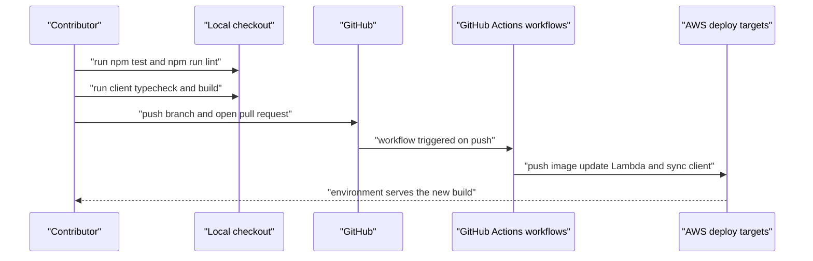

# Iteration Loop

Changes move from a local branch through lint and tests, then a pull request. Deployment after merge is driven by workflows that the excerpts describe but do not include.

## Local setup

Contributors can use Docker or a manual setup. The Docker path copies `.env.docker.example` and runs `./scripts/docker-dev.sh` ([CONTRIBUTING.md:L95-L103](https://github.com/Jeffrey-Keyser/analytics-pulse/blob/32744d978fd9eb0cd42b8198bd04d3ef4c0f3cea/CONTRIBUTING.md#L95-L103)). The manual path installs server dependencies, copies `.env`, runs `./deploy.sh` under `db`, and starts `npm run dev` ([CONTRIBUTING.md:L108-L123](https://github.com/Jeffrey-Keyser/analytics-pulse/blob/32744d978fd9eb0cd42b8198bd04d3ef4c0f3cea/CONTRIBUTING.md#L108-L123)). The server dev script runs `ts-node ./bin/www.ts` ([server/package.json:L7](https://github.com/Jeffrey-Keyser/analytics-pulse/blob/32744d978fd9eb0cd42b8198bd04d3ef4c0f3cea/server/package.json#L7)).

The guide expects the server at `localhost:3001` and the client at `localhost:3002` ([CONTRIBUTING.md:L141-L148](https://github.com/Jeffrey-Keyser/analytics-pulse/blob/32744d978fd9eb0cd42b8198bd04d3ef4c0f3cea/CONTRIBUTING.md#L141-L148)). The Vite dev port is set to 3002 ([client/vite.config.js:L7](https://github.com/Jeffrey-Keyser/analytics-pulse/blob/32744d978fd9eb0cd42b8198bd04d3ef4c0f3cea/client/vite.config.js#L7)).

## Branch and change

- Branches use prefixes such as `feature/`, `fix/`, `docs/`, and `test/` ([CONTRIBUTING.md:L167-L173](https://github.com/Jeffrey-Keyser/analytics-pulse/blob/32744d978fd9eb0cd42b8198bd04d3ef4c0f3cea/CONTRIBUTING.md#L167-L173)).
- New API endpoints are mounted in the v1 router and documented with Swagger JSDoc ([CLAUDE.md:L191-L198](https://github.com/Jeffrey-Keyser/analytics-pulse/blob/32744d978fd9eb0cd42b8198bd04d3ef4c0f3cea/CLAUDE.md#L191-L198)).

## Verify gates

Server tests run with `npm test`, and the server lint script runs ESLint over `.ts` files ([server/package.json:L10-L11](https://github.com/Jeffrey-Keyser/analytics-pulse/blob/32744d978fd9eb0cd42b8198bd04d3ef4c0f3cea/server/package.json#L10-L11)). Client tests use Vitest, and the client has `lint`, `typecheck` against `tsconfig.ci.json`, and `build` scripts ([client/package.json:L34-L38](https://github.com/Jeffrey-Keyser/analytics-pulse/blob/32744d978fd9eb0cd42b8198bd04d3ef4c0f3cea/client/package.json#L34-L38)). The tracking library runs Jest with a jsdom environment ([tracking-library/jest.config.js:L3](https://github.com/Jeffrey-Keyser/analytics-pulse/blob/32744d978fd9eb0cd42b8198bd04d3ef4c0f3cea/tracking-library/jest.config.js#L3)).

The README states that CI includes explicit package validation ([README.md:L11](https://github.com/Jeffrey-Keyser/analytics-pulse/blob/32744d978fd9eb0cd42b8198bd04d3ef4c0f3cea/README.md#L11)). The CI workflow files are not in these excerpts, so their exact steps are unknown.

## Database changes

SQL is applied with the server `db:*` scripts: bootstrap, migrate, rollback, and status ([server/package.json:L15-L18](https://github.com/Jeffrey-Keyser/analytics-pulse/blob/32744d978fd9eb0cd42b8198bd04d3ef4c0f3cea/server/package.json#L15-L18)). Migrations are tracked in `schema_migrations`, and rollbacks use paired files ([docs/OPERATIONS.md:L41-L44](https://github.com/Jeffrey-Keyser/analytics-pulse/blob/32744d978fd9eb0cd42b8198bd04d3ef4c0f3cea/docs/OPERATIONS.md#L41-L44)). CLAUDE.md still lists Sequelize CLI migration commands ([CLAUDE.md:L95-L96](https://github.com/Jeffrey-Keyser/analytics-pulse/blob/32744d978fd9eb0cd42b8198bd04d3ef4c0f3cea/CLAUDE.md#L95-L96)), which conflicts with the SQL-first runbook. Treat the runbook path as current and the Sequelize path as unverified.

## Pull request and deployment

CLAUDE.md documents that a push triggers the server image build, Lambda update, client sync, and CloudFront invalidation ([CLAUDE.md:L354-L359](https://github.com/Jeffrey-Keyser/analytics-pulse/blob/32744d978fd9eb0cd42b8198bd04d3ef4c0f3cea/CLAUDE.md#L354-L359)). Terraform changes are manual, through `workflow_dispatch` ([CLAUDE.md:L360](https://github.com/Jeffrey-Keyser/analytics-pulse/blob/32744d978fd9eb0cd42b8198bd04d3ef4c0f3cea/CLAUDE.md#L360)). The diagram reflects documentation, not verified workflow files.

## First-time bootstrap

For a new deployment, `scripts/new-service-auto.sh` runs prerequisite checks and project setup, then Terraform init, ECR creation, Docker build and push, and a full Terraform apply ([scripts/new-service-auto.sh:L189-L281](https://github.com/Jeffrey-Keyser/analytics-pulse/blob/32744d978fd9eb0cd42b8198bd04d3ef4c0f3cea/scripts/new-service-auto.sh#L189-L281)). It supports `--yes` for non-interactive mode ([scripts/new-service-auto.sh:L102-L104](https://github.com/Jeffrey-Keyser/analytics-pulse/blob/32744d978fd9eb0cd42b8198bd04d3ef4c0f3cea/scripts/new-service-auto.sh#L102-L104)). Contributor guidance on code style and tests is in [CONTRIBUTING.md](https://github.com/Jeffrey-Keyser/analytics-pulse/blob/32744d978fd9eb0cd42b8198bd04d3ef4c0f3cea/CONTRIBUTING.md#L238-L247).

Related pages: [Architecture](../architecture/), [Operations](../operations/).
