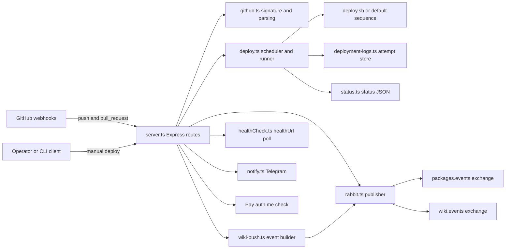

# Architecture

beelink-deploy is one Node.js process. `src/index.ts` boots config, the deployment log store and optional RabbitMQ, then listens on the configured host and port ([src/index.ts:L9-L19](https://github.com/Jeffrey-Keyser/beelink-deploy/blob/ca28cae58541cdd63ff9ad5e1601b13e3450a4b6/src/index.ts#L9-L19), [src/index.ts:L61-L63](https://github.com/Jeffrey-Keyser/beelink-deploy/blob/ca28cae58541cdd63ff9ad5e1601b13e3450a4b6/src/index.ts#L61-L63)).

## Component diagram

## Components

- **Routes (`src/server.ts`).** Owns `/health`, `/api/status`, `/repos`, `/webhook`, `/deploy/:owner/:repo` and its logs route ([src/server.ts:L115-L144](https://github.com/Jeffrey-Keyser/beelink-deploy/blob/ca28cae58541cdd63ff9ad5e1601b13e3450a4b6/src/server.ts#L115-L144)). A raw-body hook lets HMAC run on the exact bytes ([src/server.ts:L87-L92](https://github.com/Jeffrey-Keyser/beelink-deploy/blob/ca28cae58541cdd63ff9ad5e1601b13e3450a4b6/src/server.ts#L87-L92)).
- **Config (`src/config.ts`).** Reads `config.json`, `repos.json` and `packages.json` from `CONFIG_DIR` or `config/` ([src/config.ts:L29-L31](https://github.com/Jeffrey-Keyser/beelink-deploy/blob/ca28cae58541cdd63ff9ad5e1601b13e3450a4b6/src/config.ts#L29-L31), [src/config.ts:L33-L52](https://github.com/Jeffrey-Keyser/beelink-deploy/blob/ca28cae58541cdd63ff9ad5e1601b13e3450a4b6/src/config.ts#L33-L52)). It throws without `RABBITMQ_URL` ([src/config.ts:L54-L57](https://github.com/Jeffrey-Keyser/beelink-deploy/blob/ca28cae58541cdd63ff9ad5e1601b13e3450a4b6/src/config.ts#L54-L57)).
- **Deploy runner (`src/deploy.ts`).** A per-repo scheduler serializes runs and deduplicates revisions ([src/deploy.ts:L53-L58](https://github.com/Jeffrey-Keyser/beelink-deploy/blob/ca28cae58541cdd63ff9ad5e1601b13e3450a4b6/src/deploy.ts#L53-L58), [src/deploy.ts:L87-L99](https://github.com/Jeffrey-Keyser/beelink-deploy/blob/ca28cae58541cdd63ff9ad5e1601b13e3450a4b6/src/deploy.ts#L87-L99)). Immutable-worktree mode checks out a detached release ([src/deploy.ts:L245-L268](https://github.com/Jeffrey-Keyser/beelink-deploy/blob/ca28cae58541cdd63ff9ad5e1601b13e3450a4b6/src/deploy.ts#L245-L268)).
- **Deploy logs (`src/deployment-logs.ts`).** Persistent attempts under `DATA_DIR/deploy-logs` with bounded retention ([src/deployment-logs.ts:L21-L25](https://github.com/Jeffrey-Keyser/beelink-deploy/blob/ca28cae58541cdd63ff9ad5e1601b13e3450a4b6/src/deployment-logs.ts#L21-L25)).
- **Diagnostics (`src/deploy-diagnostics.ts`).** Turns failures into phase and fixed codes; public summaries are capped at 200 characters ([src/deploy-diagnostics.ts:L103-L132](https://github.com/Jeffrey-Keyser/beelink-deploy/blob/ca28cae58541cdd63ff9ad5e1601b13e3450a4b6/src/deploy-diagnostics.ts#L103-L132), [src/deploy-diagnostics.ts:L135-L145](https://github.com/Jeffrey-Keyser/beelink-deploy/blob/ca28cae58541cdd63ff9ad5e1601b13e3450a4b6/src/deploy-diagnostics.ts#L135-L145)).
- **Access (`src/log-access.ts`, `src/log-routes.ts`).** Verifies a supplied token against Pay `/api/v1/auth/me` and checks for the admin role ([src/log-access.ts:L55-L65](https://github.com/Jeffrey-Keyser/beelink-deploy/blob/ca28cae58541cdd63ff9ad5e1601b13e3450a4b6/src/log-access.ts#L55-L65)).
- **RabbitMQ (`src/rabbit.ts`).** Declares `packages.events` and `wiki.events` topic exchanges and reconnects with backoff capped at 60 s ([src/rabbit.ts:L10-L14](https://github.com/Jeffrey-Keyser/beelink-deploy/blob/ca28cae58541cdd63ff9ad5e1601b13e3450a4b6/src/rabbit.ts#L10-L14), [src/rabbit.ts:L111](https://github.com/Jeffrey-Keyser/beelink-deploy/blob/ca28cae58541cdd63ff9ad5e1601b13e3450a4b6/src/rabbit.ts#L111)).
- **Status, health and notify.** `status.ts` writes per-repo records ([src/status.ts:L68-L111](https://github.com/Jeffrey-Keyser/beelink-deploy/blob/ca28cae58541cdd63ff9ad5e1601b13e3450a4b6/src/status.ts#L68-L111)); `healthCheck.ts` polls every 2 s for up to 15 s ([src/healthCheck.ts:L1-L2](https://github.com/Jeffrey-Keyser/beelink-deploy/blob/ca28cae58541cdd63ff9ad5e1601b13e3450a4b6/src/healthCheck.ts#L1-L2)); `notify.ts` no-ops without Telegram credentials ([src/notify.ts:L5-L7](https://github.com/Jeffrey-Keyser/beelink-deploy/blob/ca28cae58541cdd63ff9ad5e1601b13e3450a4b6/src/notify.ts#L5-L7)).

## Contracts

- **HTTP.** `GET /health` returns `status` and `time` ([src/server.ts:L115-L117](https://github.com/Jeffrey-Keyser/beelink-deploy/blob/ca28cae58541cdd63ff9ad5e1601b13e3450a4b6/src/server.ts#L115-L117)). `POST /deploy/:owner/:repo` requires `DEPLOY_API_KEY` to be configured ([src/server.ts:L356-L360](https://github.com/Jeffrey-Keyser/beelink-deploy/blob/ca28cae58541cdd63ff9ad5e1601b13e3450a4b6/src/server.ts#L356-L360)). The rest of that handler is outside the excerpt, so the `X-Deploy-Key` comparison is unverified here.
- **Repo entries.** Fields are `path`, `branch`, `service`, `healthUrl`, `deploymentMode` and `releaseRoot` ([src/config.ts:L5-L12](https://github.com/Jeffrey-Keyser/beelink-deploy/blob/ca28cae58541cdd63ff9ad5e1601b13e3450a4b6/src/config.ts#L5-L12)). Immutable mode requires `releaseRoot` ([src/deploy.ts:L247-L249](https://github.com/Jeffrey-Keyser/beelink-deploy/blob/ca28cae58541cdd63ff9ad5e1601b13e3450a4b6/src/deploy.ts#L247-L249)).
- **RabbitMQ.** Routing keys are `package.push.<owner>.<repo>` and `wiki.update.<owner>.<repo>` ([src/rabbit.ts:L144](https://github.com/Jeffrey-Keyser/beelink-deploy/blob/ca28cae58541cdd63ff9ad5e1601b13e3450a4b6/src/rabbit.ts#L144), [src/rabbit.ts:L170](https://github.com/Jeffrey-Keyser/beelink-deploy/blob/ca28cae58541cdd63ff9ad5e1601b13e3450a4b6/src/rabbit.ts#L170)).

## Unknowns

Excerpts of `server.ts`, `deploy.ts` and `deployment-logs.ts` are truncated. Behavior past those cuts is unknown, and the excerpts do not prove what is absent.
