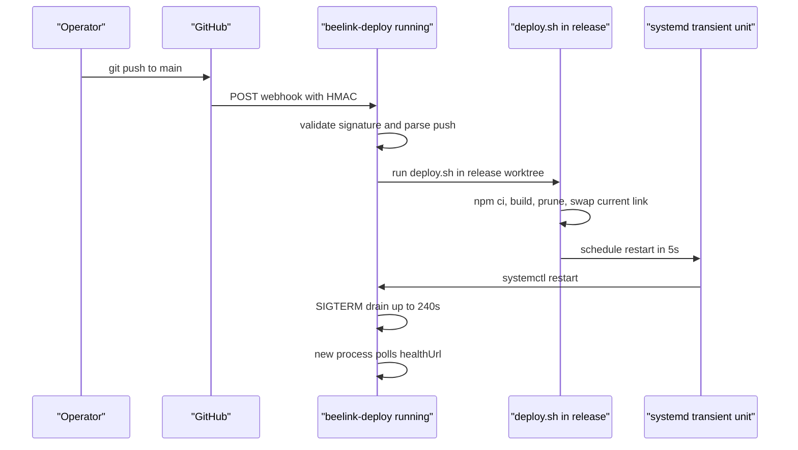

# Iteration Loop

This repo deploys itself. Its `config/repos.json` entry uses immutable-worktree mode with a release root and a health URL on port 9000 ([config/repos.json:L63-L70](https://github.com/Jeffrey-Keyser/beelink-deploy/blob/ca28cae58541cdd63ff9ad5e1601b13e3450a4b6/config/repos.json#L63-L70)). The running process restarts itself during its own deploy.

## Local checks

- `npm run typecheck`, `npm run lint`, `npm test` and `npm run build` are declared scripts ([package.json:L8-L13](https://github.com/Jeffrey-Keyser/beelink-deploy/blob/ca28cae58541cdd63ff9ad5e1601b13e3450a4b6/package.json#L8-L13)).
- `npm test` runs `tsx --test tests/*.test.ts` ([package.json:L11](https://github.com/Jeffrey-Keyser/beelink-deploy/blob/ca28cae58541cdd63ff9ad5e1601b13e3450a4b6/package.json#L11)). The test files are not in the snapshot.
- The deployment-log docs list the same four checks ([docs/deployment-logs.md:L147-L148](https://github.com/Jeffrey-Keyser/beelink-deploy/blob/ca28cae58541cdd63ff9ad5e1601b13e3450a4b6/docs/deployment-logs.md#L147-L148)).
- No CI workflow appears in the excerpts. CI behavior is unknown.

## Cycle

## Steps

1. **Signature.** The webhook is checked against `GITHUB_WEBHOOK_SECRET` when it is set ([src/server.ts:L156-L161](https://github.com/Jeffrey-Keyser/beelink-deploy/blob/ca28cae58541cdd63ff9ad5e1601b13e3450a4b6/src/server.ts#L156-L161)).
2. **Wiki event.** A default-branch push publishes `wiki.update` unless the head commit has `[skip wiki]` ([src/wiki-push.ts:L26-L29](https://github.com/Jeffrey-Keyser/beelink-deploy/blob/ca28cae58541cdd63ff9ad5e1601b13e3450a4b6/src/wiki-push.ts#L26-L29)).
3. **Scheduling.** Duplicate revisions join or skip, and runs for one repo are serialized ([src/deploy.ts:L87-L99](https://github.com/Jeffrey-Keyser/beelink-deploy/blob/ca28cae58541cdd63ff9ad5e1601b13e3450a4b6/src/deploy.ts#L87-L99)).
4. **Release prep.** The runner fetches the branch, requires a full SHA, adds a detached worktree and confirms it is clean ([src/deploy.ts:L250-L266](https://github.com/Jeffrey-Keyser/beelink-deploy/blob/ca28cae58541cdd63ff9ad5e1601b13e3450a4b6/src/deploy.ts#L250-L266)).
5. **deploy.sh.** The script checks the expected revision, runs `npm ci --include=dev`, builds, prunes dev dependencies and atomically replaces the `current` link ([deploy.sh:L8-L22](https://github.com/Jeffrey-Keyser/beelink-deploy/blob/ca28cae58541cdd63ff9ad5e1601b13e3450a4b6/deploy.sh#L8-L22)).
6. **Self-restart.** The script schedules `systemctl restart` five seconds later ([deploy.sh:L24-L32](https://github.com/Jeffrey-Keyser/beelink-deploy/blob/ca28cae58541cdd63ff9ad5e1601b13e3450a4b6/deploy.sh#L24-L32)). The unit runs from `releases/.../current` ([beelink-deploy.service:L8-L9](https://github.com/Jeffrey-Keyser/beelink-deploy/blob/ca28cae58541cdd63ff9ad5e1601b13e3450a4b6/beelink-deploy.service#L8-L9)).
7. **Drain.** SIGTERM waits up to 240 s for active deploys ([src/index.ts:L40-L56](https://github.com/Jeffrey-Keyser/beelink-deploy/blob/ca28cae58541cdd63ff9ad5e1601b13e3450a4b6/src/index.ts#L40-L56)).
8. **Health.** The new process polls `localhost:9000/health` for up to 15 s and notifies Telegram when configured ([src/server.ts:L51-L62](https://github.com/Jeffrey-Keyser/beelink-deploy/blob/ca28cae58541cdd63ff9ad5e1601b13e3450a4b6/src/server.ts#L51-L62)).

## Config-only changes

Edits to `repos.json` or `packages.json` need a reload, not a restart. Send SIGHUP or SIGUSR2 ([src/index.ts:L37-L38](https://github.com/Jeffrey-Keyser/beelink-deploy/blob/ca28cae58541cdd63ff9ad5e1601b13e3450a4b6/src/index.ts#L37-L38)).

## Manual override

`POST /deploy/:owner/:repo` with the deploy key triggers a run without GitHub ([src/server.ts:L356-L360](https://github.com/Jeffrey-Keyser/beelink-deploy/blob/ca28cae58541cdd63ff9ad5e1601b13e3450a4b6/src/server.ts#L356-L360)). Skip a push deploy with `[skip deploy]` ([README.md:L116](https://github.com/Jeffrey-Keyser/beelink-deploy/blob/ca28cae58541cdd63ff9ad5e1601b13e3450a4b6/README.md#L116)).
