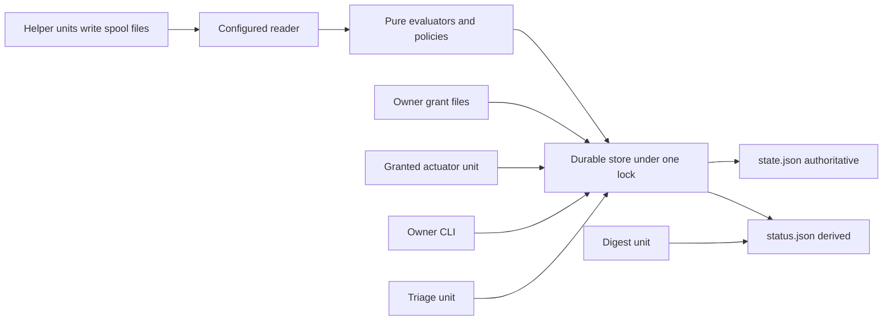

# Architecture

## Components

- **CLI dispatch.** `run` routes each subcommand to owner, grant, actuation, digest, triage or replay handlers ([cmd/beelink-steward/main.go:L42-L44](https://github.com/Jeffrey-Keyser/beelink-steward/blob/4c0dad5b395f187fd67343b0af6b4119f48df1ac/cmd/beelink-steward/main.go#L42-L44), [cmd/beelink-steward/main.go:L53-L72](https://github.com/Jeffrey-Keyser/beelink-steward/blob/4c0dad5b395f187fd67343b0af6b4119f48df1ac/cmd/beelink-steward/main.go#L53-L72)).
- **Configured reader.** Reads fixed local sources only: cgroup `cpu.stat`, proc files and spool files ([reader/configured.go:L229-L231](https://github.com/Jeffrey-Keyser/beelink-steward/blob/4c0dad5b395f187fd67343b0af6b4119f48df1ac/reader/configured.go#L229-L231), [docs/sensing-sandbox.md:L22-L26](https://github.com/Jeffrey-Keyser/beelink-steward/blob/4c0dad5b395f187fd67343b0af6b4119f48df1ac/docs/sensing-sandbox.md#L22-L26)).
- **Parsers and policies.** Pure parsers and evaluators, for example `servicehealthobservation.Parse` ([servicehealthobservation/observation.go:L100-L105](https://github.com/Jeffrey-Keyser/beelink-steward/blob/4c0dad5b395f187fd67343b0af6b4119f48df1ac/servicehealthobservation/observation.go#L100-L105)) and `servicehealthevaluator.Evaluate` ([servicehealthevaluator/evaluator.go:L132-L135](https://github.com/Jeffrey-Keyser/beelink-steward/blob/4c0dad5b395f187fd67343b0af6b4119f48df1ac/servicehealthevaluator/evaluator.go#L132-L135)). Policy constants live in packages such as [servicehealthpolicy/policy.go:L5-L14](https://github.com/Jeffrey-Keyser/beelink-steward/blob/4c0dad5b395f187fd67343b0af6b4119f48df1ac/servicehealthpolicy/policy.go#L5-L14).
- **Durable store.** Each detector commits in one transaction, such as `SampleServiceHealth` ([store/servicehealth.go:L144-L146](https://github.com/Jeffrey-Keyser/beelink-steward/blob/4c0dad5b395f187fd67343b0af6b4119f48df1ac/store/servicehealth.go#L144-L146)).
- **Deployment units.** The sampler is `beelink-steward.service`. Helper units write spool files, and `act`, digest and triage run as separate oneshots ([deploy/systemd/beelink-steward-actuator.service:L16-L21](https://github.com/Jeffrey-Keyser/beelink-steward/blob/4c0dad5b395f187fd67343b0af6b4119f48df1ac/deploy/systemd/beelink-steward-actuator.service#L16-L21), [deploy/systemd/beelink-steward-triage.service:L22](https://github.com/Jeffrey-Keyser/beelink-steward/blob/4c0dad5b395f187fd67343b0af6b4119f48df1ac/deploy/systemd/beelink-steward-triage.service#L22)).

## Contracts

- Config: `steward-config/v1` and additive `steward-config/v2` ([reader/configured.go:L24-L28](https://github.com/Jeffrey-Keyser/beelink-steward/blob/4c0dad5b395f187fd67343b0af6b4119f48df1ac/reader/configured.go#L24-L28)).
- State: `steward-state/v1` in `state.json` ([docs/durable-store.md:L74-L77](https://github.com/Jeffrey-Keyser/beelink-steward/blob/4c0dad5b395f187fd67343b0af6b4119f48df1ac/docs/durable-store.md#L74-L77)).
- Status: `steward-status/v1` with a sorted `sources` array ([docs/sensing-sandbox.md:L51-L52](https://github.com/Jeffrey-Keyser/beelink-steward/blob/4c0dad5b395f187fd67343b0af6b4119f48df1ac/docs/sensing-sandbox.md#L51-L52)).
- Fixtures: versioned inputs such as `service-health-fixture/v1` ([servicehealthevaluator/fixture.go:L15-L16](https://github.com/Jeffrey-Keyser/beelink-steward/blob/4c0dad5b395f187fd67343b0af6b4119f48df1ac/servicehealthevaluator/fixture.go#L15-L16)).
- Triage config: `beelink-steward-triage/v1` ([triage/config.go:L18-L19](https://github.com/Jeffrey-Keyser/beelink-steward/blob/4c0dad5b395f187fd67343b0af6b4119f48df1ac/triage/config.go#L18-L19)).

## Diagram

## Unknowns

The excerpts do not show the complete store implementation or any host installation state. Omitted files are not evidence of absence.
