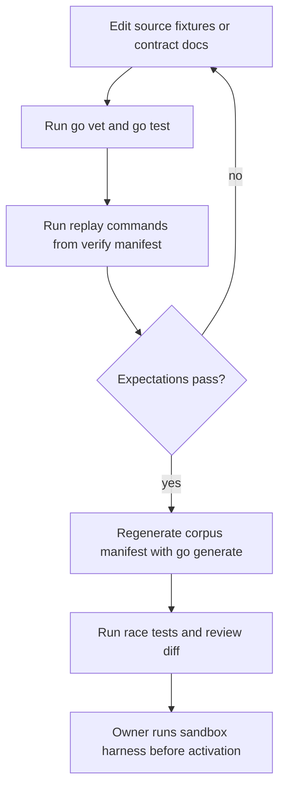

# Iteration Loop

This page describes the contributor workflow as the source excerpts document it. No CI workflow file appears in the attached excerpts, so CI behavior is unknown.

## Checks

1. Run vet and tests from the module root: `go vet ./...`, `go test -count=1 ./...` and `go test -race ./...` ([docs/cpu-contract.md:L9-L11](https://github.com/Jeffrey-Keyser/beelink-steward/blob/4c0dad5b395f187fd67343b0af6b4119f48df1ac/docs/cpu-contract.md#L9-L11)).
2. Replay each corpus. The verify manifest lists CPU, disk, memory, units, restarts, reboot, updates and service-health replays ([config/verify/beelink-steward.json:L5-L13](https://github.com/Jeffrey-Keyser/beelink-steward/blob/4c0dad5b395f187fd67343b0af6b4119f48df1ac/config/verify/beelink-steward.json#L5-L13)). The maintenance and netdata replays are documented but not in that list ([docs/maintenance-contract.md:L11-L13](https://github.com/Jeffrey-Keyser/beelink-steward/blob/4c0dad5b395f187fd67343b0af6b4119f48df1ac/docs/maintenance-contract.md#L11-L13)).
3. Replays must match recorded expectations. A mismatch fails, and output must be byte-identical across runs ([docs/maintenance-contract.md:L15-L17](https://github.com/Jeffrey-Keyser/beelink-steward/blob/4c0dad5b395f187fd67343b0af6b4119f48df1ac/docs/maintenance-contract.md#L15-L17), [docs/cpu-contract.md:L100-L105](https://github.com/Jeffrey-Keyser/beelink-steward/blob/4c0dad5b395f187fd67343b0af6b4119f48df1ac/docs/cpu-contract.md#L100-L105)).
4. Regenerate the corpus manifest. The generator runs from `replaycorpus` and reads `testdata` families ([replaycorpus/gen/main.go:L1-L5](https://github.com/Jeffrey-Keyser/beelink-steward/blob/4c0dad5b395f187fd67343b0af6b4119f48df1ac/replaycorpus/gen/main.go#L1-L5)). Each family needs a policy mapping, and non-JSON files are refused ([replaycorpus/gen/main.go:L32-L48](https://github.com/Jeffrey-Keyser/beelink-steward/blob/4c0dad5b395f187fd67343b0af6b4119f48df1ac/replaycorpus/gen/main.go#L32-L48), [replaycorpus/gen/main.go:L97-L99](https://github.com/Jeffrey-Keyser/beelink-steward/blob/4c0dad5b395f187fd67343b0af6b4119f48df1ac/replaycorpus/gen/main.go#L97-L99)).
5. Before activating sandboxed units, the owner runs `bash scripts/test-sensing-sandbox.sh` from a disposable session ([docs/memory-contract.md:L259-L266](https://github.com/Jeffrey-Keyser/beelink-steward/blob/4c0dad5b395f187fd67343b0af6b4119f48df1ac/docs/memory-contract.md#L259-L266)). The script is not in the excerpts, so its contents are unknown.

## Rules for changes

- Changing a threshold or rule is a versioned change. A gap bound, for example, needs a new policy version ([docs/container-health-contract.md:L54-L55](https://github.com/Jeffrey-Keyser/beelink-steward/blob/4c0dad5b395f187fd67343b0af6b4119f48df1ac/docs/container-health-contract.md#L54-L55)).
- Synthetic fixtures are never evidence about the live host ([docs/maintenance-contract.md:L176-L177](https://github.com/Jeffrey-Keyser/beelink-steward/blob/4c0dad5b395f187fd67343b0af6b4119f48df1ac/docs/maintenance-contract.md#L176-L177)).
- Compatibility: use the same updated binary for every command that opens upgraded state ([docs/durable-store.md:L95-L98](https://github.com/Jeffrey-Keyser/beelink-steward/blob/4c0dad5b395f187fd67343b0af6b4119f48df1ac/docs/durable-store.md#L95-L98)).
- Delivery goes through normal review. Production activation is a separate operator step ([docs/durable-store.md:L98-L99](https://github.com/Jeffrey-Keyser/beelink-steward/blob/4c0dad5b395f187fd67343b0af6b4119f48df1ac/docs/durable-store.md#L98-L99)).
