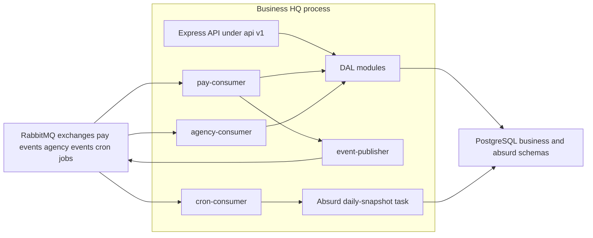

# Architecture

Business HQ is a single Node process. It hosts the Express HTTP API, three RabbitMQ consumers, and an Absurd worker. The API, consumers, and worker share one database pool ([src/db/connection.ts:4-6](https://github.com/Jeffrey-Keyser/business-hq/blob/9fa76d7545fdce535b7a3a89236c2309937f4671/src/db/connection.ts#L4-L6)). The entrypoint starts the HTTP listener first, then the Absurd worker and RabbitMQ subscriptions ([src/bin/www.ts:16-35](https://github.com/Jeffrey-Keyser/business-hq/blob/9fa76d7545fdce535b7a3a89236c2309937f4671/src/bin/www.ts#L16-L35)).

## Role contracts

**HTTP boundary.** The app is built with `createExpressApp` and mounts `/` and `/api/v1` ([src/app.ts:64-67](https://github.com/Jeffrey-Keyser/business-hq/blob/9fa76d7545fdce535b7a3a89236c2309937f4671/src/app.ts#L64-L67)). Requests to `/api/v*` other than version 1 receive a 404 `VERSION_NOT_FOUND` response ([src/middleware/versioning.ts:28-33](https://github.com/Jeffrey-Keyser/business-hq/blob/9fa76d7545fdce535b7a3a89236c2309937f4671/src/middleware/versioning.ts#L28-L33)). Responses carry an `API-Version` header ([src/middleware/versioning.ts:19](https://github.com/Jeffrey-Keyser/business-hq/blob/9fa76d7545fdce535b7a3a89236c2309937f4671/src/middleware/versioning.ts#L19)). CORS allows GET, POST, PUT, DELETE, and OPTIONS ([src/app.ts:31-36](https://github.com/Jeffrey-Keyser/business-hq/blob/9fa76d7545fdce535b7a3a89236c2309937f4671/src/app.ts#L31-L36)).

**Health.** `GET /health` is enabled and checks the database through the shared pool ([src/app.ts:54-62](https://github.com/Jeffrey-Keyser/business-hq/blob/9fa76d7545fdce535b7a3a89236c2309937f4671/src/app.ts#L54-L62)). The provided excerpt does not show the check's internals.

**Resource routes.** Each resource returns a `{ success, data }` envelope. Creates require `name` for products and a numeric `amount_cents` for revenue and costs ([src/routes/versions/v1/products.ts:34-37](https://github.com/Jeffrey-Keyser/business-hq/blob/9fa76d7545fdce535b7a3a89236c2309937f4671/src/routes/versions/v1/products.ts#L34-L37), [src/routes/versions/v1/revenue.ts:23-26](https://github.com/Jeffrey-Keyser/business-hq/blob/9fa76d7545fdce535b7a3a89236c2309937f4671/src/routes/versions/v1/revenue.ts#L23-L26)).

**Messaging layer.** `RabbitMQService` asserts the business exchange on connect ([src/services/rabbit.ts:45-50](https://github.com/Jeffrey-Keyser/business-hq/blob/9fa76d7545fdce535b7a3a89236c2309937f4671/src/services/rabbit.ts#L45-L50)) and replays subscriptions after reconnect ([src/services/rabbit.ts:65-67](https://github.com/Jeffrey-Keyser/business-hq/blob/9fa76d7545fdce535b7a3a89236c2309937f4671/src/services/rabbit.ts#L65-L67)). Handlers ack on success and nack with requeue on error ([src/services/rabbit.ts:173-183](https://github.com/Jeffrey-Keyser/business-hq/blob/9fa76d7545fdce535b7a3a89236c2309937f4671/src/services/rabbit.ts#L173-L183)). Publishing returns `false` with a warning when no channel exists ([src/services/rabbit.ts:127-131](https://github.com/Jeffrey-Keyser/business-hq/blob/9fa76d7545fdce535b7a3a89236c2309937f4671/src/services/rabbit.ts#L127-L131)).

**Inbound consumers.**
- `pay-consumer` handles `payment.succeeded` and `subscription.created` ([src/services/pay-consumer.ts:14-16](https://github.com/Jeffrey-Keyser/business-hq/blob/9fa76d7545fdce535b7a3a89236c2309937f4671/src/services/pay-consumer.ts#L14-L16), [src/services/pay-consumer.ts:61-63](https://github.com/Jeffrey-Keyser/business-hq/blob/9fa76d7545fdce535b7a3a89236c2309937f4671/src/services/pay-consumer.ts#L61-L63)).
- `agency-consumer` handles `sprint.completed` ([src/services/agency-consumer.ts:10-13](https://github.com/Jeffrey-Keyser/business-hq/blob/9fa76d7545fdce535b7a3a89236c2309937f4671/src/services/agency-consumer.ts#L10-L13)).
- `cron-consumer` handles `business.daily-snapshot` on `cron.jobs` ([src/services/cron-consumer.ts:10-12](https://github.com/Jeffrey-Keyser/business-hq/blob/9fa76d7545fdce535b7a3a89236c2309937f4671/src/services/cron-consumer.ts#L10-L12)).

**Durable workflow.** Absurd uses the queue `business-hq` with a default of three attempts ([src/services/absurd.ts:5](https://github.com/Jeffrey-Keyser/business-hq/blob/9fa76d7545fdce535b7a3a89236c2309937f4671/src/services/absurd.ts#L5), [src/services/absurd.ts:15](https://github.com/Jeffrey-Keyser/business-hq/blob/9fa76d7545fdce535b7a3a89236c2309937f4671/src/services/absurd.ts#L15)). The `daily-snapshot` task has two checkpointed steps, `collect-metrics` and `save-snapshot` ([src/services/absurd.ts:31](https://github.com/Jeffrey-Keyser/business-hq/blob/9fa76d7545fdce535b7a3a89236c2309937f4671/src/services/absurd.ts#L31), [src/services/absurd.ts:70](https://github.com/Jeffrey-Keyser/business-hq/blob/9fa76d7545fdce535b7a3a89236c2309937f4671/src/services/absurd.ts#L70)). The worker runs with concurrency 1 ([src/services/absurd.ts:121](https://github.com/Jeffrey-Keyser/business-hq/blob/9fa76d7545fdce535b7a3a89236c2309937f4671/src/services/absurd.ts#L121)).

**Outbound publisher.** `event-publisher.ts` defines three helpers: revenue updated, product launched, and milestone reached ([src/services/event-publisher.ts:7-48](https://github.com/Jeffrey-Keyser/business-hq/blob/9fa76d7545fdce535b7a3a89236c2309937f4671/src/services/event-publisher.ts#L7-L48)). Only `publishRevenueUpdated` is called in the provided excerpts ([src/services/pay-consumer.ts:43-48](https://github.com/Jeffrey-Keyser/business-hq/blob/9fa76d7545fdce535b7a3a89236c2309937f4671/src/services/pay-consumer.ts#L43-L48)).

**Data layer.** DAL modules for products, revenue, costs, build events, snapshots, and settings wrap SQL against the `business` schema ([src/dal/products.ts:4-16](https://github.com/Jeffrey-Keyser/business-hq/blob/9fa76d7545fdce535b7a3a89236c2309937f4671/src/dal/products.ts#L4-L16), [src/dal/settings.ts:3-9](https://github.com/Jeffrey-Keyser/business-hq/blob/9fa76d7545fdce535b7a3a89236c2309937f4671/src/dal/settings.ts#L3-L9)).

**Legacy calculator.** `snapshot-calculator.ts` says the cron consumer calls it ([src/services/snapshot-calculator.ts:4-7](https://github.com/Jeffrey-Keyser/business-hq/blob/9fa76d7545fdce535b7a3a89236c2309937f4671/src/services/snapshot-calculator.ts#L4-L7)). The cron consumer imports `spawnDailySnapshot` instead ([src/services/cron-consumer.ts:2](https://github.com/Jeffrey-Keyser/business-hq/blob/9fa76d7545fdce535b7a3a89236c2309937f4671/src/services/cron-consumer.ts#L2)), so the header is stale. Its insert has no `ON CONFLICT` clause ([src/services/snapshot-calculator.ts:51-56](https://github.com/Jeffrey-Keyser/business-hq/blob/9fa76d7545fdce535b7a3a89236c2309937f4671/src/services/snapshot-calculator.ts#L51-L56)). No caller appears in the provided excerpts.
