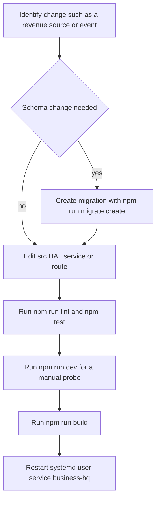

# Iteration Loop

Contributors work from the npm scripts in `package.json`. The lint script runs ESLint over `src` ([package.json:10](https://github.com/Jeffrey-Keyser/business-hq/blob/9fa76d7545fdce535b7a3a89236c2309937f4671/package.json#L10)). The test script runs `npx vitest run` ([package.json:11](https://github.com/Jeffrey-Keyser/business-hq/blob/9fa76d7545fdce535b7a3a89236c2309937f4671/package.json#L11)).

**CI status: unknown.** The provided excerpts contain no CI workflow files. This wiki does not infer that CI is absent or present.

## Step-by-step

1. **Schema first, if needed.** `npm run migrate:create -- <name>` runs `scripts/create-migration.js` ([package.json:14](https://github.com/Jeffrey-Keyser/business-hq/blob/9fa76d7545fdce535b7a3a89236c2309937f4671/package.json#L14)). It scans existing `.ts` migrations and uses the highest timestamp plus 1000 ([scripts/create-migration.js:14-28](https://github.com/Jeffrey-Keyser/business-hq/blob/9fa76d7545fdce535b7a3a89236c2309937f4671/scripts/create-migration.js#L14-L28)). The template has `up` and `down` stubs ([scripts/create-migration.js:31-39](https://github.com/Jeffrey-Keyser/business-hq/blob/9fa76d7545fdce535b7a3a89236c2309937f4671/scripts/create-migration.js#L31-L39)).

2. **Apply migrations.** `npm run migrate` runs `scripts/run-migrate.js` ([package.json:12](https://github.com/Jeffrey-Keyser/business-hq/blob/9fa76d7545fdce535b7a3a89236c2309937f4671/package.json#L12)). The script loads `.env`, requires the DATABASE variables, and runs `node-pg-migrate up` with `--no-check-order` ([scripts/run-migrate.js:6-19](https://github.com/Jeffrey-Keyser/business-hq/blob/9fa76d7545fdce535b7a3a89236c2309937f4671/scripts/run-migrate.js#L6-L19)). The migration directory is `migrations` with `.ts` files ([database.json:5-6](https://github.com/Jeffrey-Keyser/business-hq/blob/9fa76d7545fdce535b7a3a89236c2309937f4671/database.json#L5-L6)).

3. **Persistence first.** Put SQL in `src/dal/` modules, not in routes. Examples include the product DAL ([src/dal/products.ts:23-39](https://github.com/Jeffrey-Keyser/business-hq/blob/9fa76d7545fdce535b7a3a89236c2309937f4671/src/dal/products.ts#L23-L39)).

4. **Wire a route or consumer.**
   - HTTP routes mount under the v1 router ([src/routes/versions/v1/index.ts:10-13](https://github.com/Jeffrey-Keyser/business-hq/blob/9fa76d7545fdce535b7a3a89236c2309937f4671/src/routes/versions/v1/index.ts#L10-L13)).
   - New consumers must be registered in the entrypoint ([src/bin/www.ts:25-31](https://github.com/Jeffrey-Keyser/business-hq/blob/9fa76d7545fdce535b7a3a89236c2309937f4671/src/bin/www.ts#L25-L31)).
   - Outbound events are added as helpers in the publisher ([src/services/event-publisher.ts:7-18](https://github.com/Jeffrey-Keyser/business-hq/blob/9fa76d7545fdce535b7a3a89236c2309937f4671/src/services/event-publisher.ts#L7-L18)).

5. **Verify.** Run `npm run lint`, `npm test`, and `npm run dev` ([package.json:7](https://github.com/Jeffrey-Keyser/business-hq/blob/9fa76d7545fdce535b7a3a89236c2309937f4671/package.json#L7)). `dev` runs the same entrypoint as production, so it also attempts the Absurd worker and RabbitMQ setup ([src/bin/www.ts:16-35](https://github.com/Jeffrey-Keyser/business-hq/blob/9fa76d7545fdce535b7a3a89236c2309937f4671/src/bin/www.ts#L16-L35)). Point it at a non-production broker and database.

6. **Build and ship.** `npm run build` runs `tsc` ([package.json:8](https://github.com/Jeffrey-Keyser/business-hq/blob/9fa76d7545fdce535b7a3a89236c2309937f4671/package.json#L8)). Then `systemctl --user restart business-hq` ([README.md:70-72](https://github.com/Jeffrey-Keyser/business-hq/blob/9fa76d7545fdce535b7a3a89236c2309937f4671/README.md#L70-L72)).

## Conventions visible in code

- Tests under `__tests__` are excluded from the TypeScript build ([tsconfig.json:20](https://github.com/Jeffrey-Keyser/business-hq/blob/9fa76d7545fdce535b7a3a89236c2309937f4671/tsconfig.json#L20)). The test files themselves are not in the excerpts.
- The strict compiler flags are enabled ([tsconfig.json:8](https://github.com/Jeffrey-Keyser/business-hq/blob/9fa76d7545fdce535b7a3a89236c2309937f4671/tsconfig.json#L8)).
- Consumers should be idempotent. The pay consumer checks `stripe_payment_id` before insert ([src/services/pay-consumer.ts:22-30](https://github.com/Jeffrey-Keyser/business-hq/blob/9fa76d7545fdce535b7a3a89236c2309937f4671/src/services/pay-consumer.ts#L22-L30)).
- New daily or periodic aggregation should follow the Absurd pattern with checkpointed steps ([src/services/absurd.ts:19-21](https://github.com/Jeffrey-Keyser/business-hq/blob/9fa76d7545fdce535b7a3a89236c2309937f4671/src/services/absurd.ts#L19-L21)).
