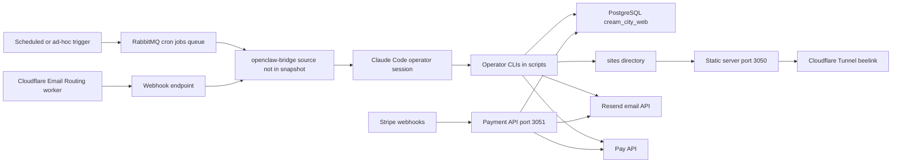

# Architecture

Cream City Web is a single Node ESM package. Its `package.json` has no `main` or `exports` field, so it is not published as a library ([package.json:L1-L26](https://github.com/Jeffrey-Keyser/cream-city-web/blob/2415ed7675f004fc1f879d5b43cab444b4bbb495/package.json#L1-L26)). Most parts are on-demand CLIs. Two HTTP services are defined, and a Cloudflare worker forwards inbound mail.

## Component diagram

The diagram shows documented links. Arrows into `openclaw-bridge` and the Stripe path are not verified by the provided source.

## Components and contracts

- **Operator runbook (`CLAUDE.md`)**: defines the run procedure, the outreach gate, compliance rules, and escalation policy ([CLAUDE.md:L21-L74](https://github.com/Jeffrey-Keyser/cream-city-web/blob/2415ed7675f004fc1f879d5b43cab444b4bbb495/CLAUDE.md#L21-L74), [CLAUDE.md:L174-L183](https://github.com/Jeffrey-Keyser/cream-city-web/blob/2415ed7675f004fc1f879d5b43cab444b4bbb495/CLAUDE.md#L174-L183)).
- **Run ledger (`scripts/run.mjs`)**: `start` inserts a `runs` row and writes `data/state.json` ([run.mjs:L48-L62](https://github.com/Jeffrey-Keyser/cream-city-web/blob/2415ed7675f004fc1f879d5b43cab444b4bbb495/scripts/run.mjs#L48-L62)). `end` counts scout, outreach, and build_site actions ([run.mjs:L69-L85](https://github.com/Jeffrey-Keyser/cream-city-web/blob/2415ed7675f004fc1f879d5b43cab444b4bbb495/scripts/run.mjs#L69-L85)). `notify` writes a NanoClaw IPC file ([run.mjs:L24-L34](https://github.com/Jeffrey-Keyser/cream-city-web/blob/2415ed7675f004fc1f879d5b43cab444b4bbb495/scripts/run.mjs#L24-L34)).
- **Database helper (`scripts/db.mjs`)**: a shared pg pool. It loads `.env`, then Solo Vault secrets ([db.mjs:L79-L81](https://github.com/Jeffrey-Keyser/cream-city-web/blob/2415ed7675f004fc1f879d5b43cab444b4bbb495/scripts/db.mjs#L79-L81)), and throws if `DATABASE_URL` is unset ([db.mjs:L83-L85](https://github.com/Jeffrey-Keyser/cream-city-web/blob/2415ed7675f004fc1f879d5b43cab444b4bbb495/scripts/db.mjs#L83-L85)). The `secrets.mjs` loader is not in the snapshot.
- **Payment API (`api/server.mjs`)**: defines `POST /payment/verify-code`, `POST /payment/create-checkout`, `POST /webhook/stripe`, and `GET /health` ([api/server.mjs:L8-L11](https://github.com/Jeffrey-Keyser/cream-city-web/blob/2415ed7675f004fc1f879d5b43cab444b4bbb495/api/server.mjs#L8-L11)). The port defaults to 3051 ([api/server.mjs:L41](https://github.com/Jeffrey-Keyser/cream-city-web/blob/2415ed7675f004fc1f879d5b43cab444b4bbb495/api/server.mjs#L41)). The listen call is beyond the excerpt.
- **Static server (`scripts/serve.mjs`)**: maps a host's subdomain to `sites/{slug}` ([serve.mjs:L34-L50](https://github.com/Jeffrey-Keyser/cream-city-web/blob/2415ed7675f004fc1f879d5b43cab444b4bbb495/scripts/serve.mjs#L34-L50)). It binds 127.0.0.1 on port 3050 by default ([serve.mjs:L15](https://github.com/Jeffrey-Keyser/cream-city-web/blob/2415ed7675f004fc1f879d5b43cab444b4bbb495/scripts/serve.mjs#L15), [serve.mjs:L129](https://github.com/Jeffrey-Keyser/cream-city-web/blob/2415ed7675f004fc1f879d5b43cab444b4bbb495/scripts/serve.mjs#L129)).
- **Site templates**: `build-site.mjs` names `general`, `restaurant`, and `services` ([build-site.mjs:L144](https://github.com/Jeffrey-Keyser/cream-city-web/blob/2415ed7675f004fc1f879d5b43cab444b4bbb495/scripts/build-site.mjs#L144)). The README lists `starter` and `starter-blue` instead ([README.md:L47](https://github.com/Jeffrey-Keyser/cream-city-web/blob/2415ed7675f004fc1f879d5b43cab444b4bbb495/README.md#L47)). The current template set is unknown.
- **Email worker (`workers/email-receiver`)**: POSTs a JSON payload with an `X-Webhook-Secret` header to `WEBHOOK_URL` ([index.js:L42-L50](https://github.com/Jeffrey-Keyser/cream-city-web/blob/2415ed7675f004fc1f879d5b43cab444b4bbb495/workers/email-receiver/src/index.js#L42-L50)). The configured URL is `webhook.creamcityweb.com/email/inbound` ([wrangler.toml:L6](https://github.com/Jeffrey-Keyser/cream-city-web/blob/2415ed7675f004fc1f879d5b43cab444b4bbb495/workers/email-receiver/wrangler.toml#L6)). It rethrows failures so Cloudflare can retry ([index.js:L54-L66](https://github.com/Jeffrey-Keyser/cream-city-web/blob/2415ed7675f004fc1f879d5b43cab444b4bbb495/workers/email-receiver/src/index.js#L54-L66)).
- **Inbound bridge**: the tools reference describes Worker to webhook to openclaw-bridge ([tools.md:L37-L40](https://github.com/Jeffrey-Keyser/cream-city-web/blob/2415ed7675f004fc1f879d5b43cab444b4bbb495/tools.md#L37-L40)). The bridge source is not in the snapshot, so the receiving side is unverified.
- **Schema (`schema.sql`)**: defines twelve tables, from `leads` to `payment_codes` ([schema.sql:L5](https://github.com/Jeffrey-Keyser/cream-city-web/blob/2415ed7675f004fc1f879d5b43cab444b4bbb495/schema.sql#L5), [schema.sql:L187](https://github.com/Jeffrey-Keyser/cream-city-web/blob/2415ed7675f004fc1f879d5b43cab444b4bbb495/schema.sql#L187)). The README's core-table list is shorter ([README.md:L18-L27](https://github.com/Jeffrey-Keyser/cream-city-web/blob/2415ed7675f004fc1f879d5b43cab444b4bbb495/README.md#L18-L27)).
