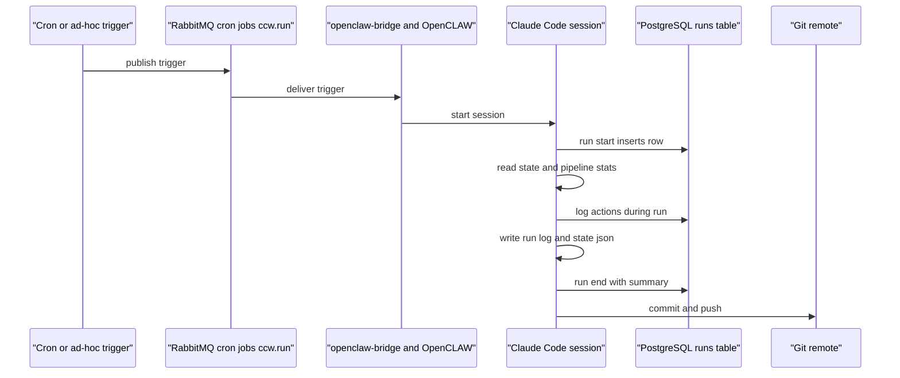

# Iteration Loop

The change cycle is a *run*: one Claude Code session, triggered hourly during business hours or ad hoc ([CLAUDE.md:L15-L19](https://github.com/Jeffrey-Keyser/cream-city-web/blob/2415ed7675f004fc1f879d5b43cab444b4bbb495/CLAUDE.md#L15-L19)). Each run records a row in `runs`, writes a markdown log, and usually commits and pushes its changes.

## Run sequence

## Steps

1. **Initialize.** `node scripts/run.mjs start` records the run ([run.mjs:L264-L265](https://github.com/Jeffrey-Keyser/cream-city-web/blob/2415ed7675f004fc1f879d5b43cab444b4bbb495/scripts/run.mjs#L264-L265)). The operator then reads pipeline stats and the dashboard ([CLAUDE.md:L26-L28](https://github.com/Jeffrey-Keyser/cream-city-web/blob/2415ed7675f004fc1f879d5b43cab444b4bbb495/CLAUDE.md#L26-L28)).
2. **Decide.** Priority runs from customer commitments through tooling ([CLAUDE.md:L198-L205](https://github.com/Jeffrey-Keyser/cream-city-web/blob/2415ed7675f004fc1f879d5b43cab444b4bbb495/CLAUDE.md#L198-L205)). When outreach is blocked, the runbook directs productive work such as testing integrations and documenting learnings ([CLAUDE.md:L207-L235](https://github.com/Jeffrey-Keyser/cream-city-web/blob/2415ed7675f004fc1f879d5b43cab444b4bbb495/CLAUDE.md#L207-L235)).
3. **Execute and log.** `run.mjs log` takes an action name, and the runbook lists `scout`, `outreach`, `build_site`, `follow_up`, `deploy`, and `admin` ([run.mjs:L269-L271](https://github.com/Jeffrey-Keyser/cream-city-web/blob/2415ed7675f004fc1f879d5b43cab444b4bbb495/scripts/run.mjs#L269-L271), [CLAUDE.md:L43-L44](https://github.com/Jeffrey-Keyser/cream-city-web/blob/2415ed7675f004fc1f879d5b43cab444b4bbb495/CLAUDE.md#L43-L44)). The log function does not validate the action name ([run.mjs:L90-L109](https://github.com/Jeffrey-Keyser/cream-city-web/blob/2415ed7675f004fc1f879d5b43cab444b4bbb495/scripts/run.mjs#L90-L109)).
4. **Wrap up.** The operator writes `data/runs/YYYY-MM-DD-HHMM.md`, then runs `run.mjs end` ([CLAUDE.md:L48](https://github.com/Jeffrey-Keyser/cream-city-web/blob/2415ed7675f004fc1f879d5b43cab444b4bbb495/CLAUDE.md#L48), [CLAUDE.md:L58](https://github.com/Jeffrey-Keyser/cream-city-web/blob/2415ed7675f004fc1f879d5b43cab444b4bbb495/CLAUDE.md#L58)). The runbook names both `data/state.md` and `data/state.json` ([CLAUDE.md:L30](https://github.com/Jeffrey-Keyser/cream-city-web/blob/2415ed7675f004fc1f879d5b43cab444b4bbb495/CLAUDE.md#L30), [CLAUDE.md:L60](https://github.com/Jeffrey-Keyser/cream-city-web/blob/2415ed7675f004fc1f879d5b43cab444b4bbb495/CLAUDE.md#L60)). The script writes `state.json` ([run.mjs:L20](https://github.com/Jeffrey-Keyser/cream-city-web/blob/2415ed7675f004fc1f879d5b43cab444b4bbb495/scripts/run.mjs#L20)).
5. **Commit and push.** The documented command stages everything and commits only if changes exist ([CLAUDE.md:L66](https://github.com/Jeffrey-Keyser/cream-city-web/blob/2415ed7675f004fc1f879d5b43cab444b4bbb495/CLAUDE.md#L66)). Because of shell precedence, `push` also runs after a clean tree, where it is a no-op.
6. **Escalate.** `run.mjs notify` sends a Telegram message via NanoClaw IPC ([run.mjs:L278-L287](https://github.com/Jeffrey-Keyser/cream-city-web/blob/2415ed7675f004fc1f879d5b43cab444b4bbb495/scripts/run.mjs#L278-L287), [CLAUDE.md:L72](https://github.com/Jeffrey-Keyser/cream-city-web/blob/2415ed7675f004fc1f879d5b43cab444b4bbb495/CLAUDE.md#L72)).

## Human gate on outreach

The runbook requires Jeffrey's explicit approval before any outreach email is sent ([CLAUDE.md:L176-L183](https://github.com/Jeffrey-Keyser/cream-city-web/blob/2415ed7675f004fc1f879d5b43cab444b4bbb495/CLAUDE.md#L176-L183)). The `request-approval` command writes an approval draft with an `APPROVE-{lead_id}` code ([send-email.mjs:L137](https://github.com/Jeffrey-Keyser/cream-city-web/blob/2415ed7675f004fc1f879d5b43cab444b4bbb495/scripts/send-email.mjs#L137), [send-email.mjs:L158-L166](https://github.com/Jeffrey-Keyser/cream-city-web/blob/2415ed7675f004fc1f879d5b43cab444b4bbb495/scripts/send-email.mjs#L158-L166)). The `send` function in the visible excerpt has no approval check, so the gate is enforced by policy rather than code ([send-email.mjs:L187-L204](https://github.com/Jeffrey-Keyser/cream-city-web/blob/2415ed7675f004fc1f879d5b43cab444b4bbb495/scripts/send-email.mjs#L187-L204)).

## Contributor checks

- `npm run lint` and `npm run build` both run `node --check` over `scripts`, `api`, and `workers` ([package.json:L13](https://github.com/Jeffrey-Keyser/cream-city-web/blob/2415ed7675f004fc1f879d5b43cab444b4bbb495/package.json#L13), [package.json:L15](https://github.com/Jeffrey-Keyser/cream-city-web/blob/2415ed7675f004fc1f879d5b43cab444b4bbb495/package.json#L15)). These are syntax checks only.
- `npm test` runs `tests.db-parse-env.test.mjs` ([package.json:L14](https://github.com/Jeffrey-Keyser/cream-city-web/blob/2415ed7675f004fc1f879d5b43cab444b4bbb495/package.json#L14)). That file is not in the snapshot, so whether it exists is unknown.
- No CI workflow files appear in the provided excerpts, so CI behavior is unknown.
