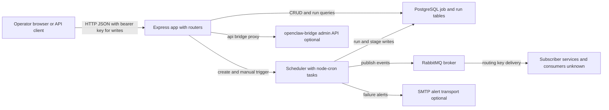

# Architecture

cron-service runs as one Node process. Startup validates environment variables, checks Postgres, connects to RabbitMQ, loads enabled jobs, starts the downstream reconciler, and then listens for HTTP ([src/index.ts:142-160](https://github.com/Jeffrey-Keyser/cron-service/blob/8ad749c7ce3502deec7e6699375aabad8f6688b3/src/index.ts#L142-L160)).

## Components and contracts

- **HTTP host.** Mounts CORS, JSON parsing, `/api` request logging, static files, the four API routers, the error mapper, health routes, and an SPA fallback ([src/index.ts:27-120](https://github.com/Jeffrey-Keyser/cron-service/blob/8ad749c7ce3502deec7e6699375aabad8f6688b3/src/index.ts#L27-L120)). Shutdown on SIGTERM or SIGINT stops the scheduler, then closes RabbitMQ and the DB pool ([src/index.ts:122-140](https://github.com/Jeffrey-Keyser/cron-service/blob/8ad749c7ce3502deec7e6699375aabad8f6688b3/src/index.ts#L122-L140)).
- **Env validation.** `validateEnv()` exits if `DATABASE_URL`, `RABBITMQ_URL`, or `CRON_API_KEY` is missing ([src/validate-env.ts:1-10](https://github.com/Jeffrey-Keyser/cron-service/blob/8ad749c7ce3502deec7e6699375aabad8f6688b3/src/validate-env.ts#L1-L10)).
- **Auth.** `requireApiKey` checks the bearer token with `timingSafeEqual` ([src/middleware/auth.ts:5-28](https://github.com/Jeffrey-Keyser/cron-service/blob/8ad749c7ce3502deec7e6699375aabad8f6688b3/src/middleware/auth.ts#L5-L28)). It guards job create, update, delete, and trigger, and the two run completion routes ([src/routes/jobs.ts:60](https://github.com/Jeffrey-Keyser/cron-service/blob/8ad749c7ce3502deec7e6699375aabad8f6688b3/src/routes/jobs.ts#L60), [src/routes/runs.ts:91](https://github.com/Jeffrey-Keyser/cron-service/blob/8ad749c7ce3502deec7e6699375aabad8f6688b3/src/routes/runs.ts#L91)).
- **Jobs router.** CRUD over `cron_jobs`. Update accepts retry settings with validation ([src/routes/jobs.ts:97-156](https://github.com/Jeffrey-Keyser/cron-service/blob/8ad749c7ce3502deec7e6699375aabad8f6688b3/src/routes/jobs.ts#L97-L156)). Job responses add `schedule_human` and `next_run_at` ([src/routes/jobs.ts:241-250](https://github.com/Jeffrey-Keyser/cron-service/blob/8ad749c7ce3502deec7e6699375aabad8f6688b3/src/routes/jobs.ts#L241-L250)).
- **Runs router.** Lists runs with filters for status, dispatch and downstream status, stage, and correlation ID. The limit is capped at 100 ([src/routes/runs.ts:37-83](https://github.com/Jeffrey-Keyser/cron-service/blob/8ad749c7ce3502deec7e6699375aabad8f6688b3/src/routes/runs.ts#L37-L83)).
- **Scheduler.** Holds a map from job ID to task and runs the publish path with retries ([src/services/scheduler.ts:38-52](https://github.com/Jeffrey-Keyser/cron-service/blob/8ad749c7ce3502deec7e6699375aabad8f6688b3/src/services/scheduler.ts#L38-L52), [src/services/scheduler.ts:239-256](https://github.com/Jeffrey-Keyser/cron-service/blob/8ad749c7ce3502deec7e6699375aabad8f6688b3/src/services/scheduler.ts#L239-L256)). Once RabbitMQ accepts an event, later persistence failures do not re-publish ([src/services/scheduler.ts:207-223](https://github.com/Jeffrey-Keyser/cron-service/blob/8ad749c7ce3502deec7e6699375aabad8f6688b3/src/services/scheduler.ts#L207-L223)).
- **RabbitMQ adapter.** Asserts the shared exchange from the contracts package at connect time and reconnects with exponential backoff up to 10 attempts ([src/services/rabbit.ts:24-75](https://github.com/Jeffrey-Keyser/cron-service/blob/8ad749c7ce3502deec7e6699375aabad8f6688b3/src/services/rabbit.ts#L24-L75)).
- **Message types route.** `GET /api/message-types` returns `CronTargets` from the contracts package ([src/routes/message-types.ts:6-8](https://github.com/Jeffrey-Keyser/cron-service/blob/8ad749c7ce3502deec7e6699375aabad8f6688b3/src/routes/message-types.ts#L6-L8)). The contents of that export are not in the provided excerpts.
- **Bridge proxy.** Forwards three admin routes to `BRIDGE_HOST:BRIDGE_PORT`, defaulting to `localhost:3099`, with a 5 second timeout ([src/routes/bridge.ts:6-7](https://github.com/Jeffrey-Keyser/cron-service/blob/8ad749c7ce3502deec7e6699375aabad8f6688b3/src/routes/bridge.ts#L6-L7), [src/routes/bridge.ts:13-20](https://github.com/Jeffrey-Keyser/cron-service/blob/8ad749c7ce3502deec7e6699375aabad8f6688b3/src/routes/bridge.ts#L13-L20)).
- **Email alerts.** Uses SMTP only when `SMTP_HOST` is set. Otherwise it logs to stdout ([src/services/email.ts:3-15](https://github.com/Jeffrey-Keyser/cron-service/blob/8ad749c7ce3502deec7e6699375aabad8f6688b3/src/services/email.ts#L3-L15), [src/services/email.ts:20-23](https://github.com/Jeffrey-Keyser/cron-service/blob/8ad749c7ce3502deec7e6699375aabad8f6688b3/src/services/email.ts#L20-L23)).
- **Schema.** Run lifecycle is an append-only stage ledger in `cron_job_run_stages`, with dispatch and downstream status kept as separate fields on the run ([schema.sql:22-52](https://github.com/Jeffrey-Keyser/cron-service/blob/8ad749c7ce3502deec7e6699375aabad8f6688b3/schema.sql#L22-L52)).
- **Health.** Reports database ping, RabbitMQ connection state, scheduled job count, and reconciler health ([src/index.ts:82-106](https://github.com/Jeffrey-Keyser/cron-service/blob/8ad749c7ce3502deec7e6699375aabad8f6688b3/src/index.ts#L82-L106)).

## Contract notes

- Default-exchange messages use `CronJobTriggered` with `correlation_id` ([src/services/scheduler.ts:192-200](https://github.com/Jeffrey-Keyser/cron-service/blob/8ad749c7ce3502deec7e6699375aabad8f6688b3/src/services/scheduler.ts#L192-L200)).
- Custom-exchange messages carry the raw payload plus `correlation_id` ([src/services/scheduler.ts:184-190](https://github.com/Jeffrey-Keyser/cron-service/blob/8ad749c7ce3502deec7e6699375aabad8f6688b3/src/services/scheduler.ts#L184-L190)).
- The contracts package is pinned at version 1.19.0. Its source is not among the provided excerpts ([package.json:15](https://github.com/Jeffrey-Keyser/cron-service/blob/8ad749c7ce3502deec7e6699375aabad8f6688b3/package.json#L15)).
