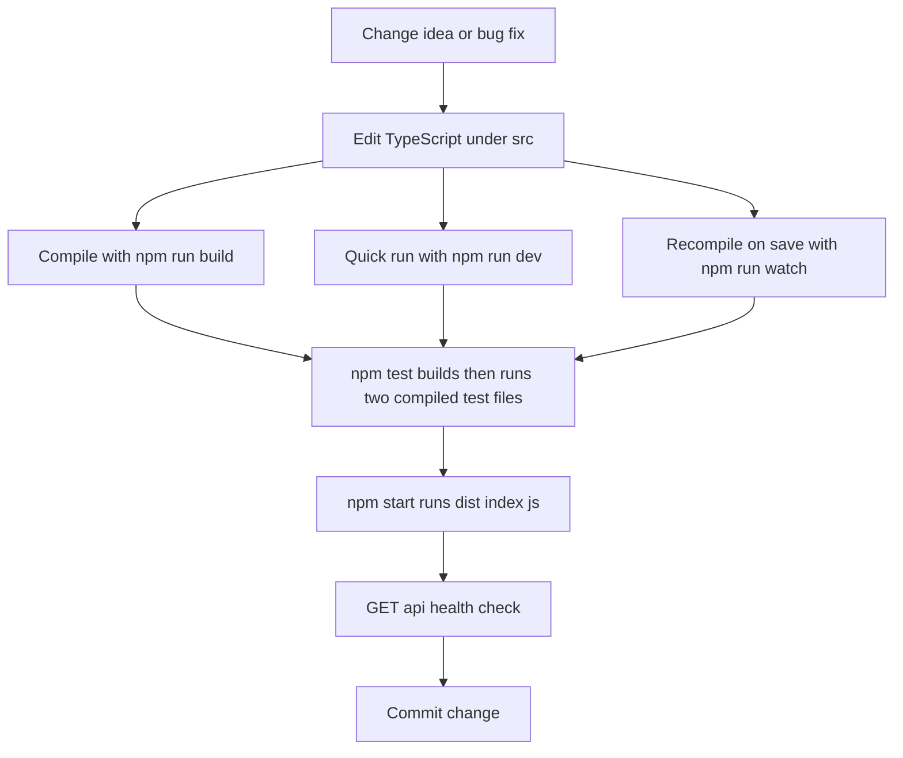

# Iteration Loop

The loop is local: edit TypeScript, compile, run tests, run the service, and check health. The provided excerpts do not include a CI workflow, a lint script, or a deploy script. Their absence is unverified because the excerpts are partial.

## Steps

1. **Edit and build.** `npm run build` runs `tsc`, which compiles `src/**/*` into `dist/` ([package.json:7](https://github.com/Jeffrey-Keyser/cron-service/blob/8ad749c7ce3502deec7e6699375aabad8f6688b3/package.json#L7), [tsconfig.json:6-7](https://github.com/Jeffrey-Keyser/cron-service/blob/8ad749c7ce3502deec7e6699375aabad8f6688b3/tsconfig.json#L6-L7), [tsconfig.json:17](https://github.com/Jeffrey-Keyser/cron-service/blob/8ad749c7ce3502deec7e6699375aabad8f6688b3/tsconfig.json#L17)).
2. **Quick run or watch.** `npm run dev` runs `ts-node src/index.ts`. `npm run watch` runs `tsc --watch` ([package.json:9-10](https://github.com/Jeffrey-Keyser/cron-service/blob/8ad749c7ce3502deec7e6699375aabad8f6688b3/package.json#L9-L10), [README.md:199-205](https://github.com/Jeffrey-Keyser/cron-service/blob/8ad749c7ce3502deec7e6699375aabad8f6688b3/README.md#L199-L205)).
3. **Tests.** `npm test` runs `npm run build`, then `node --test` on `dist/routes/jobs.test.js` and `dist/services/scheduler.test.js` ([package.json:11](https://github.com/Jeffrey-Keyser/cron-service/blob/8ad749c7ce3502deec7e6699375aabad8f6688b3/package.json#L11)). The sources for those test files are not in the provided excerpts, so their coverage is unknown.
4. **Run the built service.** `npm start` runs `node dist/index.js` ([package.json:8](https://github.com/Jeffrey-Keyser/cron-service/blob/8ad749c7ce3502deec7e6699375aabad8f6688b3/package.json#L8)). The README quick start also copies `.env.example` and runs the build first ([README.md:20-29](https://github.com/Jeffrey-Keyser/cron-service/blob/8ad749c7ce3502deec7e6699375aabad8f6688b3/README.md#L20-L29)).
5. **Schema changes.** Edit `schema.sql` and reapply it with `psql -U jeff -d cron_service -f schema.sql` ([README.md:22-25](https://github.com/Jeffrey-Keyser/cron-service/blob/8ad749c7ce3502deec7e6699375aabad8f6688b3/README.md#L22-L25)). Migration blocks use `IF NOT EXISTS` and `NOT EXISTS` guards, so reapplying them is intended to be safe ([schema.sql:54-55](https://github.com/Jeffrey-Keyser/cron-service/blob/8ad749c7ce3502deec7e6699375aabad8f6688b3/schema.sql#L54-L55), [schema.sql:92-95](https://github.com/Jeffrey-Keyser/cron-service/blob/8ad749c7ce3502deec7e6699375aabad8f6688b3/schema.sql#L92-L95), [schema.sql:147-155](https://github.com/Jeffrey-Keyser/cron-service/blob/8ad749c7ce3502deec7e6699375aabad8f6688b3/schema.sql#L147-L155)).
6. **Verify.** Check `GET /api/health`, which returns database, RabbitMQ, scheduler, and system checks ([src/index.ts:62-107](https://github.com/Jeffrey-Keyser/cron-service/blob/8ad749c7ce3502deec7e6699375aabad8f6688b3/src/index.ts#L62-L107)).

## Deploying

The repo ships a systemd unit that runs `node dist/index.js` from `/home/jkeyser/cron-service` ([cron-service.service:5-12](https://github.com/Jeffrey-Keyser/cron-service/blob/8ad749c7ce3502deec7e6699375aabad8f6688b3/cron-service.service#L5-L12)). The README documents installing and starting it with `systemctl` ([README.md:209-214](https://github.com/Jeffrey-Keyser/cron-service/blob/8ad749c7ce3502deec7e6699375aabad8f6688b3/README.md#L209-L214)). How a change reaches a host, and whether that host runs this exact checkout, is not shown in the provided source.

## Gaps

- No CI configuration appears in the provided excerpts. Whether one exists is unknown.
- No lint or format script appears in `package.json` ([package.json:6-12](https://github.com/Jeffrey-Keyser/cron-service/blob/8ad749c7ce3502deec7e6699375aabad8f6688b3/package.json#L6-L12)).
- Scheduler and RabbitMQ behavior is only checked by reading source here. No run was executed for this page.
