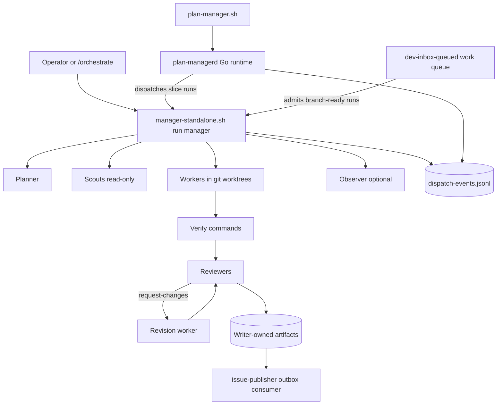

# Architecture

Three entry layers feed one run-manager pipeline. Above that pipeline sits a Go runtime that owns state and policy. See [Home](./) for an overview.

## Components

- **Run manager.** `scripts/manager-standalone.sh` is the entry point for one task-orchestration run. It is distinct from the plan manager ([scripts/manager-standalone.sh:L2-L4](https://github.com/Jeffrey-Keyser/dev-inbox/blob/9a72cd60e5068bd14367dc5f7f9acd50e387b650/scripts/manager-standalone.sh#L2-L4)).
  - It takes a per-run `manager.lock` lease and exits with 75 if another manager is already active for the run ([scripts/manager-standalone.sh:L143-L147](https://github.com/Jeffrey-Keyser/dev-inbox/blob/9a72cd60e5068bd14367dc5f7f9acd50e387b650/scripts/manager-standalone.sh#L143-L147)).
  - It writes `startup.json` and registers a failure trap before the other initialization steps ([scripts/manager-standalone.sh:L157-L168](https://github.com/Jeffrey-Keyser/dev-inbox/blob/9a72cd60e5068bd14367dc5f7f9acd50e387b650/scripts/manager-standalone.sh#L157-L168)).
  - The manager role is judgment-only: no inline planning and no source reads ([CLAUDE.md:L7](https://github.com/Jeffrey-Keyser/dev-inbox/blob/9a72cd60e5068bd14367dc5f7f9acd50e387b650/CLAUDE.md#L7)).
- **Roles.** Planner, scouts, workers, reviewers, prospectors, and the observer each run as agent CLI sessions ([CLAUDE.md:L7-L12](https://github.com/Jeffrey-Keyser/dev-inbox/blob/9a72cd60e5068bd14367dc5f7f9acd50e387b650/CLAUDE.md#L7-L12)).
  - Each role has its own spawn script, `scripts/spawn-<role>.sh` ([CLAUDE.md:L27](https://github.com/Jeffrey-Keyser/dev-inbox/blob/9a72cd60e5068bd14367dc5f7f9acd50e387b650/CLAUDE.md#L27)).
  - The default spawn backend is still tmux. Transient systemd units are used when `DEV_INBOX_SPAWN_BACKEND=systemd` ([systemd/README.md:L219-L221](https://github.com/Jeffrey-Keyser/dev-inbox/blob/9a72cd60e5068bd14367dc5f7f9acd50e387b650/systemd/README.md#L219-L221)).
  - Control prompts are situation-selected. Initial role contracts keep authority, scope, and output obligations, while detailed procedures are added only for the relevant situation ([docs/control-prompt-context.md](https://github.com/Jeffrey-Keyser/dev-inbox/blob/62e076649b2390fdbf267db53bb1bf9b4474c5ba/docs/control-prompt-context.md)).
- **`plan-managerd`.** This Go binary is a strangler-fig replacement for the old Bash plan-manager tooling ([cmd/plan-managerd/main.go:L1-L4](https://github.com/Jeffrey-Keyser/dev-inbox/blob/9a72cd60e5068bd14367dc5f7f9acd50e387b650/cmd/plan-managerd/main.go#L1-L4)).
  - It is the sole plan-manager runtime: state machine, wake routing, projection, provider selection, recovery, and `supervise` ([docs/KEY-PATHS.md:L71](https://github.com/Jeffrey-Keyser/dev-inbox/blob/9a72cd60e5068bd14367dc5f7f9acd50e387b650/docs/KEY-PATHS.md#L71)).
  - The old `PLAN_MANAGER_BACKEND` Bash fallback is gone ([docs/classify-detector-backend-reachability.md:L7-L10](https://github.com/Jeffrey-Keyser/dev-inbox/blob/9a72cd60e5068bd14367dc5f7f9acd50e387b650/docs/classify-detector-backend-reachability.md#L7-L10)).
- **Plan manager.** `scripts/plan-manager.sh` handles `start`, `status`, and `pause`. Its `wake` and `resume` commands exec `bin/plan-managerd` ([CLAUDE.md:L25](https://github.com/Jeffrey-Keyser/dev-inbox/blob/9a72cd60e5068bd14367dc5f7f9acd50e387b650/CLAUDE.md#L25)).
  - Codex lifecycle and remediation wakes receive the selected `wake.md` or `remediation.md` procedure. Tool-less Claude and OpenCode sessions keep their existing compact action contract, and shell procedures are not sent to them ([internal/controlsession/manager_prompt.go](https://github.com/Jeffrey-Keyser/dev-inbox/blob/62e076649b2390fdbf267db53bb1bf9b4474c5ba/internal/controlsession/manager_prompt.go), [internal/wake/router.go](https://github.com/Jeffrey-Keyser/dev-inbox/blob/62e076649b2390fdbf267db53bb1bf9b4474c5ba/internal/wake/router.go)).
- **Worker verification host.** Generated worker and revision runners start a task-bound `worker-verify-host` endpoint before provider invocation and stop it on exit ([docs/worker-verification-receipts.md](https://github.com/Jeffrey-Keyser/dev-inbox/blob/1c6139715f43ed8b68b9a58aca3b93781d21447a/docs/worker-verification-receipts.md)).
  - The command is hidden and registered in `cmd/plan-managerd/worker_verify_host.go`. It accepts only the `list`, `run`, and `status` operations. The transport is a private Unix socket with a capability token. When the sandbox denies `socket(2)`, the same operation-only protocol runs over a file exchange directory named by `DEV_INBOX_WORKER_VERIFY_EXCHANGE_DIR`. Commands and identities come from the launcher binding, not the client ([cmd/plan-managerd/worker_verify_host.go](https://github.com/Jeffrey-Keyser/dev-inbox/blob/34ee9c20e0acd1826eefe200bc1dac4c92434f58/cmd/plan-managerd/worker_verify_host.go), [cmd/plan-managerd/worker_verify_exchange.go](https://github.com/Jeffrey-Keyser/dev-inbox/blob/34ee9c20e0acd1826eefe200bc1dac4c92434f58/cmd/plan-managerd/worker_verify_exchange.go)).
  - A successful verification binds the final build outputs and test caches. The runtime fingerprints reviewed source, index, HEAD, task identity, and verification policy before and after execution, and refuses the result if any of them changed during verification ([cmd/plan-managerd/worker_verify_runtime.go](https://github.com/Jeffrey-Keyser/dev-inbox/blob/34ee9c20e0acd1826eefe200bc1dac4c92434f58/cmd/plan-managerd/worker_verify_runtime.go)).
  - Worker and manager verification for one repository share a lease in `internal/verificationexecution/repository_lease.go` so suites do not reset the same test database concurrently ([internal/verificationexecution/repository_lease.go](https://github.com/Jeffrey-Keyser/dev-inbox/blob/1c6139715f43ed8b68b9a58aca3b93781d21447a/internal/verificationexecution/repository_lease.go)).
- **Work queue.** `dev-inbox-queued` runs either as a daemon or as an operator CLI.
  - The daemon defaults to shadow mode. `--released-bake` keeps the per-job hold/release gate, and `--unattended` removes it ([cmd/dev-inbox-queued/main.go:L155-L174](https://github.com/Jeffrey-Keyser/dev-inbox/blob/9a72cd60e5068bd14367dc5f7f9acd50e387b650/cmd/dev-inbox-queued/main.go#L155-L174)).
  - `plan-managerd prompter queue-manager` selects admission, admission-drift, recovery, and incident guidance from packet signal kinds before model invocation. The packet is delivered unchanged, and a missing selected module stops launch rather than omitting policy ([internal/prompter/queue_manager.go](https://github.com/Jeffrey-Keyser/dev-inbox/blob/62e076649b2390fdbf267db53bb1bf9b4474c5ba/internal/prompter/queue_manager.go)).
  - Plan bootstrap stderr is captured as reconcile evidence. For plan launches, the `devinbox` driver creates `<attempt>/driver/bootstrap.stderr` exclusively with mode 0600 and passes it to the child as stderr. The file is a regular file, not a daemon-owned pipe. Capture is best-effort and never blocks launch. When a dead bootstrap is reconciled as never-started or as an ambiguous stop, one bounded, whitespace-collapsed, redacted `bootstrap stderr tail:` line is appended to the evidence ([internal/workqueue/driver/devinbox/devinbox.go](https://github.com/Jeffrey-Keyser/dev-inbox/blob/c9a95688d74b/internal/workqueue/driver/devinbox/devinbox.go), [internal/workqueue/driver/devinbox/collaborators.go](https://github.com/Jeffrey-Keyser/dev-inbox/blob/c9a95688d74b/internal/workqueue/driver/devinbox/collaborators.go)).
- **Isolated boundary binaries.** Read-only checkers validate agent drafts without writing anything:
  - `observer-submit-check` ([cmd/observer-submit-check/main.go:L3-L11](https://github.com/Jeffrey-Keyser/dev-inbox/blob/9a72cd60e5068bd14367dc5f7f9acd50e387b650/cmd/observer-submit-check/main.go#L3-L11));
  - `scout-submit-check` ([cmd/scout-submit-check/main.go:L3-L18](https://github.com/Jeffrey-Keyser/dev-inbox/blob/9a72cd60e5068bd14367dc5f7f9acd50e387b650/cmd/scout-submit-check/main.go#L3-L18)).
  - `run-observe guidance analysis|report` prints two Markdown guidance resources embedded in the reader binary. Arbitrary paths are refused ([cmd/run-observe/main.go](https://github.com/Jeffrey-Keyser/dev-inbox/blob/62e076649b2390fdbf267db53bb1bf9b4474c5ba/cmd/run-observe/main.go), [cmd/run-observe/guidance/report.md](https://github.com/Jeffrey-Keyser/dev-inbox/blob/62e076649b2390fdbf267db53bb1bf9b4474c5ba/cmd/run-observe/guidance/report.md)).
- **Publishers.** Two publishers share the filesystem outboxes:
  - `forge-lifecycle` is a credential-free outbox writer;
  - `issue-publisher` is the only component that performs remote mutations ([docs/forge-lifecycle-operations.md:L3-L4](https://github.com/Jeffrey-Keyser/dev-inbox/blob/9a72cd60e5068bd14367dc5f7f9acd50e387b650/docs/forge-lifecycle-operations.md#L3-L4)).

## State and contracts

- **Split source of truth.**
  - The event log is canonical for identity, lifecycle, ordering, and timing.
  - Role and manager writers are canonical for `result.json`, `review.json`, `verify.json`, and the other artifact bodies.
  - `plan-managerd project` can recreate a missing compatible artifact, but it never replaces a writer-of-record artifact.
  - Waits are event-tail only, and orchestration emits no `tmux wait-for -S` signals ([CLAUDE.md:L14](https://github.com/Jeffrey-Keyser/dev-inbox/blob/9a72cd60e5068bd14367dc5f7f9acd50e387b650/CLAUDE.md#L14)).
  - tmux is only a display surface ([README.md:L152-L154](https://github.com/Jeffrey-Keyser/dev-inbox/blob/9a72cd60e5068bd14367dc5f7f9acd50e387b650/README.md#L152-L154)).
- **Run artifact consumer contract.** Consumers read canonical run and task evidence under `results/<runId>/`, and plan state and events under `plans/<planId>/`. The contract keeps the plan event log separate from the run event log. Consumers gain no write authority by knowing a source path ([.agent/context/run-artifacts.md](https://github.com/Jeffrey-Keyser/dev-inbox/blob/62e076649b2390fdbf267db53bb1bf9b4474c5ba/.agent/context/run-artifacts.md)).
- **Outcome separation.** Worker outcome, reviewer judgment, verification, and merge outcome are recorded separately. An approving review does not prove that verification passed or that a commit was integrated. Missing or malformed evidence stays visible as a limitation ([.agent/context/run-artifacts.md](https://github.com/Jeffrey-Keyser/dev-inbox/blob/62e076649b2390fdbf267db53bb1bf9b4474c5ba/.agent/context/run-artifacts.md)).
- **Result finalization.** Host-owned finalization of synthesized `result.json` (commit `96e8b338d26f`):
  - An admitted model keeps its narrative, but `startedAt` and `completedAt` are replaced with the host attempt start and the finalizer's completion clock ([internal/resultsynthesis/resultsynthesis.go](https://github.com/Jeffrey-Keyser/dev-inbox/blob/96e8b338d26f/internal/resultsynthesis/resultsynthesis.go)).
  - Each result carries the host's normalized `generation`. `finalizationProvenance` is bound only to a finalization receipt matching that generation, run, task, repository, worktree, and branch; model-supplied provenance is discarded ([internal/resultsynthesis/provenance.go](https://github.com/Jeffrey-Keyser/dev-inbox/blob/96e8b338d26f/internal/resultsynthesis/provenance.go)).
  - Before canonical replacement, publication keeps a private, redacted, create-only `result-<generation>-<content-key>.json` snapshot. If the snapshot cannot be written, the canonical `result.json` is not replaced ([internal/resultsynthesis/provenance.go](https://github.com/Jeffrey-Keyser/dev-inbox/blob/96e8b338d26f/internal/resultsynthesis/provenance.go)).
  - Incident evidence and regression coverage: [docs/issue-132-result-completion.md](https://github.com/Jeffrey-Keyser/dev-inbox/blob/96e8b338d26f/docs/issue-132-result-completion.md).
- **Aggregates.**
  - Orchestration: `plan → slices → run → tasks`.
  - Queue: `batch → jobs → attempts → intent` ([docs/DOMAIN-GLOSSARY.md:L9-L10](https://github.com/Jeffrey-Keyser/dev-inbox/blob/9a72cd60e5068bd14367dc5f7f9acd50e387b650/docs/DOMAIN-GLOSSARY.md#L9-L10), [docs/DOMAIN-GLOSSARY.md:L36-L42](https://github.com/Jeffrey-Keyser/dev-inbox/blob/9a72cd60e5068bd14367dc5f7f9acd50e387b650/docs/DOMAIN-GLOSSARY.md#L36-L42)).
- **Provider selection.** `plan-managerd providers select` owns the choice. The shell router only exports the chosen provider and model and emits `inference_*` events ([docs/inference-layer.md:L5-L8](https://github.com/Jeffrey-Keyser/dev-inbox/blob/9a72cd60e5068bd14367dc5f7f9acd50e387b650/docs/inference-layer.md#L5-L8)).
- **Concurrency.** At most 12 agent CLIs run at once, enforced by a filesystem semaphore in `results/.slots/` ([CLAUDE.md:L99](https://github.com/Jeffrey-Keyser/dev-inbox/blob/9a72cd60e5068bd14367dc5f7f9acd50e387b650/CLAUDE.md#L99)).
- **Review policy.**
  - Tiering lets trivial diffs skip the LLM review ([CLAUDE.md:L101](https://github.com/Jeffrey-Keyser/dev-inbox/blob/9a72cd60e5068bd14367dc5f7f9acd50e387b650/CLAUDE.md#L101)).
  - Revisions are capped by `maxRevisions`, default 3, and a `reject` verdict is never auto-revised ([CLAUDE.md:L102](https://github.com/Jeffrey-Keyser/dev-inbox/blob/9a72cd60e5068bd14367dc5f7f9acd50e387b650/CLAUDE.md#L102)).
  - A revision that commits nothing is held instead of spending another revision. When `review.json` and the previous attempt's archived `review-<n-1>.json` record the same host-derived `reviewedHeadSha`, the decision holds with a `revision made no progress: HEAD <sha> unchanged` reason. Unknown or missing identities never match, and the check runs after the revision budget check ([internal/reviewacceptance/accept.go:L409-L411](https://github.com/Jeffrey-Keyser/dev-inbox/blob/78402b9ca152bc8a108473de0c83754a1bb6bc46/internal/reviewacceptance/accept.go#L409-L411), [internal/reviewacceptance/stall.go:L81-L96](https://github.com/Jeffrey-Keyser/dev-inbox/blob/78402b9ca152bc8a108473de0c83754a1bb6bc46/internal/reviewacceptance/stall.go#L81-L96)).
- **Compiled task context.** `plan-managerd context-prepare` publishes immutable context artifacts and binds their digests in `plan.json` ([CLAUDE.md:L95](https://github.com/Jeffrey-Keyser/dev-inbox/blob/9a72cd60e5068bd14367dc5f7f9acd50e387b650/CLAUDE.md#L95)).
- **Manager invocation accounting.** Each executed manager decomposition, initialization, wake, or correction attempt appends one `plan.invocation_usage` event to `plans/<planId>/events.jsonl`, including failed and rejected attempts. The event carries numeric usage read only from the invocation-local native provider stream; answer text is never an accounting source. When a start fails after the journal holds records, `plan-managerd trap-commit write-failed --plan-events-file` projects the same invocations into `results/<runId>/failed.json` under `retainedUsage` without creating new invocations or charges. The projection lives in `internal/planevents/invocationusage.go`, `internal/agentclitrace/managerusage.go`, and `internal/trapcommit/retained.go`, with CLI wiring in `cmd/plan-managerd/plan_event.go` and `cmd/plan-managerd/trap_commit.go` ([docs/manager-control-usage-accounting.md](https://github.com/Jeffrey-Keyser/dev-inbox/blob/f1c7fd60982b2c82333aab0e7bc5692b7cfd8697/docs/manager-control-usage-accounting.md)).
