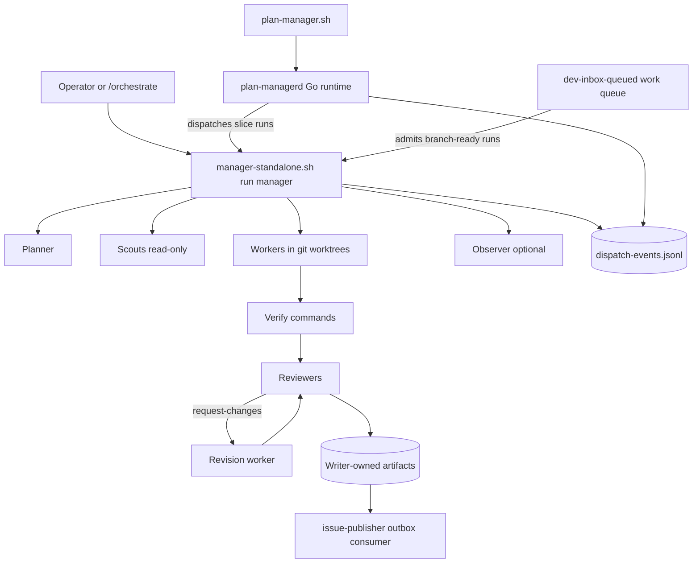

# Architecture

Three entry layers feed one run-manager pipeline. Above that pipeline sits a Go runtime that owns state and policy. See [Home](./) for an overview.

## Components

- **Run manager.** `scripts/manager-standalone.sh` is the entry point for one task-orchestration run. It is distinct from the plan manager ([scripts/manager-standalone.sh:L2-L4](https://github.com/Jeffrey-Keyser/dev-inbox/blob/9a72cd60e5068bd14367dc5f7f9acd50e387b650/scripts/manager-standalone.sh#L2-L4)).
  - It takes a per-run `manager.lock` lease and exits with 75 if another manager is already active for the run ([scripts/manager-standalone.sh:L143-L147](https://github.com/Jeffrey-Keyser/dev-inbox/blob/9a72cd60e5068bd14367dc5f7f9acd50e387b650/scripts/manager-standalone.sh#L143-L147)).
  - It writes `startup.json` and registers a failure trap before the other initialization steps ([scripts/manager-standalone.sh:L157-L168](https://github.com/Jeffrey-Keyser/dev-inbox/blob/9a72cd60e5068bd14367dc5f7f9acd50e387b650/scripts/manager-standalone.sh#L157-L168)).
  - The manager role is judgment-only: no inline planning and no source reads ([CLAUDE.md:L7](https://github.com/Jeffrey-Keyser/dev-inbox/blob/9a72cd60e5068bd14367dc5f7f9acd50e387b650/CLAUDE.md#L7)).
- **Roles.** Planner, scouts, workers, reviewers, prospectors, and the observer each run as agent CLI sessions ([CLAUDE.md:L7-L12](https://github.com/Jeffrey-Keyser/dev-inbox/blob/9a72cd60e5068bd14367dc5f7f9acd50e387b650/CLAUDE.md#L7-L12)).
  - Each role has its own spawn script, `scripts/spawn-<role>.sh` ([CLAUDE.md:L27](https://github.com/Jeffrey-Keyser/dev-inbox/blob/9a72cd60e5068bd14367dc5f7f9acd50e387b650/CLAUDE.md#L27)).
  - The default spawn backend is still tmux. Transient systemd units are used when `DEV_INBOX_SPAWN_BACKEND=systemd` ([systemd/README.md:L219-L221](https://github.com/Jeffrey-Keyser/dev-inbox/blob/9a72cd60e5068bd14367dc5f7f9acd50e387b650/systemd/README.md#L219-L221)).
- **`plan-managerd`.** This Go binary is a strangler-fig replacement for the old Bash plan-manager tooling ([cmd/plan-managerd/main.go:L1-L4](https://github.com/Jeffrey-Keyser/dev-inbox/blob/9a72cd60e5068bd14367dc5f7f9acd50e387b650/cmd/plan-managerd/main.go#L1-L4)).
  - It is the sole plan-manager runtime: state machine, wake routing, projection, provider selection, recovery, and `supervise` ([docs/KEY-PATHS.md:L71](https://github.com/Jeffrey-Keyser/dev-inbox/blob/9a72cd60e5068bd14367dc5f7f9acd50e387b650/docs/KEY-PATHS.md#L71)).
  - The old `PLAN_MANAGER_BACKEND` Bash fallback is gone ([docs/classify-detector-backend-reachability.md:L7-L10](https://github.com/Jeffrey-Keyser/dev-inbox/blob/9a72cd60e5068bd14367dc5f7f9acd50e387b650/docs/classify-detector-backend-reachability.md#L7-L10)).
- **Plan manager.** `scripts/plan-manager.sh` handles `start`, `status`, and `pause`. Its `wake` and `resume` commands exec `bin/plan-managerd` ([CLAUDE.md:L25](https://github.com/Jeffrey-Keyser/dev-inbox/blob/9a72cd60e5068bd14367dc5f7f9acd50e387b650/CLAUDE.md#L25)).
- **Work queue.** `dev-inbox-queued` runs either as a daemon or as an operator CLI.
  - The daemon defaults to shadow mode. `--released-bake` keeps the per-job hold/release gate, and `--unattended` removes it ([cmd/dev-inbox-queued/main.go:L155-L174](https://github.com/Jeffrey-Keyser/dev-inbox/blob/9a72cd60e5068bd14367dc5f7f9acd50e387b650/cmd/dev-inbox-queued/main.go#L155-L174)).
- **Isolated boundary binaries.** Read-only checkers validate agent drafts without writing anything:
  - `observer-submit-check` ([cmd/observer-submit-check/main.go:L3-L11](https://github.com/Jeffrey-Keyser/dev-inbox/blob/9a72cd60e5068bd14367dc5f7f9acd50e387b650/cmd/observer-submit-check/main.go#L3-L11));
  - `scout-submit-check` ([cmd/scout-submit-check/main.go:L3-L18](https://github.com/Jeffrey-Keyser/dev-inbox/blob/9a72cd60e5068bd14367dc5f7f9acd50e387b650/cmd/scout-submit-check/main.go#L3-L18)).
- **Publishers.** Two publishers share the filesystem outboxes:
  - `forge-lifecycle` is a credential-free outbox writer;
  - `issue-publisher` is the only component that performs remote mutations ([docs/forge-lifecycle-operations.md:L3-L4](https://github.com/Jeffrey-Keyser/dev-inbox/blob/9a72cd60e5068bd14367dc5f7f9acd50e387b650/docs/forge-lifecycle-operations.md#L3-L4)).

## State and contracts

- **Split source of truth.**
  - The event log is canonical for identity, lifecycle, ordering, and timing.
  - Role and manager writers are canonical for `result.json`, `review.json`, `verify.json`, and the other artifact bodies.
  - `plan-managerd project` can recreate a missing compatible artifact, but it never replaces a writer-of-record artifact.
  - Waits are event-tail only, and orchestration emits no `tmux wait-for -S` signals ([CLAUDE.md:L14](https://github.com/Jeffrey-Keyser/dev-inbox/blob/9a72cd60e5068bd14367dc5f7f9acd50e387b650/CLAUDE.md#L14)).
  - tmux is only a display surface ([README.md:L152-L154](https://github.com/Jeffrey-Keyser/dev-inbox/blob/9a72cd60e5068bd14367dc5f7f9acd50e387b650/README.md#L152-L154)).
- **Aggregates.**
  - Orchestration: `plan → slices → run → tasks`.
  - Queue: `batch → jobs → attempts → intent` ([docs/DOMAIN-GLOSSARY.md:L9-L10](https://github.com/Jeffrey-Keyser/dev-inbox/blob/9a72cd60e5068bd14367dc5f7f9acd50e387b650/docs/DOMAIN-GLOSSARY.md#L9-L10), [docs/DOMAIN-GLOSSARY.md:L36-L42](https://github.com/Jeffrey-Keyser/dev-inbox/blob/9a72cd60e5068bd14367dc5f7f9acd50e387b650/docs/DOMAIN-GLOSSARY.md#L36-L42)).
- **Provider selection.** `plan-managerd providers select` owns the choice. The shell router only exports the chosen provider and model and emits `inference_*` events ([docs/inference-layer.md:L5-L8](https://github.com/Jeffrey-Keyser/dev-inbox/blob/9a72cd60e5068bd14367dc5f7f9acd50e387b650/docs/inference-layer.md#L5-L8)).
- **Concurrency.** At most 12 agent CLIs run at once, enforced by a filesystem semaphore in `results/.slots/` ([CLAUDE.md:L99](https://github.com/Jeffrey-Keyser/dev-inbox/blob/9a72cd60e5068bd14367dc5f7f9acd50e387b650/CLAUDE.md#L99)).
- **Review policy.**
  - Tiering lets trivial diffs skip the LLM review ([CLAUDE.md:L101](https://github.com/Jeffrey-Keyser/dev-inbox/blob/9a72cd60e5068bd14367dc5f7f9acd50e387b650/CLAUDE.md#L101)).
  - Revisions are capped by `maxRevisions`, default 3, and a `reject` verdict is never auto-revised ([CLAUDE.md:L102](https://github.com/Jeffrey-Keyser/dev-inbox/blob/9a72cd60e5068bd14367dc5f7f9acd50e387b650/CLAUDE.md#L102)).
  - A revision that commits nothing is held instead of spending another revision. When `review.json` and the previous attempt's archived `review-<n-1>.json` record the same host-derived `reviewedHeadSha`, the decision holds with a `revision made no progress: HEAD <sha> unchanged` reason. Unknown or missing identities never match, and the check runs after the revision budget check ([internal/reviewacceptance/accept.go:L409-L411](https://github.com/Jeffrey-Keyser/dev-inbox/blob/78402b9ca152bc8a108473de0c83754a1bb6bc46/internal/reviewacceptance/accept.go#L409-L411), [internal/reviewacceptance/stall.go:L81-L96](https://github.com/Jeffrey-Keyser/dev-inbox/blob/78402b9ca152bc8a108473de0c83754a1bb6bc46/internal/reviewacceptance/stall.go#L81-L96)).
- **Compiled task context.** `plan-managerd context-prepare` publishes immutable context artifacts and binds their digests in `plan.json` ([CLAUDE.md:L95](https://github.com/Jeffrey-Keyser/dev-inbox/blob/9a72cd60e5068bd14367dc5f7f9acd50e387b650/CLAUDE.md#L95)).
