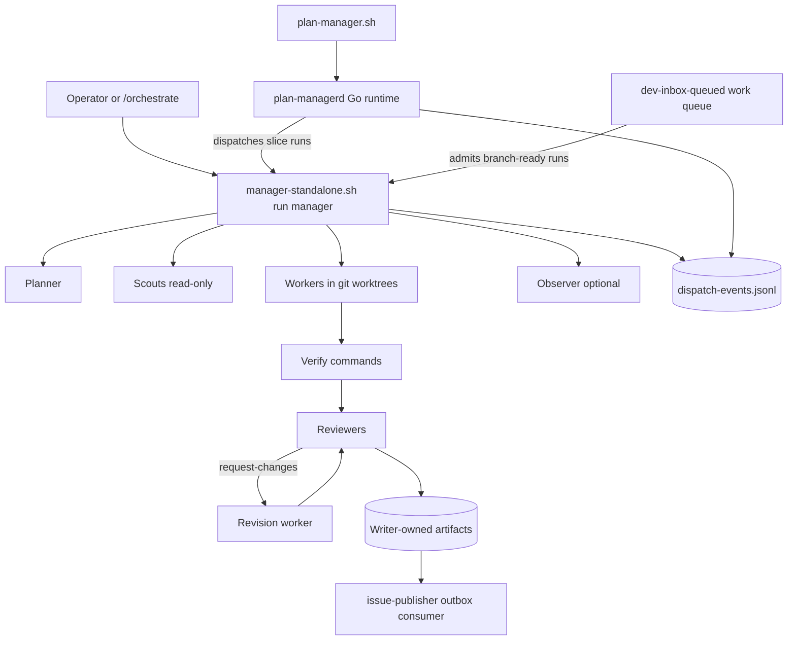

# Architecture

Three entry layers feed one run-manager pipeline. Above that pipeline sits a Go runtime that owns state and policy. See [Home](./) for an overview.

## Components

- **Run manager.** `scripts/manager-standalone.sh` is the entry point for one task-orchestration run. It is distinct from the plan manager ([scripts/manager-standalone.sh:L2-L4](https://github.com/Jeffrey-Keyser/dev-inbox/blob/9a72cd60e5068bd14367dc5f7f9acd50e387b650/scripts/manager-standalone.sh#L2-L4)).
  - It takes a per-run `manager.lock` lease and exits with 75 if another manager is already active for the run ([scripts/manager-standalone.sh:L143-L147](https://github.com/Jeffrey-Keyser/dev-inbox/blob/9a72cd60e5068bd14367dc5f7f9acd50e387b650/scripts/manager-standalone.sh#L143-L147)).
  - It writes `startup.json` and registers a failure trap before the other initialization steps ([scripts/manager-standalone.sh:L157-L168](https://github.com/Jeffrey-Keyser/dev-inbox/blob/9a72cd60e5068bd14367dc5f7f9acd50e387b650/scripts/manager-standalone.sh#L157-L168)).
  - The manager role is judgment-only: no inline planning and no source reads ([CLAUDE.md:L7](https://github.com/Jeffrey-Keyser/dev-inbox/blob/9a72cd60e5068bd14367dc5f7f9acd50e387b650/CLAUDE.md#L7)).
- **Roles.** Planner, scouts, workers, reviewers, prospectors, and the observer each run as agent CLI sessions ([CLAUDE.md:L7-L12](https://github.com/Jeffrey-Keyser/dev-inbox/blob/9a72cd60e5068bd14367dc5f7f9acd50e387b650/CLAUDE.md#L7-L12)).
  - Each role has its own spawn script, `scripts/spawn-<role>.sh` ([CLAUDE.md:L27](https://github.com/Jeffrey-Keyser/dev-inbox/blob/9a72cd60e5068bd14367dc5f7f9acd50e387b650/CLAUDE.md#L27)).
  - The default spawn backend is still tmux. Transient systemd units are used when `DEV_INBOX_SPAWN_BACKEND=systemd` ([systemd/README.md:L219-L221](https://github.com/Jeffrey-Keyser/dev-inbox/blob/9a72cd60e5068bd14367dc5f7f9acd50e387b650/systemd/README.md#L219-L221)).
  - Control prompts are situation-selected. Initial role contracts keep authority, scope, and output obligations, while detailed procedures are added only for the relevant situation ([docs/control-prompt-context.md](https://github.com/Jeffrey-Keyser/dev-inbox/blob/62e076649b2390fdbf267db53bb1bf9b4474c5ba/docs/control-prompt-context.md)).
- **`plan-managerd`.** This Go binary is a strangler-fig replacement for the old Bash plan-manager tooling ([cmd/plan-managerd/main.go:L1-L4](https://github.com/Jeffrey-Keyser/dev-inbox/blob/9a72cd60e5068bd14367dc5f7f9acd50e387b650/cmd/plan-managerd/main.go#L1-L4)).
  - It is the sole plan-manager runtime: state machine, wake routing, projection, provider selection, recovery, and `supervise` ([docs/KEY-PATHS.md:L71](https://github.com/Jeffrey-Keyser/dev-inbox/blob/9a72cd60e5068bd14367dc5f7f9acd50e387b650/docs/KEY-PATHS.md#L71)).
  - The old `PLAN_MANAGER_BACKEND` Bash fallback is gone ([docs/classify-detector-backend-reachability.md:L7-L10](https://github.com/Jeffrey-Keyser/dev-inbox/blob/9a72cd60e5068bd14367dc5f7f9acd50e387b650/docs/classify-detector-backend-reachability.md#L7-L10)).
- **Plan manager.** `scripts/plan-manager.sh` handles `start`, `status`, and `pause`. Its `wake` and `resume` commands exec `bin/plan-managerd` ([CLAUDE.md:L25](https://github.com/Jeffrey-Keyser/dev-inbox/blob/9a72cd60e5068bd14367dc5f7f9acd50e387b650/CLAUDE.md#L25)).
  - Codex lifecycle and remediation wakes receive the selected `wake.md` or `remediation.md` procedure. Tool-less Claude and OpenCode sessions keep their existing compact action contract, and shell procedures are not sent to them ([internal/controlsession/manager_prompt.go](https://github.com/Jeffrey-Keyser/dev-inbox/blob/62e076649b2390fdbf267db53bb1bf9b4474c5ba/internal/controlsession/manager_prompt.go), [internal/wake/router.go](https://github.com/Jeffrey-Keyser/dev-inbox/blob/62e076649b2390fdbf267db53bb1bf9b4474c5ba/internal/wake/router.go)).
- **Worker verification host.** Generated worker and revision runners start a task-bound `worker-verify-host` endpoint before provider invocation and stop it on exit ([docs/worker-verification-receipts.md](https://github.com/Jeffrey-Keyser/dev-inbox/blob/1c6139715f43ed8b68b9a58aca3b93781d21447a/docs/worker-verification-receipts.md)).
  - The command is hidden and registered in `cmd/plan-managerd/worker_verify_host.go`. It accepts only the `list`, `run`, and `status` operations. The transport is a private Unix socket with a capability token. When the sandbox denies `socket(2)`, the same operation-only protocol runs over a file exchange directory named by `DEV_INBOX_WORKER_VERIFY_EXCHANGE_DIR`. Commands and identities come from the launcher binding, not the client ([cmd/plan-managerd/worker_verify_host.go](https://github.com/Jeffrey-Keyser/dev-inbox/blob/34ee9c20e0acd1826eefe200bc1dac4c92434f58/cmd/plan-managerd/worker_verify_host.go), [cmd/plan-managerd/worker_verify_exchange.go](https://github.com/Jeffrey-Keyser/dev-inbox/blob/34ee9c20e0acd1826eefe200bc1dac4c92434f58/cmd/plan-managerd/worker_verify_exchange.go)).
  - A successful verification binds the final build outputs and test caches. The runtime fingerprints reviewed source, index, HEAD, task identity, and verification policy before and after execution, and refuses the result if any of them changed during verification ([cmd/plan-managerd/worker_verify_runtime.go](https://github.com/Jeffrey-Keyser/dev-inbox/blob/34ee9c20e0acd1826eefe200bc1dac4c92434f58/cmd/plan-managerd/worker_verify_runtime.go)).
  - Every run replaces the canonical `results/<runId>/tasks/<taskId>/worker-verify.json`. A receipt classified `fail` is also published to `worker-verify-last-fail.json` beside it, both by the runtime and by `worker-verify-publish`, so a later `infra` or stale run cannot erase the most recent actionable failure. Freshness and status read only `worker-verify.json` ([cmd/plan-managerd/worker_verify_runtime.go](https://github.com/Jeffrey-Keyser/dev-inbox/blob/5a50afdc82342e278e8873ae9dd7fd879ea925a9/cmd/plan-managerd/worker_verify_runtime.go), [cmd/plan-managerd/worker_verify_transport.go](https://github.com/Jeffrey-Keyser/dev-inbox/blob/5a50afdc82342e278e8873ae9dd7fd879ea925a9/cmd/plan-managerd/worker_verify_transport.go), [internal/artifactlayout/layout.go](https://github.com/Jeffrey-Keyser/dev-inbox/blob/5a50afdc82342e278e8873ae9dd7fd879ea925a9/internal/artifactlayout/layout.go), [docs/worker-verification-receipts.md](https://github.com/Jeffrey-Keyser/dev-inbox/blob/5a50afdc82342e278e8873ae9dd7fd879ea925a9/docs/worker-verification-receipts.md)).
  - One `worker-verify run` is admitted per task through the `worker-verify-run.lock` lease beside the receipt; a second concurrent run gets the shared busy exit 75 ([cmd/plan-managerd/worker_verify_runtime.go](https://github.com/Jeffrey-Keyser/dev-inbox/blob/20bce1493c6e05a4a6a21fe56f7c591a63f98b30/cmd/plan-managerd/worker_verify_runtime.go)).
  - Worker and manager verification for one repository share a lease in `internal/verificationexecution/repository_lease.go` so suites do not reset the same test database concurrently ([internal/verificationexecution/repository_lease.go](https://github.com/Jeffrey-Keyser/dev-inbox/blob/1c6139715f43ed8b68b9a58aca3b93781d21447a/internal/verificationexecution/repository_lease.go)).
- **Manager verification plan projection.** `plan-managerd manager-verify` now accepts `render-plan-request` alongside the scalar `render-request` ([cmd/plan-managerd/manager_verify.go](https://github.com/Jeffrey-Keyser/dev-inbox/blob/244a1f52c4cd6790979a2c3dbcb8d0343fb9beb7/cmd/plan-managerd/manager_verify.go)).
  - It reads the plan JSON on stdin (up to 8 MiB) and takes `--run-id`, `--task-id`, `--orchestration-repo`, `--task-artifact-dir`, `--timeout-seconds`, and `--minimum-bar`. Positional arguments or bad flags are usage errors (exit 64). Classified plan errors and invalid verification requests exit 2 as invalid input. On success it prints one rendered request through `verificationexecution.RenderRequestJSON`.
  - The typed owner is `internal/plancompiler.ProjectManagerVerificationRequest`. It selects exactly one task by identity and applies the manager-compatible precedence: `repository // repo // repoPath`, `taskMode // "implementation"` (ignoring legacy `mode`), task-versus-plan `baseBranch` with a `main` default, and ordered `verifyCommands`. It rejects trailing plan input and builds the request through `internal/verificationexecution.BuildRenderRequest`. `plancompiler` now depends on `verificationexecution` ([internal/plancompiler/manager_verification.go](https://github.com/Jeffrey-Keyser/dev-inbox/blob/244a1f52c4cd6790979a2c3dbcb8d0343fb9beb7/internal/plancompiler/manager_verification.go), [internal/boundarycontract/package-deps.manifest](https://github.com/Jeffrey-Keyser/dev-inbox/blob/244a1f52c4cd6790979a2c3dbcb8d0343fb9beb7/internal/boundarycontract/package-deps.manifest)).
  - `scripts/verify-task.sh` only transports the plan bytes and operational scalars to the new operation; it makes no task-selection or precedence decisions in Bash. If a pinned binary rejects `render-plan-request` with usage exit 64, the script logs the selected binary identity and operation, publishes the established conservative configuration-failure receipt under the existing lease, and returns through the current verification-failure consumer without running verification commands. The scalar `render-request` and worker verification views are unchanged. The gate is `scripts/test-manager-verification-plan-projection.sh` ([docs/plan-manager-go-migration.md](https://github.com/Jeffrey-Keyser/dev-inbox/blob/244a1f52c4cd6790979a2c3dbcb8d0343fb9beb7/docs/plan-manager-go-migration.md), [scripts/verify-task.sh](https://github.com/Jeffrey-Keyser/dev-inbox/blob/244a1f52c4cd6790979a2c3dbcb8d0343fb9beb7/scripts/verify-task.sh), [scripts/test-manager-verification-plan-projection.sh](https://github.com/Jeffrey-Keyser/dev-inbox/blob/244a1f52c4cd6790979a2c3dbcb8d0343fb9beb7/scripts/test-manager-verification-plan-projection.sh)).
  - This implements the design `manager-verification-plan-projection-existing-owner`, now marked `done` ([design/manager-verification-plan-projection-existing-owner/meta.json](https://github.com/Jeffrey-Keyser/dev-inbox/blob/244a1f52c4cd6790979a2c3dbcb8d0343fb9beb7/design/manager-verification-plan-projection-existing-owner/meta.json)).
- **Worker elapsed budget and verification credit (issue #152).** The hidden `plan-managerd worker-budget` command (module `worker-liveness`) is the typed elapsed-budget boundary for the manager's worker poll loop. The manager consults it only once the base budget (`--timeout-seconds`) is spent ([cmd/plan-managerd/worker_budget.go](https://github.com/Jeffrey-Keyser/dev-inbox/blob/20bce1493c6e05a4a6a21fe56f7c591a63f98b30/cmd/plan-managerd/worker_budget.go)).
  - Required flags are `--results-dir`, `--run-id`, `--task-id`, `--elapsed-seconds`, and `--timeout-seconds`. Optional flags are `--worktree`, `--since` (RFC3339; empty counts all), and `--verify-credit-max-seconds`, the maximum verification credit.
  - It sums `duration_ms` over the task's `worker_verify` events with `operation=run` in `results/<runId>/dispatch-events.jsonl`. Status checks are excluded because they do not wait on suites. A missing stream counts as zero runs, and malformed lines are skipped with a stderr diagnostic.
  - It probes whether a verification is in flight by taking a non-blocking shared lock on the `worker-verify-run.lock` lease beside the receipt and, when `--worktree` is given, beside the worktree's worker-verify outbox. The probe opens without creating and fails only while a run holds the exclusive lock.
  - The result is one `worker-budget.v1` JSON verdict (`workerliveness.BudgetVerdict`, computed by `workerliveness.Budget` in [internal/workerliveness/budget.go](https://github.com/Jeffrey-Keyser/dev-inbox/blob/20bce1493c6e05a4a6a21fe56f7c591a63f98b30/internal/workerliveness/budget.go)) with exit 0. Unknown flags are usage errors (exit 64), so the Bash adapter can keep the legacy timeout on a pinned binary that predates the command. The shell side of the poll loop changed in [scripts/lib/manager-poll-liveness.sh](https://github.com/Jeffrey-Keyser/dev-inbox/blob/20bce1493c6e05a4a6a21fe56f7c591a63f98b30/scripts/lib/manager-poll-liveness.sh), and the regression gate is [scripts/test-worker-verify-budget-credit.sh](https://github.com/Jeffrey-Keyser/dev-inbox/blob/20bce1493c6e05a4a6a21fe56f7c591a63f98b30/scripts/test-worker-verify-budget-credit.sh).
  - The opaque budget reply is admitted before any scalar read. The Bash adapter forwards the producer's bytes to the hidden `plan-managerd worker-budget-receive` command on stdin. Admission is owned by `internal/workerliveness` (`AdmitBudgetResponse`), which requires exactly one JSON object and checks the four historical predicates: `version` equal to `worker-budget.v1`, boolean `expired`, string `reason`, and numeric `verifyCreditSeconds`. Admission exits 0 with empty stdout, a typed refusal exits 2 with no payload, and flag or positional misuse exits 64. A missing receiver, a usage exit, a refusal or a failure logs the binary identity and operation, keeps the reason empty and the credit zero, and keeps the plain timeout ([cmd/plan-managerd/worker_budget_receive.go](https://github.com/Jeffrey-Keyser/dev-inbox/blob/45edfeee2f3d31631eea4a9d5f3503a56ecdac03/cmd/plan-managerd/worker_budget_receive.go), [internal/workerliveness/receive.go](https://github.com/Jeffrey-Keyser/dev-inbox/blob/45edfeee2f3d31631eea4a9d5f3503a56ecdac03/internal/workerliveness/receive.go), [scripts/lib/manager-poll-liveness.sh](https://github.com/Jeffrey-Keyser/dev-inbox/blob/45edfeee2f3d31631eea4a9d5f3503a56ecdac03/scripts/lib/manager-poll-liveness.sh)). The focused gate is `scripts/test-worker-budget-response-admission.sh` ([scripts/test-worker-budget-response-admission.sh](https://github.com/Jeffrey-Keyser/dev-inbox/blob/45edfeee2f3d31631eea4a9d5f3503a56ecdac03/scripts/test-worker-budget-response-admission.sh)).
- **Salvage executor admission.** `plan-managerd salvage-merge` accepts `verdict`, `execute`, `approve`, and `admit`. The `admit` operation calls the typed `salvagemerge` engine's `Admit` ([cmd/plan-managerd/salvage_merge.go](https://github.com/Jeffrey-Keyser/dev-inbox/blob/66a24e87f1b79595a752c91fb78062a39db910fe/cmd/plan-managerd/salvage_merge.go), [internal/salvagemerge/admit.go](https://github.com/Jeffrey-Keyser/dev-inbox/blob/66a24e87f1b79595a752c91fb78062a39db910fe/internal/salvagemerge/admit.go)).
  - When the slice is already merged, it prints the frozen `already-merged` OK response for the slice. Otherwise it prints `{"admitted":true}`.
  - The design moves the salvage executor's admission and idempotency decisions (slice-status `already-merged` and the dirty-host check) out of Bash. `scripts/plan-manager-tools/salvage-worker-commits.sh` is left as a locator/exec adapter, and `scripts/test-salvage-worker-commits.sh` covers it ([design/salvage-executor-admission-existing-typed-owner/meta.json](https://github.com/Jeffrey-Keyser/dev-inbox/blob/66a24e87f1b79595a752c91fb78062a39db910fe/design/salvage-executor-admission-existing-typed-owner/meta.json), [scripts/plan-manager-tools/salvage-worker-commits.sh](https://github.com/Jeffrey-Keyser/dev-inbox/blob/66a24e87f1b79595a752c91fb78062a39db910fe/scripts/plan-manager-tools/salvage-worker-commits.sh), [scripts/test-salvage-worker-commits.sh](https://github.com/Jeffrey-Keyser/dev-inbox/blob/66a24e87f1b79595a752c91fb78062a39db910fe/scripts/test-salvage-worker-commits.sh)).
- **Scout-cache response admission.** `plan-managerd scout-cache receive --cache-dir DIR` reads one scout response object on stdin and prints the admitted decision as one compact JSON line with `decision`, `cacheKey`, `cachePath`, and `candidatePath` ([cmd/plan-managerd/scout_cache.go](https://github.com/Jeffrey-Keyser/dev-inbox/blob/14047a693123b4070d9a67a4141b04f62241eebd/cmd/plan-managerd/scout_cache.go)).
  - The typed owner is `internal/scoutcache`. Its `Receive` function validates the response shape, decision vocabulary, field types, nonempty keys, the lexical cache-path-prefix check, and the decision-dependent required-path predicates ([internal/scoutcache/receive.go](https://github.com/Jeffrey-Keyser/dev-inbox/blob/14047a693123b4070d9a67a4141b04f62241eebd/internal/scoutcache/receive.go), [internal/scoutcache/scoutcache.go](https://github.com/Jeffrey-Keyser/dev-inbox/blob/14047a693123b4070d9a67a4141b04f62241eebd/internal/scoutcache/scoutcache.go)).
  - Invalid input exits 2 with no stdout, and bad flags or an unknown operation exit 64. A rejected admission never yields a decision, so callers take the conservative no-reuse, no-cache-write agent path.
  - `resolve` remains read-only: it stats files and reads the cache directory, and it never writes ([cmd/plan-managerd/scout_cache.go](https://github.com/Jeffrey-Keyser/dev-inbox/blob/14047a693123b4070d9a67a4141b04f62241eebd/cmd/plan-managerd/scout_cache.go)).
  - The shell edge in `scripts/spawn-scout.sh` keeps the artifact copy, the blob-stable check on the candidate path, event emission, and the agent launch. Gates are `scripts/test-scout-cache-receiver.sh`, `go test ./internal/scoutcache/...`, and the command fixtures in [cmd/plan-managerd/scout_cache_receive_test.go](https://github.com/Jeffrey-Keyser/dev-inbox/blob/14047a693123b4070d9a67a4141b04f62241eebd/cmd/plan-managerd/scout_cache_receive_test.go).
- **Legacy session cleanup.** The typed legacy dev-inbox session cleanup owner is `internal/legacysessioncleanup`, exposed by `plan-managerd` through `evaluate` (one `Request` on stdin, decision on stdout) and `render-request` (prints the canonical observation request envelope) ([cmd/plan-managerd/legacy_session_cleanup.go](https://github.com/Jeffrey-Keyser/dev-inbox/blob/244a1f52c4cd6790979a2c3dbcb8d0343fb9beb7/cmd/plan-managerd/legacy_session_cleanup.go)).
  - `render-request` accepts `--age-floor-waived true|false` (default `false`), carried as `ageFloorWaived` in the request. Any other value is rejected as invalid input ([internal/legacysessioncleanup/render_request.go](https://github.com/Jeffrey-Keyser/dev-inbox/blob/2b1a7e26d31557ffbb7dd0f06f713792908b8c72/internal/legacysessioncleanup/render_request.go)).
  - `render-request` also accepts an optional `--manager-probes-file`, a file of repeated NUL-delimited manager probe fields. When the flag is omitted or the path does not exist, the probe set is left incomplete; an unreadable or malformed probe file exits 2 with no envelope. The request carries the probes as `managerProbes` (each with `pid`, `alive`, `command`, and observed `runIds`) and a `managerProbesComplete` flag whose zero value is `false` ([cmd/plan-managerd/legacy_session_cleanup.go](https://github.com/Jeffrey-Keyser/dev-inbox/blob/244a1f52c4cd6790979a2c3dbcb8d0343fb9beb7/cmd/plan-managerd/legacy_session_cleanup.go), [internal/legacysessioncleanup/legacysessioncleanup.go](https://github.com/Jeffrey-Keyser/dev-inbox/blob/244a1f52c4cd6790979a2c3dbcb8d0343fb9beb7/internal/legacysessioncleanup/legacysessioncleanup.go)).
  - `Evaluate` protects a session younger than `maxAgeSeconds` ("below age floor") unless both `ageFloorWaived` and `force` are true; the waiver lifts only the age floor. A pane is protected as an active workload only when its command is a worker workload (`IsWorkerWorkload`), rather than whenever it is not an idle shell ([internal/legacysessioncleanup/legacysessioncleanup.go](https://github.com/Jeffrey-Keyser/dev-inbox/blob/2b1a7e26d31557ffbb7dd0f06f713792908b8c72/internal/legacysessioncleanup/legacysessioncleanup.go)).
  - These changes implement the design `legacy-session-cleanup-baseline-duty-parity`, now marked `done`, which restored the baseline flags, cadence and pane eligibility ([design/legacy-session-cleanup-baseline-duty-parity/meta.json](https://github.com/Jeffrey-Keyser/dev-inbox/blob/2b1a7e26d31557ffbb7dd0f06f713792908b8c72/design/legacy-session-cleanup-baseline-duty-parity/meta.json)).
  - Correlation of a found run now consults manager liveness and plan resolution. A run with `summary.json` or `failed.json` is `terminal`. Otherwise it is `active` (protected) when a live manager is confirmed or when the probe set is incomplete, so absent probes fail closed. With complete probes and no live manager, it is `resolved` (terminal) when `plan.json` lists at least one task and every task has a terminal `result.json`, with `review.json` present for each completed result; any other case is `orphaned` (terminal). A live manager is confirmed by an alive probe whose PID matches the positive `pid` in `results/<run>/startup.json` and whose command contains `manager-standalone` or `plan-managerd`, or by an alive probe whose observed `RUN_ID`/`MANAGER_RUN_ID` tokens include the run token ([internal/legacysessioncleanup/legacysessioncleanup.go](https://github.com/Jeffrey-Keyser/dev-inbox/blob/244a1f52c4cd6790979a2c3dbcb8d0343fb9beb7/internal/legacysessioncleanup/legacysessioncleanup.go)).
  - `scripts/cleanup-zombie-sessions.sh` supplies the probes, and the shell gates are `scripts/test-legacy-session-cleanup.sh` and `scripts/test-legacy-session-killed-provenance.sh`. This implements the design `legacy-session-cleanup-orphan-and-resolved-run-reaping`, now marked `done` ([scripts/cleanup-zombie-sessions.sh](https://github.com/Jeffrey-Keyser/dev-inbox/blob/244a1f52c4cd6790979a2c3dbcb8d0343fb9beb7/scripts/cleanup-zombie-sessions.sh), [scripts/test-legacy-session-cleanup.sh](https://github.com/Jeffrey-Keyser/dev-inbox/blob/244a1f52c4cd6790979a2c3dbcb8d0343fb9beb7/scripts/test-legacy-session-cleanup.sh), [design/legacy-session-cleanup-orphan-and-resolved-run-reaping/meta.json](https://github.com/Jeffrey-Keyser/dev-inbox/blob/244a1f52c4cd6790979a2c3dbcb8d0343fb9beb7/design/legacy-session-cleanup-orphan-and-resolved-run-reaping/meta.json)).
- **Work queue.** `dev-inbox-queued` runs either as a daemon or as an operator CLI.
  - The daemon defaults to shadow mode. `--released-bake` keeps the per-job hold/release gate, and `--unattended` removes it ([cmd/dev-inbox-queued/main.go:L155-L174](https://github.com/Jeffrey-Keyser/dev-inbox/blob/9a72cd60e5068bd14367dc5f7f9acd50e387b650/cmd/dev-inbox-queued/main.go#L155-L174)).
  - The health daemon-ownership probe, `probeDaemonOwnership`, opens the queue lock file read-only with `O_CLOEXEC` and never creates it. A missing lock file reports that no daemon owns the queue, and the lock-based check means a crashed daemon is never reported as still owning the queue. Tests for the probe are in `cmd/dev-inbox-queued/health_extra_test.go` ([cmd/dev-inbox-queued/health_extra.go](https://github.com/Jeffrey-Keyser/dev-inbox/blob/8d40d724ac019818f9a5e0c1ec6a8622586071be/cmd/dev-inbox-queued/health_extra.go), [cmd/dev-inbox-queued/health_extra_test.go](https://github.com/Jeffrey-Keyser/dev-inbox/blob/8d40d724ac019818f9a5e0c1ec6a8622586071be/cmd/dev-inbox-queued/health_extra_test.go)).
  - Operator blocked reattach is attributed. `dev-inbox-queued job reattach --actor <id> --reason <text> [--json] <job-id>` requires both flags. After trimming, a blank value, an actor over 128 bytes or containing CR, LF or NUL, or a reason over 512 bytes is a usage error, and the journal is left untouched. These bounds are shared with `job retry` through `attributionBoundsInvalid` ([cmd/dev-inbox-queued/cli_reattach.go](https://github.com/Jeffrey-Keyser/dev-inbox/blob/edf6ed14196949da8c1ac06f7b891e0e78bfa8ff/cmd/dev-inbox-queued/cli_reattach.go), [cmd/dev-inbox-queued/cli_attribution.go](https://github.com/Jeffrey-Keyser/dev-inbox/blob/edf6ed14196949da8c1ac06f7b891e0e78bfa8ff/cmd/dev-inbox-queued/cli_attribution.go), [cmd/dev-inbox-queued/cli_retry.go](https://github.com/Jeffrey-Keyser/dev-inbox/blob/edf6ed14196949da8c1ac06f7b891e0e78bfa8ff/cmd/dev-inbox-queued/cli_retry.go)).
    - The CLI passes a `dispatch.ReattachAttribution{Actor, Reason}` to `Controller.ReattachBlocked`. The controller revalidates the same bounds and refuses a reason or evidence containing secret markers such as `password`, `secret`, `api_key`, `authorization`, `bearer ` or `private_key`. It then journals the `blocked`→`running` transition with the reason and with evidence that starts with `reattached-by: <actor>`, followed by the driver's reconciliation evidence ([internal/workqueue/dispatch/controller.go](https://github.com/Jeffrey-Keyser/dev-inbox/blob/edf6ed14196949da8c1ac06f7b891e0e78bfa8ff/internal/workqueue/dispatch/controller.go)).
    - The daemon's automatic reattach in `Tick` passes a nil attribution, so its transition stays unattributed. This lets later readings tell the operator intervention apart from automation ([cmd/dev-inbox-queued/daemon.go](https://github.com/Jeffrey-Keyser/dev-inbox/blob/edf6ed14196949da8c1ac06f7b891e0e78bfa8ff/cmd/dev-inbox-queued/daemon.go)).
    - The queue manager's `ReattachJob` port runs the CLI with `--actor` set to `queuemanager.Actor` and the reason `queue-manager job.blocked reattach signal`. The queue manager's reattach CLI hint now shows `--actor <you> --reason <why>` ([cmd/dev-inbox-queued/queue_manager.go](https://github.com/Jeffrey-Keyser/dev-inbox/blob/edf6ed14196949da8c1ac06f7b891e0e78bfa8ff/cmd/dev-inbox-queued/queue_manager.go), [internal/queuemanager/executor.go](https://github.com/Jeffrey-Keyser/dev-inbox/blob/edf6ed14196949da8c1ac06f7b891e0e78bfa8ff/internal/queuemanager/executor.go)).
    - This implements the design `queue-operator-reattach-recorded-cause`, now marked `done` ([design/queue-operator-reattach-recorded-cause/meta.json](https://github.com/Jeffrey-Keyser/dev-inbox/blob/edf6ed14196949da8c1ac06f7b891e0e78bfa8ff/design/queue-operator-reattach-recorded-cause/meta.json)).
  - `plan-managerd prompter queue-manager` selects admission, admission-drift, recovery, and incident guidance from packet signal kinds before model invocation. The packet is delivered unchanged, and a missing selected module stops launch rather than omitting policy ([internal/prompter/queue_manager.go](https://github.com/Jeffrey-Keyser/dev-inbox/blob/62e076649b2390fdbf267db53bb1bf9b4474c5ba/internal/prompter/queue_manager.go)).
  - Plan bootstrap stderr is captured as reconcile evidence. For plan launches, the `devinbox` driver creates `<attempt>/driver/bootstrap.stderr` exclusively with mode 0600 and passes it to the child as stderr. The file is a regular file, not a daemon-owned pipe. Capture is best-effort and never blocks launch. When a dead bootstrap is reconciled as never-started or as an ambiguous stop, one bounded, whitespace-collapsed, redacted `bootstrap stderr tail:` line is appended to the evidence ([internal/workqueue/driver/devinbox/devinbox.go](https://github.com/Jeffrey-Keyser/dev-inbox/blob/c9a95688d74b/internal/workqueue/driver/devinbox/devinbox.go), [internal/workqueue/driver/devinbox/collaborators.go](https://github.com/Jeffrey-Keyser/dev-inbox/blob/c9a95688d74b/internal/workqueue/driver/devinbox/collaborators.go)).
- **Isolated boundary binaries.** Read-only checkers validate agent drafts without writing anything:
  - `observer-submit-check` ([cmd/observer-submit-check/main.go:L3-L11](https://github.com/Jeffrey-Keyser/dev-inbox/blob/9a72cd60e5068bd14367dc5f7f9acd50e387b650/cmd/observer-submit-check/main.go#L3-L11));
  - `scout-submit-check` ([cmd/scout-submit-check/main.go:L3-L18](https://github.com/Jeffrey-Keyser/dev-inbox/blob/9a72cd60e5068bd14367dc5f7f9acd50e387b650/cmd/scout-submit-check/main.go#L3-L18)).
  - `run-observe guidance analysis|report` prints two Markdown guidance resources embedded in the reader binary. Arbitrary paths are refused ([cmd/run-observe/main.go](https://github.com/Jeffrey-Keyser/dev-inbox/blob/62e076649b2390fdbf267db53bb1bf9b4474c5ba/cmd/run-observe/main.go), [cmd/run-observe/guidance/report.md](https://github.com/Jeffrey-Keyser/dev-inbox/blob/62e076649b2390fdbf267db53bb1bf9b4474c5ba/cmd/run-observe/guidance/report.md)).
- **Publishers.** Two publishers share the filesystem outboxes:
  - `forge-lifecycle` is a credential-free outbox writer;
  - `issue-publisher` is the only component that performs remote mutations ([docs/forge-lifecycle-operations.md:L3-L4](https://github.com/Jeffrey-Keyser/dev-inbox/blob/9a72cd60e5068bd14367dc5f7f9acd50e387b650/docs/forge-lifecycle-operations.md#L3-L4)).

## State and contracts

- **Split source of truth.**
  - The event log is canonical for identity, lifecycle, ordering, and timing.
  - Role and manager writers are canonical for `result.json`, `review.json`, `verify.json`, and the other artifact bodies.
  - `plan-managerd project` can recreate a missing compatible artifact, but it never replaces a writer-of-record artifact.
  - Waits are event-tail only, and orchestration emits no `tmux wait-for -S` signals ([CLAUDE.md:L14](https://github.com/Jeffrey-Keyser/dev-inbox/blob/9a72cd60e5068bd14367dc5f7f9acd50e387b650/CLAUDE.md#L14)).
  - tmux is only a display surface ([README.md:L152-L154](https://github.com/Jeffrey-Keyser/dev-inbox/blob/9a72cd60e5068bd14367dc5f7f9acd50e387b650/README.md#L152-L154)).
- **Run artifact consumer contract.** Consumers read canonical run and task evidence under `results/<runId>/`, and plan state and events under `plans/<planId>/`. The contract keeps the plan event log separate from the run event log. Consumers gain no write authority by knowing a source path ([.agent/context/run-artifacts.md](https://github.com/Jeffrey-Keyser/dev-inbox/blob/62e076649b2390fdbf267db53bb1bf9b4474c5ba/.agent/context/run-artifacts.md)).
- **Outcome separation.** Worker outcome, reviewer judgment, verification, and merge outcome are recorded separately. An approving review does not prove that verification passed or that a commit was integrated. Missing or malformed evidence stays visible as a limitation ([.agent/context/run-artifacts.md](https://github.com/Jeffrey-Keyser/dev-inbox/blob/62e076649b2390fdbf267db53bb1bf9b4474c5ba/.agent/context/run-artifacts.md)).
- **Directive success reading v6 (operator blocked-retry attribution).** `orchmeasure directive-reading --reading-version v6` is an explicit opt-in `directive-reading/v6` definition that extends the v5 mix-partitioned reading. Unlike v3–v5, it requires both `--queue-journal DIR` and `--plans-dir DIR` and refuses without them; defaults and v1–v5 readings keep their contracts ([cmd/orchmeasure/directive_reading.go](https://github.com/Jeffrey-Keyser/dev-inbox/blob/fb15dffdd71824ded663ffeebf039d0a459b65b4/cmd/orchmeasure/directive_reading.go), [docs/directive-reading-v6.md](https://github.com/Jeffrey-Keyser/dev-inbox/blob/fb15dffdd71824ded663ffeebf039d0a459b65b4/docs/directive-reading-v6.md)).
  - The queue `events.jsonl` is scanned read-only for `job.transitioned` events from `blocked` to `queued` whose first evidence entry starts with `retried-by: ` (written by `Store.RetryBlocked`). Each match is attached to the joined queue job as an `OperatorRestarts` observation with `jobId`, `attemptId`, `actor`, `cause` (the recorded reason), a `queue/events.jsonl#<line>` `journalRef`, and a `sha256:` `eventDigest` over the source line bytes. Earlier kernels ignore the field, so v3–v5 outputs are unchanged ([internal/measurement/directive_reading.go](https://github.com/Jeffrey-Keyser/dev-inbox/blob/fb15dffdd71824ded663ffeebf039d0a459b65b4/internal/measurement/directive_reading.go), [internal/measurement/directive_reading_v6.go](https://github.com/Jeffrey-Keyser/dev-inbox/blob/fb15dffdd71824ded663ffeebf039d0a459b65b4/internal/measurement/directive_reading_v6.go)).
  - A well-formed restart on a joined succeeded job moves its otherwise-verified runs out of the success numerator into `intervention.operatorExcludedRuns`, with observations retained in `intervention.restartObservations`; the runs keep their denominator slot and attributable cost. A restart with an empty actor or reason is malformed and leaves the job's runs in `unknownEligibleRuns`. Restarts without the `retried-by: ` prefix, or on jobs that did not succeed, add no exclusion ([internal/measurement/directive_reading_v3.go](https://github.com/Jeffrey-Keyser/dev-inbox/blob/fb15dffdd71824ded663ffeebf039d0a459b65b4/internal/measurement/directive_reading_v3.go), [docs/directive-reading-v6.md](https://github.com/Jeffrey-Keyser/dev-inbox/blob/fb15dffdd71824ded663ffeebf039d0a459b65b4/docs/directive-reading-v6.md)).
  - The report always declares `successBound: "upper-bound"` and `conclusion: "inconclusive"`, and its schema is `docs/schemas/directive-reading.v6.schema.json`. This implements the design `directive-success-operator-blocked-retry-attribution`, now marked `done` ([docs/schemas/directive-reading.v6.schema.json](https://github.com/Jeffrey-Keyser/dev-inbox/blob/fb15dffdd71824ded663ffeebf039d0a459b65b4/docs/schemas/directive-reading.v6.schema.json), [design/directive-success-operator-blocked-retry-attribution/meta.json](https://github.com/Jeffrey-Keyser/dev-inbox/blob/fb15dffdd71824ded663ffeebf039d0a459b65b4/design/directive-success-operator-blocked-retry-attribution/meta.json)).
- **Directive success reading v7 (operator reattach attribution).** `orchmeasure directive-reading --reading-version v7` is an explicit opt-in `directive-reading/v7` definition. Like v6, it requires both `--queue-journal DIR` and `--plans-dir DIR` and refuses without them; the `--plans-dir` flag help and usage text list v7 alongside v6 ([cmd/orchmeasure/directive_reading.go](https://github.com/Jeffrey-Keyser/dev-inbox/blob/5685599d4a0544dbe2e911dccd4330d612d69231/cmd/orchmeasure/directive_reading.go)).
  - Besides the `retried-by:` restarts described for v6, the queue `events.jsonl` is scanned read-only for `job.transitioned` events from `blocked` to `running` whose first evidence entry starts with `reattached-by: ` (written by the attributed `dev-inbox-queued job reattach` path). Matches are attached to the joined queue jobs as `OperatorReattaches` observations, sorted by `journalRef`. Automatic reattaches from the daemon carry no attribution and are not matched. Earlier kernels ignore the reattach field, so v3–v6 outputs stay byte-identical ([internal/measurement/directive_reading.go](https://github.com/Jeffrey-Keyser/dev-inbox/blob/5685599d4a0544dbe2e911dccd4330d612d69231/internal/measurement/directive_reading.go), [cmd/orchmeasure/directive_reading.go](https://github.com/Jeffrey-Keyser/dev-inbox/blob/5685599d4a0544dbe2e911dccd4330d612d69231/cmd/orchmeasure/directive_reading.go)).
  - The v7 report wraps the kernel reading with the same provenance envelope as v6 (generation time, results and plans directories, and objective, corpus and price-table digests). The kernel value carries the partitions array ([cmd/orchmeasure/directive_reading.go](https://github.com/Jeffrey-Keyser/dev-inbox/blob/5685599d4a0544dbe2e911dccd4330d612d69231/cmd/orchmeasure/directive_reading.go), [internal/measurement/directive_reading_v7.go](https://github.com/Jeffrey-Keyser/dev-inbox/blob/5685599d4a0544dbe2e911dccd4330d612d69231/internal/measurement/directive_reading_v7.go)).
  - The contract is described in [docs/directive-reading-v7.md](https://github.com/Jeffrey-Keyser/dev-inbox/blob/5685599d4a0544dbe2e911dccd4330d612d69231/docs/directive-reading-v7.md), with schema [docs/schemas/directive-reading.v7.schema.json](https://github.com/Jeffrey-Keyser/dev-inbox/blob/5685599d4a0544dbe2e911dccd4330d612d69231/docs/schemas/directive-reading.v7.schema.json). This implements the design `directive-success-operator-reattach-attribution` ([design/directive-success-operator-reattach-attribution/design.md](https://github.com/Jeffrey-Keyser/dev-inbox/blob/5685599d4a0544dbe2e911dccd4330d612d69231/design/directive-success-operator-reattach-attribution/design.md)).
- **Directive comparison v5 (P90 time regression).** `orchmeasure directive-comparison` now defaults to `--comparison-version v5`; v1–v4 remain selectable and unchanged ([cmd/orchmeasure/directive_comparison.go](https://github.com/Jeffrey-Keyser/dev-inbox/blob/5685599d4a0544dbe2e911dccd4330d612d69231/cmd/orchmeasure/directive_comparison.go)).
  - `CompareDirectiveReadingsV5` embeds the v4 result unchanged and adds orthogonal `p90Regression`, `p90RegressionThreshold` (`1/5`), `p90RegressionReasons` and `p90AcceptedReference` fields. A treatment P90 strictly above baseline × 6/5 is a regression unless a covering accepted record exists. Missing, negative or zero-baseline P90 values, limitations, overlapping or unknown success relations, and incomparable readings are inconclusive ([internal/measurement/directive_comparison_v5.go](https://github.com/Jeffrey-Keyser/dev-inbox/blob/5685599d4a0544dbe2e911dccd4330d612d69231/internal/measurement/directive_comparison_v5.go)).
  - The time exception is found by `FindCoveringDirectiveTimeImprovement`, which admits only `task-success` and `cost-per-verified-success` accepted records bound to the exact baseline and treatment digests. A covering record yields `improvement-linked`. The existing cost-regression finder is unchanged ([internal/measurement/cost_history.go](https://github.com/Jeffrey-Keyser/dev-inbox/blob/5685599d4a0544dbe2e911dccd4330d612d69231/internal/measurement/cost_history.go)).
  - The contract is described in [docs/directive-comparison-v5.md](https://github.com/Jeffrey-Keyser/dev-inbox/blob/5685599d4a0544dbe2e911dccd4330d612d69231/docs/directive-comparison-v5.md), with schema [docs/schemas/directive-comparison.v5.schema.json](https://github.com/Jeffrey-Keyser/dev-inbox/blob/5685599d4a0544dbe2e911dccd4330d612d69231/docs/schemas/directive-comparison.v5.schema.json). This implements the design `directive-comparison-p90-time-regression-classification` ([design/directive-comparison-p90-time-regression-classification/design.md](https://github.com/Jeffrey-Keyser/dev-inbox/blob/5685599d4a0544dbe2e911dccd4330d612d69231/design/directive-comparison-p90-time-regression-classification/design.md)).
- **Directive time split v1.** `orchmeasure directive-time-split --results-dir DIR --queue-journal DIR` is a separate measurement subcommand. Both flags are required; without them, or when the journal directory has no `events.jsonl`, it returns the usage error ([cmd/orchmeasure/directive_time_split.go](https://github.com/Jeffrey-Keyser/dev-inbox/blob/67cc3797f6f8aea2d3589ae3f38a2c304abedcfe/cmd/orchmeasure/directive_time_split.go), [cmd/orchmeasure/main.go](https://github.com/Jeffrey-Keyser/dev-inbox/blob/67cc3797f6f8aea2d3589ae3f38a2c304abedcfe/cmd/orchmeasure/main.go)).
  - It refuses a queue journal `events.jsonl` that is a symlink or not a regular file, then opens the queue with `workqueue.Open` and reads its events and state. From `job.enqueued` events it keeps the first RFC3339 `submittedAt` per job. From `job.transitioned` events it records each transition's `expected` and `to` states, its optional RFC3339 `at`, and its journal sequence. The latest timestamped transition into a terminal status becomes the job's terminal time. Payloads that do not decode, or that have an empty job ID, are skipped.
  - Queue jobs are joined to result runs through the shared `queueJobFacts` helper. The per-job report is computed by `measurement.BuildDirectiveTimeSplitV1` ([internal/measurement/directive_time_split.go](https://github.com/Jeffrey-Keyser/dev-inbox/blob/67cc3797f6f8aea2d3589ae3f38a2c304abedcfe/internal/measurement/directive_time_split.go)).
  - The indented JSON report also carries `generatedAt`, `resultsDir`, `queueJournal`, `resultsDigest`, and `queueDigest`. `resultsDigest` is a `sha256:` digest over the sorted `<relative path>:<sha256>` lines for every file in the results corpus; a symlink or other non-regular entry fails the command. `queueDigest` is a digest of the journal `events.jsonl`.
  - The contract is [docs/directive-time-split-v1.md](https://github.com/Jeffrey-Keyser/dev-inbox/blob/67cc3797f6f8aea2d3589ae3f38a2c304abedcfe/docs/directive-time-split-v1.md), with schema [docs/schemas/directive-time-split.v1.schema.json](https://github.com/Jeffrey-Keyser/dev-inbox/blob/67cc3797f6f8aea2d3589ae3f38a2c304abedcfe/docs/schemas/directive-time-split.v1.schema.json). Fixtures live under `cmd/orchmeasure/testdata/directive-time-split/`. This implements the design `directive-time-split-queue-active-gate-unattributed`, now marked `done` ([design/directive-time-split-queue-active-gate-unattributed/meta.json](https://github.com/Jeffrey-Keyser/dev-inbox/blob/67cc3797f6f8aea2d3589ae3f38a2c304abedcfe/design/directive-time-split-queue-active-gate-unattributed/meta.json)).
- **Result finalization.** Host-owned finalization of synthesized `result.json` (commit `96e8b338d26f`):
  - An admitted model keeps its narrative, but `startedAt` and `completedAt` are replaced with the host attempt start and the finalizer's completion clock ([internal/resultsynthesis/resultsynthesis.go](https://github.com/Jeffrey-Keyser/dev-inbox/blob/96e8b338d26f/internal/resultsynthesis/resultsynthesis.go)).
  - Each result carries the host's normalized `generation`. `finalizationProvenance` is bound only to a finalization receipt matching that generation, run, task, repository, worktree, and branch; model-supplied provenance is discarded ([internal/resultsynthesis/provenance.go](https://github.com/Jeffrey-Keyser/dev-inbox/blob/96e8b338d26f/internal/resultsynthesis/provenance.go)).
  - Before canonical replacement, publication keeps a private, redacted, create-only `result-<generation>-<content-key>.json` snapshot. If the snapshot cannot be written, the canonical `result.json` is not replaced ([internal/resultsynthesis/provenance.go](https://github.com/Jeffrey-Keyser/dev-inbox/blob/96e8b338d26f/internal/resultsynthesis/provenance.go)).
  - Incident evidence and regression coverage: [docs/issue-132-result-completion.md](https://github.com/Jeffrey-Keyser/dev-inbox/blob/96e8b338d26f/docs/issue-132-result-completion.md).
- **Result git evidence (issue #150).** `plan-managerd result-evidence record-facts` accepts `--submit-binding`. When the worker-submit binding is admitted for the task and branch, its `baselineHead` bounds the commit range instead of the possibly stale default branch; a binding that is not admitted produces a warning and counting falls back to the default branch. The facts also report dirty non-runtime worktree changes, and `result-synthesis build-record-request --dirty` carries that observation into the record request ([cmd/plan-managerd/result_evidence.go](https://github.com/Jeffrey-Keyser/dev-inbox/blob/5a50afdc82342e278e8873ae9dd7fd879ea925a9/cmd/plan-managerd/result_evidence.go), [cmd/plan-managerd/result_synthesis.go](https://github.com/Jeffrey-Keyser/dev-inbox/blob/5a50afdc82342e278e8873ae9dd7fd879ea925a9/cmd/plan-managerd/result_synthesis.go), [internal/resultsynthesis/shaping.go](https://github.com/Jeffrey-Keyser/dev-inbox/blob/5a50afdc82342e278e8873ae9dd7fd879ea925a9/internal/resultsynthesis/shaping.go)).
  - `scripts/write-result.sh` passes the binding, retries without it when a pinned binary returns usage exit 64, and forwards `--dirty` ([scripts/write-result.sh](https://github.com/Jeffrey-Keyser/dev-inbox/blob/5a50afdc82342e278e8873ae9dd7fd879ea925a9/scripts/write-result.sh)).
  - The manager's wall-clock kill of a worker records exit 124, so the result carries the typed `worker:timeout` marker, and the task's spawn time is used as `startedAt` ([scripts/lib/manager-helpers.sh](https://github.com/Jeffrey-Keyser/dev-inbox/blob/5a50afdc82342e278e8873ae9dd7fd879ea925a9/scripts/lib/manager-helpers.sh), [scripts/manager-standalone.sh](https://github.com/Jeffrey-Keyser/dev-inbox/blob/5a50afdc82342e278e8873ae9dd7fd879ea925a9/scripts/manager-standalone.sh)). Time the worker spent in host verification runs can be credited against that budget through `plan-managerd worker-budget` (see the worker elapsed budget component above).
  - The characterization goldens for the dirty live-worktree fixtures now record `dirty` and `salvageRequired`; the delta is documented in [internal/resultevidence/testdata/record-facts/README.md](https://github.com/Jeffrey-Keyser/dev-inbox/blob/5a50afdc82342e278e8873ae9dd7fd879ea925a9/internal/resultevidence/testdata/record-facts/README.md).
- **Self-heal repair evidence snapshot.** When the self-heal port enqueues a repair task, `repairEvidencePrompt` appends a `## Host evidence snapshot` section with a `selfheal-evidence/v1` JSON envelope to the repair prompt. The snapshot is framed as diagnostic data, never instructions, and it grants the worker no access to the live results tree, provider state, credentials, or git transport ([cmd/plan-managerd/selfheal.go](https://github.com/Jeffrey-Keyser/dev-inbox/blob/58643a05854277fec75dddab3797d0b334fa9e53/cmd/plan-managerd/selfheal.go), [cmd/plan-managerd/selfheal_evidence.go](https://github.com/Jeffrey-Keyser/dev-inbox/blob/58643a05854277fec75dddab3797d0b334fa9e53/cmd/plan-managerd/selfheal_evidence.go)).
  - The artifact set is a fixed allowlist selected by the incident's own plan, run, and task IDs: `plans/<planId>/state.json`, `slices.json`, `events.jsonl` and the matching `needs-attention/<runId>-<taskId>.json`; `results/<runId>/dispatch-events.jsonl`, `summary.json`, `failed.json`; the task's `result.json`, `worker-submission.json`, `worker-finalization.json`, `review.json` and `verify.json`; and the runtime manifest when its configured path is absolute. IDs that are empty, `.`, `..` or contain a path separator select nothing.
  - Each file is opened component by component with `O_NOFOLLOW`, so symlinks are rejected, and must be a regular file of at most 16 KiB. JSONL is carried as an array of complete records, never a byte prefix. Content is redacted, and a SHA-256 of the original bytes is recorded. Each artifact has a status of `captured`, `unavailable`, `invalid-json` or `over-budget`, and dropped artifacts are counted in `omittedArtifacts`.
  - Artifacts are prioritized `result.json`, then `state.json`, then `manifest.json`. The total stays within the context compiler's `MaxArtifactBytes` less 2048 bytes; a prompt that exceeds that budget on its own fails the enqueue. The envelope also records the host's local `refs/remotes/origin/main` as `hostOriginMain`, which is a local observation and not a remote-freshness claim.
- **Self-heal prompt read-only restriction.** Unattended self-heal repairs can run under a restricted capability profile in which `prompts/` is read-only. The restriction is derived by the host from the persisted self-heal incident and job relationship (its idempotency key), not from task prose or worker-controlled environment. The queue daemon sets it on each standalone launch intent ([cmd/dev-inbox-queued/daemon.go](https://github.com/Jeffrey-Keyser/dev-inbox/blob/17e8096d4cafa3a4b573350d003693bc48bd6ec2/cmd/dev-inbox-queued/daemon.go)).
  - `plan-managerd capabilities resolve --prompts-read-only` resolves the restricted profile. `capabilities admit` and `fastpath-check` accept `--require-prompts-read-only`; when the stored profile's restriction does not match the invocation in either direction, launch is refused with the existing fallback-authority-mismatch class rather than widening or narrowing authority. A new `read-only-subtrees` subcommand prints the authenticated read-only subtrees from the stored profile and fails closed on malformed evidence ([cmd/plan-managerd/capabilities.go](https://github.com/Jeffrey-Keyser/dev-inbox/blob/17e8096d4cafa3a4b573350d003693bc48bd6ec2/cmd/plan-managerd/capabilities.go), [internal/capabilities/admission.go](https://github.com/Jeffrey-Keyser/dev-inbox/blob/17e8096d4cafa3a4b573350d003693bc48bd6ec2/internal/capabilities/admission.go), [internal/capabilities/profile.go](https://github.com/Jeffrey-Keyser/dev-inbox/blob/17e8096d4cafa3a4b573350d003693bc48bd6ec2/internal/capabilities/profile.go)).
  - When the self-heal port merges a repair branch, it inspects the committed branch diff with NUL-delimited output and `--no-renames`, so a rename reports as a delete plus an add and cannot move content into or out of `prompts/` past the refusal. The merge owner is unchanged; only committed branch tips are inspected ([cmd/plan-managerd/selfheal.go](https://github.com/Jeffrey-Keyser/dev-inbox/blob/17e8096d4cafa3a4b573350d003693bc48bd6ec2/cmd/plan-managerd/selfheal.go), [internal/selfheal/prompt.go](https://github.com/Jeffrey-Keyser/dev-inbox/blob/17e8096d4cafa3a4b573350d003693bc48bd6ec2/internal/selfheal/prompt.go)).
- **Aggregates.**
  - Orchestration: `plan → slices → run → tasks`.
  - Queue: `batch → jobs → attempts → intent` ([docs/DOMAIN-GLOSSARY.md:L9-L10](https://github.com/Jeffrey-Keyser/dev-inbox/blob/9a72cd60e5068bd14367dc5f7f9acd50e387b650/docs/DOMAIN-GLOSSARY.md#L9-L10), [docs/DOMAIN-GLOSSARY.md:L36-L42](https://github.com/Jeffrey-Keyser/dev-inbox/blob/9a72cd60e5068bd14367dc5f7f9acd50e387b650/docs/DOMAIN-GLOSSARY.md#L36-L42)).
- **Provider selection.** `plan-managerd providers select` owns the choice. The shell router only exports the chosen provider and model and emits `inference_*` events ([docs/inference-layer.md:L5-L8](https://github.com/Jeffrey-Keyser/dev-inbox/blob/9a72cd60e5068bd14367dc5f7f9acd50e387b650/docs/inference-layer.md#L5-L8)).
  - Provider health never sends a model prompt; local checks run only `--version`. With `DEV_INBOX_PROVIDER_PASSIVE_MONITOR=1`, which the installed queue and supervisor units enable, `supervise` maintains `results/provider-health.json` each tick and launch adapters record real invocation outcomes through `plan-managerd providers observe-invocation`. Confirmed authentication or rate-limit failures hold a provider for five minutes (or a reported reset, capped at fifteen minutes); other task failures do not mark it unavailable ([docs/agent-providers.md](https://github.com/Jeffrey-Keyser/dev-inbox/blob/20bce1493c6e05a4a6a21fe56f7c591a63f98b30/docs/agent-providers.md), [cmd/plan-managerd/providers.go](https://github.com/Jeffrey-Keyser/dev-inbox/blob/20bce1493c6e05a4a6a21fe56f7c591a63f98b30/cmd/plan-managerd/providers.go), [cmd/plan-managerd/supervise.go](https://github.com/Jeffrey-Keyser/dev-inbox/blob/20bce1493c6e05a4a6a21fe56f7c591a63f98b30/cmd/plan-managerd/supervise.go)).
- **Concurrency.** At most 12 agent CLIs run at once, enforced by a filesystem semaphore in `results/.slots/` ([CLAUDE.md:L99](https://github.com/Jeffrey-Keyser/dev-inbox/blob/9a72cd60e5068bd14367dc5f7f9acd50e387b650/CLAUDE.md#L99)).
- **Review policy.**
  - Tiering lets trivial diffs skip the LLM review ([CLAUDE.md:L101](https://github.com/Jeffrey-Keyser/dev-inbox/blob/9a72cd60e5068bd14367dc5f7f9acd50e387b650/CLAUDE.md#L101)).
  - Revisions are capped by `maxRevisions`, default 3, and a `reject` verdict is never auto-revised ([CLAUDE.md:L102](https://github.com/Jeffrey-Keyser/dev-inbox/blob/9a72cd60e5068bd14367dc5f7f9acd50e387b650/CLAUDE.md#L102)).
  - A revision that commits nothing is held instead of spending another revision. When `review.json` and the previous attempt's archived `review-<n-1>.json` record the same host-derived `reviewedHeadSha`, the decision holds with a `revision made no progress: HEAD <sha> unchanged` reason. Unknown or missing identities never match, and the check runs after the revision budget check ([internal/reviewacceptance/accept.go:L409-L411](https://github.com/Jeffrey-Keyser/dev-inbox/blob/78402b9ca152bc8a108473de0c83754a1bb6bc46/internal/reviewacceptance/accept.go#L409-L411), [internal/reviewacceptance/stall.go:L81-L96](https://github.com/Jeffrey-Keyser/dev-inbox/blob/78402b9ca152bc8a108473de0c83754a1bb6bc46/internal/reviewacceptance/stall.go#L81-L96)).
  - At merge time, an accepted child task is held as dependency-blocked unless every parent in its `dependsOn` list has the expected outcome (`merged`, or `branch-ready` in branch-only mode). The typed `manager-summary merge-dependency-hold` operation described above owns that verdict ([internal/managersummary/merge_dependency_hold.go](https://github.com/Jeffrey-Keyser/dev-inbox/blob/638b717992beebdb22efd0edcdede98cbd7b04d3/internal/managersummary/merge_dependency_hold.go)).
- **Compiled task context.** `plan-managerd context-prepare` publishes immutable context artifacts and binds their digests in `plan.json` ([CLAUDE.md:L95](https://github.com/Jeffrey-Keyser/dev-inbox/blob/9a72cd60e5068bd14367dc5f7f9acd50e387b650/CLAUDE.md#L95)).
- **Manager invocation accounting.** Each executed manager decomposition, initialization, wake, or correction attempt appends one `plan.invocation_usage` event to `plans/<planId>/events.jsonl`, including failed and rejected attempts. The event carries numeric usage read only from the invocation-local native provider stream; answer text is never an accounting source. When a start fails after the journal holds records, `plan-managerd trap-commit write-failed --plan-events-file` projects the same invocations into `results/<runId>/failed.json` under `retainedUsage` without creating new invocations or charges. The projection lives in `internal/planevents/invocationusage.go`, `internal/agentclitrace/managerusage.go`, and `internal/trapcommit/retained.go`, with CLI wiring in `cmd/plan-managerd/plan_event.go` and `cmd/plan-managerd/trap_commit.go` ([docs/manager-control-usage-accounting.md](https://github.com/Jeffrey-Keyser/dev-inbox/blob/f1c7fd60982b2c82333aab0e7bc5692b7cfd8697/docs/manager-control-usage-accounting.md)).
