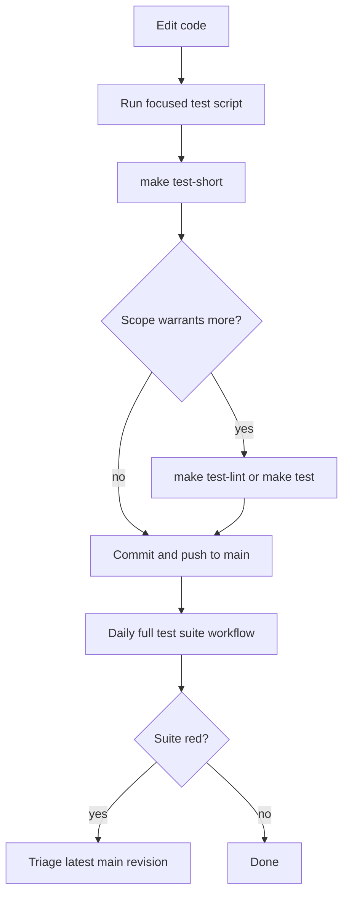

# Iteration Loop

This page covers changing dev-inbox itself. For the runtime pipeline that delivers changes to target repositories, see [Architecture](../architecture/).

## Inner loop

The repository defines four test entry points ([README.md:L256-L268](https://github.com/Jeffrey-Keyser/dev-inbox/blob/9a72cd60e5068bd14367dc5f7f9acd50e387b650/README.md#L256-L268)):

| Command | What it runs |
| --- | --- |
| `make test-short` | Fast Go inner loop |
| `bash scripts/test-<area>.sh` | Focused shell suite for the area being changed |
| `npm test` | Bash portion of the suite |
| `npm run test:all` | Full local suite |

In `package.json`, `npm test` is `bash scripts/run-tests.sh`. `test:all` adds `make test` and `make test-lint` ([package.json:L7-L8](https://github.com/Jeffrey-Keyser/dev-inbox/blob/9a72cd60e5068bd14367dc5f7f9acd50e387b650/package.json#L7-L8)).

Expected practice ([README.md:L280-L284](https://github.com/Jeffrey-Keyser/dev-inbox/blob/9a72cd60e5068bd14367dc5f7f9acd50e387b650/README.md#L280-L284)):

- Always run the fastest focused checks that cover the changed behavior.
- Add `make test-short` and `make test-lint` when the scope warrants them.
- Don't wait on `npm test` or `test:all` unless someone explicitly asks for a full run.

`make test` uses the Go race detector. It bounds parallelism on memory-constrained Linux hosts; inspect the resolved flags with `make print-test-flags` ([README.md:L288-L290](https://github.com/Jeffrey-Keyser/dev-inbox/blob/9a72cd60e5068bd14367dc5f7f9acd50e387b650/README.md#L288-L290)).

## Local fixtures

Local dev mode tests scripts without a live Agency HQ, NanoClaw, RabbitMQ, or real agent CLIs ([docs/LOCAL-DEV-MODE.md:L3](https://github.com/Jeffrey-Keyser/dev-inbox/blob/9a72cd60e5068bd14367dc5f7f9acd50e387b650/docs/LOCAL-DEV-MODE.md#L3)). It provides three substitutes ([docs/LOCAL-DEV-MODE.md:L21-L23](https://github.com/Jeffrey-Keyser/dev-inbox/blob/9a72cd60e5068bd14367dc5f7f9acd50e387b650/docs/LOCAL-DEV-MODE.md#L21-L23)):

- mock agent CLIs under `scripts/test-fixtures/`;
- a mock Agency HQ HTTP server;
- environment overrides.

Run it with `bash scripts/run-tests.sh local-dev` ([docs/LOCAL-DEV-MODE.md:L12](https://github.com/Jeffrey-Keyser/dev-inbox/blob/9a72cd60e5068bd14367dc5f7f9acd50e387b650/docs/LOCAL-DEV-MODE.md#L12)).

## Area-specific checks

- **Forwarded environment variables.** When adding a forwarded variable, append it to `agent_provider_env_exports` ([docs/agent-env-contract.md:L34](https://github.com/Jeffrey-Keyser/dev-inbox/blob/9a72cd60e5068bd14367dc5f7f9acd50e387b650/docs/agent-env-contract.md#L34)). Then run `bash scripts/run-tests.sh agent-cli` ([docs/agent-env-contract.md:L55](https://github.com/Jeffrey-Keyser/dev-inbox/blob/9a72cd60e5068bd14367dc5f7f9acd50e387b650/docs/agent-env-contract.md#L55)).
- **Harness probes.** A new probe needs a passing case and a failing case in `scripts/test-harness-probe.sh`. Keep probes role-agnostic ([docs/agent-harness-contract.md:L52-L60](https://github.com/Jeffrey-Keyser/dev-inbox/blob/9a72cd60e5068bd14367dc5f7f9acd50e387b650/docs/agent-harness-contract.md#L52-L60)).
- **Generated contracts.** Generators support `--check` and fail when output is stale:
  - Event types: rerun `scripts/generate-event-type-contract.sh` ([cmd/event-type-contract-gen/main.go:L16](https://github.com/Jeffrey-Keyser/dev-inbox/blob/9a72cd60e5068bd14367dc5f7f9acd50e387b650/cmd/event-type-contract-gen/main.go#L16), [cmd/event-type-contract-gen/main.go:L43-L45](https://github.com/Jeffrey-Keyser/dev-inbox/blob/9a72cd60e5068bd14367dc5f7f9acd50e387b650/cmd/event-type-contract-gen/main.go#L43-L45)).
  - Status contracts follow the same pattern ([cmd/status-contract-gen/main.go:L83-L85](https://github.com/Jeffrey-Keyser/dev-inbox/blob/9a72cd60e5068bd14367dc5f7f9acd50e387b650/cmd/status-contract-gen/main.go#L83-L85)).
- **Go-owned plan-manager behavior.** Many Bash plan-manager tests were ported to, or are covered by, Go tests, so look in Go packages for that coverage ([docs/bash-test-retirement-dispositions.md:L13-L22](https://github.com/Jeffrey-Keyser/dev-inbox/blob/9a72cd60e5068bd14367dc5f7f9acd50e387b650/docs/bash-test-retirement-dispositions.md#L13-L22)).
- **Manager usage accounting.** Run `bash scripts/test-plan-manager-manager-usage.sh` to drive the shell decomposition and initialization callers with controlled provider executables in `scripts/test-fixtures/manager-usage/` for claude, codex, and opencode. For the Go wake boundary, run `go test ./internal/wake/ -run 'Wake|PublishWake'`. Coverage is per controlled fixture ([docs/manager-control-usage-accounting.md](https://github.com/Jeffrey-Keyser/dev-inbox/blob/f1c7fd60982b2c82333aab0e7bc5692b7cfd8697/docs/manager-control-usage-accounting.md)).
- **Skill registry publication.** Registry create/update bodies are constructed by the typed `plan-managerd prompter registry-body` owner in `internal/prompter/registry.go` ([internal/prompter/registry.go:L1-L86](https://github.com/Jeffrey-Keyser/dev-inbox/blob/bfeb40a53393c363227b00132e80eafcc56e04d7/internal/prompter/registry.go#L1-L86)), and `scripts/register-skills.sh` publishes them only through a compatible binary ([docs/skill-installation.md:L56-L66](https://github.com/Jeffrey-Keyser/dev-inbox/blob/bfeb40a53393c363227b00132e80eafcc56e04d7/docs/skill-installation.md#L56-L66)). Run `bash scripts/test-register-skill-registry-body-go.sh` for the registrar loop against an isolated local HTTP registry, and `bash scripts/test-register-skill-renderer-preflight-go.sh` for the renderer and bundle publication sections ([docs/skill-installation.md:L86-L87](https://github.com/Jeffrey-Keyser/dev-inbox/blob/bfeb40a53393c363227b00132e80eafcc56e04d7/docs/skill-installation.md#L86-L87)). `scripts/test-skill-sync.sh` builds the checkout binary on demand when no `PLAN_MANAGERD_BIN` pin is set ([scripts/test-skill-sync.sh:L11-L20](https://github.com/Jeffrey-Keyser/dev-inbox/blob/bfeb40a53393c363227b00132e80eafcc56e04d7/scripts/test-skill-sync.sh#L11-L20)).
- **Generalist prospector spawn envelope.** The generalist prospector spawn request is rendered by the typed `plan-managerd spawn-envelope render-prospector-generalist` operation in `internal/spawnenvelope`. `scripts/lib/prospector-facade.sh` (`prospector_facade_spawn_generalist`) only locates and execs that binary and does not rebuild the envelope in Bash. Run `bash scripts/test-generalist-spawn-envelope-go-parity.sh` for the parity gate ([scripts/test-generalist-spawn-envelope-go-parity.sh](https://github.com/Jeffrey-Keyser/dev-inbox/blob/98f7b876ca6bd6d3069bbbcbf702f37558a5bb04/scripts/test-generalist-spawn-envelope-go-parity.sh)). When the binary is missing or the render is rejected (including exit 64 from a pinned binary), the facade logs the failure, invokes no spawner, and returns 0 with `PROSPECTOR_FACADE_GENERALIST_SKIPPED=1` ([scripts/lib/prospector-facade.sh](https://github.com/Jeffrey-Keyser/dev-inbox/blob/98f7b876ca6bd6d3069bbbcbf702f37558a5bb04/scripts/lib/prospector-facade.sh)).
- **Failure-proposal admission and fallback.** Returned-proposal admission and the low-confidence `unclassified` fallback body are owned by `internal/memorytools` behind `plan-managerd memory-proposal validate|fallback` ([internal/memorytools/proposal.go](https://github.com/Jeffrey-Keyser/dev-inbox/blob/41693f23e989c77c6d89ef4cbe3fa4e72259b48b/internal/memorytools/proposal.go), [cmd/plan-managerd/memory_proposal.go](https://github.com/Jeffrey-Keyser/dev-inbox/blob/41693f23e989c77c6d89ef4cbe3fa4e72259b48b/cmd/plan-managerd/memory_proposal.go)). Run `bash scripts/test-memory-proposal-admission-go.sh` for the real-wrapper flows, renderer and publication failures, and pinned-binary skew probes. `bash scripts/test-propose-memory.sh` and `bash scripts/test-propose-memory-cleanup.sh` cover the wrapper contract. `scripts/test-propose-memory.sh` clears any ambient `PLAN_MANAGERD_BIN` pin and exercises the checkout binary ([scripts/test-propose-memory.sh](https://github.com/Jeffrey-Keyser/dev-inbox/blob/41693f23e989c77c6d89ef4cbe3fa4e72259b48b/scripts/test-propose-memory.sh)). The wrapper contract and its binary-skew limitation are described in [docs/failure-classification.md](https://github.com/Jeffrey-Keyser/dev-inbox/blob/41693f23e989c77c6d89ef4cbe3fa4e72259b48b/docs/failure-classification.md).
- **Judge corpus selection.** Result eligibility, identity fallback, seeded ranking, and per-status quotas are owned by `internal/telemetry` and exposed as `orchmeasure telemetry judge-corpus-select --seed VALUE` ([internal/telemetry/judge_corpus_select.go](https://github.com/Jeffrey-Keyser/dev-inbox/blob/41693f23e989c77c6d89ef4cbe3fa4e72259b48b/internal/telemetry/judge_corpus_select.go), [cmd/orchmeasure/judge_corpus_select.go](https://github.com/Jeffrey-Keyser/dev-inbox/blob/41693f23e989c77c6d89ef4cbe3fa4e72259b48b/cmd/orchmeasure/judge_corpus_select.go)). Run `bash scripts/test-judge-corpus-selection-go.sh` for the gate. The frozen Bash selection pipeline in [internal/telemetry/testdata/judge-corpus-selection-legacy.sh](https://github.com/Jeffrey-Keyser/dev-inbox/blob/41693f23e989c77c6d89ef4cbe3fa4e72259b48b/internal/telemetry/testdata/judge-corpus-selection-legacy.sh) is a test-only oracle, not a production path.
- **Judge target vocabularies.** The ordered result, review, and commit-decision label vocabularies are defined once in `internal/telemetry` (`JudgeTargetVocabularies`, `JudgeTargetLabels`) and selected through `orchmeasure telemetry judge-statistics --target TARGET` ([internal/telemetry/judge_target_vocabulary.go](https://github.com/Jeffrey-Keyser/dev-inbox/blob/4d1fdc42bdcb9f99a23b3b47e1294b76d5ca0ba1/internal/telemetry/judge_target_vocabulary.go), [cmd/orchmeasure/judge_statistics.go](https://github.com/Jeffrey-Keyser/dev-inbox/blob/4d1fdc42bdcb9f99a23b3b47e1294b76d5ca0ba1/cmd/orchmeasure/judge_statistics.go)). Exactly one of `--target` or `--labels` is required; `--labels` remains available for custom label arrays. The judge runner in `scripts/eval/judge/run.sh` no longer declares `VALID_LABELS` arrays or builds `labels_json`. Run `bash scripts/test-judge-statistics-target-go.sh` for the runner-level gate covering all three targets ([scripts/test-judge-statistics-target-go.sh](https://github.com/Jeffrey-Keyser/dev-inbox/blob/4d1fdc42bdcb9f99a23b3b47e1294b76d5ca0ba1/scripts/test-judge-statistics-target-go.sh)), and `go test ./internal/telemetry/... ./cmd/orchmeasure/...` for the Go owner and CLI fixtures ([internal/telemetry/judge_target_vocabulary_test.go](https://github.com/Jeffrey-Keyser/dev-inbox/blob/4d1fdc42bdcb9f99a23b3b47e1294b76d5ca0ba1/internal/telemetry/judge_target_vocabulary_test.go), [cmd/orchmeasure/judge_statistics_target_test.go](https://github.com/Jeffrey-Keyser/dev-inbox/blob/4d1fdc42bdcb9f99a23b3b47e1294b76d5ca0ba1/cmd/orchmeasure/judge_statistics_target_test.go)).

## CI

The complete suite (Bash, Go race, and lint) runs daily at 06:17 UTC against the latest `main`. It can also be started manually ([README.md:L270-L275](https://github.com/Jeffrey-Keyser/dev-inbox/blob/9a72cd60e5068bd14367dc5f7f9acd50e387b650/README.md#L270-L275)). Key points:

- It is the authoritative full-suite signal ([README.md:L277-L279](https://github.com/Jeffrey-Keyser/dev-inbox/blob/9a72cd60e5068bd14367dc5f7f9acd50e387b650/README.md#L277-L279)).
- Pushes and PRs do **not** trigger it.
- It is not a prerequisite for a push or merge.
- A red run means the latest `main` needs triage. It does not invalidate focused verification recorded earlier ([README.md:L284-L286](https://github.com/Jeffrey-Keyser/dev-inbox/blob/9a72cd60e5068bd14367dc5f7f9acd50e387b650/README.md#L284-L286)).

The CI host is Ubuntu 24.04 with Go from `go.mod` and Node 24. Its gate commands are documented ([docs/ci-testing.md:L3-L14](https://github.com/Jeffrey-Keyser/dev-inbox/blob/9a72cd60e5068bd14367dc5f7f9acd50e387b650/docs/ci-testing.md#L3-L14)).

The Image Studio phone proofs are excluded operator gates unless run explicitly ([docs/ci-testing.md:L17-L21](https://github.com/Jeffrey-Keyser/dev-inbox/blob/9a72cd60e5068bd14367dc5f7f9acd50e387b650/docs/ci-testing.md#L17-L21)).

The Tier 4 durability sweep is advisory and disabled by default ([README.md:L290-L291](https://github.com/Jeffrey-Keyser/dev-inbox/blob/9a72cd60e5068bd14367dc5f7f9acd50e387b650/README.md#L290-L291)).

