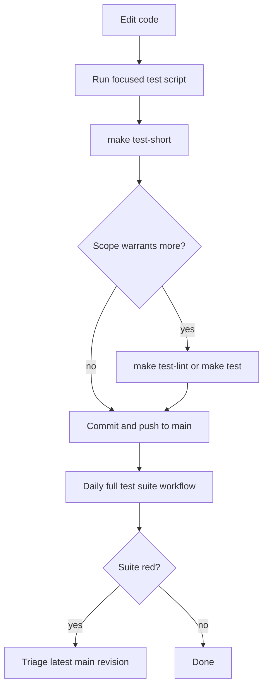

# Iteration Loop

This page covers changing dev-inbox itself. For the runtime pipeline that delivers changes to target repositories, see [Architecture](../architecture/).

## Inner loop

The repository defines four test entry points ([README.md:L256-L268](https://github.com/Jeffrey-Keyser/dev-inbox/blob/9a72cd60e5068bd14367dc5f7f9acd50e387b650/README.md#L256-L268)):

| Command | What it runs |
| --- | --- |
| `make test-short` | Fast Go inner loop |
| `bash scripts/test-<area>.sh` | Focused shell suite for the area being changed |
| `npm test` | Bash portion of the suite |
| `npm run test:all` | Full local suite |

In `package.json`, `npm test` is `bash scripts/run-tests.sh`. `test:all` adds `make test` and `make test-lint` ([package.json:L7-L8](https://github.com/Jeffrey-Keyser/dev-inbox/blob/9a72cd60e5068bd14367dc5f7f9acd50e387b650/package.json#L7-L8)).

Expected practice ([README.md:L280-L284](https://github.com/Jeffrey-Keyser/dev-inbox/blob/9a72cd60e5068bd14367dc5f7f9acd50e387b650/README.md#L280-L284)):

- Always run the fastest focused checks that cover the changed behavior.
- Add `make test-short` and `make test-lint` when the scope warrants them.
- Don't wait on `npm test` or `test:all` unless someone explicitly asks for a full run.

`make test` uses the Go race detector. It bounds parallelism on memory-constrained Linux hosts; inspect the resolved flags with `make print-test-flags` ([README.md:L288-L290](https://github.com/Jeffrey-Keyser/dev-inbox/blob/9a72cd60e5068bd14367dc5f7f9acd50e387b650/README.md#L288-L290)).

## Local fixtures

Local dev mode tests scripts without a live Agency HQ, NanoClaw, RabbitMQ, or real agent CLIs ([docs/LOCAL-DEV-MODE.md:L3](https://github.com/Jeffrey-Keyser/dev-inbox/blob/9a72cd60e5068bd14367dc5f7f9acd50e387b650/docs/LOCAL-DEV-MODE.md#L3)). It provides three substitutes ([docs/LOCAL-DEV-MODE.md:L21-L23](https://github.com/Jeffrey-Keyser/dev-inbox/blob/9a72cd60e5068bd14367dc5f7f9acd50e387b650/docs/LOCAL-DEV-MODE.md#L21-L23)):

- mock agent CLIs under `scripts/test-fixtures/`;
- a mock Agency HQ HTTP server;
- environment overrides.

Run it with `bash scripts/run-tests.sh local-dev` ([docs/LOCAL-DEV-MODE.md:L12](https://github.com/Jeffrey-Keyser/dev-inbox/blob/9a72cd60e5068bd14367dc5f7f9acd50e387b650/docs/LOCAL-DEV-MODE.md#L12)).

## Area-specific checks

- **Forwarded environment variables.** When adding a forwarded variable, append it to `agent_provider_env_exports` ([docs/agent-env-contract.md:L34](https://github.com/Jeffrey-Keyser/dev-inbox/blob/9a72cd60e5068bd14367dc5f7f9acd50e387b650/docs/agent-env-contract.md#L34)). Then run `bash scripts/run-tests.sh agent-cli` ([docs/agent-env-contract.md:L55](https://github.com/Jeffrey-Keyser/dev-inbox/blob/9a72cd60e5068bd14367dc5f7f9acd50e387b650/docs/agent-env-contract.md#L55)). The Codex worker tool shell allowlist in `scripts/lib/agent-cli.sh` also carries the worker-verify host socket and broker token names; `bash scripts/test-worker-tool-shell.sh` checks that allowlist ([scripts/lib/agent-cli.sh](https://github.com/Jeffrey-Keyser/dev-inbox/blob/1c6139715f43ed8b68b9a58aca3b93781d21447a/scripts/lib/agent-cli.sh), [scripts/test-worker-tool-shell.sh](https://github.com/Jeffrey-Keyser/dev-inbox/blob/1c6139715f43ed8b68b9a58aca3b93781d21447a/scripts/test-worker-tool-shell.sh)).
- **Harness probes.** A new probe needs a passing case and a failing case in `scripts/test-harness-probe.sh`. Keep probes role-agnostic ([docs/agent-harness-contract.md:L52-L60](https://github.com/Jeffrey-Keyser/dev-inbox/blob/9a72cd60e5068bd14367dc5f7f9acd50e387b650/docs/agent-harness-contract.md#L52-L60)).
- **Worker host-blocked preflight.** Host prerequisite failures reported during worker preflight are preserved through launcher cleanup. Run `bash scripts/test-worker-host-blocked-preflight.sh` for the focused gate ([scripts/test-worker-host-blocked-preflight.sh](https://github.com/Jeffrey-Keyser/dev-inbox/blob/db053afd736ec24771b4968bebaba3d33cc22a49/scripts/test-worker-host-blocked-preflight.sh)). The spawn path is in [scripts/spawn-worker.sh](https://github.com/Jeffrey-Keyser/dev-inbox/blob/db053afd736ec24771b4968bebaba3d33cc22a49/scripts/spawn-worker.sh).
- **Worker verification host.** The task-bound `worker-verify-host` endpoint runs registered verification outside the provider sandbox. It supports a Unix socket transport and a file-exchange transport for sandboxes that deny `socket(2)`, and a successful verification is bound to the final build outputs and test caches. Run `bash scripts/test-worker-verify-host-sandbox.sh` for the sandbox gate, and `go test ./cmd/plan-managerd/... ./internal/verificationexecution/...` for the typed host, file-exchange, output-binding, lease, and bootstrap-receipt fixtures ([docs/worker-verification-receipts.md](https://github.com/Jeffrey-Keyser/dev-inbox/blob/1c6139715f43ed8b68b9a58aca3b93781d21447a/docs/worker-verification-receipts.md), [cmd/plan-managerd/worker_verify_host.go](https://github.com/Jeffrey-Keyser/dev-inbox/blob/1c6139715f43ed8b68b9a58aca3b93781d21447a/cmd/plan-managerd/worker_verify_host.go), [cmd/plan-managerd/worker_verify_exchange_test.go](https://github.com/Jeffrey-Keyser/dev-inbox/blob/34ee9c20e0acd1826eefe200bc1dac4c92434f58/cmd/plan-managerd/worker_verify_exchange_test.go), [cmd/plan-managerd/worker_verify_output_binding_test.go](https://github.com/Jeffrey-Keyser/dev-inbox/blob/34ee9c20e0acd1826eefe200bc1dac4c92434f58/cmd/plan-managerd/worker_verify_output_binding_test.go)).
- **Generated contracts.** Generators support `--check` and fail when output is stale:
  - Event types: rerun `scripts/generate-event-type-contract.sh` ([cmd/event-type-contract-gen/main.go:L16](https://github.com/Jeffrey-Keyser/dev-inbox/blob/9a72cd60e5068bd14367dc5f7f9acd50e387b650/cmd/event-type-contract-gen/main.go#L16), [cmd/event-type-contract-gen/main.go:L43-L45](https://github.com/Jeffrey-Keyser/dev-inbox/blob/9a72cd60e5068bd14367dc5f7f9acd50e387b650/cmd/event-type-contract-gen/main.go#L43-L45)).
  - Status contracts follow the same pattern ([cmd/status-contract-gen/main.go:L83-L85](https://github.com/Jeffrey-Keyser/dev-inbox/blob/9a72cd60e5068bd14367dc5f7f9acd50e387b650/cmd/status-contract-gen/main.go#L83-L85)).
- **Go-owned plan-manager behavior.** Many Bash plan-manager tests were ported to, or are covered by, Go tests, so look in Go packages for that coverage ([docs/bash-test-retirement-dispositions.md:L13-L22](https://github.com/Jeffrey-Keyser/dev-inbox/blob/9a72cd60e5068bd14367dc5f7f9acd50e387b650/docs/bash-test-retirement-dispositions.md#L13-L22)).
- **Manager usage accounting.** Run `bash scripts/test-plan-manager-manager-usage.sh` to drive the shell decomposition and initialization callers with controlled provider executables in `scripts/test-fixtures/manager-usage/` for claude, codex, and opencode. For the Go wake boundary, run `go test ./internal/wake/ -run 'Wake|PublishWake'`. Coverage is per controlled fixture ([docs/manager-control-usage-accounting.md](https://github.com/Jeffrey-Keyser/dev-inbox/blob/f1c7fd60982b2c82333aab0e7bc5692b7cfd8697/docs/manager-control-usage-accounting.md)).
- **Manager journal overhead in cost reports.** `orchmeasure cost-report --report-version v4` prices the canonical `plan.invocation_usage` records of explicitly selected manager plans (`--manager-plan-id`, repeatable, with `--plans-dir` and the v3 price-table flags) and reports that overhead separately from run rows. The report-owned logic is in `cmd/orchmeasure/cost_evidence_v4.go` ([cmd/orchmeasure/cost_evidence_v4.go](https://github.com/Jeffrey-Keyser/dev-inbox/blob/1b89c9b56ef52e38f50e760a9ea7ed850664bd0a/cmd/orchmeasure/cost_evidence_v4.go)). Run `go test ./cmd/orchmeasure/...` for the CLI fixtures ([cmd/orchmeasure/cost_report_v4_cli_test.go](https://github.com/Jeffrey-Keyser/dev-inbox/blob/1b89c9b56ef52e38f50e760a9ea7ed850664bd0a/cmd/orchmeasure/cost_report_v4_cli_test.go)). The report contract is described in [docs/cost-report-v4.md](https://github.com/Jeffrey-Keyser/dev-inbox/blob/1b89c9b56ef52e38f50e760a9ea7ed850664bd0a/docs/cost-report-v4.md).
- **Canonical review reuse match.** `plan-managerd review match-canonical --results-dir --run-id --task-id --attempt N` exposes the read-only `MatchCanonicalReview` predicate in `internal/reviewerboundary`, which decides whether an existing canonical `review.json` may be reused. The focused-review helpers in `scripts/lib/review-loop-helpers.sh` call it as a command adapter. Run `bash scripts/test-canonical-review-reuse.sh` for the shell gate, and `go test ./internal/reviewerboundary/... ./cmd/plan-managerd/...` for the typed owner and command fixtures ([internal/reviewerboundary/review_match.go](https://github.com/Jeffrey-Keyser/dev-inbox/blob/1b89c9b56ef52e38f50e760a9ea7ed850664bd0a/internal/reviewerboundary/review_match.go), [cmd/plan-managerd/review_match.go](https://github.com/Jeffrey-Keyser/dev-inbox/blob/1b89c9b56ef52e38f50e760a9ea7ed850664bd0a/cmd/plan-managerd/review_match.go)).
- **Codex review-synthesis accounting.** Native Codex `turn.completed` usage for opted-in review-synthesizer CLI attempts is retained through the attempt accounting path, the canonical traces and the invocation usage events. Run `bash scripts/test-codex-synthesis-accounting.sh` for the controlled-execution gate, and `go test ./internal/agentclitrace/... ./internal/reviewsynth/...` for the typed owners. The design and its scope are described in [docs/codex-synthesis-accounting.md](https://github.com/Jeffrey-Keyser/dev-inbox/blob/ec98ebe0be94925b6f048c79475133ecc46dd3f9/docs/codex-synthesis-accounting.md) ([scripts/test-codex-synthesis-accounting.sh](https://github.com/Jeffrey-Keyser/dev-inbox/blob/ec98ebe0be94925b6f048c79475133ecc46dd3f9/scripts/test-codex-synthesis-accounting.sh)).
- **Claude review-synthesis accounting.** Native Claude terminal `result` usage for opted-in review-synthesizer CLI attempts is retained through the v3 attempt accounting path. A valid native observation replaces that attempt's byte estimate in the canonical traces and invocation usage events, and the observed-budget consumer includes these attempts. Run `bash scripts/test-claude-synthesis-accounting.sh` for the controlled-execution gate, and `go test ./internal/agentclitrace/... ./internal/reviewsynth/...` for the typed owners. The design and its scope are described in [docs/claude-synthesis-accounting.md](https://github.com/Jeffrey-Keyser/dev-inbox/blob/bad6162be241d3ae38367d0ea1baf89810a4e2f3/docs/claude-synthesis-accounting.md) ([scripts/test-claude-synthesis-accounting.sh](https://github.com/Jeffrey-Keyser/dev-inbox/blob/bad6162be241d3ae38367d0ea1baf89810a4e2f3/scripts/test-claude-synthesis-accounting.sh)).
- **Skill registry publication.** Registry create/update bodies are constructed by the typed `plan-managerd prompter registry-body` owner in `internal/prompter/registry.go` ([internal/prompter/registry.go:L1-L86](https://github.com/Jeffrey-Keyser/dev-inbox/blob/bfeb40a53393c363227b00132e80eafcc56e04d7/internal/prompter/registry.go#L1-L86)), and `scripts/register-skills.sh` publishes them only through a compatible binary ([docs/skill-installation.md:L56-L66](https://github.com/Jeffrey-Keyser/dev-inbox/blob/bfeb40a53393c363227b00132e80eafcc56e04d7/docs/skill-installation.md#L56-L66)). Run `bash scripts/test-register-skill-registry-body-go.sh` for the registrar loop against an isolated local HTTP registry, and `bash scripts/test-register-skill-renderer-preflight-go.sh` for the renderer and bundle publication sections ([docs/skill-installation.md:L86-L87](https://github.com/Jeffrey-Keyser/dev-inbox/blob/bfeb40a53393c363227b00132e80eafcc56e04d7/docs/skill-installation.md#L86-L87)). `scripts/test-skill-sync.sh` builds the checkout binary on demand when no `PLAN_MANAGERD_BIN` pin is set ([scripts/test-skill-sync.sh:L11-L20](https://github.com/Jeffrey-Keyser/dev-inbox/blob/bfeb40a53393c363227b00132e80eafcc56e04d7/scripts/test-skill-sync.sh#L11-L20)).
- **ADR registry publication.** `scripts/generate-adr.sh` builds the registry update body through the typed `plan-managerd prompter registry-body --operation update` owner, resolved with `plan_managerd_existing_bin` ([scripts/generate-adr.sh:L17](https://github.com/Jeffrey-Keyser/dev-inbox/blob/4a511ed3509e73e51f0be842d8cf3daeb24b13a2/scripts/generate-adr.sh#L17), [scripts/generate-adr.sh:L113-L141](https://github.com/Jeffrey-Keyser/dev-inbox/blob/4a511ed3509e73e51f0be842d8cf3daeb24b13a2/scripts/generate-adr.sh#L113-L141)). A missing executable, or a pinned binary that exits 64, prints a publication skip and exits 0 without sending a registry request. Other construction failures and empty output exit 1 before any HTTP call. Run `bash scripts/test-generate-adr-registry-body-go.sh` for the caller-level gate. It builds the checkout binary, runs the real script against a PATH-intercepted `curl`, and checks the decoded value, description, and ordered tags against the retired jq body ([scripts/test-generate-adr-registry-body-go.sh:L1-L15](https://github.com/Jeffrey-Keyser/dev-inbox/blob/4a511ed3509e73e51f0be842d8cf3daeb24b13a2/scripts/test-generate-adr-registry-body-go.sh#L1-L15)).
- **Seeded ADR publication.** `scripts/seed-adrs.sh` captures both the create and update bodies for each of its ten seed entries through the same typed `plan-managerd prompter registry-body --operation create|update` owner, resolved with `plan_managerd_existing_bin`. Bodies are built before the rate-limit sleep and before any HTTP call. A missing executable or usage exit 64 from either constructor prints a visible entry skip, returns success for that entry, and sends no request. Other construction failures and empty output fail the run before publishing the affected entry. Run `bash scripts/test-seed-adr-registry-body-go.sh` for the caller-level gate. It runs the real seed caller from a disposable fixture tree with the typed binary and recording `curl` and `sleep` replacements, covering POST-then-PUT fallback, construction failures, empty output, and rejecting pinned stubs (`scripts/seed-adrs.sh`, `scripts/test-seed-adr-registry-body-go.sh`).
- **Generalist prospector spawn envelope.** The generalist prospector spawn request is rendered by the typed `plan-managerd spawn-envelope render-prospector-generalist` operation in `internal/spawnenvelope`. `scripts/lib/prospector-facade.sh` (`prospector_facade_spawn_generalist`) only locates and execs that binary and does not rebuild the envelope in Bash. Run `bash scripts/test-generalist-spawn-envelope-go-parity.sh` for the parity gate ([scripts/test-generalist-spawn-envelope-go-parity.sh](https://github.com/Jeffrey-Keyser/dev-inbox/blob/98f7b876ca6bd6d3069bbbcbf702f37558a5bb04/scripts/test-generalist-spawn-envelope-go-parity.sh)). When the binary is missing or the render is rejected (including exit 64 from a pinned binary), the facade logs the failure, invokes no spawner, and returns 0 with `PROSPECTOR_FACADE_GENERALIST_SKIPPED=1` ([scripts/lib/prospector-facade.sh](https://github.com/Jeffrey-Keyser/dev-inbox/blob/98f7b876ca6bd6d3069bbbcbf702f37558a5bb04/scripts/lib/prospector-facade.sh)).
- **Failure-proposal admission and fallback.** Returned-proposal admission and the low-confidence `unclassified` fallback body are owned by `internal/memorytools` behind `plan-managerd memory-proposal validate|fallback` ([internal/memorytools/proposal.go](https://github.com/Jeffrey-Keyser/dev-inbox/blob/41693f23e989c77c6d89ef4cbe3fa4e72259b48b/internal/memorytools/proposal.go), [cmd/plan-managerd/memory_proposal.go](https://github.com/Jeffrey-Keyser/dev-inbox/blob/41693f23e989c77c6d89ef4cbe3fa4e72259b48b/cmd/plan-managerd/memory_proposal.go)). The admission error types expose exit codes: `ProposalRejectedError` maps to 1 and `ProposalInfraError` maps to 74 (`internal/memorytools/proposal.go`). The wrapper `scripts/eval/propose-memory.sh` treats a validation exit other than 1 (and not the usage exit 64) as an infrastructure failure. It logs a redacted, bounded validation-stderr diagnostic and preserves the existing proposal rather than publishing the unvalidated candidate. Run `bash scripts/test-memory-proposal-admission-go.sh` for the real-wrapper flows, renderer and publication failures, and pinned-binary skew probes. `bash scripts/test-propose-memory.sh` and `bash scripts/test-propose-memory-cleanup.sh` cover the wrapper contract. `scripts/test-propose-memory.sh` clears any ambient `PLAN_MANAGERD_BIN` pin and exercises the checkout binary ([scripts/test-propose-memory.sh](https://github.com/Jeffrey-Keyser/dev-inbox/blob/41693f23e989c77c6d89ef4cbe3fa4e72259b48b/scripts/test-propose-memory.sh)). The wrapper contract and its binary-skew limitation are described in [docs/failure-classification.md](https://github.com/Jeffrey-Keyser/dev-inbox/blob/41693f23e989c77c6d89ef4cbe3fa4e72259b48b/docs/failure-classification.md).
- **Judge corpus selection.** Result eligibility, identity fallback, seeded ranking, and per-status quotas are owned by `internal/telemetry` and exposed as `orchmeasure telemetry judge-corpus-select --seed VALUE` ([internal/telemetry/judge_corpus_select.go](https://github.com/Jeffrey-Keyser/dev-inbox/blob/41693f23e989c77c6d89ef4cbe3fa4e72259b48b/internal/telemetry/judge_corpus_select.go), [cmd/orchmeasure/judge_corpus_select.go](https://github.com/Jeffrey-Keyser/dev-inbox/blob/41693f23e989c77c6d89ef4cbe3fa4e72259b48b/cmd/orchmeasure/judge_corpus_select.go)). Run `bash scripts/test-judge-corpus-selection-go.sh` for the gate. The frozen Bash selection pipeline in [internal/telemetry/testdata/judge-corpus-selection-legacy.sh](https://github.com/Jeffrey-Keyser/dev-inbox/blob/41693f23e989c77c6d89ef4cbe3fa4e72259b48b/internal/telemetry/testdata/judge-corpus-selection-legacy.sh) is a test-only oracle, not a production path.
- **Judge corpus diff-stat rendering.** `write_diff_stat` in `scripts/eval/judge/load-corpus.sh` renders the diff-stat through `orchmeasure telemetry judge-corpus-text --kind diff-stat` into a staged temporary file. The staged file is published to `diff-stat.txt` only when the renderer exits 0, or exits 65 (the data-error code from `JudgeCorpusTextError`, which keeps the legacy partial projection). Any other failure removes the staged file and returns the renderer's exit code, so a failed run cannot leave a file that a later loader mistakes for complete evidence. Run `bash scripts/test-judge-corpus-text-go.sh` for the gate, which includes a retry test over exit codes 1, 64, and 70 with and without pre-seeded worker output ([scripts/eval/judge/load-corpus.sh](https://github.com/Jeffrey-Keyser/dev-inbox/blob/b8675ba8b265ad4/scripts/eval/judge/load-corpus.sh), [internal/telemetry/judge_corpus_text.go](https://github.com/Jeffrey-Keyser/dev-inbox/blob/b8675ba8b265ad4/internal/telemetry/judge_corpus_text.go)).
- **Judge target vocabularies.** The ordered result, review, and commit-decision label vocabularies are defined once in `internal/telemetry` (`JudgeTargetVocabularies`, `JudgeTargetLabels`) and selected through `orchmeasure telemetry judge-statistics --target TARGET` ([internal/telemetry/judge_target_vocabulary.go](https://github.com/Jeffrey-Keyser/dev-inbox/blob/4d1fdc42bdcb9f99a23b3b47e1294b76d5ca0ba1/internal/telemetry/judge_target_vocabulary.go), [cmd/orchmeasure/judge_statistics.go](https://github.com/Jeffrey-Keyser/dev-inbox/blob/4d1fdc42bdcb9f99a23b3b47e1294b76d5ca0ba1/cmd/orchmeasure/judge_statistics.go)). Exactly one of `--target` or `--labels` is required; `--labels` remains available for custom label arrays. The judge runner in `scripts/eval/judge/run.sh` no longer declares `VALID_LABELS` arrays or builds `labels_json`. Run `bash scripts/test-judge-statistics-target-go.sh` for the runner-level gate covering all three targets ([scripts/test-judge-statistics-target-go.sh](https://github.com/Jeffrey-Keyser/dev-inbox/blob/4d1fdc42bdcb9f99a23b3b47e1294b76d5ca0ba1/scripts/test-judge-statistics-target-go.sh)), and `go test ./internal/telemetry/... ./cmd/orchmeasure/...` for the Go owner and CLI fixtures ([internal/telemetry/judge_target_vocabulary_test.go](https://github.com/Jeffrey-Keyser/dev-inbox/blob/4d1fdc42bdcb9f99a23b3b47e1294b76d5ca0ba1/internal/telemetry/judge_target_vocabulary_test.go), [cmd/orchmeasure/judge_statistics_target_test.go](https://github.com/Jeffrey-Keyser/dev-inbox/blob/4d1fdc42bdcb9f99a23b3b47e1294b76d5ca0ba1/cmd/orchmeasure/judge_statistics_target_test.go)).
- **Raw fanout findings assembly.** `plan-managerd prospector-index render-raw-bundle` takes ordered `--lens-result LENS=PATH` pairs and prints the completed raw findings array. The typed owner is `internal/prospectorindex/rawbundle.go` ([internal/prospectorindex/rawbundle.go](https://github.com/Jeffrey-Keyser/dev-inbox/blob/b445a37eda1a4bdb8ba1788b641fb0e192e53b28/internal/prospectorindex/rawbundle.go)), exposed by [cmd/plan-managerd/prospector_index.go](https://github.com/Jeffrey-Keyser/dev-inbox/blob/b445a37eda1a4bdb8ba1788b641fb0e192e53b28/cmd/plan-managerd/prospector_index.go). Run `go test ./internal/prospectorindex/... -count=1` and `go test ./cmd/plan-managerd/... -run TestProspectorIndex -count=1` for the Go gates, and `bash scripts/test-prospect-fanout.sh` for the collector-level gate ([scripts/test-prospect-fanout.sh](https://github.com/Jeffrey-Keyser/dev-inbox/blob/b445a37eda1a4bdb8ba1788b641fb0e192e53b28/scripts/test-prospect-fanout.sh)). The shell collector in [scripts/prospect-fanout.sh](https://github.com/Jeffrey-Keyser/dev-inbox/blob/b445a37eda1a4bdb8ba1788b641fb0e192e53b28/scripts/prospect-fanout.sh) keeps worker dispatch, waits, and file publication. It calls the typed command once and publishes only buffered output. The boundary and the pinned-binary limitation are described in [docs/prospect-fanout-contract.md](https://github.com/Jeffrey-Keyser/dev-inbox/blob/b445a37eda1a4bdb8ba1788b641fb0e192e53b28/docs/prospect-fanout-contract.md).
- **Bash completion-action preparation.** `plan-managerd completion-actions prepare-bash --operation plan|apply|verify` reads one raw Bash action spec and renders the preparation verdict. The typed owner is `internal/completionchecklist/bash_prepare.go` ([internal/completionchecklist/bash_prepare.go](https://github.com/Jeffrey-Keyser/dev-inbox/blob/b445a37eda1a4bdb8ba1788b641fb0e192e53b28/internal/completionchecklist/bash_prepare.go), [cmd/plan-managerd/bash_prepare.go](https://github.com/Jeffrey-Keyser/dev-inbox/blob/b445a37eda1a4bdb8ba1788b641fb0e192e53b28/cmd/plan-managerd/bash_prepare.go)). A refused or malformed spec exits 2 with no stdout verdict, and bad flags exit 64. Run `bash scripts/test-bash-completion-spec-go.sh` for the caller-level gate ([scripts/test-bash-completion-spec-go.sh](https://github.com/Jeffrey-Keyser/dev-inbox/blob/b445a37eda1a4bdb8ba1788b641fb0e192e53b28/scripts/test-bash-completion-spec-go.sh)), and `go test ./internal/completionchecklist/...` for the typed fixtures.
- **Observer respawn verdict receiver.** `plan-managerd observer-supervisor receive-respawn-verdict --phase reserve|dispatch|complete [--reservation BINDING]` reads one `observer-respawn-verdict/v1` document on stdin and prints the bounded instruction (`proceed`, `stand-down`, or `fallback`). Invalid verdict data exits 2 with no instruction, and bad argv exits 64. The typed receiver is `internal/observersupervisor/receive.go` ([internal/observersupervisor/receive.go](https://github.com/Jeffrey-Keyser/dev-inbox/blob/872861dbcbce2d54d165af053b34220dde3cdc7c/internal/observersupervisor/receive.go), [cmd/plan-managerd/observer_supervisor.go](https://github.com/Jeffrey-Keyser/dev-inbox/blob/872861dbcbce2d54d165af053b34220dde3cdc7c/cmd/plan-managerd/observer_supervisor.go)). Run `bash scripts/test-observer-respawn-receiver.sh` for the caller-level gate ([scripts/test-observer-respawn-receiver.sh](https://github.com/Jeffrey-Keyser/dev-inbox/blob/872861dbcbce2d54d165af053b34220dde3cdc7c/scripts/test-observer-respawn-receiver.sh)), and `go test ./internal/observersupervisor/... ./cmd/plan-managerd/...` for the typed owner and command fixtures ([internal/observersupervisor/receive_test.go](https://github.com/Jeffrey-Keyser/dev-inbox/blob/872861dbcbce2d54d165af053b34220dde3cdc7c/internal/observersupervisor/receive_test.go), [cmd/plan-managerd/observer_receive_test.go](https://github.com/Jeffrey-Keyser/dev-inbox/blob/872861dbcbce2d54d165af053b34220dde3cdc7c/cmd/plan-managerd/observer_receive_test.go)).

## CI

The complete suite (Bash, Go race, and lint) runs daily at 06:17 UTC against the latest `main`. It can also be started manually ([README.md:L270-L275](https://github.com/Jeffrey-Keyser/dev-inbox/blob/9a72cd60e5068bd14367dc5f7f9acd50e387b650/README.md#L270-L275)). Key points:

- It is the authoritative full-suite signal ([README.md:L277-L279](https://github.com/Jeffrey-Keyser/dev-inbox/blob/9a72cd60e5068bd14367dc5f7f9acd50e387b650/README.md#L277-L279)).
- Pushes and PRs do **not** trigger it.
- It is not a prerequisite for a push or merge.
- A red run means the latest `main` needs triage. It does not invalidate focused verification recorded earlier ([README.md:L284-L286](https://github.com/Jeffrey-Keyser/dev-inbox/blob/9a72cd60e5068bd14367dc5f7f9acd50e387b650/README.md#L284-L286)).

The CI host is Ubuntu 24.04 with Go from `go.mod` and Node 24. Its gate commands are documented ([docs/ci-testing.md:L3-L14](https://github.com/Jeffrey-Keyser/dev-inbox/blob/9a72cd60e5068bd14367dc5f7f9acd50e387b650/docs/ci-testing.md#L3-L14)).

The Image Studio phone proofs are excluded operator gates unless run explicitly ([docs/ci-testing.md:L17-L21](https://github.com/Jeffrey-Keyser/dev-inbox/blob/9a72cd60e5068bd14367dc5f7f9acd50e387b650/docs/ci-testing.md#L17-L21)).

The Tier 4 durability sweep is advisory and disabled by default ([README.md:L290-L291](https://github.com/Jeffrey-Keyser/dev-inbox/blob/9a72cd60e5068bd14367dc5f7f9acd50e387b650/README.md#L290-L291)).

