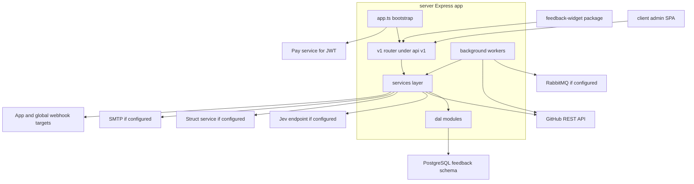

# Architecture

The server layers HTTP routes over domain services, a data access layer and PostgreSQL. `app.ts` builds the Express app with `@jeffrey-keyser/express-server-factory`, adds correlation IDs, the GitHub error middleware, versioning and Pay authentication, then mounts the routers ([server/app.ts:L1-L5](https://github.com/Jeffrey-Keyser/feedback-registry/blob/e21e9339c65151a9f0e1293bfc071a2b3ed034f8/server/app.ts#L1-L5), [server/app.ts:L222-L228](https://github.com/Jeffrey-Keyser/feedback-registry/blob/e21e9339c65151a9f0e1293bfc071a2b3ed034f8/server/app.ts#L222-L228)). A code comment says the app is self-hosted rather than serverless ([server/app.ts:L250-L251](https://github.com/Jeffrey-Keyser/feedback-registry/blob/e21e9339c65151a9f0e1293bfc071a2b3ed034f8/server/app.ts#L250-L251)).

## Component map

## Role contracts

- **Versioned router.** Mounts `/auth`, `/diagnostics`, `/feedback`, `/incidents`, `/admin`, `/webhooks` and `/notifications` under `/api/v1` ([server/routes/versions/v1/index.ts:L54-L75](https://github.com/Jeffrey-Keyser/feedback-registry/blob/e21e9339c65151a9f0e1293bfc071a2b3ed034f8/server/routes/versions/v1/index.ts#L54-L75)).
- **Response envelope.** Successful feedback responses use `{ success, data }`; mapped errors use `{ success: false, error }` ([server/routes/feedback.ts:L202-L205](https://github.com/Jeffrey-Keyser/feedback-registry/blob/e21e9339c65151a9f0e1293bfc071a2b3ed034f8/server/routes/feedback.ts#L202-L205), [server/app.ts:L195-L197](https://github.com/Jeffrey-Keyser/feedback-registry/blob/e21e9339c65151a9f0e1293bfc071a2b3ed034f8/server/app.ts#L195-L197)).
- **FeedbackService.** Orchestrates submission, lookup, updates and comments, and calls the GitHub, triage, webhook, email and analytics collaborators ([server/services/FeedbackService.ts:L43-L58](https://github.com/Jeffrey-Keyser/feedback-registry/blob/e21e9339c65151a9f0e1293bfc071a2b3ed034f8/server/services/FeedbackService.ts#L43-L58)). Bulk resolution (`bulkResolveFeedbackSubmissions`) also creates a resolved in-app notice for each resolved report with a reporter identity, in the same database transaction as the resolution. Transactional email to the reporter is sent only after the batch commits, with each send settled independently, so a mail failure does not roll back the batch. Setting `notifyUser` to `false` suppresses both ([server/services/FeedbackService.ts:L696-L713](https://github.com/Jeffrey-Keyser/feedback-registry/blob/00f50b07b61ec27e1f46366835537f3ad4399d95/server/services/FeedbackService.ts#L696-L713), [server/services/FeedbackService.ts:L725-L757](https://github.com/Jeffrey-Keyser/feedback-registry/blob/00f50b07b61ec27e1f46366835537f3ad4399d95/server/services/FeedbackService.ts#L725-L757), [server/services/FeedbackService.ts:L768-L785](https://github.com/Jeffrey-Keyser/feedback-registry/blob/00f50b07b61ec27e1f46366835537f3ad4399d95/server/services/FeedbackService.ts#L768-L785)).
- **AutoTriageService.** Calls the classifier, writes triage fields and an internal comment, then tries durable issue publication ([server/services/AutoTriageService.ts:L74-L115](https://github.com/Jeffrey-Keyser/feedback-registry/blob/e21e9339c65151a9f0e1293bfc071a2b3ed034f8/server/services/AutoTriageService.ts#L74-L115)).
- **TriageClassifier.** Tries Jev first, then Struct when configured, then keyword rules ([server/services/TriageClassifier.ts:L52-L56](https://github.com/Jeffrey-Keyser/feedback-registry/blob/e21e9339c65151a9f0e1293bfc071a2b3ed034f8/server/services/TriageClassifier.ts#L52-L56)).
- **Webhook dispatchers.** Per-app dispatch posts to the app's `webhookUrl` ([server/services/WebhookDispatchService.ts:L22-L23](https://github.com/Jeffrey-Keyser/feedback-registry/blob/e21e9339c65151a9f0e1293bfc071a2b3ed034f8/server/services/WebhookDispatchService.ts#L22-L23)). The global dispatcher signs payloads with HMAC SHA-256 ([server/services/GlobalWebhookService.ts:L36-L42](https://github.com/Jeffrey-Keyser/feedback-registry/blob/e21e9339c65151a9f0e1293bfc071a2b3ed034f8/server/services/GlobalWebhookService.ts#L36-L42)).
- **DAL.** Per-table modules such as `dal/apps.ts` and `dal/comments.ts` use parameterized SQL against the pool ([server/dal/comments.ts:L44-L48](https://github.com/Jeffrey-Keyser/feedback-registry/blob/e21e9339c65151a9f0e1293bfc071a2b3ed034f8/server/dal/comments.ts#L44-L48)). `dal/notifications.ts` `createNotification` takes an optional query client, typed as `NotificationQueryClient`, so callers can write a notice inside their own transaction. It defaults to the shared pool ([server/dal/notifications.ts:L15-L27](https://github.com/Jeffrey-Keyser/feedback-registry/blob/00f50b07b61ec27e1f46366835537f3ad4399d95/server/dal/notifications.ts#L15-L27), [server/dal/notifications.ts:L43-L56](https://github.com/Jeffrey-Keyser/feedback-registry/blob/00f50b07b61ec27e1f46366835537f3ad4399d95/server/dal/notifications.ts#L43-L56)).
- **Domain layer.** `DiagnosticsService` aggregates health checks ([server/domain/services/DiagnosticsService.ts:L51-L57](https://github.com/Jeffrey-Keyser/feedback-registry/blob/e21e9339c65151a9f0e1293bfc071a2b3ed034f8/server/domain/services/DiagnosticsService.ts#L51-L57)). The entity and repository index files are empty placeholders ([server/domain/entities/index.ts:L1-L2](https://github.com/Jeffrey-Keyser/feedback-registry/blob/e21e9339c65151a9f0e1293bfc071a2b3ed034f8/server/domain/entities/index.ts#L1-L2)).
- **Background work.** `www.ts` starts the incident worker, the feedback issue publisher and the RabbitMQ cron consumer, then stops them on shutdown ([server/bin/www.ts:L21-L31](https://github.com/Jeffrey-Keyser/feedback-registry/blob/e21e9339c65151a9f0e1293bfc071a2b3ed034f8/server/bin/www.ts#L21-L31)).
- **Client and packages.** The admin client exposes dashboard containers ([client/src/containers/index.ts:L1-L3](https://github.com/Jeffrey-Keyser/feedback-registry/blob/e21e9339c65151a9f0e1293bfc071a2b3ed034f8/client/src/containers/index.ts#L1-L3)). The SDK exports `FeedbackClient` and React helpers ([packages/feedback-client/src/index.ts:L1-L4](https://github.com/Jeffrey-Keyser/feedback-registry/blob/e21e9339c65151a9f0e1293bfc071a2b3ed034f8/packages/feedback-client/src/index.ts#L1-L4)).

## Unknowns

The incident subsystem's storage and worker internals are only partly visible here. Its route contracts are shown in [incidents/routes.ts](https://github.com/Jeffrey-Keyser/feedback-registry/blob/e21e9339c65151a9f0e1293bfc071a2b3ed034f8/server/incidents/routes.ts#L11-L29).
