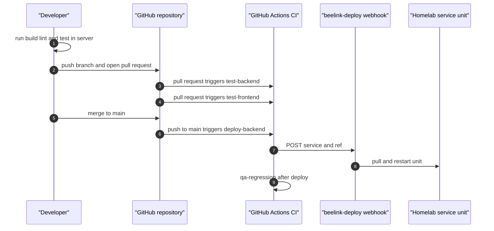

# Iteration Loop

The server has explicit npm scripts for development, build, lint and tests. CI runs backend and frontend test jobs on pull requests, and a push to `main` calls the homelab deploy webhook ([server/package.json:L6-L18](https://github.com/Jeffrey-Keyser/feedback-registry/blob/e21e9339c65151a9f0e1293bfc071a2b3ed034f8/server/package.json#L6-L18), [.github/workflows/ci-cd-pipeline.yml:L14-L15](https://github.com/Jeffrey-Keyser/feedback-registry/blob/e21e9339c65151a9f0e1293bfc071a2b3ed034f8/.github/workflows/ci-cd-pipeline.yml#L14-L15)).

## Local server loop

Run commands from `server/`:

- `npm run dev` runs `ts-node ./bin/www.ts` ([server/package.json:L8](https://github.com/Jeffrey-Keyser/feedback-registry/blob/e21e9339c65151a9f0e1293bfc071a2b3ed034f8/server/package.json#L8)).
- `npm run build` runs `tsc` and `npm run lint` runs ESLint over TypeScript files ([server/package.json:L9](https://github.com/Jeffrey-Keyser/feedback-registry/blob/e21e9339c65151a9f0e1293bfc071a2b3ed034f8/server/package.json#L9), [server/package.json:L11](https://github.com/Jeffrey-Keyser/feedback-registry/blob/e21e9339c65151a9f0e1293bfc071a2b3ed034f8/server/package.json#L11)).
- `npm test` runs Jest. `npm run test:unit` excludes the integration directory ([server/package.json:L12-L13](https://github.com/Jeffrey-Keyser/feedback-registry/blob/e21e9339c65151a9f0e1293bfc071a2b3ed034f8/server/package.json#L12-L13), [server/jest.unit.config.cjs:L3-L7](https://github.com/Jeffrey-Keyser/feedback-registry/blob/e21e9339c65151a9f0e1293bfc071a2b3ed034f8/server/jest.unit.config.cjs#L3-L7)).
- `npm run test:incidents` builds and runs the incident test script ([server/package.json:L14](https://github.com/Jeffrey-Keyser/feedback-registry/blob/e21e9339c65151a9f0e1293bfc071a2b3ed034f8/server/package.json#L14)). The runtime-incidents guide says it needs a disposable database URL and refuses databases with existing feedback or incident tables ([docs/runtime-incidents.md:L143-L150](https://github.com/Jeffrey-Keyser/feedback-registry/blob/e21e9339c65151a9f0e1293bfc071a2b3ed034f8/docs/runtime-incidents.md#L143-L150)).

Client commands run from `client/`: `npm run dev`, `npm run build`, `npm test` (Vitest run mode) and `npm run coverage` ([client/package.json:L34-L38](https://github.com/Jeffrey-Keyser/feedback-registry/blob/e21e9339c65151a9f0e1293bfc071a2b3ed034f8/client/package.json#L34-L38)).

## MyRRS onboarding tests

`server/tests/__tests__/integration/myrrs-feedback-onboarding.test.ts` exercises the MyRRS registration and feedback submission path against a fixture launcher in `server/tests/fixtures/myrrs-isolated-registry.ts`. The fixture starts the built production entry `server/dist/bin/www.js`, so `npm run build` must run first. It requires an explicit isolated database (`FEEDBACK_ISOLATED_DATABASE_URL`, `FEEDBACK_TEST_DATABASE_URL`, or discrete `DATABASE_*`/`DB_*` settings) and has no production connection fallback. The checkout location comes from `FEEDBACK_REGISTRY_PATH`, which defaults to `/home/jkeyser/feedback-registry` ([server/tests/__tests__/integration/myrrs-feedback-onboarding.test.ts](https://github.com/Jeffrey-Keyser/feedback-registry/blob/32bf687677906b8e0beaf320fbc3768d036e114e/server/tests/__tests__/integration/myrrs-feedback-onboarding.test.ts), [server/tests/fixtures/myrrs-isolated-registry.ts](https://github.com/Jeffrey-Keyser/feedback-registry/blob/32bf687677906b8e0beaf320fbc3768d036e114e/server/tests/fixtures/myrrs-isolated-registry.ts)).

The fixture's `resetIsolatedDatabase` drops and recreates the `feedback` schema. It refuses to run unless the database is explicitly isolated or its path name contains `test`, `isolated`, `disposable` or `myrrs` ([server/tests/fixtures/myrrs-isolated-registry.ts](https://github.com/Jeffrey-Keyser/feedback-registry/blob/32bf687677906b8e0beaf320fbc3768d036e114e/server/tests/fixtures/myrrs-isolated-registry.ts)).

In the merge commit at `0ce5a8b8e940`, the MyRRS test's exact-list CORS expectation names the full adopted-app origin union: MyRRS, Image Studio and Spanish Studio ([server/tests/__tests__/integration/myrrs-feedback-onboarding.test.ts](https://github.com/Jeffrey-Keyser/feedback-registry/blob/0ce5a8b8e940c1e650841031c5c8d087a75d3ad9/server/tests/__tests__/integration/myrrs-feedback-onboarding.test.ts)).

## Image Studio and Spanish Studio onboarding tests

Two further integration tests follow the MyRRS pattern, with the same isolated-database requirements and the same built-entry startup:

- `server/tests/__tests__/integration/image-studio-feedback-onboarding.test.ts` uses `server/tests/fixtures/image-studio-isolated-registry.ts`. Its reset guard also accepts path names containing `image-studio` or `image_studio`. It checks the `image-studio` registration, idempotent preparation, a bug and a feature report, and the Image Studio origin.
- `server/tests/__tests__/integration/spanish-studio-feedback-onboarding.test.ts` uses `server/tests/fixtures/spanish-studio-isolated-registry.ts`, which reuses the shared MyRRS fixture helpers for database URL resolution, schema reset and startup. It checks the `spanish-studio` registration, that the MyRRS row is preserved, a bug and a feature report, and the Spanish Studio origin.

Both tests check that `deploy.sh` runs their preparation script before the `systemctl restart` line ([server/tests/__tests__/integration/image-studio-feedback-onboarding.test.ts](https://github.com/Jeffrey-Keyser/feedback-registry/blob/0ce5a8b8e940c1e650841031c5c8d087a75d3ad9/server/tests/__tests__/integration/image-studio-feedback-onboarding.test.ts), [server/tests/__tests__/integration/spanish-studio-feedback-onboarding.test.ts](https://github.com/Jeffrey-Keyser/feedback-registry/blob/0ce5a8b8e940c1e650841031c5c8d087a75d3ad9/server/tests/__tests__/integration/spanish-studio-feedback-onboarding.test.ts)).

## Life and NanoClaw onboarding tests

Two integration tests cover the Life and NanoClaw registrations, using the same isolated-database and built-entry requirements:

- `server/tests/__tests__/integration/life-feedback-onboarding.test.ts` uses `server/tests/fixtures/life-isolated-registry.ts`. It checks the `life` registration shape with triage disabled and no recipient, idempotent preparation, preservation of customized settings on conflict, coexistence with the MyRRS and Spanish Studio rows, and the exact server-side payload persisted for a `question` report. It also checks that the retired `life-journal` payload shape is rejected and that the CORS allowlist is unchanged.
- `server/tests/__tests__/integration/nanoclaw-feedback-onboarding.test.ts` uses `server/tests/fixtures/nanoclaw-isolated-registry.ts`. It applies the same checks to the `nanoclaw` registration, and verifies the persisted `bug` payload from the NanoClaw IPC handler. It also checks that the retired `appId`-less payload is rejected.

Both tests check that `deploy.sh` runs their preparation script before the `systemctl restart` line ([server/tests/__tests__/integration/life-feedback-onboarding.test.ts](https://github.com/Jeffrey-Keyser/feedback-registry/blob/321c3f798b873b8823734899172603e746db3eed/server/tests/__tests__/integration/life-feedback-onboarding.test.ts), [server/tests/__tests__/integration/nanoclaw-feedback-onboarding.test.ts](https://github.com/Jeffrey-Keyser/feedback-registry/blob/321c3f798b873b8823734899172603e746db3eed/server/tests/__tests__/integration/nanoclaw-feedback-onboarding.test.ts)).

## Sequence

## CI details

- Backend and frontend tests run only for pull requests, on Node 20, using a composite action from a private actions repository ([.github/workflows/ci-cd-pipeline.yml:L15-L16](https://github.com/Jeffrey-Keyser/feedback-registry/blob/e21e9339c65151a9f0e1293bfc071a2b3ed034f8/.github/workflows/ci-cd-pipeline.yml#L15-L16), [.github/workflows/ci-cd-pipeline.yml:L34-L38](https://github.com/Jeffrey-Keyser/feedback-registry/blob/e21e9339c65151a9f0e1293bfc071a2b3ed034f8/.github/workflows/ci-cd-pipeline.yml#L34-L38)). The composite action's internal commands are not in the excerpts.
- The deploy job posts the service name and commit SHA to the webhook ([.github/workflows/ci-cd-pipeline.yml:L80-L85](https://github.com/Jeffrey-Keyser/feedback-registry/blob/e21e9339c65151a9f0e1293bfc071a2b3ed034f8/.github/workflows/ci-cd-pipeline.yml#L80-L85)). The workflow comment says the webhook pulls and restarts the service ([.github/workflows/ci-cd-pipeline.yml:L9-L10](https://github.com/Jeffrey-Keyser/feedback-registry/blob/e21e9339c65151a9f0e1293bfc071a2b3ed034f8/.github/workflows/ci-cd-pipeline.yml#L9-L10)).
- A QA regression job runs after deploy against configured URLs ([.github/workflows/ci-cd-pipeline.yml:L88-L108](https://github.com/Jeffrey-Keyser/feedback-registry/blob/e21e9339c65151a9f0e1293bfc071a2b3ed034f8/.github/workflows/ci-cd-pipeline.yml#L88-L108)). The script it runs is not in these sources.
- The repository's `deploy.sh` runs the migration script, then `scripts/ensure-myrrs-app.cjs`, then `scripts/ensure-image-studio-app.cjs`, `scripts/ensure-spanish-studio-app.cjs`, `scripts/ensure-life-app.cjs` and `scripts/ensure-nanoclaw-app.cjs`, then restarts the `feedback-registry` service. The registration steps are ordered before the restart ([deploy.sh](https://github.com/Jeffrey-Keyser/feedback-registry/blob/321c3f798b873b8823734899172603e746db3eed/deploy.sh)). Whether the webhook runs `deploy.sh` is not shown in these sources.

## Other workflows

- The widget publishes to GitHub Packages on tags matching `feedback-widget-v*` ([.github/workflows/publish-feedback-widget.yml:L5-L6](https://github.com/Jeffrey-Keyser/feedback-registry/blob/e21e9339c65151a9f0e1293bfc071a2b3ed034f8/.github/workflows/publish-feedback-widget.yml#L5-L6)).
- Terraform deployment is manual through `workflow_dispatch` ([.github/workflows/terraform_deploy.yml:L3-L4](https://github.com/Jeffrey-Keyser/feedback-registry/blob/e21e9339c65151a9f0e1293bfc071a2b3ed034f8/.github/workflows/terraform_deploy.yml#L3-L4)).

## Verification commands

`config/verify/feedback-registry.json` lists four verification commands, each run from `server/`: the unit test file for bulk resolution notifications, the matching integration test file, the full unit test run with `--runInBand`, and `npm run build` ([config/verify/feedback-registry.json:L2-L7](https://github.com/Jeffrey-Keyser/feedback-registry/blob/00f50b07b61ec27e1f46366835537f3ad4399d95/config/verify/feedback-registry.json#L2-L7)). The file does not say how or where these commands are invoked. The MyRRS, Image Studio, Spanish Studio, Life and NanoClaw onboarding integration tests are not listed in that file ([server/tests/__tests__/integration/myrrs-feedback-onboarding.test.ts](https://github.com/Jeffrey-Keyser/feedback-registry/blob/32bf687677906b8e0beaf320fbc3768d036e114e/server/tests/__tests__/integration/myrrs-feedback-onboarding.test.ts)).

## Contributor checklist

Run the server build, lint and tests before opening a pull request. Schema changes need the database tooling referenced in the Operations page; the CLAUDE.md file documents `db-deploy` commands ([CLAUDE.md:L99-L108](https://github.com/Jeffrey-Keyser/feedback-registry/blob/e21e9339c65151a9f0e1293bfc071a2b3ed034f8/CLAUDE.md#L99-L108)).
