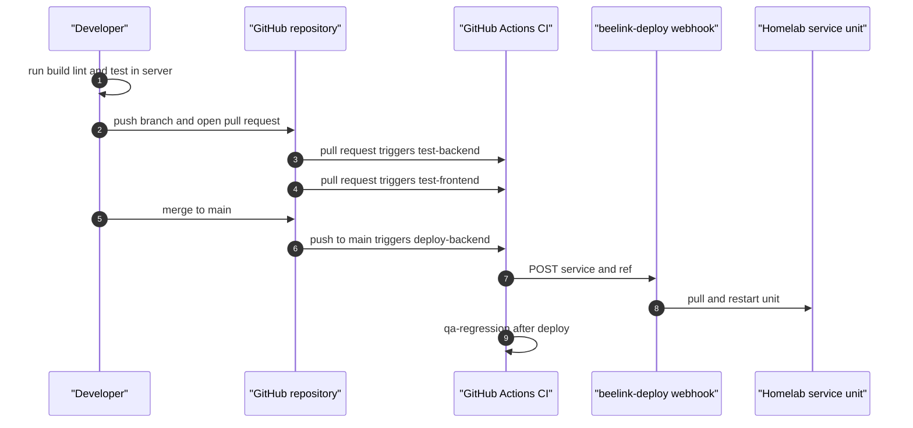

# Iteration Loop

The server has explicit npm scripts for development, build, lint and tests. CI runs backend and frontend test jobs on pull requests, and a push to `main` calls the homelab deploy webhook ([server/package.json:L6-L18](https://github.com/Jeffrey-Keyser/feedback-registry/blob/e21e9339c65151a9f0e1293bfc071a2b3ed034f8/server/package.json#L6-L18), [.github/workflows/ci-cd-pipeline.yml:L14-L15](https://github.com/Jeffrey-Keyser/feedback-registry/blob/e21e9339c65151a9f0e1293bfc071a2b3ed034f8/.github/workflows/ci-cd-pipeline.yml#L14-L15)).

## Local server loop

Run commands from `server/`:

- `npm run dev` runs `ts-node ./bin/www.ts` ([server/package.json:L8](https://github.com/Jeffrey-Keyser/feedback-registry/blob/e21e9339c65151a9f0e1293bfc071a2b3ed034f8/server/package.json#L8)).
- `npm run build` runs `tsc` and `npm run lint` runs ESLint over TypeScript files ([server/package.json:L9](https://github.com/Jeffrey-Keyser/feedback-registry/blob/e21e9339c65151a9f0e1293bfc071a2b3ed034f8/server/package.json#L9), [server/package.json:L11](https://github.com/Jeffrey-Keyser/feedback-registry/blob/e21e9339c65151a9f0e1293bfc071a2b3ed034f8/server/package.json#L11)).
- `npm test` runs Jest. `npm run test:unit` excludes the integration directory ([server/package.json:L12-L13](https://github.com/Jeffrey-Keyser/feedback-registry/blob/e21e9339c65151a9f0e1293bfc071a2b3ed034f8/server/package.json#L12-L13), [server/jest.unit.config.cjs:L3-L7](https://github.com/Jeffrey-Keyser/feedback-registry/blob/e21e9339c65151a9f0e1293bfc071a2b3ed034f8/server/jest.unit.config.cjs#L3-L7)).
- `npm run test:incidents` builds and runs the incident test script ([server/package.json:L14](https://github.com/Jeffrey-Keyser/feedback-registry/blob/e21e9339c65151a9f0e1293bfc071a2b3ed034f8/server/package.json#L14)). The runtime-incidents guide says it needs a disposable database URL and refuses databases with existing feedback or incident tables ([docs/runtime-incidents.md:L143-L150](https://github.com/Jeffrey-Keyser/feedback-registry/blob/e21e9339c65151a9f0e1293bfc071a2b3ed034f8/docs/runtime-incidents.md#L143-L150)).

Client commands run from `client/`: `npm run dev`, `npm run build`, `npm test` (Vitest run mode) and `npm run coverage` ([client/package.json:L34-L38](https://github.com/Jeffrey-Keyser/feedback-registry/blob/e21e9339c65151a9f0e1293bfc071a2b3ed034f8/client/package.json#L34-L38)).

## Sequence

## CI details

- Backend and frontend tests run only for pull requests, on Node 20, using a composite action from a private actions repository ([.github/workflows/ci-cd-pipeline.yml:L15-L16](https://github.com/Jeffrey-Keyser/feedback-registry/blob/e21e9339c65151a9f0e1293bfc071a2b3ed034f8/.github/workflows/ci-cd-pipeline.yml#L15-L16), [.github/workflows/ci-cd-pipeline.yml:L34-L38](https://github.com/Jeffrey-Keyser/feedback-registry/blob/e21e9339c65151a9f0e1293bfc071a2b3ed034f8/.github/workflows/ci-cd-pipeline.yml#L34-L38)). The composite action's internal commands are not in the excerpts.
- The deploy job posts the service name and commit SHA to the webhook ([.github/workflows/ci-cd-pipeline.yml:L80-L85](https://github.com/Jeffrey-Keyser/feedback-registry/blob/e21e9339c65151a9f0e1293bfc071a2b3ed034f8/.github/workflows/ci-cd-pipeline.yml#L80-L85)). The workflow comment says the webhook pulls and restarts the service ([.github/workflows/ci-cd-pipeline.yml:L9-L10](https://github.com/Jeffrey-Keyser/feedback-registry/blob/e21e9339c65151a9f0e1293bfc071a2b3ed034f8/.github/workflows/ci-cd-pipeline.yml#L9-L10)).
- A QA regression job runs after deploy against configured URLs ([.github/workflows/ci-cd-pipeline.yml:L88-L108](https://github.com/Jeffrey-Keyser/feedback-registry/blob/e21e9339c65151a9f0e1293bfc071a2b3ed034f8/.github/workflows/ci-cd-pipeline.yml#L88-L108)). The script it runs is not in these sources.

## Other workflows

- The widget publishes to GitHub Packages on tags matching `feedback-widget-v*` ([.github/workflows/publish-feedback-widget.yml:L5-L6](https://github.com/Jeffrey-Keyser/feedback-registry/blob/e21e9339c65151a9f0e1293bfc071a2b3ed034f8/.github/workflows/publish-feedback-widget.yml#L5-L6)).
- Terraform deployment is manual through `workflow_dispatch` ([.github/workflows/terraform_deploy.yml:L3-L4](https://github.com/Jeffrey-Keyser/feedback-registry/blob/e21e9339c65151a9f0e1293bfc071a2b3ed034f8/.github/workflows/terraform_deploy.yml#L3-L4)).

## Verification commands

`config/verify/feedback-registry.json` lists four verification commands, each run from `server/`: the unit test file for bulk resolution notifications, the matching integration test file, the full unit test run with `--runInBand`, and `npm run build` ([config/verify/feedback-registry.json:L2-L7](https://github.com/Jeffrey-Keyser/feedback-registry/blob/00f50b07b61ec27e1f46366835537f3ad4399d95/config/verify/feedback-registry.json#L2-L7)). The file does not say how or where these commands are invoked.

## Contributor checklist

Run the server build, lint and tests before opening a pull request. Schema changes need the database tooling referenced in the Operations page; the CLAUDE.md file documents `db-deploy` commands ([CLAUDE.md:L99-L108](https://github.com/Jeffrey-Keyser/feedback-registry/blob/e21e9339c65151a9f0e1293bfc071a2b3ed034f8/CLAUDE.md#L99-L108)).
