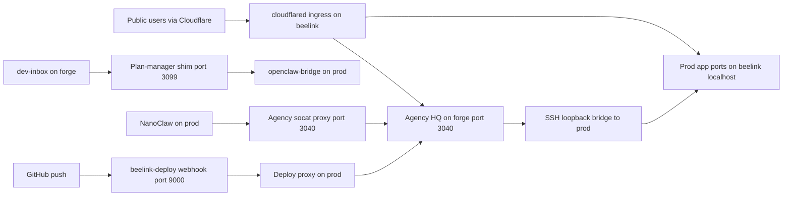

# Architecture

The homelab splits work across two hosts. Prod (`beelink`) serves user-facing traffic, and forge runs dev and agent workloads ([forge/README.md:L5-L8](https://github.com/Jeffrey-Keyser/homelab/blob/29fbeff80bda8de0932ee4ffadfa11f873b7cfed/forge/README.md#L5-L8)). The split exists because agent test stacks drove prod to high load ([forge/README.md:L10-L11](https://github.com/Jeffrey-Keyser/homelab/blob/29fbeff80bda8de0932ee4ffadfa11f873b7cfed/forge/README.md#L10-L11)).

## Components and contracts

- **Cloudflared ingress (beelink).** Maps public hostnames to `localhost` ports and ends with a 404 catch-all ([cloudflared/config.yml:L1-L2](https://github.com/Jeffrey-Keyser/homelab/blob/29fbeff80bda8de0932ee4ffadfa11f873b7cfed/cloudflared/config.yml#L1-L2), [L201-L202](https://github.com/Jeffrey-Keyser/homelab/blob/29fbeff80bda8de0932ee4ffadfa11f873b7cfed/cloudflared/config.yml#L201-L202)). The agency hostname routes to forge over Tailscale on port 3040 ([cloudflared/config.yml:L155-L157](https://github.com/Jeffrey-Keyser/homelab/blob/29fbeff80bda8de0932ee4ffadfa11f873b7cfed/cloudflared/config.yml#L155-L157)).
- **Agency HQ (forge, port 3040).** Reads prod endpoints from environment settings ([forge/README.md:L15-L17](https://github.com/Jeffrey-Keyser/homelab/blob/29fbeff80bda8de0932ee4ffadfa11f873b7cfed/forge/README.md#L15-L17)). Its model-inventory environment loads after the main unit's files ([forge/systemd/agency-hq.service.d/model-inventory.conf:L6-L7](https://github.com/Jeffrey-Keyser/homelab/blob/29fbeff80bda8de0932ee4ffadfa11f873b7cfed/forge/systemd/agency-hq.service.d/model-inventory.conf#L6-L7)).
- **Prod loopback bridge (forge).** An SSH session forwarding prod ports to forge loopback, including 5432 and 5672 ([forge/systemd/prod-loopback-bridge.service:L7-L8](https://github.com/Jeffrey-Keyser/homelab/blob/29fbeff80bda8de0932ee4ffadfa11f873b7cfed/forge/systemd/prod-loopback-bridge.service#L7-L8)). It excludes ports that live on forge ([L7](https://github.com/Jeffrey-Keyser/homelab/blob/29fbeff80bda8de0932ee4ffadfa11f873b7cfed/forge/systemd/prod-loopback-bridge.service#L7)).
- **Plan-manager shim (forge, 127.0.0.1:3099).** Serves `/plan-manager` locally and proxies other paths to the prod bridge ([forge/bin/plan-manager-shim.js:L2-L4](https://github.com/Jeffrey-Keyser/homelab/blob/29fbeff80bda8de0932ee4ffadfa11f873b7cfed/forge/bin/plan-manager-shim.js#L2-L4)). It exposes a `/health` route ([L13](https://github.com/Jeffrey-Keyser/homelab/blob/29fbeff80bda8de0932ee4ffadfa11f873b7cfed/forge/bin/plan-manager-shim.js#L13)).
- **Agency proxy (prod).** A socat relay from prod port 3040 to forge for callers that assume localhost ([forge/prod-side/agency-hq-forge-proxy.service:L1-L6](https://github.com/Jeffrey-Keyser/homelab/blob/29fbeff80bda8de0932ee4ffadfa11f873b7cfed/forge/prod-side/agency-hq-forge-proxy.service#L1-L6)).
- **Deploy chain.** The prod proxy SSHes to forge and runs the remote deploy ([forge/deploy-proxy/deploy.sh:L5](https://github.com/Jeffrey-Keyser/homelab/blob/29fbeff80bda8de0932ee4ffadfa11f873b7cfed/forge/deploy-proxy/deploy.sh#L5)).
- **Compose services.** Caddy and Uptime Kuma are defined in the compose file ([docker-compose.yml:L6-L7](https://github.com/Jeffrey-Keyser/homelab/blob/29fbeff80bda8de0932ee4ffadfa11f873b7cfed/docker-compose.yml#L6-L7), [L21-L22](https://github.com/Jeffrey-Keyser/homelab/blob/29fbeff80bda8de0932ee4ffadfa11f873b7cfed/docker-compose.yml#L21-L22)). The Caddyfile they mount is not in this snapshot ([L14](https://github.com/Jeffrey-Keyser/homelab/blob/29fbeff80bda8de0932ee4ffadfa11f873b7cfed/docker-compose.yml#L14)).

## Flow

Sources: [cloudflared/config.yml:L137-L139](https://github.com/Jeffrey-Keyser/homelab/blob/29fbeff80bda8de0932ee4ffadfa11f873b7cfed/cloudflared/config.yml#L137-L139), [forge/README.md:L36-L45](https://github.com/Jeffrey-Keyser/homelab/blob/29fbeff80bda8de0932ee4ffadfa11f873b7cfed/forge/README.md#L36-L45).

## Unknowns

The deploy webhook source and the Caddy site configuration are not in this snapshot, so their internals are unknown.
