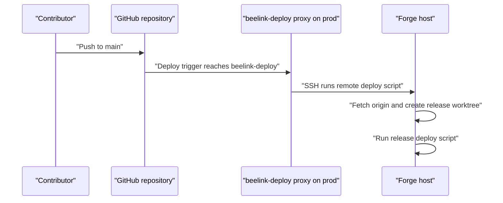

# Iteration Loop

This page describes how a change moves through the repository today. No CI workflow files appear in this snapshot, so CI behavior is unknown. The checks described here are the ones visible in scripts.

## 1. Set up a host

The quick start clones the repository and runs `scripts/setup.sh` ([README.md:L98-L101](https://github.com/Jeffrey-Keyser/homelab/blob/29fbeff80bda8de0932ee4ffadfa11f873b7cfed/README.md#L98-L101)). The script refuses to run as root ([scripts/setup.sh:L26-L29](https://github.com/Jeffrey-Keyser/homelab/blob/29fbeff80bda8de0932ee4ffadfa11f873b7cfed/scripts/setup.sh#L26-L29)). It installs Node 22 ([scripts/setup.sh:L67](https://github.com/Jeffrey-Keyser/homelab/blob/29fbeff80bda8de0932ee4ffadfa11f873b7cfed/scripts/setup.sh#L67)), while forge uses Node 24 ([forge/bootstrap.sh:L36-L38](https://github.com/Jeffrey-Keyser/homelab/blob/29fbeff80bda8de0932ee4ffadfa11f873b7cfed/forge/bootstrap.sh#L36-L38)).

## 2. Change ingress

Edit `cloudflared/config.yml`, which is the tracked source of truth ([README.md:L237-L238](https://github.com/Jeffrey-Keyser/homelab/blob/29fbeff80bda8de0932ee4ffadfa11f873b7cfed/README.md#L237-L238)). Then run `./scripts/update-cloudflared.sh`. It validates the ingress rules ([scripts/update-cloudflared.sh:L32-L33](https://github.com/Jeffrey-Keyser/homelab/blob/29fbeff80bda8de0932ee4ffadfa11f873b7cfed/scripts/update-cloudflared.sh#L32-L33)), keeps the previous config as a `.previous` file ([L42-L44](https://github.com/Jeffrey-Keyser/homelab/blob/29fbeff80bda8de0932ee4ffadfa11f873b7cfed/scripts/update-cloudflared.sh#L42-L44)), and restarts the service ([L46-L47](https://github.com/Jeffrey-Keyser/homelab/blob/29fbeff80bda8de0932ee4ffadfa11f873b7cfed/scripts/update-cloudflared.sh#L46-L47)).

## 3. Change forge tooling

Forge bootstrap is idempotent ([forge/bootstrap.sh:L7](https://github.com/Jeffrey-Keyser/homelab/blob/29fbeff80bda8de0932ee4ffadfa11f873b7cfed/forge/bootstrap.sh#L7)). When a service moves between hosts, update the bridge port list and reload the user unit ([forge/README.md:L20-L21](https://github.com/Jeffrey-Keyser/homelab/blob/29fbeff80bda8de0932ee4ffadfa11f873b7cfed/forge/README.md#L20-L21)). Check the parity checklist for known setup traps ([forge/README.md:L61-L62](https://github.com/Jeffrey-Keyser/homelab/blob/29fbeff80bda8de0932ee4ffadfa11f873b7cfed/forge/README.md#L61-L62)).

## 4. Deploy

The proxy runs `bin/agency-hq-remote-deploy.sh` over SSH ([forge/deploy-proxy/deploy.sh:L5](https://github.com/Jeffrey-Keyser/homelab/blob/29fbeff80bda8de0932ee4ffadfa11f873b7cfed/forge/deploy-proxy/deploy.sh#L5)). That script fetches origin and creates a detached worktree keyed by commit ([forge/bin/agency-hq-remote-deploy.sh:L8-L11](https://github.com/Jeffrey-Keyser/homelab/blob/29fbeff80bda8de0932ee4ffadfa11f873b7cfed/forge/bin/agency-hq-remote-deploy.sh#L8-L11)).

## 5. Verify

The Nix pilot records local checks and timings, not CI results ([docs/nix-development-pilot.md:L104-L108](https://github.com/Jeffrey-Keyser/homelab/blob/29fbeff80bda8de0932ee4ffadfa11f873b7cfed/docs/nix-development-pilot.md#L104-L108)). Opt-in CI is a later step ([L15-L16](https://github.com/Jeffrey-Keyser/homelab/blob/29fbeff80bda8de0932ee4ffadfa11f873b7cfed/docs/nix-development-pilot.md#L15-L16)). The flake files that pin toolchains are not included in this snapshot.
