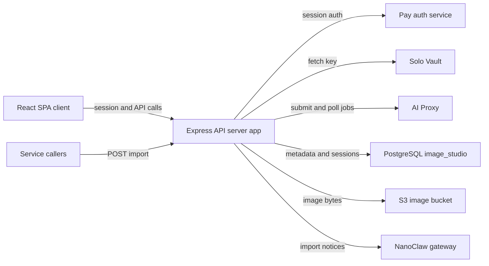

# Architecture

The repository has two deployable surfaces: an Express API in `server/` and a Vite-built React SPA in `client/` ([README.md:L240-L241](https://github.com/Jeffrey-Keyser/image-studio/blob/cc09e9afb77781ab37b1237f3341edbe1e5425f9/README.md#L240-L241)). The API is assembled in one `app.ts` with `createServerlessAppSync` ([server/app.ts:L315-L321](https://github.com/Jeffrey-Keyser/image-studio/blob/cc09e9afb77781ab37b1237f3341edbe1e5425f9/server/app.ts#L315-L321)).

## Server components

- **Bootstrap (`server/app.ts`).** Pay auth runs with a public-route list. That list exempts the service-token import route and storyboard and exploration service routes from session auth ([server/app.ts:L92-L110](https://github.com/Jeffrey-Keyser/image-studio/blob/cc09e9afb77781ab37b1237f3341edbe1e5425f9/server/app.ts#L92-L110)). Sessions live in `image_studio.user_sessions` ([server/app.ts:L209-L213](https://github.com/Jeffrey-Keyser/image-studio/blob/cc09e9afb77781ab37b1237f3341edbe1e5425f9/server/app.ts#L209-L213)). The rate limiter allows 200 requests per 60 s and skips `/auth` ([server/app.ts:L184-L190](https://github.com/Jeffrey-Keyser/image-studio/blob/cc09e9afb77781ab37b1237f3341edbe1e5425f9/server/app.ts#L184-L190)).
- **Error bridge.** `bridgeDomainErrors` re-creates api-errors instances as express-server-factory errors so status mapping works ([server/app.ts:L157-L168](https://github.com/Jeffrey-Keyser/image-studio/blob/cc09e9afb77781ab37b1237f3341edbe1e5425f9/server/app.ts#L157-L168)).
- **Startup (`server/bin/www.ts`).** Orphaned generation jobs are recovered and the exploration worker starts before listening ([server/bin/www.ts:L16-L18](https://github.com/Jeffrey-Keyser/image-studio/blob/cc09e9afb77781ab37b1237f3341edbe1e5425f9/server/bin/www.ts#L16-L18)).
- **Generation service.** Submits to AI Proxy `/v1/image`, polls every 4 s, and gives up after 150 attempts ([server/services/generationService.ts:L33-L34](https://github.com/Jeffrey-Keyser/image-studio/blob/cc09e9afb77781ab37b1237f3341edbe1e5425f9/server/services/generationService.ts#L33-L34), [server/services/generationService.ts:L163](https://github.com/Jeffrey-Keyser/image-studio/blob/cc09e9afb77781ab37b1237f3341edbe1e5425f9/server/services/generationService.ts#L163)).
- **Solo Vault client.** Fetches and caches the AI Proxy key and rejects values without the expected prefix ([server/services/soloVault.ts:L11-L18](https://github.com/Jeffrey-Keyser/image-studio/blob/cc09e9afb77781ab37b1237f3341edbe1e5425f9/server/services/soloVault.ts#L11-L18), [server/services/soloVault.ts:L43-L45](https://github.com/Jeffrey-Keyser/image-studio/blob/cc09e9afb77781ab37b1237f3341edbe1e5425f9/server/services/soloVault.ts#L43-L45)).
- **Exploration worker.** Keeps at most two active candidate jobs and ticks every 2 s ([server/services/explorationWorker.ts:L10-L12](https://github.com/Jeffrey-Keyser/image-studio/blob/cc09e9afb77781ab37b1237f3341edbe1e5425f9/server/services/explorationWorker.ts#L10-L12), [server/services/explorationWorker.ts:L229](https://github.com/Jeffrey-Keyser/image-studio/blob/cc09e9afb77781ab37b1237f3341edbe1e5425f9/server/services/explorationWorker.ts#L229)).
- **Import notifier.** Sends debounced notices to NanoClaw only when enabled ([server/services/importNotifier.ts:L88-L89](https://github.com/Jeffrey-Keyser/image-studio/blob/cc09e9afb77781ab37b1237f3341edbe1e5425f9/server/services/importNotifier.ts#L88-L89)).
- **Stream helper (`server/routes/streamResponse.ts`).** `streamToResponse` pipes a stored file (such as an S3 body) into a response. It attaches a source `error` listener that returns a 500 JSON body when no bytes have been sent, or destroys the response otherwise. It also destroys the source when the client closes the response early ([server/routes/streamResponse.ts](https://github.com/Jeffrey-Keyser/image-studio/blob/afe319a3f84076ffeccf5c7da51ac6034e392a8b/server/routes/streamResponse.ts)). Version `/file`, latest `/file`, generation history `/file`, and generate job `/file` routes use it ([server/routes/versions/v1/images.ts](https://github.com/Jeffrey-Keyser/image-studio/blob/afe319a3f84076ffeccf5c7da51ac6034e392a8b/server/routes/versions/v1/images.ts), [server/routes/versions/v1/generate.ts](https://github.com/Jeffrey-Keyser/image-studio/blob/afe319a3f84076ffeccf5c7da51ac6034e392a8b/server/routes/versions/v1/generate.ts)).

## Route contracts (`/api/v1`)

- **Generate:** submit, status, job list, file, and save ([server/routes/versions/v1/generate.ts:L15](https://github.com/Jeffrey-Keyser/image-studio/blob/cc09e9afb77781ab37b1237f3341edbe1e5425f9/server/routes/versions/v1/generate.ts#L15), [server/routes/versions/v1/generate.ts:L110](https://github.com/Jeffrey-Keyser/image-studio/blob/cc09e9afb77781ab37b1237f3341edbe1e5425f9/server/routes/versions/v1/generate.ts#L110), [server/routes/versions/v1/generate.ts:L177](https://github.com/Jeffrey-Keyser/image-studio/blob/cc09e9afb77781ab37b1237f3341edbe1e5425f9/server/routes/versions/v1/generate.ts#L177)).
- **Images and history:** library CRUD, versions, thumbnails, and generation history ([server/routes/versions/v1/images.ts:L150-L170](https://github.com/Jeffrey-Keyser/image-studio/blob/cc09e9afb77781ab37b1237f3341edbe1e5425f9/server/routes/versions/v1/images.ts#L150-L170), [server/routes/versions/v1/images.ts:L312-L339](https://github.com/Jeffrey-Keyser/image-studio/blob/cc09e9afb77781ab37b1237f3341edbe1e5425f9/server/routes/versions/v1/images.ts#L312-L339)).
- **Version uploads:** `POST /api/v1/images/:id/versions` accepts one `image` file, capped at 10 MB (`MAX_VERSION_UPLOAD_BYTES`). Larger uploads return 413 with `VERSION_PAYLOAD_TOO_LARGE` before storage is touched ([server/routes/versions/v1/images.ts](https://github.com/Jeffrey-Keyser/image-studio/blob/afe319a3f84076ffeccf5c7da51ac6034e392a8b/server/routes/versions/v1/images.ts), [server/routes/errorCatalog.ts](https://github.com/Jeffrey-Keyser/image-studio/blob/afe319a3f84076ffeccf5c7da51ac6034e392a8b/server/routes/errorCatalog.ts)).
- **Import:** service-token ingest of JSON or multipart images, capped at 10 MB and limited to five MIME types ([server/routes/versions/v1/import.ts:L19](https://github.com/Jeffrey-Keyser/image-studio/blob/cc09e9afb77781ab37b1237f3341edbe1e5425f9/server/routes/versions/v1/import.ts#L19), [server/routes/versions/v1/import.ts:L26-L32](https://github.com/Jeffrey-Keyser/image-studio/blob/cc09e9afb77781ab37b1237f3341edbe1e5425f9/server/routes/versions/v1/import.ts#L26-L32)).
- **Staging, storyboards, explorations:** mounted under `/api/v1` ([server/routes/versions/v1/index.ts:L43-L52](https://github.com/Jeffrey-Keyser/image-studio/blob/cc09e9afb77781ab37b1237f3341edbe1e5425f9/server/routes/versions/v1/index.ts#L43-L52)).
- **Errors:** catalog-backed bodies use `success`, `code`, and `error` ([server/routes/errorCatalog.ts:L61-L65](https://github.com/Jeffrey-Keyser/image-studio/blob/cc09e9afb77781ab37b1237f3341edbe1e5425f9/server/routes/errorCatalog.ts#L61-L65)). Many routes still return ad hoc error bodies.

## Client

- Routes cover the image list, studio, image detail, storyboards, explorations, and staging batch review ([client/src/App.tsx:L27-L41](https://github.com/Jeffrey-Keyser/image-studio/blob/cc09e9afb77781ab37b1237f3341edbe1e5425f9/client/src/App.tsx#L27-L41)).
- RTK Query slices cover diagnostics, users, image, generations, and feedback ([client/src/reducers/index.ts:L1-L5](https://github.com/Jeffrey-Keyser/image-studio/blob/cc09e9afb77781ab37b1237f3341edbe1e5425f9/client/src/reducers/index.ts#L1-L5)).
- Requests resolve against `VITE_API_URL` ([client/src/services/explorations.ts:L2](https://github.com/Jeffrey-Keyser/image-studio/blob/cc09e9afb77781ab37b1237f3341edbe1e5425f9/client/src/services/explorations.ts#L2)).

## External dependencies and unknowns

- PostgreSQL is reached through a shared `pg` pool ([server/app.ts:L61](https://github.com/Jeffrey-Keyser/image-studio/blob/cc09e9afb77781ab37b1237f3341edbe1e5425f9/server/app.ts#L61)). The `db/connection` module is not in the excerpts.
- Endpoint defaults come from config: AI Proxy is `https://ai-proxy-api.jeffreykeyser.net` by default ([server/config/env.ts:L135](https://github.com/Jeffrey-Keyser/image-studio/blob/cc09e9afb77781ab37b1237f3341edbe1e5425f9/server/config/env.ts#L135)). README and CLAUDE name `api.ai-proxy.jeffreykeyser.net` ([README.md:L3](https://github.com/Jeffrey-Keyser/image-studio/blob/cc09e9afb77781ab37b1237f3341edbe1e5425f9/README.md#L3)). The deployed value is unknown.
