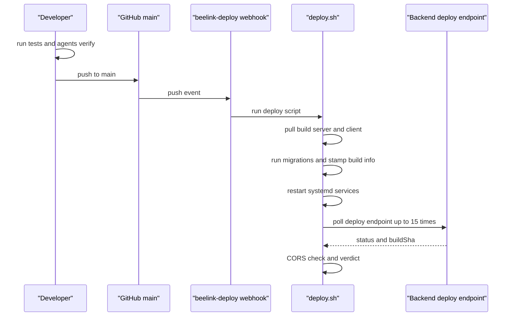

# Iteration Loop

Work happens in one repository. Contributors run the server and client locally, run tests, pass the agent verification gate, and push to `main`. The Beelink deploy script then builds and restarts services.

## Steps

1. **Run locally.** The server's `dev` script runs `ts-node ./bin/www.ts` ([server/package.json:L7](https://github.com/Jeffrey-Keyser/image-studio/blob/cc09e9afb77781ab37b1237f3341edbe1e5425f9/server/package.json#L7)). The client's `dev` script runs Vite ([client/package.json:L29](https://github.com/Jeffrey-Keyser/image-studio/blob/cc09e9afb77781ab37b1237f3341edbe1e5425f9/client/package.json#L29)). Local ports are documented inconsistently. The README says 3001 and CLAUDE says 3030 for the server ([README.md:L34](https://github.com/Jeffrey-Keyser/image-studio/blob/cc09e9afb77781ab37b1237f3341edbe1e5425f9/README.md#L34), [CLAUDE.md:L18](https://github.com/Jeffrey-Keyser/image-studio/blob/cc09e9afb77781ab37b1237f3341edbe1e5425f9/CLAUDE.md#L18)). The config default is 3001 ([server/config/env.ts:L90](https://github.com/Jeffrey-Keyser/image-studio/blob/cc09e9afb77781ab37b1237f3341edbe1e5425f9/server/config/env.ts#L90)).
2. **Test and lint.** The server runs `vitest run` and has integration and Docker variants ([server/package.json:L11-L16](https://github.com/Jeffrey-Keyser/image-studio/blob/cc09e9afb77781ab37b1237f3341edbe1e5425f9/server/package.json#L11-L16)). Its `lint` script runs ESLint ([server/package.json:L10](https://github.com/Jeffrey-Keyser/image-studio/blob/cc09e9afb77781ab37b1237f3341edbe1e5425f9/server/package.json#L10)). The client runs `vitest --run` ([client/package.json:L32](https://github.com/Jeffrey-Keyser/image-studio/blob/cc09e9afb77781ab37b1237f3341edbe1e5425f9/client/package.json#L32)). The explorations database tests run in Docker via `server/scripts/test-explorations.sh` ([README.md:L264-L268](https://github.com/Jeffrey-Keyser/image-studio/blob/cc09e9afb77781ab37b1237f3341edbe1e5425f9/README.md#L264-L268)).
3. **Agent verification gate.** AGENTS.md defines four checks: the pay-auth version pin, no private subpath imports, at most one `new PayAuth(`, and green build and test ([AGENTS.md:L35-L52](https://github.com/Jeffrey-Keyser/image-studio/blob/cc09e9afb77781ab37b1237f3341edbe1e5425f9/AGENTS.md#L35-L52)). The same file requires a non-empty `GITHUB_TOKEN` for the GitHub Packages registry ([AGENTS.md:L23](https://github.com/Jeffrey-Keyser/image-studio/blob/cc09e9afb77781ab37b1237f3341edbe1e5425f9/AGENTS.md#L23)).
4. **Push to `main`.** The README and CLAUDE document a push-to-`main` trigger through the `beelink-deploy` webhook ([README.md:L197](https://github.com/Jeffrey-Keyser/image-studio/blob/cc09e9afb77781ab37b1237f3341edbe1e5425f9/README.md#L197), [CLAUDE.md:L58](https://github.com/Jeffrey-Keyser/image-studio/blob/cc09e9afb77781ab37b1237f3341edbe1e5425f9/CLAUDE.md#L58)). The webhook configuration is not in the excerpts.
5. **Deploy script.** `deploy.sh` runs `git pull --ff-only origin main` and records the commit SHA ([deploy.sh:L8-L11](https://github.com/Jeffrey-Keyser/image-studio/blob/cc09e9afb77781ab37b1237f3341edbe1e5425f9/deploy.sh#L8-L11)). It then runs `npm ci` and `npm run build` for the server ([deploy.sh:L16-L17](https://github.com/Jeffrey-Keyser/image-studio/blob/cc09e9afb77781ab37b1237f3341edbe1e5425f9/deploy.sh#L16-L17)). It applies migrations through `scripts/run-migrations.js`, whose contents are not in the excerpts ([deploy.sh:L20](https://github.com/Jeffrey-Keyser/image-studio/blob/cc09e9afb77781ab37b1237f3341edbe1e5425f9/deploy.sh#L20)). It writes `build-info.json` ([deploy.sh:L24-L26](https://github.com/Jeffrey-Keyser/image-studio/blob/cc09e9afb77781ab37b1237f3341edbe1e5425f9/deploy.sh#L24-L26)) and builds the client ([deploy.sh:L32-L33](https://github.com/Jeffrey-Keyser/image-studio/blob/cc09e9afb77781ab37b1237f3341edbe1e5425f9/deploy.sh#L32-L33)).
6. **Restart and verify.** The script restarts `image-studio` and `image-studio-frontend` ([deploy.sh:L38-L39](https://github.com/Jeffrey-Keyser/image-studio/blob/cc09e9afb77781ab37b1237f3341edbe1e5425f9/deploy.sh#L38-L39)). It polls the deploy endpoint up to 15 times ([deploy.sh:L45-L55](https://github.com/Jeffrey-Keyser/image-studio/blob/cc09e9afb77781ab37b1237f3341edbe1e5425f9/deploy.sh#L45-L55)). It passes only when `status` is `ok` and `buildSha` matches the commit ([deploy.sh:L57](https://github.com/Jeffrey-Keyser/image-studio/blob/cc09e9afb77781ab37b1237f3341edbe1e5425f9/deploy.sh#L57)). Then it runs the CORS check ([deploy.sh:L59](https://github.com/Jeffrey-Keyser/image-studio/blob/cc09e9afb77781ab37b1237f3341edbe1e5425f9/deploy.sh#L59)). A missing `PAY_SERVICE_TOKEN` only prints a warning ([deploy.sh:L61-L63](https://github.com/Jeffrey-Keyser/image-studio/blob/cc09e9afb77781ab37b1237f3341edbe1e5425f9/deploy.sh#L61-L63)).

## Unknowns

- **CI.** No CI workflow file appears in the excerpts. Any pipeline that runs tests before deploy is unknown.
- **Ports.** The deploy script's default verify URL uses port 3030 ([deploy.sh:L45](https://github.com/Jeffrey-Keyser/image-studio/blob/cc09e9afb77781ab37b1237f3341edbe1e5425f9/deploy.sh#L45)), but a comment in the same script says 3001 ([deploy.sh:L42-L43](https://github.com/Jeffrey-Keyser/image-studio/blob/cc09e9afb77781ab37b1237f3341edbe1e5425f9/deploy.sh#L42-L43)).
- **Manual rerun.** The README says `./deploy.sh` is the manual path ([README.md:L210](https://github.com/Jeffrey-Keyser/image-studio/blob/cc09e9afb77781ab37b1237f3341edbe1e5425f9/README.md#L210)).
