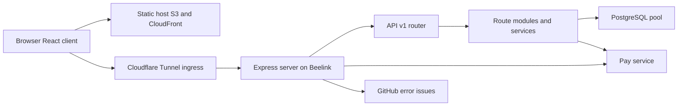

# Architecture

The repo has two workspaces: `client/` (Vite React SPA) and `server/` (Express with TypeScript) ([README.md:L6-L12](https://github.com/Jeffrey-Keyser/insta-travel-map/blob/e5887e273f84c43fe656071dccb23f3d3df3da2b/README.md#L6-L12), [CLAUDE.md:L88-L99](https://github.com/Jeffrey-Keyser/insta-travel-map/blob/e5887e273f84c43fe656071dccb23f3d3df3da2b/CLAUDE.md#L88-L99)). Server startup is ordered so vault secrets load before config validation and pool creation ([server/bin/www.ts:L26-L31](https://github.com/Jeffrey-Keyser/insta-travel-map/blob/e5887e273f84c43fe656071dccb23f3d3df3da2b/server/bin/www.ts#L26-L31), [server/app.ts:L17-L27](https://github.com/Jeffrey-Keyser/insta-travel-map/blob/e5887e273f84c43fe656071dccb23f3d3df3da2b/server/app.ts#L17-L27)).

The topology is documented in the README. The diagram shows how the source wires the parts, not confirmed production state.

## Server contracts

**Bootstrap.** The dev entrypoint `server/bin/www.ts` loads dotenv, fetches vault secrets, validates config, initializes the app, and listens on `config.PORT` ([server/bin/www.ts:L19-L53](https://github.com/Jeffrey-Keyser/insta-travel-map/blob/e5887e273f84c43fe656071dccb23f3d3df3da2b/server/bin/www.ts#L19-L53)). The production start script runs `node ./dist/bin/www.js` ([server/package.json:L6](https://github.com/Jeffrey-Keyser/insta-travel-map/blob/e5887e273f84c43fe656071dccb23f3d3df3da2b/server/package.json#L6)).

**App factory.** `server/app.ts` builds a `ServerConfigV2` for `createServerlessApp` ([server/app.ts:L139-L146](https://github.com/Jeffrey-Keyser/insta-travel-map/blob/e5887e273f84c43fe656071dccb23f3d3df3da2b/server/app.ts#L139-L146)). The config enables request IDs, rate limiting, JSON logs in production, a CORS allow-list, and database-backed sessions ([server/app.ts:L149-L153](https://github.com/Jeffrey-Keyser/insta-travel-map/blob/e5887e273f84c43fe656071dccb23f3d3df3da2b/server/app.ts#L149-L153), [server/app.ts:L156-L164](https://github.com/Jeffrey-Keyser/insta-travel-map/blob/e5887e273f84c43fe656071dccb23f3d3df3da2b/server/app.ts#L156-L164), [server/app.ts:L180-L209](https://github.com/Jeffrey-Keyser/insta-travel-map/blob/e5887e273f84c43fe656071dccb23f3d3df3da2b/server/app.ts#L180-L209), [server/app.ts:L216-L236](https://github.com/Jeffrey-Keyser/insta-travel-map/blob/e5887e273f84c43fe656071dccb23f3d3df3da2b/server/app.ts#L216-L236)).

**Routing.** Top-level mounts are `/`, `/api/v1`, and `/auth` ([server/app.ts:L288-L292](https://github.com/Jeffrey-Keyser/insta-travel-map/blob/e5887e273f84c43fe656071dccb23f3d3df3da2b/server/app.ts#L288-L292)). The v1 router mounts auth, travel requests, access requests, ACL, flights, admin travel requests, and the payment proxy ([server/routes/versions/v1/index.ts:L50-L74](https://github.com/Jeffrey-Keyser/insta-travel-map/blob/e5887e273f84c43fe656071dccb23f3d3df3da2b/server/routes/versions/v1/index.ts#L50-L74)). Versioning middleware negotiates the header, redirects legacy `/v1/*` paths, and rejects unsupported versions ([server/middleware/versioning.ts:L26-L46](https://github.com/Jeffrey-Keyser/insta-travel-map/blob/e5887e273f84c43fe656071dccb23f3d3df3da2b/server/middleware/versioning.ts#L26-L46), [server/middleware/versioning.ts:L58-L80](https://github.com/Jeffrey-Keyser/insta-travel-map/blob/e5887e273f84c43fe656071dccb23f3d3df3da2b/server/middleware/versioning.ts#L58-L80)).

**Auth.** `setupPayAuth` must return both middleware and routes, or startup throws ([server/app.ts:L121-L136](https://github.com/Jeffrey-Keyser/insta-travel-map/blob/e5887e273f84c43fe656071dccb23f3d3df3da2b/server/app.ts#L121-L136)). Route handlers use `requireAuth` from the Pay server export ([server/routes/travel-requests.ts:L8](https://github.com/Jeffrey-Keyser/insta-travel-map/blob/e5887e273f84c43fe656071dccb23f3d3df3da2b/server/routes/travel-requests.ts#L8)).

**Services and data.** `TravelRequestService` and `NotifyService` sit under `server/services/`. The DB pool is created lazily behind a proxy ([server/db/connection.ts:L10-L29](https://github.com/Jeffrey-Keyser/insta-travel-map/blob/e5887e273f84c43fe656071dccb23f3d3df3da2b/server/db/connection.ts#L10-L29)). The health check delegates to `dal/diagnostics` ([server/app.ts:L244-L252](https://github.com/Jeffrey-Keyser/insta-travel-map/blob/e5887e273f84c43fe656071dccb23f3d3df3da2b/server/app.ts#L244-L252), [server/dal/diagnostics.ts:L31-L37](https://github.com/Jeffrey-Keyser/insta-travel-map/blob/e5887e273f84c43fe656071dccb23f3d3df3da2b/server/dal/diagnostics.ts#L31-L37)). CLAUDE.md describes a `BaseDal` pattern, but no `BaseDal` class appears in the provided excerpts, so its status is unknown ([CLAUDE.md:L204-L208](https://github.com/Jeffrey-Keyser/insta-travel-map/blob/e5887e273f84c43fe656071dccb23f3d3df3da2b/CLAUDE.md#L204-L208)).

**Configuration.** `server/config/env.ts` validates environment values and exposes a config object that `initConfig()` fills in ([server/config/env.ts:L142-L144](https://github.com/Jeffrey-Keyser/insta-travel-map/blob/e5887e273f84c43fe656071dccb23f3d3df3da2b/server/config/env.ts#L142-L144), [server/config/env.ts:L175-L178](https://github.com/Jeffrey-Keyser/insta-travel-map/blob/e5887e273f84c43fe656071dccb23f3d3df3da2b/server/config/env.ts#L175-L178)). The vault loader requires `JWT_SECRET`, `SESSION_SECRET`, and `DATABASE_PASSWORD` ([server/config/vault.ts:L26](https://github.com/Jeffrey-Keyser/insta-travel-map/blob/e5887e273f84c43fe656071dccb23f3d3df3da2b/server/config/vault.ts#L26)).

## Client contracts

Routes are declared in `App.tsx`, with payment, map, no-access, admin, and error pages ([client/src/App.tsx:L31-L72](https://github.com/Jeffrey-Keyser/insta-travel-map/blob/e5887e273f84c43fe656071dccb23f3d3df3da2b/client/src/App.tsx#L31-L72)). Containers are lazy-loaded ([client/src/App.tsx:L12-L17](https://github.com/Jeffrey-Keyser/insta-travel-map/blob/e5887e273f84c43fe656071dccb23f3d3df3da2b/client/src/App.tsx#L12-L17)). The Redux store combines the RTK Query APIs ([client/src/app/store.ts:L12-L20](https://github.com/Jeffrey-Keyser/insta-travel-map/blob/e5887e273f84c43fe656071dccb23f3d3df3da2b/client/src/app/store.ts#L12-L20)). The Pay provider wraps the whole app ([client/src/index.tsx:L24](https://github.com/Jeffrey-Keyser/insta-travel-map/blob/e5887e273f84c43fe656071dccb23f3d3df3da2b/client/src/index.tsx#L24)).
