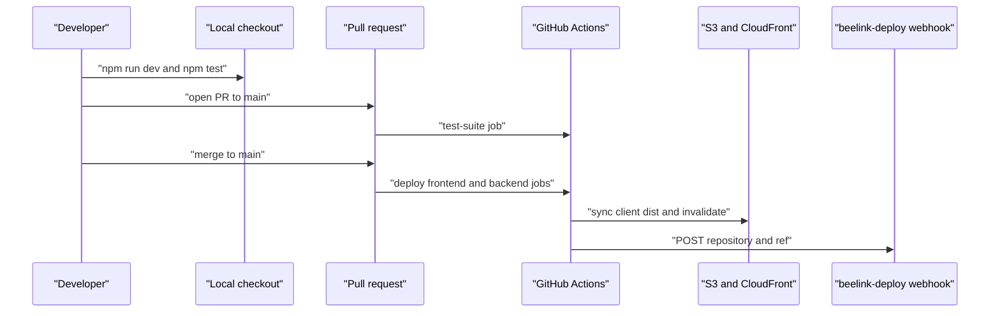

# Iteration Loop

This page describes the contributor loop as the repo's scripts and workflows define it.

## Local commands

- **Client**: `npm run dev` starts Vite, `npm run test` runs Vitest once, and `npm run build` runs a production build ([client/package.json:L45-L48](https://github.com/Jeffrey-Keyser/insta-travel-map/blob/e5887e273f84c43fe656071dccb23f3d3df3da2b/client/package.json#L45-L48)).
- **Server**: `npm run dev` runs `ts-node ./bin/www.ts`, `npm test` runs Jest, and `npm run lint` lints TypeScript ([server/package.json:L7](https://github.com/Jeffrey-Keyser/insta-travel-map/blob/e5887e273f84c43fe656071dccb23f3d3df3da2b/server/package.json#L7), [server/package.json:L10-L11](https://github.com/Jeffrey-Keyser/insta-travel-map/blob/e5887e273f84c43fe656071dccb23f3d3df3da2b/server/package.json#L10-L11)).
- **Setup**: `./setup-project.sh` is documented as installing dependencies and creating env files ([README.md:L16-L35](https://github.com/Jeffrey-Keyser/insta-travel-map/blob/e5887e273f84c43fe656071dccb23f3d3df3da2b/README.md#L16-L35)). The script itself is not in the excerpts, so its behavior is unverified.
- **Packages**: `@jeffrey-keyser/*` packages install from GitHub Packages and need `GITHUB_TOKEN` ([AGENTS.md:L21-L23](https://github.com/Jeffrey-Keyser/insta-travel-map/blob/e5887e273f84c43fe656071dccb23f3d3df3da2b/AGENTS.md#L21-L23)).

## Guardrails before done

AGENTS.md requires four checks: the pay-auth version pin, no forbidden private subpath imports, at most one `new PayAuth(...)` site, and a green build and test run ([AGENTS.md:L31](https://github.com/Jeffrey-Keyser/insta-travel-map/blob/e5887e273f84c43fe656071dccb23f3d3df3da2b/AGENTS.md#L31), [AGENTS.md:L37-L51](https://github.com/Jeffrey-Keyser/insta-travel-map/blob/e5887e273f84c43fe656071dccb23f3d3df3da2b/AGENTS.md#L37-L51)). The block is machine-extracted by a script in another repo, `dev-inbox`, so it is not run from this repo ([AGENTS.md:L33](https://github.com/Jeffrey-Keyser/insta-travel-map/blob/e5887e273f84c43fe656071dccb23f3d3df3da2b/AGENTS.md#L33)).

## Database changes

Schema files are deployed with `cd server/db` and `./deploy.sh`. The script runs migrations, schema, stored procedures, session tables, and dev-only seeds ([CLAUDE.md:L60-L62](https://github.com/Jeffrey-Keyser/insta-travel-map/blob/e5887e273f84c43fe656071dccb23f3d3df3da2b/CLAUDE.md#L60-L62), [server/db/deploy.sh:L14-L40](https://github.com/Jeffrey-Keyser/insta-travel-map/blob/e5887e273f84c43fe656071dccb23f3d3df3da2b/server/db/deploy.sh#L14-L40)). Sequelize CLI migration commands are also documented ([CLAUDE.md:L70-L73](https://github.com/Jeffrey-Keyser/insta-travel-map/blob/e5887e273f84c43fe656071dccb23f3d3df3da2b/CLAUDE.md#L70-L73)).

## Pull request CI

The `test-suite` job runs only on `pull_request`. It checks out the private actions repo with `PRIVATE_ACTIONS_TOKEN` and runs the `node-build` composite action with `issue_on_failure` ([.github/workflows/ci-cd-pipeline.yml:L11-L12](https://github.com/Jeffrey-Keyser/insta-travel-map/blob/e5887e273f84c43fe656071dccb23f3d3df3da2b/.github/workflows/ci-cd-pipeline.yml#L11-L12), [.github/workflows/ci-cd-pipeline.yml:L19-L41](https://github.com/Jeffrey-Keyser/insta-travel-map/blob/e5887e273f84c43fe656071dccb23f3d3df3da2b/.github/workflows/ci-cd-pipeline.yml#L19-L41)). Pushes to `develop` trigger the workflow, but no job condition in the excerpt matches that event ([.github/workflows/ci-cd-pipeline.yml:L5](https://github.com/Jeffrey-Keyser/insta-travel-map/blob/e5887e273f84c43fe656071dccb23f3d3df3da2b/.github/workflows/ci-cd-pipeline.yml#L5)).

## Merge to main

Both deploy jobs run only for pushes to `main` ([.github/workflows/ci-cd-pipeline.yml:L45](https://github.com/Jeffrey-Keyser/insta-travel-map/blob/e5887e273f84c43fe656071dccb23f3d3df3da2b/.github/workflows/ci-cd-pipeline.yml#L45), [.github/workflows/ci-cd-pipeline.yml:L100](https://github.com/Jeffrey-Keyser/insta-travel-map/blob/e5887e273f84c43fe656071dccb23f3d3df3da2b/.github/workflows/ci-cd-pipeline.yml#L100)). The frontend job installs with `--force`, builds, syncs `client/dist` to S3, and invalidates CloudFront `/*` ([.github/workflows/ci-cd-pipeline.yml:L73-L96](https://github.com/Jeffrey-Keyser/insta-travel-map/blob/e5887e273f84c43fe656071dccb23f3d3df3da2b/.github/workflows/ci-cd-pipeline.yml#L73-L96)). The backend job POSTs `{repository, ref}` to the beelink-deploy webhook ([.github/workflows/ci-cd-pipeline.yml:L105-L113](https://github.com/Jeffrey-Keyser/insta-travel-map/blob/e5887e273f84c43fe656071dccb23f3d3df3da2b/.github/workflows/ci-cd-pipeline.yml#L105-L113)).

## Other paths

A manual `deploy.sh` at the repo root runs `git pull`, builds the server and client, and restarts `insta-travel-map` and `insta-travel-map-frontend` ([deploy.sh:L5-L21](https://github.com/Jeffrey-Keyser/insta-travel-map/blob/e5887e273f84c43fe656071dccb23f3d3df3da2b/deploy.sh#L5-L21)). Whether this unit exists or is used is unknown. The Terraform workflow is manual (`workflow_dispatch`) and auto-applies a directory not included in this snapshot ([.github/workflows/terraform_deploy.yml:L3-L13](https://github.com/Jeffrey-Keyser/insta-travel-map/blob/e5887e273f84c43fe656071dccb23f3d3df3da2b/.github/workflows/terraform_deploy.yml#L3-L13)).

Production 5xx-style errors reach `GitHubErrorIssueService`, which files issues with stack and request metadata ([server/app.ts:L312-L327](https://github.com/Jeffrey-Keyser/insta-travel-map/blob/e5887e273f84c43fe656071dccb23f3d3df3da2b/server/app.ts#L312-L327)). Status filtering is not visible in the excerpt.
