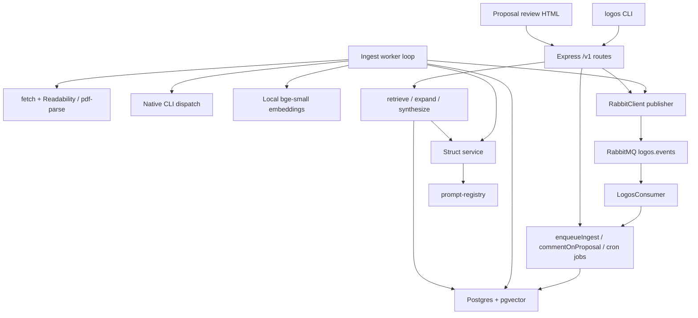

# Architecture

Logos boots as one Node process. Startup runs in this order ([src/bin/www.ts:L10-L43](https://github.com/Jeffrey-Keyser/logos/blob/818a9eeb9f98a6c82656c22be7eeeb73bd1f9cd0/src/bin/www.ts#L10-L43)):

1. Warm up the embedding model.
2. Start the HTTP listener.
3. Connect the RabbitMQ client and attach the consumer.
4. Start the ingest worker with concurrency 2.

## Components and contracts

### HTTP surface

- **Mounts.** `/` serves the health routes. `/v1` is guarded by bearer auth. `/proposals` is an HTML router with query-token auth ([src/app.ts:L49-L54](https://github.com/Jeffrey-Keyser/logos/blob/818a9eeb9f98a6c82656c22be7eeeb73bd1f9cd0/src/app.ts#L49-L54)).
- **Routers.** `/v1` aggregates status, ingest, proposals, pages, query, feeds, themes, contexts and project-documents ([src/routes/v1/index.ts:L14-L22](https://github.com/Jeffrey-Keyser/logos/blob/818a9eeb9f98a6c82656c22be7eeeb73bd1f9cd0/src/routes/v1/index.ts#L14-L22)).
- **Browser approvals.** The HTML router does not write proposals directly. It calls back into `/v1` over HTTP using the service token ([src/routes/proposals-html.ts:L53-L74](https://github.com/Jeffrey-Keyser/logos/blob/818a9eeb9f98a6c82656c22be7eeeb73bd1f9cd0/src/routes/proposals-html.ts#L53-L74)).

### Ingest service and worker

- **One entry point.** `enqueueIngest` is shared by the HTTP route and the bus consumer ([src/ingest/service.ts:L69-L74](https://github.com/Jeffrey-Keyser/logos/blob/818a9eeb9f98a6c82656c22be7eeeb73bd1f9cd0/src/ingest/service.ts#L69-L74)).
- **Polling.** The worker polls every second and claims jobs with `FOR UPDATE SKIP LOCKED` ([src/worker/ingest.ts:L34-L36](https://github.com/Jeffrey-Keyser/logos/blob/818a9eeb9f98a6c82656c22be7eeeb73bd1f9cd0/src/worker/ingest.ts#L34-L36), [src/db/repos/ingest-job.ts:L52-L78](https://github.com/Jeffrey-Keyser/logos/blob/818a9eeb9f98a6c82656c22be7eeeb73bd1f9cd0/src/db/repos/ingest-job.ts#L52-L78)).
- **Retries.** Failed jobs retry up to 5 attempts with exponential backoff.
- **Extraction order:**
  - PDFs go to `pdf-parse`.
  - Other HTML goes to Readability.
  - If Readability yields fewer than 500 characters, the worker dispatches the `logos/extract-fallback` prompt to a native agent ([src/worker/ingest.ts:L301-L322](https://github.com/Jeffrey-Keyser/logos/blob/818a9eeb9f98a6c82656c22be7eeeb73bd1f9cd0/src/worker/ingest.ts#L301-L322)).
- **Candidate pages.** Candidate recall is scoped to the ingest's context ([src/hub/themes.ts:L29-L52](https://github.com/Jeffrey-Keyser/logos/blob/818a9eeb9f98a6c82656c22be7eeeb73bd1f9cd0/src/hub/themes.ts#L29-L52)).

### LLM integrations

- **Struct.** `structRun` POSTs `{prompt, schema}` to `/api/v1/run`, with one retry on 5xx or timeout. The input is serialized into the prompt ([src/llm/struct.ts:L45-L70](https://github.com/Jeffrey-Keyser/logos/blob/818a9eeb9f98a6c82656c22be7eeeb73bd1f9cd0/src/llm/struct.ts#L45-L70)).
- **Struct async.** `structRunAsync` polls a Struct job. Streaming queries use it to send progress heartbeats ([src/llm/struct.ts:L215-L222](https://github.com/Jeffrey-Keyser/logos/blob/818a9eeb9f98a6c82656c22be7eeeb73bd1f9cd0/src/llm/struct.ts#L215-L222)).
- **Native CLI dispatch.** It tries Codex, Copilot and Gemini in order. Each provider has two lockfile slots, and the call falls through to the next provider on failure ([src/agents/native-cli.ts:L181-L226](https://github.com/Jeffrey-Keyser/logos/blob/818a9eeb9f98a6c82656c22be7eeeb73bd1f9cd0/src/agents/native-cli.ts#L181-L226)).

### Proposals

- **Apply.** `applyProposal` writes page, sections, themes and re-embedded chunks in one transaction. Only `create_page` and `update_page` are supported ([src/proposals/apply.ts:L71-L102](https://github.com/Jeffrey-Keyser/logos/blob/818a9eeb9f98a6c82656c22be7eeeb73bd1f9cd0/src/proposals/apply.ts#L71-L102)).
- **Known limitation.** New pages still land in the `default` context ([src/proposals/apply.ts:L141-L154](https://github.com/Jeffrey-Keyser/logos/blob/818a9eeb9f98a6c82656c22be7eeeb73bd1f9cd0/src/proposals/apply.ts#L141-L154)).
- **Revise.** A revision creates a new pending proposal and supersedes the original ([src/proposals/revise.ts:L33-L44](https://github.com/Jeffrey-Keyser/logos/blob/818a9eeb9f98a6c82656c22be7eeeb73bd1f9cd0/src/proposals/revise.ts#L33-L44)).

### Query

- **Retrieval.** Semantic and lexical legs run concurrently, with optional context filters ([src/query/retrieve.ts:L106-L116](https://github.com/Jeffrey-Keyser/logos/blob/818a9eeb9f98a6c82656c22be7eeeb73bd1f9cd0/src/query/retrieve.ts#L106-L116)).
- **Distance gate.** Semantic hits farther than cosine distance 0.5 are dropped before fusion.
- **Failure modes.** An empty hub short-circuits with a fixed message. If synthesis fails, the API returns retrieval results only ([src/query/run.ts:L141-L204](https://github.com/Jeffrey-Keyser/logos/blob/818a9eeb9f98a6c82656c22be7eeeb73bd1f9cd0/src/query/run.ts#L141-L204)).
- **Streaming.** A client that sends `Accept: text/event-stream` gets Server-Sent Events: `progress`, then `result` or `error` ([src/routes/v1/query.ts:L105-L113](https://github.com/Jeffrey-Keyser/logos/blob/818a9eeb9f98a6c82656c22be7eeeb73bd1f9cd0/src/routes/v1/query.ts#L105-L113)).

### Project documents

- **Revisions.** Documents keep immutable revisions.
- **Snapshots.** A snapshot returns the complete active corpus plus a fingerprint built from sorted IDs, content hashes and titles ([src/project-documents/service.ts:L45-L98](https://github.com/Jeffrey-Keyser/logos/blob/818a9eeb9f98a6c82656c22be7eeeb73bd1f9cd0/src/project-documents/service.ts#L45-L98)).
- **URL sources.** Ingested URL sources are also synced into the document corpus ([src/worker/ingest.ts:L338-L347](https://github.com/Jeffrey-Keyser/logos/blob/818a9eeb9f98a6c82656c22be7eeeb73bd1f9cd0/src/worker/ingest.ts#L338-L347)).

### Bus

- **Publisher.** `RabbitClient` asserts the exchange and publishes best-effort. It reconnects with backoff capped at 60s ([src/bus/rabbit.ts:L60-L70](https://github.com/Jeffrey-Keyser/logos/blob/818a9eeb9f98a6c82656c22be7eeeb73bd1f9cd0/src/bus/rabbit.ts#L60-L70)).
- **Consumer.** It binds five routing keys and nacks without requeue on domain errors ([src/bus/consumer.ts:L51-L68](https://github.com/Jeffrey-Keyser/logos/blob/818a9eeb9f98a6c82656c22be7eeeb73bd1f9cd0/src/bus/consumer.ts#L51-L68)).
