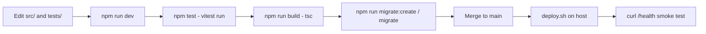

# Iteration Loop

This page describes the contributor workflow that the attached source can confirm. **CI is unknown.** No CI workflow file is among the provided excerpts, so this page does not claim that any automated check runs on pull requests. The checks below are the local scripts plus what `deploy.sh` runs on the host.

## Local scripts

| Script | What it runs |
|---|---|
| `npm run dev` | `ts-node src/bin/www.ts` ([package.json:L7](https://github.com/Jeffrey-Keyser/logos/blob/818a9eeb9f98a6c82656c22be7eeeb73bd1f9cd0/package.json#L7)) |
| `npm run build` | `tsc` into `dist/` with strict settings ([package.json:L8](https://github.com/Jeffrey-Keyser/logos/blob/818a9eeb9f98a6c82656c22be7eeeb73bd1f9cd0/package.json#L8), [tsconfig.json:L6-L8](https://github.com/Jeffrey-Keyser/logos/blob/818a9eeb9f98a6c82656c22be7eeeb73bd1f9cd0/tsconfig.json#L6-L8)) |
| `npm test` | `vitest run` over `tests/**/*.test.ts`, with a 30s timeout ([package.json:L10](https://github.com/Jeffrey-Keyser/logos/blob/818a9eeb9f98a6c82656c22be7eeeb73bd1f9cd0/package.json#L10), [vitest.config.ts:L4-L8](https://github.com/Jeffrey-Keyser/logos/blob/818a9eeb9f98a6c82656c22be7eeeb73bd1f9cd0/vitest.config.ts#L4-L8)) |
| `migrate`, `migrate:down`, `migrate:create` | Migration wrappers in `scripts/` ([package.json:L11-L13](https://github.com/Jeffrey-Keyser/logos/blob/818a9eeb9f98a6c82656c22be7eeeb73bd1f9cd0/package.json#L11-L13)) |
| `prepare:models` | Populates the local embedding model cache ([package.json:L16](https://github.com/Jeffrey-Keyser/logos/blob/818a9eeb9f98a6c82656c22be7eeeb73bd1f9cd0/package.json#L16)) |
| `seed:prompts` | Seeds the extract-fallback, page-propose, proposal-revise and answer-synthesize prompts, plus the query skill ([package.json:L17](https://github.com/Jeffrey-Keyser/logos/blob/818a9eeb9f98a6c82656c22be7eeeb73bd1f9cd0/package.json#L17)) |
| `register-cron`, `dedupe-themes` | Maintenance scripts ([package.json:L14-L15](https://github.com/Jeffrey-Keyser/logos/blob/818a9eeb9f98a6c82656c22be7eeeb73bd1f9cd0/package.json#L14-L15)) |

**Required environment.** Local boot needs `NODE_ENV` and `LOGOS_SERVICE_TOKEN`, plus database settings. `RABBITMQ_URL` defaults to `amqp://localhost:5672` outside production ([src/config/env.ts:L19-L57](https://github.com/Jeffrey-Keyser/logos/blob/818a9eeb9f98a6c82656c22be7eeeb73bd1f9cd0/src/config/env.ts#L19-L57)).

## Testing patterns

Most modules take injectable dependencies, so tests can avoid live infrastructure:

- **Worker.** It accepts fakes for fetch, extraction, Struct and the publisher. A `manual` flag lets tests drive `tick()` themselves ([src/worker/ingest.ts:L42-L79](https://github.com/Jeffrey-Keyser/logos/blob/818a9eeb9f98a6c82656c22be7eeeb73bd1f9cd0/src/worker/ingest.ts#L42-L79)).
- **Struct client.** `fetchFn` and `fetchPromptFn` can be overridden ([src/llm/struct.ts:L12-L19](https://github.com/Jeffrey-Keyser/logos/blob/818a9eeb9f98a6c82656c22be7eeeb73bd1f9cd0/src/llm/struct.ts#L12-L19)).
- **Bus consumer.** Its handlers can be overridden ([src/bus/consumer.ts:L34-L49](https://github.com/Jeffrey-Keyser/logos/blob/818a9eeb9f98a6c82656c22be7eeeb73bd1f9cd0/src/bus/consumer.ts#L34-L49)).
- **HTML review router.** It exposes a test hook for the `/v1` caller ([src/routes/proposals-html.ts:L78-L82](https://github.com/Jeffrey-Keyser/logos/blob/818a9eeb9f98a6c82656c22be7eeeb73bd1f9cd0/src/routes/proposals-html.ts#L78-L82)).

New code should follow the same pattern so that tests need no broker, Struct instance or live database.

## Design documents

Larger changes have been preceded by design-only memos. The context-isolation memo is one example; it split implementation into follow-on PRDs ([prds/context-isolation-feasibility.md:L3-L7](https://github.com/Jeffrey-Keyser/logos/blob/818a9eeb9f98a6c82656c22be7eeeb73bd1f9cd0/prds/context-isolation-feasibility.md#L3-L7)).

The dry-run report `reconciliation-design.md` is explicitly marked superseded. Treat it as history, not guidance ([reconciliation-design.md:L3-L14](https://github.com/Jeffrey-Keyser/logos/blob/818a9eeb9f98a6c82656c22be7eeeb73bd1f9cd0/reconciliation-design.md#L3-L14)).

New reconciliation goals should use `project-<project>-<goal>` context slugs ([README.md:L9-L24](https://github.com/Jeffrey-Keyser/logos/blob/818a9eeb9f98a6c82656c22be7eeeb73bd1f9cd0/README.md#L9-L24)).

## Merge to deploy

The README documents auto-deploy by `beelink-deploy` on push to `main`, using `deploymentMode: immutable-worktree` ([README.md](https://github.com/Jeffrey-Keyser/logos/blob/c7ea06ff741f3e3daab4d624768ba94553d85708/README.md)). Each commit is checked out clean at `~/releases/logos/<sha>`, and `deploy.sh` runs there. The source checkout `~/logos` holds only shared state (`.env`, `models/`, `.locks/`). Uncommitted edits in `~/logos` never deploy. See [Operations](../operations/) for the release lock, rollback and pruning details.

`deploy.sh` runs these steps in order ([deploy.sh](https://github.com/Jeffrey-Keyser/logos/blob/c7ea06ff741f3e3daab4d624768ba94553d85708/deploy.sh)):

1. Check that the release is a clean worktree at the revision `beelink-deploy` supplied. It refuses to run otherwise.
2. Link the shared `.env` into the release, then hydrate secrets into it.
3. `npm ci --include=dev`.
4. `prepare:models`, using the shared model cache.
5. `build`.
6. `migrate`.
7. `seed:prompts`. A failure here fails the deploy.
8. `register-cron`. A failure here is non-fatal.
9. Switch `~/releases/logos/current` to the release. Install `logos.service` if it changed.
10. Restart the service and smoke-test `/health`. On failure, roll back to the previous release and exit 1.
11. Prune old release worktrees, keeping the three most recent.

Migrations and prompt seeding therefore run on every deploy. Keep both idempotent.

## Services-and-Dependencies.md

See [Services & Dependencies](../services-and-dependencies/) for upstream services and downstream consumers.
