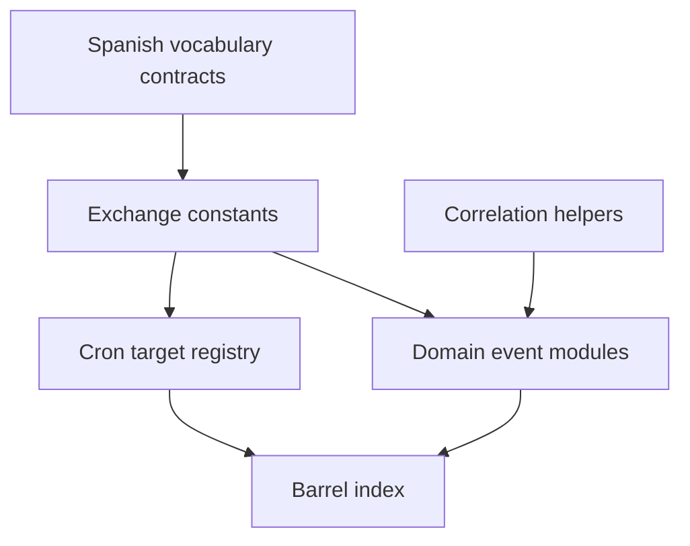

# Architecture

The package is organized as one barrel entry point that re-exports exchange constants, correlation helpers, and per-domain event modules ([src/index.ts:L8-L72](https://github.com/Jeffrey-Keyser/message-contracts/blob/95d5d12e4d2de5407329ffd5a5406e470b0ec0f8/src/index.ts#L8-L72)).

## Components

- **Exchange constants.** Each service block defines an exchange name, type, durable flag, and routing keys. The Ping block is a fanout exchange ([src/exchanges.ts:L17-L32](https://github.com/Jeffrey-Keyser/message-contracts/blob/95d5d12e4d2de5407329ffd5a5406e470b0ec0f8/src/exchanges.ts#L17-L32)). The file imports Spanish vocabulary exchange configs ([src/exchanges.ts:L8-L11](https://github.com/Jeffrey-Keyser/message-contracts/blob/95d5d12e4d2de5407329ffd5a5406e470b0ec0f8/src/exchanges.ts#L8-L11)).
- **Correlation helpers.** `CorrelationId` is a string type, `CorrelationIdCarrier` holds an optional field, and `isCorrelationId` validates UUID format ([src/correlation.ts:L8-L26](https://github.com/Jeffrey-Keyser/message-contracts/blob/95d5d12e4d2de5407329ffd5a5406e470b0ec0f8/src/correlation.ts#L8-L26)).
- **Domain event modules.** Interfaces and metadata objects per domain, such as cron ([src/cron/events.ts:L25-L47](https://github.com/Jeffrey-Keyser/message-contracts/blob/95d5d12e4d2de5407329ffd5a5406e470b0ec0f8/src/cron/events.ts#L25-L47)) and Logos ([src/logos/events.ts:L118-L127](https://github.com/Jeffrey-Keyser/message-contracts/blob/95d5d12e4d2de5407329ffd5a5406e470b0ec0f8/src/logos/events.ts#L118-L127)).
- **Cron target registry.** A list of label, exchange, and routing key entries ([src/cron-targets.ts:L21-L36](https://github.com/Jeffrey-Keyser/message-contracts/blob/95d5d12e4d2de5407329ffd5a5406e470b0ec0f8/src/cron-targets.ts#L21-L36)).
- **Spanish vocabulary contracts.** Versioned command and result types, plus runtime validators ([src/spanish/vocabulary-seed-events.ts:L25-L52](https://github.com/Jeffrey-Keyser/message-contracts/blob/95d5d12e4d2de5407329ffd5a5406e470b0ec0f8/src/spanish/vocabulary-seed-events.ts#L25-L52), [L111](https://github.com/Jeffrey-Keyser/message-contracts/blob/95d5d12e4d2de5407329ffd5a5406e470b0ec0f8/src/spanish/vocabulary-seed-events.ts#L111)).

## Flowchart

## Contract notes

Events are plain TypeScript shapes. The package does not include a runtime bus client in the provided excerpts. Some modules, such as the Spanish validators, include runtime checks ([src/spanish/vocabulary-seed-events.ts:L130-L161](https://github.com/Jeffrey-Keyser/message-contracts/blob/95d5d12e4d2de5407329ffd5a5406e470b0ec0f8/src/spanish/vocabulary-seed-events.ts#L130-L161)). The exchange file is truncated after line 360 in the provided excerpt, so later exchanges are not covered here.
