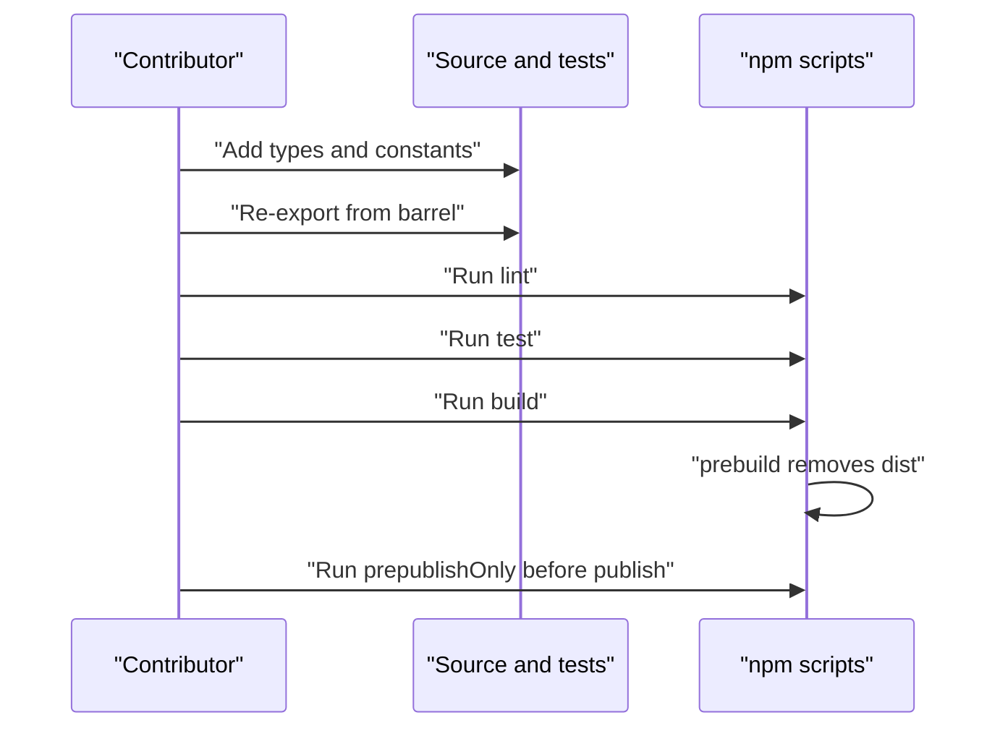

# Iteration Loop

## Adding a message type

The README gives five steps: create a service directory under `src/`, define interfaces, add exchange constants, re-export from the barrel, and update the README ([README.md:L126-L132](https://github.com/Jeffrey-Keyser/message-contracts/blob/95d5d12e4d2de5407329ffd5a5406e470b0ec0f8/README.md#L126-L132)). The barrel is `src/index.ts` ([src/index.ts:L8-L72](https://github.com/Jeffrey-Keyser/message-contracts/blob/95d5d12e4d2de5407329ffd5a5406e470b0ec0f8/src/index.ts#L8-L72)).

## Scripts

- `prebuild` deletes `dist` before a build ([package.json:L11](https://github.com/Jeffrey-Keyser/message-contracts/blob/95d5d12e4d2de5407329ffd5a5406e470b0ec0f8/package.json#L11)).
- `build` runs `tsc` ([package.json:L12](https://github.com/Jeffrey-Keyser/message-contracts/blob/95d5d12e4d2de5407329ffd5a5406e470b0ec0f8/package.json#L12)). TypeScript compiles `src` into `dist` in strict mode ([tsconfig.json:L9-L11](https://github.com/Jeffrey-Keyser/message-contracts/blob/95d5d12e4d2de5407329ffd5a5406e470b0ec0f8/tsconfig.json#L9-L11)).
- `lint` runs ESLint on `src` and `tests` ([package.json:L13](https://github.com/Jeffrey-Keyser/message-contracts/blob/95d5d12e4d2de5407329ffd5a5406e470b0ec0f8/package.json#L13)). The config forbids explicit `any` ([eslint.config.js:L16-L18](https://github.com/Jeffrey-Keyser/message-contracts/blob/95d5d12e4d2de5407329ffd5a5406e470b0ec0f8/eslint.config.js#L16-L18)).
- `test` runs `vitest run --dir tests` ([package.json:L14](https://github.com/Jeffrey-Keyser/message-contracts/blob/95d5d12e4d2de5407329ffd5a5406e470b0ec0f8/package.json#L14)).
- `prepublishOnly` runs the build ([package.json:L15](https://github.com/Jeffrey-Keyser/message-contracts/blob/95d5d12e4d2de5407329ffd5a5406e470b0ec0f8/package.json#L15)).

## Loop

## CI status

No CI workflow files appear in the provided excerpts, so whether CI runs these scripts is unknown. Verify against the repository's workflow configuration before relying on it.
