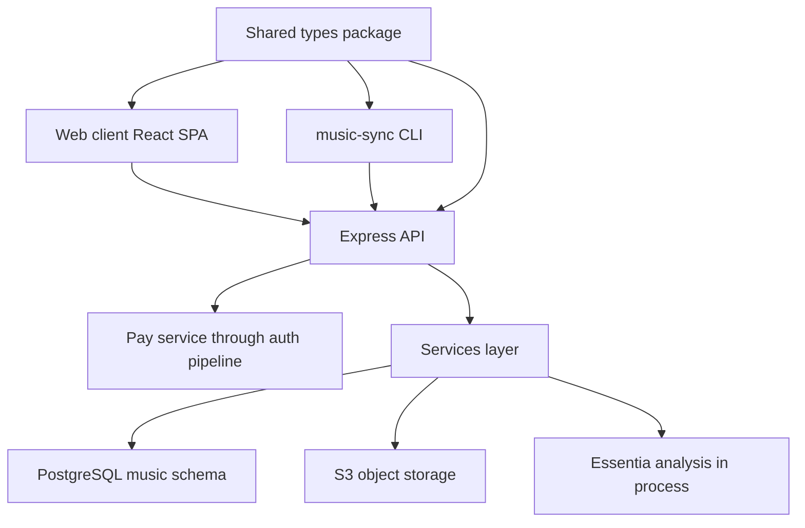

# Architecture

## Components

- **Express API.** Mounts a public `/health` route before auth ([server/src/app.ts:L46-L49](https://github.com/Jeffrey-Keyser/music-store/blob/9c5d7976a3a48460b7cf94b676bf879bff00fd54/server/src/app.ts#L46-L49)). The Pay auth pipeline runs next ([server/src/app.ts:L52](https://github.com/Jeffrey-Keyser/music-store/blob/9c5d7976a3a48460b7cf94b676bf879bff00fd54/server/src/app.ts#L52)).
- **Pay proxy.** Auth operations are proxied under `/auth` ([server/src/app.ts:L55-L57](https://github.com/Jeffrey-Keyser/music-store/blob/9c5d7976a3a48460b7cf94b676bf879bff00fd54/server/src/app.ts#L55-L57)). The client points its auth endpoints at these paths ([client/src/index.tsx:L19-L28](https://github.com/Jeffrey-Keyser/music-store/blob/9c5d7976a3a48460b7cf94b676bf879bff00fd54/client/src/index.tsx#L19-L28)).
- **Routers.** Tracks, tags, library, playlists, smart playlists, sync, and artifacts ([server/src/app.ts:L60-L66](https://github.com/Jeffrey-Keyser/music-store/blob/9c5d7976a3a48460b7cf94b676bf879bff00fd54/server/src/app.ts#L60-L66)).
- **Services.** Track upload and S3 key logic ([server/src/services/tracks.ts:L71-L76](https://github.com/Jeffrey-Keyser/music-store/blob/9c5d7976a3a48460b7cf94b676bf879bff00fd54/server/src/services/tracks.ts#L71-L76), [server/src/services/storage.ts:L77-L81](https://github.com/Jeffrey-Keyser/music-store/blob/9c5d7976a3a48460b7cf94b676bf879bff00fd54/server/src/services/storage.ts#L77-L81)). Batch analysis uses Essentia.js WASM with no external API calls ([server/src/services/audio-analysis.ts:L6](https://github.com/Jeffrey-Keyser/music-store/blob/9c5d7976a3a48460b7cf94b676bf879bff00fd54/server/src/services/audio-analysis.ts#L6), [L114](https://github.com/Jeffrey-Keyser/music-store/blob/9c5d7976a3a48460b7cf94b676bf879bff00fd54/server/src/services/audio-analysis.ts#L114)).
- **Data access.** A pool scoped to the `music` schema ([server/src/db/connection.ts:L5-L8](https://github.com/Jeffrey-Keyser/music-store/blob/9c5d7976a3a48460b7cf94b676bf879bff00fd54/server/src/db/connection.ts#L5-L8)). Transactions are available for bulk operations ([server/src/db/connection.ts:L17](https://github.com/Jeffrey-Keyser/music-store/blob/9c5d7976a3a48460b7cf94b676bf879bff00fd54/server/src/db/connection.ts#L17)).
- **Client.** Routes are defined in the React app ([client/src/App.tsx:L85-L93](https://github.com/Jeffrey-Keyser/music-store/blob/9c5d7976a3a48460b7cf94b676bf879bff00fd54/client/src/App.tsx#L85-L93)). The RTK Query base URL comes from `VITE_API_URL` ([client/src/reducers/baseQuery.ts:L4](https://github.com/Jeffrey-Keyser/music-store/blob/9c5d7976a3a48460b7cf94b676bf879bff00fd54/client/src/reducers/baseQuery.ts#L4)).
- **CLI.** Commands `init`, `status`, `pull`, `push`, `clean`, and `add` ([cli/src/index.ts:L41-L245](https://github.com/Jeffrey-Keyser/music-store/blob/9c5d7976a3a48460b7cf94b676bf879bff00fd54/cli/src/index.ts#L41-L245)).
- **Shared types.** Imported by server, client, and CLI ([shared/types/index.ts:L1](https://github.com/Jeffrey-Keyser/music-store/blob/9c5d7976a3a48460b7cf94b676bf879bff00fd54/shared/types/index.ts#L1)).

## Contracts

- **Auth.** The CLI sends a Bearer token ([cli/src/api.ts:L14](https://github.com/Jeffrey-Keyser/music-store/blob/9c5d7976a3a48460b7cf94b676bf879bff00fd54/cli/src/api.ts#L14)). Unauthenticated requests get 401 ([server/src/routes/tracks.ts:L161-L163](https://github.com/Jeffrey-Keyser/music-store/blob/9c5d7976a3a48460b7cf94b676bf879bff00fd54/server/src/routes/tracks.ts#L161-L163)).
- **Upload.** Success returns 201 with the track ([server/src/routes/tracks.ts:L180](https://github.com/Jeffrey-Keyser/music-store/blob/9c5d7976a3a48460b7cf94b676bf879bff00fd54/server/src/routes/tracks.ts#L180)). Duplicates return 409 ([server/src/routes/tracks.ts:L193-L198](https://github.com/Jeffrey-Keyser/music-store/blob/9c5d7976a3a48460b7cf94b676bf879bff00fd54/server/src/routes/tracks.ts#L193-L198)).
- **Artwork.** `GET /tracks/:id/artwork` requires auth and looks artwork up only for tracks owned by the caller. A track owned by another user, or with no artwork, returns 204. Successful responses use `Cache-Control: private, max-age=86400`, so shared caches should not store them ([server/src/routes/tracks.ts:L102-L116](https://github.com/Jeffrey-Keyser/music-store/blob/0a33e53a69072a2cd59f17bdc05f921fdef75009/server/src/routes/tracks.ts#L102-L116), [server/src/dal/artwork.ts:L1-L16](https://github.com/Jeffrey-Keyser/music-store/blob/0a33e53a69072a2cd59f17bdc05f921fdef75009/server/src/dal/artwork.ts#L1-L16)).
- **Manifest.** `SyncManifest` holds `generatedAt` and `tracks` ([shared/types/index.ts:L76-L80](https://github.com/Jeffrey-Keyser/music-store/blob/9c5d7976a3a48460b7cf94b676bf879bff00fd54/shared/types/index.ts#L76-L80)).
- **Route prefixes.** Smart playlists and artifacts use `/api/v1` ([server/src/app.ts:L64-L65](https://github.com/Jeffrey-Keyser/music-store/blob/9c5d7976a3a48460b7cf94b676bf879bff00fd54/server/src/app.ts#L64-L65)). Other routes do not.

## Diagram

The CLI is a separate process that talks to the API over HTTP ([cli/src/api.ts:L40](https://github.com/Jeffrey-Keyser/music-store/blob/9c5d7976a3a48460b7cf94b676bf879bff00fd54/cli/src/api.ts#L40)). The `CLAUDE.md` diagram shows a similar layout but is documentation; hostnames in it are not verified by these excerpts ([CLAUDE.md:L35-L45](https://github.com/Jeffrey-Keyser/music-store/blob/9c5d7976a3a48460b7cf94b676bf879bff00fd54/CLAUDE.md#L35-L45)).
