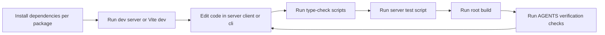

# Iteration Loop

This page describes the contributor loop using scripts present in the source excerpts. CI configuration is unknown: no workflow file appears in the provided excerpts.

## Scripts

- **Root.** `build` runs the server build then the client build. `test` runs the server test script ([package.json:L7-L8](https://github.com/Jeffrey-Keyser/music-store/blob/9c5d7976a3a48460b7cf94b676bf879bff00fd54/package.json#L7-L8)).
- **Server.** `dev` runs nodemon with ts-node ([server/package.json:L7](https://github.com/Jeffrey-Keyser/music-store/blob/9c5d7976a3a48460b7cf94b676bf879bff00fd54/server/package.json#L7)). `type-check` runs `tsc --noEmit` ([server/package.json:L10](https://github.com/Jeffrey-Keyser/music-store/blob/9c5d7976a3a48460b7cf94b676bf879bff00fd54/server/package.json#L10)). `test` runs `vitest run` ([server/package.json:L15](https://github.com/Jeffrey-Keyser/music-store/blob/9c5d7976a3a48460b7cf94b676bf879bff00fd54/server/package.json#L15)).
- **Shared tests.** The server Vitest config also includes shared `*.test.ts` files ([server/vitest.config.ts:L5-L14](https://github.com/Jeffrey-Keyser/music-store/blob/9c5d7976a3a48460b7cf94b676bf879bff00fd54/server/vitest.config.ts#L5-L14)).
- **Client.** Scripts are `dev`, `build`, and `preview`. No test script is listed ([client/package.json:L19-L21](https://github.com/Jeffrey-Keyser/music-store/blob/9c5d7976a3a48460b7cf94b676bf879bff00fd54/client/package.json#L19-L21)).
- **CLI.** `dev` uses tsx, `build` uses tsc, and `test` uses Vitest ([cli/package.json:L10-L13](https://github.com/Jeffrey-Keyser/music-store/blob/9c5d7976a3a48460b7cf94b676bf879bff00fd54/cli/package.json#L10-L13)).
- **Database.** `db:migrate` and `db:migrate:status` run node-pg-migrate against `migrations` ([server/package.json:L12-L13](https://github.com/Jeffrey-Keyser/music-store/blob/9c5d7976a3a48460b7cf94b676bf879bff00fd54/server/package.json#L12-L13)). The migrations directory itself is not in the excerpts.

## Guardrails

`AGENTS.md` lists rules for the `pay-auth-integration` package: pin `^6.10.1`, use only allowed import paths, and keep one `PayAuth` instance per app ([AGENTS.md:L7-L17](https://github.com/Jeffrey-Keyser/music-store/blob/9c5d7976a3a48460b7cf94b676bf879bff00fd54/AGENTS.md#L7-L17)). Packages in the `@jeffrey-keyser` scope need `GITHUB_TOKEN` ([AGENTS.md:L23](https://github.com/Jeffrey-Keyser/music-store/blob/9c5d7976a3a48460b7cf94b676bf879bff00fd54/AGENTS.md#L23)).

The verification block asks for four checks: version pin, no private subpath imports, single instance, and build plus test ([AGENTS.md:L35-L52](https://github.com/Jeffrey-Keyser/music-store/blob/9c5d7976a3a48460b7cf94b676bf879bff00fd54/AGENTS.md#L35-L52)). The block is extracted by a script that lives outside this repository ([AGENTS.md:L33](https://github.com/Jeffrey-Keyser/music-store/blob/9c5d7976a3a48460b7cf94b676bf879bff00fd54/AGENTS.md#L33)).

## Loop

`CLAUDE.md` gives per-package install commands ([CLAUDE.md:L11-L28](https://github.com/Jeffrey-Keyser/music-store/blob/9c5d7976a3a48460b7cf94b676bf879bff00fd54/CLAUDE.md#L11-L28)). Treat it as documentation; these commands are not executed by this wiki.
