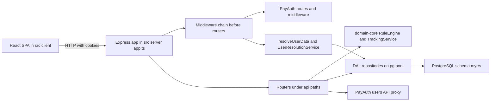

# Architecture

Myrrs is a two-workspace monorepo. A React SPA in `src/client` calls an Express API in `src/server`, which reads and writes a PostgreSQL schema and uses the domain-core package for rule evaluation ([package.json:L4-L7](https://github.com/Jeffrey-Keyser/myrrs/blob/39ea32f15f79b94f655af227ef5b7db26d828205/package.json#L4-L7), [src/server/package.json:L18](https://github.com/Jeffrey-Keyser/myrrs/blob/39ea32f15f79b94f655af227ef5b7db26d828205/src/server/package.json#L18)).

## Components and contracts

**Client entry.** Two entry files exist, `src/client/src/main.tsx` and `src/client/src/index.tsx`, and both call `createRoot` ([src/client/src/main.tsx:L16-L22](https://github.com/Jeffrey-Keyser/myrrs/blob/39ea32f15f79b94f655af227ef5b7db26d828205/src/client/src/main.tsx#L16-L22), [src/client/src/index.tsx:L8-L17](https://github.com/Jeffrey-Keyser/myrrs/blob/39ea32f15f79b94f655af227ef5b7db26d828205/src/client/src/index.tsx#L8-L17)). Which one Vite loads is unknown because `index.html` is not in the excerpts. The app wraps Redux, PayAuth, and routing ([src/client/src/App.tsx:L92-L114](https://github.com/Jeffrey-Keyser/myrrs/blob/39ea32f15f79b94f655af227ef5b7db26d828205/src/client/src/App.tsx#L92-L114)).

**Feedback widget.** The app shell renders `FeedbackWidget` from `@jeffrey-keyser/feedback-widget` alongside `GuestBanner`, `AppRoutes`, and `ToastContainer` ([src/client/src/App.tsx:L12](https://github.com/Jeffrey-Keyser/myrrs/blob/763c73a821b091c836c69fc3ee961a252fe10bd6/src/client/src/App.tsx#L12), [L109](https://github.com/Jeffrey-Keyser/myrrs/blob/763c73a821b091c836c69fc3ee961a252fe10bd6/src/client/src/App.tsx#L109)). It receives `appId` and `apiBaseUrl` from `src/client/src/config/feedback.ts` ([L9](https://github.com/Jeffrey-Keyser/myrrs/blob/763c73a821b091c836c69fc3ee961a252fe10bd6/src/client/src/config/feedback.ts#L9), [L17-L19](https://github.com/Jeffrey-Keyser/myrrs/blob/763c73a821b091c836c69fc3ee961a252fe10bd6/src/client/src/config/feedback.ts#L17-L19)). The config comment states that the widget posts directly to the shared feedback registry and that the app shell provides no parallel transport ([feedback.ts:L4-L6](https://github.com/Jeffrey-Keyser/myrrs/blob/763c73a821b091c836c69fc3ee961a252fe10bd6/src/client/src/config/feedback.ts#L4-L6)). Feedback traffic therefore does not pass through the Express API.

**API composition root.** `src/server/app.ts` calls `createExpressApp` with CORS, a database-backed session store, PayAuth, and two custom middleware that run before the routers ([src/server/app.ts:L64-L68](https://github.com/Jeffrey-Keyser/myrrs/blob/39ea32f15f79b94f655af227ef5b7db26d828205/src/server/app.ts#L64-L68), [L119-L121](https://github.com/Jeffrey-Keyser/myrrs/blob/39ea32f15f79b94f655af227ef5b7db26d828205/src/server/app.ts#L119-L121)). CORS allows `localhost:3002` and `https://` forms of `ORIGIN_BASE_URL` ([src/server/app.ts:L53-L62](https://github.com/Jeffrey-Keyser/myrrs/blob/39ea32f15f79b94f655af227ef5b7db26d828205/src/server/app.ts#L53-L62)).

**Routers.** Mounted paths are `/`, `/auth`, `/api/profile`, `/api/routines`, `/api/schedule`, `/api/rules`, `/api/user-rule-configurations`, and `/api/analytics` ([src/server/app.ts:L123-L132](https://github.com/Jeffrey-Keyser/myrrs/blob/39ea32f15f79b94f655af227ef5b7db26d828205/src/server/app.ts#L123-L132)).

**Known path issue.** The rule configuration router defines its own `/user-rule-configurations` prefixes ([src/server/routes/ruleConfigurations.ts:L31](https://github.com/Jeffrey-Keyser/myrrs/blob/39ea32f15f79b94f655af227ef5b7db26d828205/src/server/routes/ruleConfigurations.ts#L31), [L76](https://github.com/Jeffrey-Keyser/myrrs/blob/39ea32f15f79b94f655af227ef5b7db26d828205/src/server/routes/ruleConfigurations.ts#L76)) under a mount that already ends in that segment ([src/server/app.ts:L130](https://github.com/Jeffrey-Keyser/myrrs/blob/39ea32f15f79b94f655af227ef5b7db26d828205/src/server/app.ts#L130)). As written, the effective path appears doubled. Verify before relying on it.

**Domain logic.** Routes import domain-core services and rules directly. The routines router registers `TemporalRule`, `MaxDailyLimitsRule`, and `FrequencyRule` ([src/server/routes/routines.ts:L4-L15](https://github.com/Jeffrey-Keyser/myrrs/blob/39ea32f15f79b94f655af227ef5b7db26d828205/src/server/routes/routines.ts#L4-L15), [L43-L46](https://github.com/Jeffrey-Keyser/myrrs/blob/39ea32f15f79b94f655af227ef5b7db26d828205/src/server/routes/routines.ts#L43-L46)). The local `services/routines` folder no longer holds wrappers ([src/server/services/routines/index.ts:L1-L3](https://github.com/Jeffrey-Keyser/myrrs/blob/39ea32f15f79b94f655af227ef5b7db26d828205/src/server/services/routines/index.ts#L1-L3)). The module design note describes a planned `RoutineScheduler` class ([scheduler_service_module.md:L14](https://github.com/Jeffrey-Keyser/myrrs/blob/39ea32f15f79b94f655af227ef5b7db26d828205/src/server/services/routines/scheduler_service_module.md#L14)); treat it as design intent, not current code.

**Data access.** Repositories extend `BaseRepository`, which holds the shared `pg` pool ([src/server/dal/BaseRepository.ts:L9-L16](https://github.com/Jeffrey-Keyser/myrrs/blob/39ea32f15f79b94f655af227ef5b7db26d828205/src/server/dal/BaseRepository.ts#L9-L16)). The DAL index exports `RoutineRepository`, `TaskRepository`, and `PreferencesRepository` ([src/server/dal/index.ts:L2-L7](https://github.com/Jeffrey-Keyser/myrrs/blob/39ea32f15f79b94f655af227ef5b7db26d828205/src/server/dal/index.ts#L2-L7)). `UsersDal` calls the database functions `get_or_create_user` and `provision_myrrs_user` ([src/server/dal/UsersDal.ts:L38](https://github.com/Jeffrey-Keyser/myrrs/blob/39ea32f15f79b94f655af227ef5b7db26d828205/src/server/dal/UsersDal.ts#L38), [L67](https://github.com/Jeffrey-Keyser/myrrs/blob/39ea32f15f79b94f655af227ef5b7db26d828205/src/server/dal/UsersDal.ts#L67)).

**Schema contract.** The deploy script expects six tables ([src/server/db/deploy_complete_schema.sh:L122-L129](https://github.com/Jeffrey-Keyser/myrrs/blob/39ea32f15f79b94f655af227ef5b7db26d828205/src/server/db/deploy_complete_schema.sh#L122-L129)). The SQL files themselves are not in the excerpts.

**Client sections.** The configuration page switches among routines, scheduling, rules, and profile sections ([src/client/src/pages/ConfigurationPage.tsx:L38-L47](https://github.com/Jeffrey-Keyser/myrrs/blob/39ea32f15f79b94f655af227ef5b7db26d828205/src/client/src/pages/ConfigurationPage.tsx#L38-L47)). The profile section is a placeholder ([src/client/src/components/config/ProfileSettings.tsx:L23-L24](https://github.com/Jeffrey-Keyser/myrrs/blob/39ea32f15f79b94f655af227ef5b7db26d828205/src/client/src/components/config/ProfileSettings.tsx#L23-L24)).
