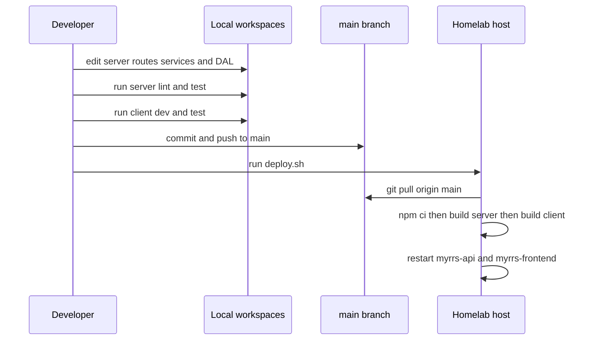

# Iteration Loop

Contributors work backend first, then frontend, then ship from `main` with `deploy.sh` ([CLAUDE.md:L145-L154](https://github.com/Jeffrey-Keyser/myrrs/blob/39ea32f15f79b94f655af227ef5b7db26d828205/CLAUDE.md#L145-L154)). This page lists only scripts and workflows that appear in the excerpts.

## Local loop

**Server.** From `src/server`: `npm run dev` (ts-node on `bin/www.ts`), `npm run build` (tsc), `npm run lint` (eslint), and `npm test` (jest) ([src/server/package.json:L7-L13](https://github.com/Jeffrey-Keyser/myrrs/blob/39ea32f15f79b94f655af227ef5b7db26d828205/src/server/package.json#L7-L13)). Jest uses the ts-jest preset in a node environment ([src/server/jest.config.js:L2-L3](https://github.com/Jeffrey-Keyser/myrrs/blob/39ea32f15f79b94f655af227ef5b7db26d828205/src/server/jest.config.js#L2-L3)). `npm run seed` runs `db/seed.ts`, which the TypeScript build excludes ([src/server/tsconfig.json:L31](https://github.com/Jeffrey-Keyser/myrrs/blob/39ea32f15f79b94f655af227ef5b7db26d828205/src/server/tsconfig.json#L31)).

**Client.** From `src/client`: `npm run dev` (Vite), `npm run build`, and `npm test` (`vitest --run`) ([src/client/package.json:L32-L35](https://github.com/Jeffrey-Keyser/myrrs/blob/39ea32f15f79b94f655af227ef5b7db26d828205/src/client/package.json#L32-L35)). The dev server port is 3002 ([src/client/vite.config.js:L7](https://github.com/Jeffrey-Keyser/myrrs/blob/39ea32f15f79b94f655af227ef5b7db26d828205/src/client/vite.config.js#L7)).

**Clean rebuild.** When tests behave oddly, the documented fix is `rm -rf dist && npm run build && npm test` in the server ([CLAUDE.md:L58-L59](https://github.com/Jeffrey-Keyser/myrrs/blob/39ea32f15f79b94f655af227ef5b7db26d828205/CLAUDE.md#L58-L59)). This is guidance, not a script.

**Schema changes.** The documented steps are: add a migration under `src/server/db/migrations/`, update types, update repositories and mappers, then run tests ([CLAUDE.md:L156-L160](https://github.com/Jeffrey-Keyser/myrrs/blob/39ea32f15f79b94f655af227ef5b7db26d828205/CLAUDE.md#L156-L160)). The migrations folder is not in the excerpts. The DB deploy script loads only the `schema` and `stored_procedures` folders ([src/server/db/deploy.sh:L30-L31](https://github.com/Jeffrey-Keyser/myrrs/blob/39ea32f15f79b94f655af227ef5b7db26d828205/src/server/db/deploy.sh#L30-L31)), so how migrations are applied is unclear.

## Ship

`deploy.sh` runs `git pull origin main`, `npm ci`, builds the server and client, and restarts both user units ([deploy.sh:L5-L23](https://github.com/Jeffrey-Keyser/myrrs/blob/39ea32f15f79b94f655af227ef5b7db26d828205/deploy.sh#L5-L23)). The script contains no test or lint step ([deploy.sh:L1-L25](https://github.com/Jeffrey-Keyser/myrrs/blob/39ea32f15f79b94f655af227ef5b7db26d828205/deploy.sh#L1-L25)), so tests must be run before pushing.

## CI files present

Three GitHub workflow files sit under `src/.github/workflows/`, not the repo root:

- UI build and S3 sync with CloudFront invalidation, triggered on push to `main` ([src/.github/workflows/deploy-ui.yml:L3-L6](https://github.com/Jeffrey-Keyser/myrrs/blob/39ea32f15f79b94f655af227ef5b7db26d828205/src/.github/workflows/deploy-ui.yml#L3-L6), [L44-L49](https://github.com/Jeffrey-Keyser/myrrs/blob/39ea32f15f79b94f655af227ef5b7db26d828205/src/.github/workflows/deploy-ui.yml#L44-L49)).
- Docker image push to ECR and Lambda code update, triggered on push to `main` ([src/.github/workflows/lambda-push.yml:L3-L6](https://github.com/Jeffrey-Keyser/myrrs/blob/39ea32f15f79b94f655af227ef5b7db26d828205/src/.github/workflows/lambda-push.yml#L3-L6), [L51-L53](https://github.com/Jeffrey-Keyser/myrrs/blob/39ea32f15f79b94f655af227ef5b7db26d828205/src/.github/workflows/lambda-push.yml#L51-L53)).
- Manual Terraform apply with auto-approve ([src/.github/workflows/terraform_deploy.yml:L3-L4](https://github.com/Jeffrey-Keyser/myrrs/blob/39ea32f15f79b94f655af227ef5b7db26d828205/src/.github/workflows/terraform_deploy.yml#L3-L4), [L36](https://github.com/Jeffrey-Keyser/myrrs/blob/39ea32f15f79b94f655af227ef5b7db26d828205/src/.github/workflows/terraform_deploy.yml#L36)).

These describe a Lambda/CloudFront path that conflicts with the homelab flow in `deploy.sh`. Their `working-directory: ./client` entries ([deploy-ui.yml:L32](https://github.com/Jeffrey-Keyser/myrrs/blob/39ea32f15f79b94f655af227ef5b7db26d828205/src/.github/workflows/deploy-ui.yml#L32)) do not match the `src/client` layout ([package.json:L4-L7](https://github.com/Jeffrey-Keyser/myrrs/blob/39ea32f15f79b94f655af227ef5b7db26d828205/package.json#L4-L7)). GitHub normally reads workflows from the root `.github` directory, so these files may be inert. Whether they run is unknown.
