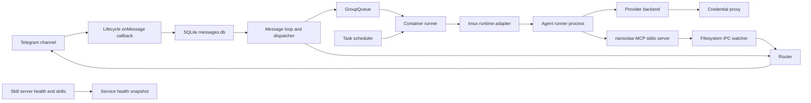

# Architecture

NanoClaw runs as a single Node.js process. Channels self-register at startup. Group work is queued and executed in tmux sessions that receive explicit host mounts ([README.md:L190-L194](https://github.com/Jeffrey-Keyser/nanoclaw/blob/080f00b65b7849e311f7b4aa5825eaa8ab9a8228/README.md#L190-L194)). The default execution path runs from `container-runner.ts` through `session-settings.ts` to `runtime-adapter.ts` ([docs/PROJECT_STATUS.md:L9](https://github.com/Jeffrey-Keyser/nanoclaw/blob/080f00b65b7849e311f7b4aa5825eaa8ab9a8228/docs/PROJECT_STATUS.md#L9)).

## Component diagram

The scheduler-to-runner edge follows the specification's diagram ([docs/SPEC.md:L119-L127](https://github.com/Jeffrey-Keyser/nanoclaw/blob/080f00b65b7849e311f7b4aa5825eaa8ab9a8228/docs/SPEC.md#L119-L127)). The specification's references to containers are historical design intent ([docs/SPEC.md:L5](https://github.com/Jeffrey-Keyser/nanoclaw/blob/080f00b65b7849e311f7b4aa5825eaa8ab9a8228/docs/SPEC.md#L5)).

The credential proxy edge describes Anthropic-style requests. Whether the `opencode` and `codex` backends route through the proxy is not shown in the attached source.

## Contracts

### Startup

`initApp` runs the following steps in order ([src/lifecycle.ts:L175-L234](https://github.com/Jeffrey-Keyser/nanoclaw/blob/080f00b65b7849e311f7b4aa5825eaa8ab9a8228/src/lifecycle.ts#L175-L234)):

- loads secrets;
- verifies the runtime;
- initializes SQLite;
- prunes events older than 7 days;
- loads state;
- starts the credential proxy;
- starts the skill registry, which serves `/skills` and `/health`.

Shutdown handlers for SIGTERM and SIGINT stop each subsystem and mark it as disabled ([src/lifecycle.ts:L236-L304](https://github.com/Jeffrey-Keyser/nanoclaw/blob/080f00b65b7849e311f7b4aa5825eaa8ab9a8228/src/lifecycle.ts#L236-L304)).

### Channels

A channel implements the following methods ([docs/channel-development.md:L18-L30](https://github.com/Jeffrey-Keyser/nanoclaw/blob/080f00b65b7849e311f7b4aa5825eaa8ab9a8228/docs/channel-development.md#L18-L30)):

- `connect`
- `sendMessage`
- `isConnected`
- `ownsJid`
- `disconnect`

A channel registers itself by being imported from the barrel file ([src/channels/index.ts:L1-L11](https://github.com/Jeffrey-Keyser/nanoclaw/blob/080f00b65b7849e311f7b4aa5825eaa8ab9a8228/src/channels/index.ts#L1-L11)).

### Router

Inbound messages are formatted as XML `<messages>` blocks that carry a timezone header. Outbound text has its `<internal>` blocks stripped before sending ([src/router.ts:L13-L35](https://github.com/Jeffrey-Keyser/nanoclaw/blob/080f00b65b7849e311f7b4aa5825eaa8ab9a8228/src/router.ts#L13-L35)).

### Dispatcher

The dispatcher advances the message cursor in memory. It persists the cursor only after success, or after output has already been sent to the user ([src/message-dispatcher.ts:L186-L287](https://github.com/Jeffrey-Keyser/nanoclaw/blob/080f00b65b7849e311f7b4aa5825eaa8ab9a8228/src/message-dispatcher.ts#L186-L287)).

"Capture" executions run in a diagnostic copy of the group. This copy has no extra mounts, and nothing is delivered to the channel ([src/message-dispatcher.ts:L55-L98](https://github.com/Jeffrey-Keyser/nanoclaw/blob/080f00b65b7849e311f7b4aa5825eaa8ab9a8228/src/message-dispatcher.ts#L55-L98)).

### Runtime adapter

The adapter exposes the following operations ([src/runtime-adapter.ts:L22-L30](https://github.com/Jeffrey-Keyser/nanoclaw/blob/080f00b65b7849e311f7b4aa5825eaa8ab9a8228/src/runtime-adapter.ts#L22-L30)):

- `ensureReady`
- `hasSession`
- `stopSession`
- `cleanupOrphans`
- `getStatus`

Orphan cleanup stops any tmux session whose name starts with `nanoclaw-` ([src/runtime-adapter.ts:L99-L119](https://github.com/Jeffrey-Keyser/nanoclaw/blob/080f00b65b7849e311f7b4aa5825eaa8ab9a8228/src/runtime-adapter.ts#L99-L119)).

### Agent runner

Input to the runner contains these fields:

- `prompt`
- `sessionId`
- `groupFolder`
- `chatJid`
- `isMain`

Output contains:

- `status`
- `result`
- `newSessionId`
- `execution`

The output is framed between `---NANOCLAW_OUTPUT_START---` and `---NANOCLAW_OUTPUT_END---` ([container/agent-runner/src/index.ts:L15-L34](https://github.com/Jeffrey-Keyser/nanoclaw/blob/080f00b65b7849e311f7b4aa5825eaa8ab9a8228/container/agent-runner/src/index.ts#L15-L34)).

Instructions passed to the agent combine a role line, the global `CLAUDE.md` (included for non-main groups only), and the group's `CLAUDE.local.md` ([container/agent-runner/src/index.ts:L66-L74](https://github.com/Jeffrey-Keyser/nanoclaw/blob/080f00b65b7849e311f7b4aa5825eaa8ab9a8228/container/agent-runner/src/index.ts#L66-L74)).

Providers self-register. The ones present are `claude` and `mock` ([container/agent-runner/src/providers/index.ts:L5-L6](https://github.com/Jeffrey-Keyser/nanoclaw/blob/080f00b65b7849e311f7b4aa5825eaa8ab9a8228/container/agent-runner/src/providers/index.ts#L5-L6)).

### MCP and IPC

The `nanoclaw` MCP server exposes whatever tools were registered at import time ([container/agent-runner/src/mcp-tools/server.ts:L24-L54](https://github.com/Jeffrey-Keyser/nanoclaw/blob/080f00b65b7849e311f7b4aa5825eaa8ab9a8228/container/agent-runner/src/mcp-tools/server.ts#L24-L54)).

IPC works through JSON files ([docs/IPC.md:L5-L25](https://github.com/Jeffrey-Keyser/nanoclaw/blob/080f00b65b7849e311f7b4aa5825eaa8ab9a8228/docs/IPC.md#L5-L25)):

- Requests are written to `data/ipc/{group}/messages/` or `data/ipc/{group}/tasks/`.
- The main group is authorized to target any group; other groups can only target themselves.
- Files that fail processing are moved to `data/ipc/errors/`.

### Persistence

A single SQLite handle is shared across these domain modules ([src/db/index.ts:L17-L26](https://github.com/Jeffrey-Keyser/nanoclaw/blob/080f00b65b7849e311f7b4aa5825eaa8ab9a8228/src/db/index.ts#L17-L26)):

- agent events
- messages
- sessions
- groups
- tasks
- dispatch slots
- outbound messages
- tool events

### Health

The health snapshot reports `degraded` when any of these is true ([src/service-health.ts:L59-L83](https://github.com/Jeffrey-Keyser/nanoclaw/blob/080f00b65b7849e311f7b4aa5825eaa8ab9a8228/src/service-health.ts#L59-L83)):

- the runtime is not ready;
- no agent provider is available;
- no channels are registered or connected;
- a production subsystem is unhealthy.

### Agency HQ dispatch

External Agency HQ and dev-inbox services own task dispatch. NanoClaw's polling dispatcher is disabled unless `NANOCLAW_LEGACY_AGENCY_DISPATCH=true` is set ([README.md:L167-L171](https://github.com/Jeffrey-Keyser/nanoclaw/blob/080f00b65b7849e311f7b4aa5825eaa8ab9a8228/README.md#L167-L171), [src/agency-hq-dispatcher.ts:L45-L51](https://github.com/Jeffrey-Keyser/nanoclaw/blob/080f00b65b7849e311f7b4aa5825eaa8ab9a8228/src/agency-hq-dispatcher.ts#L45-L51)).

When legacy dispatch is enabled, slots are stored in SQLite by default, or in Agency HQ's PostgreSQL when `DISPATCH_SLOTS_PG=true` ([src/dispatch-slot-backends.ts:L21-L23](https://github.com/Jeffrey-Keyser/nanoclaw/blob/080f00b65b7849e311f7b4aa5825eaa8ab9a8228/src/dispatch-slot-backends.ts#L21-L23)).
