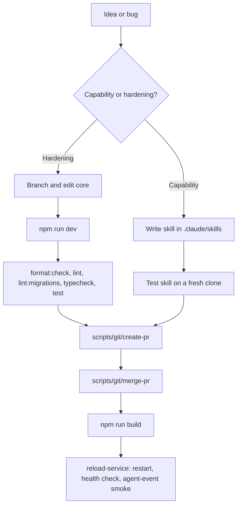

# Iteration Loop

The loop starts with a scope decision. Core changes should target correctness, security, deploy safety, observability and simplification. Most new capability belongs in a skill or a downstream fork ([README.md:L208-L212](https://github.com/Jeffrey-Keyser/nanoclaw/blob/080f00b65b7849e311f7b4aa5825eaa8ab9a8228/README.md#L208-L212), [CONTRIBUTING.md:L25-L36](https://github.com/Jeffrey-Keyser/nanoclaw/blob/080f00b65b7849e311f7b4aa5825eaa8ab9a8228/CONTRIBUTING.md#L25-L36)).

## Cycle diagram

## Steps

1. **Choose the path.**
   - A skill is a markdown file under `.claude/skills/` that contains instructions, not pre-built code.
   - A skill PR should not modify source files ([CONTRIBUTING.md:L11-L15](https://github.com/Jeffrey-Keyser/nanoclaw/blob/080f00b65b7849e311f7b4aa5825eaa8ab9a8228/CONTRIBUTING.md#L11-L15)).
   - Test a skill on a fresh clone before submitting it ([CONTRIBUTING.md:L21-L23](https://github.com/Jeffrey-Keyser/nanoclaw/blob/080f00b65b7849e311f7b4aa5825eaa8ab9a8228/CONTRIBUTING.md#L21-L23)).

2. **Develop locally.**
   - `npm run dev` runs `tsx src/index.ts` ([package.json:L16](https://github.com/Jeffrey-Keyser/nanoclaw/blob/080f00b65b7849e311f7b4aa5825eaa8ab9a8228/package.json#L16)).
   - `npm run build:core` compiles the service with `tsc`.
   - `npm run build:agent-runner` builds `container/agent-runner` ([package.json:L12-L13](https://github.com/Jeffrey-Keyser/nanoclaw/blob/080f00b65b7849e311f7b4aa5825eaa8ab9a8228/package.json#L12-L13)).

3. **Validate.** The minimal validation set is `format:check`, `lint`, `lint:migrations`, `typecheck` and `test` ([docs/SETUP_RECOVERY.md:L78-L86](https://github.com/Jeffrey-Keyser/nanoclaw/blob/080f00b65b7849e311f7b4aa5825eaa8ab9a8228/docs/SETUP_RECOVERY.md#L78-L86)).
   - Vitest picks up `src/**/*.test.ts` and `setup/**/*.test.ts` ([vitest.config.ts:L4-L6](https://github.com/Jeffrey-Keyser/nanoclaw/blob/080f00b65b7849e311f7b4aa5825eaa8ab9a8228/vitest.config.ts#L4-L6)).
   - Skill tests use `.claude/skills/**/tests/*.test.ts` ([vitest.skills.config.ts:L4-L6](https://github.com/Jeffrey-Keyser/nanoclaw/blob/080f00b65b7849e311f7b4aa5825eaa8ab9a8228/vitest.skills.config.ts#L4-L6)).
   - ESLint enforces `no-unused-vars`, ignoring names that start with an underscore ([eslint.config.js:L12-L18](https://github.com/Jeffrey-Keyser/nanoclaw/blob/080f00b65b7849e311f7b4aa5825eaa8ab9a8228/eslint.config.js#L12-L18)).

4. **Git hooks.** `npm prepare` installs Husky ([package.json:L21](https://github.com/Jeffrey-Keyser/nanoclaw/blob/080f00b65b7849e311f7b4aa5825eaa8ab9a8228/package.json#L21)). The hook contents are not in the attached excerpts.

5. **Open and merge the PR.**
   - Use `scripts/git/create-pr <branch> [--title] [--auto-merge] [--base]`.
   - Then use `merge-pr <n> [--squash|--merge|--rebase]`, or `create-and-merge` to run both ([CLAUDE.md:L44-L54](https://github.com/Jeffrey-Keyser/nanoclaw/blob/080f00b65b7849e311f7b4aa5825eaa8ab9a8228/CLAUDE.md#L44-L54)).
   - These helpers handle worktree conflicts, API retries, waiting for CI, and branch cleanup ([README.md:L138-L146](https://github.com/Jeffrey-Keyser/nanoclaw/blob/080f00b65b7849e311f7b4aa5825eaa8ab9a8228/README.md#L138-L146)).
   - The CI workflow definitions themselves are not in the attached sources, so the specific jobs CI runs are unknown here.

6. **Reload.**
   - `npm run build` runs `build:core` and then `reload-service` ([package.json:L11-L14](https://github.com/Jeffrey-Keyser/nanoclaw/blob/080f00b65b7849e311f7b4aa5825eaa8ab9a8228/package.json#L11-L14)).
   - The reload script restarts the systemd user unit and waits until it reports active.
   - It then runs `scripts/health-check.mjs`.
   - Finally it runs the silent agent-event smoke if `NANOCLAW_SMOKE_RECIPIENT` is configured ([scripts/reload-service.mjs:L90-L125](https://github.com/Jeffrey-Keyser/nanoclaw/blob/080f00b65b7849e311f7b4aa5825eaa8ab9a8228/scripts/reload-service.mjs#L90-L125)).
   - Set `NANOCLAW_SKIP_AGENT_EVENT_SMOKE=1` to skip the smoke ([README.md:L163-L165](https://github.com/Jeffrey-Keyser/nanoclaw/blob/080f00b65b7849e311f7b4aa5825eaa8ab9a8228/README.md#L163-L165)).

7. **Deploy with tests where it matters.** Guidance describes `./deploy-service <service> --with-tests` for changes to dispatch, routing, IPC, config verification or notifications ([CLAUDE.md:L85-L89](https://github.com/Jeffrey-Keyser/nanoclaw/blob/080f00b65b7849e311f7b4aa5825eaa8ab9a8228/CLAUDE.md#L85-L89)). The script itself is not attached.

8. **Per-group instructions.**
   - Edit `groups/{name}/CLAUDE.local.md`.
   - Treat `groups/{name}/CLAUDE.md` as generated state, because it may be rewritten when the agent spawns ([CLAUDE.md:L69-L73](https://github.com/Jeffrey-Keyser/nanoclaw/blob/080f00b65b7849e311f7b4aa5825eaa8ab9a8228/CLAUDE.md#L69-L73)).

## Skill conflicts

When two skills touch the same files, recover deliberately:

1. Pick an ownership boundary.
2. Restore a coherent baseline.
3. Reapply the second skill.
4. Re-run `typecheck` and `test` ([docs/SKILL_CONFLICT_RECOVERY.md:L12-L21](https://github.com/Jeffrey-Keyser/nanoclaw/blob/080f00b65b7849e311f7b4aa5825eaa8ab9a8228/docs/SKILL_CONFLICT_RECOVERY.md#L12-L21)).
