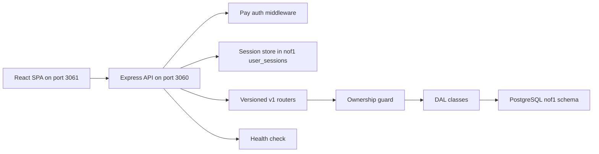

# Architecture

nof1 is a React SPA backed by an Express 5 API and a PostgreSQL `nof1` schema ([CLAUDE.md:L10-L14](https://github.com/Jeffrey-Keyser/nof1/blob/bc081ecf9abd6052e7831723fe99a7d99e2dde79/CLAUDE.md#L10-L14)).

## Server components

- **App factory:** The server is assembled with `createServerlessAppSync` and a production preset ([server/app.ts:L2](https://github.com/Jeffrey-Keyser/nof1/blob/bc081ecf9abd6052e7831723fe99a7d99e2dde79/server/app.ts#L2), [server/app.ts:L57](https://github.com/Jeffrey-Keyser/nof1/blob/bc081ecf9abd6052e7831723fe99a7d99e2dde79/server/app.ts#L57)).
- **Routes:** Root, `/api/v1`, and `/auth` are mounted ([server/app.ts:L137-L141](https://github.com/Jeffrey-Keyser/nof1/blob/bc081ecf9abd6052e7831723fe99a7d99e2dde79/server/app.ts#L137-L141)). The v1 router adds diagnostics and nested experiment resources ([server/routes/versions/v1/index.ts:L35-L46](https://github.com/Jeffrey-Keyser/nof1/blob/bc081ecf9abd6052e7831723fe99a7d99e2dde79/server/routes/versions/v1/index.ts#L35-L46)).
- **Ownership contract:** Child resources such as variables, phases, and entries pass through a guard that resolves the parent experiment for the current user ([server/routes/requireExperimentOwnership.ts:L18-L33](https://github.com/Jeffrey-Keyser/nof1/blob/bc081ecf9abd6052e7831723fe99a7d99e2dde79/server/routes/requireExperimentOwnership.ts#L18-L33)).
- **Data access:** Experiment DAL methods take a `userId` and match on it ([server/dal/ExperimentDal.ts:L11-L16](https://github.com/Jeffrey-Keyser/nof1/blob/bc081ecf9abd6052e7831723fe99a7d99e2dde79/server/dal/ExperimentDal.ts#L11-L16)).
- **Insights:** Insight reports are computed from phases, metrics, and entries rather than stored ([server/dal/InsightDal.ts:L275-L281](https://github.com/Jeffrey-Keyser/nof1/blob/bc081ecf9abd6052e7831723fe99a7d99e2dde79/server/dal/InsightDal.ts#L275-L281)).
- **Sessions:** Sessions use a database store in `nof1.user_sessions` ([server/app.ts:L81-L89](https://github.com/Jeffrey-Keyser/nof1/blob/bc081ecf9abd6052e7831723fe99a7d99e2dde79/server/app.ts#L81-L89)).

## Client components

- The API base URL comes from `VITE_API_URL`, defaulting to localhost:3060 ([client/src/store/api.ts:L25](https://github.com/Jeffrey-Keyser/nof1/blob/bc081ecf9abd6052e7831723fe99a7d99e2dde79/client/src/store/api.ts#L25)).
- Requests carry a bearer token and cookies ([client/src/store/api.ts:L29-L31](https://github.com/Jeffrey-Keyser/nof1/blob/bc081ecf9abd6052e7831723fe99a7d99e2dde79/client/src/store/api.ts#L29-L31)).
- Routes cover dashboard, experiment detail, quick log, templates, and placeholders for insights and settings ([client/src/App.tsx:L24-L31](https://github.com/Jeffrey-Keyser/nof1/blob/bc081ecf9abd6052e7831723fe99a7d99e2dde79/client/src/App.tsx#L24-L31)).

## Contracts and storage

- Responses use a `success` and `data` envelope in the client wrapper ([client/src/models/types.ts:L126-L131](https://github.com/Jeffrey-Keyser/nof1/blob/bc081ecf9abd6052e7831723fe99a7d99e2dde79/client/src/models/types.ts#L126-L131)).
- The schema defines experiments, variables, metrics, phases, entries, observations, templates, and insights ([server/db/schema/001-nof1-tables.sql:L6-L106](https://github.com/Jeffrey-Keyser/nof1/blob/bc081ecf9abd6052e7831723fe99a7d99e2dde79/server/db/schema/001-nof1-tables.sql#L6-L106)).
- A unique index enforces one entry per experiment, phase, and UTC day ([server/db/schema/001-nof1-tables.sql:L129-L130](https://github.com/Jeffrey-Keyser/nof1/blob/bc081ecf9abd6052e7831723fe99a7d99e2dde79/server/db/schema/001-nof1-tables.sql#L129-L130)).

Message queue settings exist, but these excerpts show no consuming code. See Services and Dependencies.
