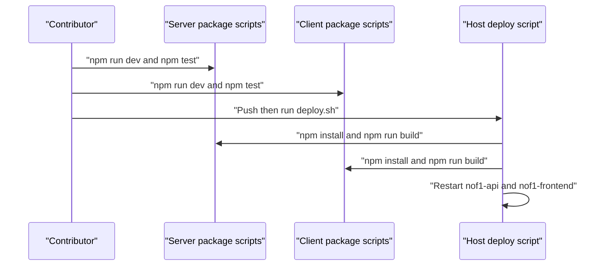

# Iteration Loop

This page describes the contributor workflow as shown in the source. No CI workflow file appears in the provided excerpts, so CI behavior is unknown.

## Setup

- Server config lives in `server/.env` and client config in `client/.env` ([CLAUDE.md:L49-L52](https://github.com/Jeffrey-Keyser/nof1/blob/bc081ecf9abd6052e7831723fe99a7d99e2dde79/CLAUDE.md#L49-L52)).
- The server refuses to start without required variables, and it rejects the `CHANGE_ME` placeholder for secrets ([server/config/env.ts:L78-L94](https://github.com/Jeffrey-Keyser/nof1/blob/bc081ecf9abd6052e7831723fe99a7d99e2dde79/server/config/env.ts#L78-L94)).

## Local loop

- Run the API with `npm run dev`, which uses ts-node on `bin/www.ts` ([server/package.json:L7](https://github.com/Jeffrey-Keyser/nof1/blob/bc081ecf9abd6052e7831723fe99a7d99e2dde79/server/package.json#L7)).
- Run the client with `npm run dev`, which starts Vite ([client/package.json:L24](https://github.com/Jeffrey-Keyser/nof1/blob/bc081ecf9abd6052e7831723fe99a7d99e2dde79/client/package.json#L24)).
- Check changes with server tests, lint, and format checks ([server/package.json:L10-L13](https://github.com/Jeffrey-Keyser/nof1/blob/bc081ecf9abd6052e7831723fe99a7d99e2dde79/server/package.json#L10-L13)) and client tests and format checks ([client/package.json:L29-L32](https://github.com/Jeffrey-Keyser/nof1/blob/bc081ecf9abd6052e7831723fe99a7d99e2dde79/client/package.json#L29-L32)).
- Built-in templates are seeded on every server boot, so template changes take effect on restart ([server/bin/www.ts:L13-L17](https://github.com/Jeffrey-Keyser/nof1/blob/bc081ecf9abd6052e7831723fe99a7d99e2dde79/server/bin/www.ts#L13-L17)).

## Schema changes

SQL files under `server/db/schema` are applied by `server/db/deploy.sh` through `db-deploy` ([server/db/deploy.sh:L11-L14](https://github.com/Jeffrey-Keyser/nof1/blob/bc081ecf9abd6052e7831723fe99a7d99e2dde79/server/db/deploy.sh#L11-L14)). The root `deploy.sh` does not call this script in the provided excerpt ([deploy.sh:L1-L28](https://github.com/Jeffrey-Keyser/nof1/blob/bc081ecf9abd6052e7831723fe99a7d99e2dde79/deploy.sh#L1-L28)).

## Deploy loop

The root deploy script pulls `main`, installs and builds both packages, and restarts the two services ([deploy.sh:L7-L26](https://github.com/Jeffrey-Keyser/nof1/blob/bc081ecf9abd6052e7831723fe99a7d99e2dde79/deploy.sh#L7-L26)). Build failures are suppressed with `|| true` ([deploy.sh:L13](https://github.com/Jeffrey-Keyser/nof1/blob/bc081ecf9abd6052e7831723fe99a7d99e2dde79/deploy.sh#L13)), so a successful script does not prove a successful build.

## UI review loop

For mockup-facing client changes, the plan is to update a Storybook story, review it at 393 by 852, close gaps in a fixed order, and only then add screenshot coverage ([MOCKUP_ALIGNMENT_PLAN.md:L46-L53](https://github.com/Jeffrey-Keyser/nof1/blob/bc081ecf9abd6052e7831723fe99a7d99e2dde79/MOCKUP_ALIGNMENT_PLAN.md#L46-L53)).
